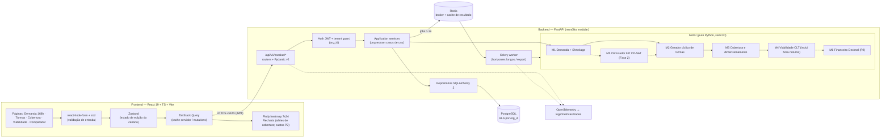
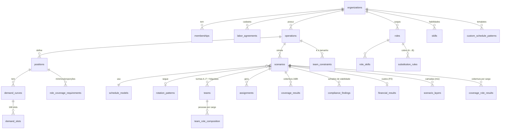

# TRD — Simulador de Escalas 24/7 (CLT Brasil)

| Metadado | Detalhe |
| :--- | :--- |
| **Documento** | Technical Requirements Document (TRD) |
| **Base** | `01-PRD.md` (PRD v3.3 — MVP enxuto em 4 sprints; v3.2 — simulador operacional de cobertura; catálogo ampliado, construtor, K e cargos como restrições; IDs FR-xx canônicos). Esquema e API detalhados: `05-esquema-backend.md` |
| **Repositório** | `Ferramentas-Web` — `frontend/` (React 19 + TS + Vite 7 + Tailwind 4) e `backend/` (FastAPI) |
| **Status** | Proposto |
| **Data** | Novembro de 2026 |

> **Foco técnico:** o caminho crítico do motor é **demanda → gerador de turmas → cobertura hora a hora**; as regras CLT atuam como **restrições de viabilidade** sobre a escala; o motor financeiro é módulo P2 (fase futura).
>
> **Corte do MVP (v3.3, 4 sprints — `06` §3):** cada seção/módulo traz a tag **[MVP]**, **[MVP parcial]** (o que fica de fora vai na própria seção como "Fase 2") ou **[Fase 2]** / **[P2]**. Resumo:
>
> | Módulo | MVP (P0) | Fase 2 |
> | :--- | :--- | :--- |
> | M1 demanda + shrinkage | tudo (FR-01–03) | Erlang-C (FR-04, P2) |
> | M2 gerador + M2b | gerador genérico; catálogo essencial (10 modelos: `6X1_BASE`, `5X2`, `12X36`, `6X2`, `4X2`, `2X2_12H`, `5T`, `4X3`, `FIXO_D`, `FIXO_N`); `validar_padrao` básico (sequência + horários + offsets) | catálogo restante, `R`, folgas fixas, camadas, templates, ciclo em horas, split |
> | M3 cobertura | cobertura hora a hora, 7×24, KPIs, dimensionamento, visão com reserva; K fixo/mínimo por operação; cargos com matriz direcional (f = 1,0) + mínimo por cargo por turno (`min_cost_flow`) | feriados (FR-12), furos no intervalo (FR-10), folguistas (FR-13, `folguistas.py`), K faixa/livre e tamanho de turma (FR-33), habilidades, substituição parcial (LP) |
> | M4 viabilidade | `CLT_INTERJORNADA`, `CLT_DSR_35H`, `CLT_SETIMO_DIA`, `CLT_JORNADA_DIARIA`, `CLT_MEDIA_SEMANAL` (8/7) | domingo, revezamento, 12x36, intrajornada, tempo parcial, Súmula 60, `valida_incremental` |
> | M5 CP-SAT / M6 financeiro | — (sem otimizador) | Fase 2 / P2 |
> | Infra | FastAPI síncrono, Postgres 16 + RLS, JWT de acesso, NFR-01 com 200 colaboradores | Celery/Redis, refresh token, observabilidade, 1.000 colaboradores |

> **Aviso jurídico:** as regras trabalhistas aqui codificadas são parametrizáveis e versionadas (ver §5.5). O motor emite **alertas e bloqueios técnicos**, não parecer jurídico. Toda regra tem fonte normativa registrada e pode ser sobrescrita por ACT/CCT cadastrada.

---

## 1. Estado atual do repositório

- **Backend** (`backend/app`): FastAPI com estrutura `api/v1/endpoints`, `schemas`, `services`; hoje contém apenas o módulo `atas`. `requirements.txt` já traz `fastapi`, `uvicorn`, `pandas`, `sqlalchemy`, `psycopg2-binary`, `celery`, `redis`. **Não há** Alembic, Pydantic Settings, OR-Tools, NumPy explícito, autenticação nem testes.
- **Frontend** (`frontend/src`): app Vite mínimo (`App.tsx`), já com `zustand@5`, `react-plotly.js`, `tailwind-merge`. **Não há** TanStack Query, react-hook-form, zod, Recharts nem roteamento.
- **Consequência:** o simulador entra como um novo *bounded context* `escalas` no mesmo monólito modular, sem afetar `atas`.

---

## 2. Arquitetura

### 2.1 Visão de componentes



### 2.2 Princípios
1. **Motor puro e determinístico:** `backend/app/services/engine/` não importa FastAPI, SQLAlchemy nem relógio do sistema. Entrada = Pydantic/dataclasses imutáveis; saída = resultado + lista de `Achado` (código, severidade, local, fonte normativa). Permite golden tests e execução em worker.
2. **Simular por turma, expandir por colaborador** (§6): o custo computacional depende do nº de turmas/padrões, não de colaboradores.
3. **Dois domínios numéricos separados:** horas/cobertura em `int` (minutos) e NumPy; dinheiro e hora ficta em `Decimal`/`Fraction`. Nunca `float` em valor monetário.
4. **Síncrono por padrão, assíncrono por exceção:** simulação de padrão catalogado (6x1, 12x36, 6x2, 4x2, 5 turmas) roda síncrona (< 2 s). Horizonte longo, comparações grandes, export e (Fase 2) ILP vão para Celery com `job_id` e polling.
5. **Cobertura é o produto:** toda simulação devolve primeiro a matriz de cobertura e os KPIs (FR-09–FR-14); achados de viabilidade e custos são camadas sobre ela.

### 2.3 Estrutura de pastas proposta

Árvore completa e canônica em **`05-esquema-backend.md` §6** (camadas já usadas pelo repo: `app/api/v1/endpoints`, `app/schemas`, `app/services`). O motor fica em `backend/app/services/engine/`:

```
backend/app/services/engine/
  demanda.py  shrinkage.py                          # M1 [MVP]
  gerador.py  catalogo.py  construtor.py             # M2 (+ M2b catálogo/construtor, FR-28–31) [MVP parcial]
  cobertura.py  dimensionamento.py                 # M3 (núcleo) [MVP]
  folguistas.py                                     # M3 folguistas [Fase 2]
  turmas_k.py  cobertura_cargos.py                  # M3 restrição de K e matriz de cargos [MVP parcial]
  noturno.py  compliance/ (regras, registro.py)     # M4 [MVP parcial]
  otimizador.py                                     # M5 [Fase 2]
  financeiro.py                                     # M6 [P2]
backend/alembic/                                    # migrações
backend/tests/engine/  unit · golden · property · perf
frontend/src/features/escalas/
  api/ (hooks TanStack)  store/ (zustand)  schemas/ (zod)  components/  pages/
```

---

## 3. Stack

| Camada | Tecnologia | Uso |
| :--- | :--- | :--- |
| API | FastAPI, Uvicorn | REST `/api/v1/escalas` |
| Contratos | Pydantic v2 (`ConfigDict(frozen=True, strict=True)`), `pydantic-settings` | Validação, OpenAPI → tipos TS gerados (`openapi-typescript`) |
| Persistência | SQLAlchemy 2 (estilo `Mapped`), Alembic, PostgreSQL 16 (JSONB para matrizes) | Cenários, turmas, CCTs, resultados versionados |
| Otimização | **OR-Tools**: `min_cost_flow` + GLOP no **MVP** (alocação por cargo, ADR-009); **CP-SAT** na Fase 2 | Transporte cargo→posto por hora (M3); ILP de turnos livres, K e cargos (M5) |
| Numérico | **NumPy** (`int16/int32`) | Matriz 168h/10080 min, cobertura vetorizada |
| Dinheiro (P2) | `decimal.Decimal` (contexto `prec=28`, `ROUND_HALF_EVEN` interno, `ROUND_HALF_UP` contábil 2 casas) e `fractions.Fraction` para 8/7 | NFR-02 |
| Assíncrono | Celery + Redis (já no requirements) | Horizontes longos, export, ILP (Fase 2) |
| Auth | JWT (PyJWT, RS256), `passlib[argon2]` | Multi-tenant |
| Observabilidade | OpenTelemetry SDK, `structlog`, Prometheus `/metrics` | §9 |
| Testes BE | pytest, **hypothesis**, pytest-benchmark, syrupy (snapshot golden) | §10 |
| Frontend | React 19, TS strict, Vite 7, Tailwind 4 | SPA |
| Estado | **TanStack Query v5** (servidor), **Zustand v5** (rascunho do cenário, undo) | |
| Formulários | **react-hook-form + zod** (`@hookform/resolvers`) | Esquemas espelham Pydantic |
| Gráficos | **Plotly** (`react-plotly.js`, já instalado) para heatmap 7x24; **Recharts** para séries de cobertura/déficit e (P2) custo | NFR-06 |
| Testes FE | Vitest, Testing Library, Playwright (E2E), MSW | |

**Dependências a adicionar (backend):** `numpy`, `ortools` (MVP: só `min_cost_flow`/GLOP; CP-SAT na Fase 2), `alembic`, `pydantic-settings`, `pyjwt[crypto]`, `passlib[argon2]`, `structlog`, `opentelemetry-*`, `hypothesis`, `pytest-benchmark`, `syrupy`.
**Frontend:** `@tanstack/react-query`, `react-hook-form`, `zod`, `@hookform/resolvers`, `recharts`, `react-router`.

---

## 4. Modelo de dados (resumo)

Fonte da verdade do esquema: **`05-esquema-backend.md`** (DDL, nomes de tabela em inglês `snake_case` plural). Resumo das entidades centrais:



- Toda tabela de negócio tem `organization_id` + **Row-Level Security** (`current_setting('app.org_id')`).
- `rotation_patterns`: `matrix` (turma × dia do ciclo), `cycle_length_days`, `team_offsets`.
- `shift_templates`: `start_time`, `duration_minutes`, `break_minutes`, `break_policy` (`computado_rendicao` | `nao_computado` | `volante` — FR-10).
- `teams.kind`: `regular` | `folguista` (FR-13).
- `scenarios`: `inputs_hash` (SHA-256 do JSON canônico), `engine_version`, `rules_version`, KPIs de cobertura desnormalizados — reprodutibilidade e cache.
- `coverage_results`: por slot, `required_net`, `required_gross`, `scheduled`, `expected` (com shrinkage), `break_gap`, `status`.
- v3.2: `roles`, `skills`, `role_skills`, `employee_skills` (Fase 2), `substitution_rules`, `role_coverage_requirements`, `team_constraints`, `custom_schedule_patterns` (+ `_versions`), `scenario_layers`, `team_role_composition`, `coverage_role_results` — DDL em `05` §3.12.
- `labor_agreements`: `night_premium_pct`, `allows_8h_rotating`, `sunday_off_max_interval_weeks`, vigência.

---

## 5. Módulos do motor — algoritmos e complexidade

Notação: `H = 168` horas (ou `S = 336` slots de 30 min), `K` = nº de turmas, `C` = nº de colaboradores, `D` = dias do horizonte, `J` = nº de turnos candidatos.

| Módulo | Arquivo(s) em `engine/` | FRs (`01-PRD.md`) | Fase |
| :--- | :--- | :--- | :--- |
| **M1** Demanda + shrinkage | `demanda.py`, `shrinkage.py` | FR-01–03 (FR-04 P2) | MVP |
| **M2** Gerador cíclico de turmas | `gerador.py` | FR-05–07 | MVP |
| **M3** Cobertura e dimensionamento | `cobertura.py`, `dimensionamento.py`, `folguistas.py` | FR-08–14 | MVP (núcleo) |
| **M4** Viabilidade CLT (inclui hora noturna) | `compliance/`, `noturno.py` | FR-15–20 | MVP |
| **M5** Otimizador ILP | `otimizador.py` | — (Fase 2) | Fase 2 |
| **M6** Financeiro | `financeiro.py` | FR-25–27 | P2 |

### 5.1 M1 — Demanda (FR-01, FR-02; FR-04 P2) [MVP]

Representação: `np.ndarray[int32]` shape `(7, 24)` (ou `(7, 48)`), reindexável para vetor circular de 168 posições (`idx = dia*24 + hora`, segunda 00h = 0). Turnos que cruzam a meia-noite de domingo fazem *wrap* para segunda (operação 24/7 é cíclica).

```python
def demanda_bruta(cfg) -> np.ndarray:               # O(H)
    match cfg.modo:
        case POSTOS_FIXOS:  return cfg.postos            # P(d,t) = k
        case PRODUTIVIDADE: return cfg.volume / (cfg.uph * cfg.delta_t)   # float, arredondado só no fim
        case ERLANG_C:      return np.vectorize(erlang_c_agentes)(cfg.trafego, cfg.sl_alvo, cfg.tma, cfg.tempo_alvo)
```

Erlang-C: busca incremental de `m` a partir de `ceil(A)+1`, usando recorrência de Erlang-B em log-espaço para estabilidade (`B(m) = A·B(m-1)/(m + A·B(m-1))`). Complexidade `O(H · m_max)`.

### 5.2 M1b — Shrinkage diferenciado (FR-03; usado em FR-11) [MVP]

```python
S = 1 - (1 - S_int[t]) * (1 - S_ext[d, t])            # vetorizado (7,24)
N_req = np.ceil(FTE_bruto / (1 - S) - 1e-9).astype(int32)   # O(H)
```
- Validação: `0 ≤ S < 0.6` (FR-03; bloqueia divisão explosiva). Epsilon evita `ceil(3.0000000001)=4` por ruído de float.
- **Ressalva:** aplicar `ceil` hora a hora e depois somar superdimensiona; o motor guarda também `FTE_liquido` fracionário para relatórios.

### 5.3 M2 — Gerador cíclico de turmas (FR-05–FR-07) [MVP]

Um padrão = `(sequencia: list[Turno|F], ciclo L, K turmas, offset)`. Turma `i` no dia absoluto `d` executa `seq[(d + offset_i) mod L]`.

```python
def gerar_matriz_turmas(padrao, D) -> np.ndarray:           # O(K·D) — K≈4..6
    d = np.arange(D)
    idx = (d[None, :] + padrao.offsets[:, None]) % padrao.L   # (K, D)
    return padrao.seq_codificada[idx]                         # códigos int8

def cobertura_168h(matriz_turmas, turnos, pessoas_por_turma) -> np.ndarray:   # O(K·D·24)
    # mascaras pré-computadas turno -> vetor de 24*2 (para wrap noturno)
    ...

def expandir(matriz_turmas, alocacao_colab_turma) -> np.ndarray:  # O(C·D) via fancy indexing
    return matriz_turmas[alocacao_colab_turma]        # view/cópia int8: 1000×56 = 56 KB
```

**Teste de viabilidade analítico (antes de gerar):** para `s` turnos/dia de cobertura contínua e padrão com `w` dias trabalhados em ciclo `L`, o nº de turmas para cobrir **1 equipe por turno** é

$$K^\* = \frac{s \cdot L}{w}$$

e a cobertura é exata somente se `K*` é inteiro e os offsets distribuem cada turno uniformemente. Esse teste corrige várias afirmações do PRD (ver §11).

Construção de offsets: `offset_i = i·L/K` quando inteiro; senão busca por backtracking/CP-SAT pequeno (`K ≤ 8`, `L ≤ 42`) que minimiza `Σ|cobertura − alvo|`. Ciclo de calendário = `lcm(L, 7)` dias (6x2: `lcm(8,7)=56` dias = 8 semanas, como o PRD afirma corretamente).

**12x36:** usar índice de **dia absoluto** (`(data − data_ancora).days mod 2`), nunca `dia_do_mês mod 2` (o PRD usa `d mod 2` com `d ∈ 1..30`: em meses de 31 dias, dias 31 e 1 são ambos ímpares → a turma trabalharia 12x12 e outra folgaria 60h).

### 5.3.1 M2b — Catálogo ampliado e construtor de padrões (FR-28–FR-31) [MVP parcial: catálogo essencial + `validar_padrao` básico; resto Fase 2]

**Catálogo como dados.** Cada modelo da `01` §6.1 é uma linha de `schedule_models` + um `rotation_patterns` canônico; o gerador (§5.3) é o mesmo para todos. Extensões do gerador:
- **Ciclo em horas** (`cycle_unit = 'hours'`, P1): para 18x36 o estado é indexado por `(h_abs + offset_h) mod L_h` (L = 54 h); o ciclo calendário é `mmc(L_h, 24·7)/24` dias (18x36: `mmc(54,168)` = 1.512 h = 63 dias para alinhar à semana; 9 dias para alinhar ao dia).
- **Turno multibloco** (`SPLIT`, P1): `Turno.blocos = [(ini, dur), …]`; máscaras de cobertura somam os blocos; M4 calcula intrajornada entre blocos.
- **Estado `R`** (reserva, 5T francesa): presença sem posto — entra como capacidade de reserva no FR-11/FR-13, não em `cob`.
- **Folga fixa** (P1): máscara de calendário `fixed_off[weekday]` aplicada **depois** do índice cíclico (`estado = F se weekday ∈ fixed_off`), o que quebra a exatidão; o validador recalcula cobertura.

**Construtor — validação em tempo real** (`POST /custom-schedule-patterns:validate`, ≤ 300 ms; também executável no cliente em TS para feedback por tecla, com o backend como fonte da verdade):

```python
def validar_padrao(seq, turnos, s, offsets=None, rotacao="frente") -> RelatorioPadrao:   # O(L·K + L_cal·K)
    L, w = len(seq), sum(e not in (F, R) for e in seq)
    k_star = Fraction(s * L, w)                       # exato se denominador == 1
    offs = offsets or offsets_uniformes(L, k_star)     # i·L/K ou busca (≤ 8 turmas, L ≤ 84)
    cob = contagem_por_turno_dia(seq, offs, mmc(L, 7)) # turnos-dia cobertos; exato ⇔ todas == 1
    gaps = interjornadas_ciclicas(seq, turnos)         # timestamps absolutos, inclui a volta do ciclo
    return RelatorioPadrao(k_star, exato, h_sem=w*h*7/L, max_consecutivos, min_interjornada=min(gaps),
                           max_descanso_7d, domingos_folga, achados=[COB_PADRAO_NAO_EXATO, CLT_INTERJORNADA, CLT_SETIMO_DIA, …])
```

**Rotação para frente/para trás:** o construtor gera a sequência a partir de blocos (`n` dias por turno, ordem M→T→N ou N→T→M, `f` folgas por bloco). Para trás sem folga entre blocos produz `N(06h) → T(14h)` = 8 h → `CLT_INTERJORNADA`; o construtor sugere inserir 1 F.

**Mix de camadas (FR-30):** um cenário tem `layers[]`; cada camada é um `(padrão, turnos, K, tamanho por turma, cargo, máscara de dias)` gerado independentemente; `cob_total[h] = Σ_camadas cob_c[h]`, mantendo `cob_c` para o heatmap por camada. Interjornada/DSR são validadas por turma **dentro** da camada (pessoas não migram entre camadas no MVP).

**Templates (FR-31):** `custom_schedule_patterns` versionados; o cenário grava `pattern_version_id` + a sequência materializada em `rotation_patterns.matrix` (reprodutibilidade, NFR-03).

### 5.4 M3 — Cobertura e dimensionamento (FR-08–FR-14) — núcleo [MVP parcial: FR-10, FR-12, FR-13 são Fase 2]

Entrada: matriz turma × dia (M2), turnos (início, duração, política de intervalo), pessoas por turma, folguistas, `N_req`/`S` (M1), calendário do horizonte (feriados + política). Saída: vetores por hora absoluta do horizonte e agregados 7×24.

```python
def cobertura_horizonte(matriz, turnos, pessoas, D) -> np.ndarray:      # O(K·D·24)
    cob = np.zeros(D * 24, int32)
    for k, linha in enumerate(matriz):                 # K ≈ 4..10
        for d, cod in enumerate(linha):
            if cod != F:
                ini = d*24 + turnos[cod].inicio_h      # turnos noturnos cruzam o dia: índice absoluto
                cob[ini : ini + turnos[cod].dur_h] += pessoas[k]
    return cob

def furos_intervalo(turnos, pessoas, politica) -> np.ndarray:           # FR-10
    # 'computado_rendicao' → 0; 'nao_computado' → −pessoas na hora do intervalo; 'volante' → dimensiona volantes
    ...

req   = np.tile(N_req.ravel(), D // 7)            # demanda no horizonte (feriados sobrescrevem dias)
gap   = cob - furo - req                          # < 0 déficit, = 0 exato, > 0 excesso
esper = cob * (1 - S_h) - req                     # FR-11 visão "postos + reserva"
heat_pior  = gap.reshape(-1, 7, 24).min(axis=0)   # agregação 7×24 pior caso (Q10)
heat_media = gap.reshape(-1, 7, 24).mean(axis=0)
```

**KPIs (FR-14)**, todos `O(D·24)`: `pct_horas_posto = Σ min(cob, req) / Σ req`; `deficit_hp = Σ max(0, −gap)`; `pico = max(−gap)` + `argmax` → (data, hora); `horas_deficit = count(gap < 0)`; `excesso_hp = Σ max(0, gap)`; `furos_intervalo_hp`.

**Dimensionamento (FR-08):** `K* = s·L/w` (ver §5.3) → `headcount_min = ceil(K*)·postos`; com reserva, `headcount_reserva = ceil(Σ_turno postos/(1−S_turno)) × K*` ou nº mínimo de folguistas (abaixo). Achado `COB_TURMAS_INSUFICIENTES` quando `K < K*`.

**Folguistas (FR-13):** heurística gulosa determinística — ordenar horas de déficit por (data, hora); para cada bloco de déficit, alocar um folguista no turno que o cobre, se `M4.valida_incremental(folguista, turno)` não gerar `ERRO`; repetir até zerar ou esgotar folguistas (`COB_FOLGUISTA_INSUFICIENTE`). "Calcular mínimo" = busca incremental de 0..F_max folguistas (F_max ≤ K). Na Fase 2, CP-SAT (M5) substitui a heurística.

Achados de cobertura: `COB_DEFICIT`, `COB_DEFICIT_POSTO_CRITICO`, `COB_EXCESSO`, `COB_FURO_INTERVALO`, `COB_DEFICIT_ESPERADO_SHRINKAGE`, `COB_TURMAS_INSUFICIENTES`, `COB_FOLGUISTA_INSUFICIENTE` e, v3.2, `COB_PADRAO_NAO_EXATO`, `COB_K_INSUFICIENTE`, `COB_K_ACIMA_NECESSARIO`, `COB_TURMA_ABAIXO_MINIMO`, `COB_TURMA_ACIMA_MAXIMO`, `COB_CARGO_SEM_QUALIFICADO`, `COB_DEFICIT_CARGO`, `COB_COBERTURA_POR_SUBSTITUICAO`, `COB_LIMITE_FORA_CARGO`, `COB_PROPORCAO_VIOLADA` (catálogo: `01-PRD.md` Apêndice A).

### 5.4.1 M3 — Turmas (K) como restrição (FR-32, FR-33) [MVP parcial: K fixo/mínimo por operação; faixa/livre e FR-33 Fase 2]

Entrada: `TeamConstraint{escopo: operação|posto|cargo|camada, modo: fixo|faixa|livre, k_min, k_max, k_fixo, tamanho_min, tamanho_max, permite_meias}`.

1. **Tamanho → multiplicador:** postos do turno `p`; com `tamanho_max = m`, cada turno-dia precisa de `g = ceil(p/m)` grupos ⇒ `K_req = g · K*` (meias-turmas: `g = 2`, tamanho `p/2`). Turmas de tamanhos diferentes: `pessoas[k]` vetorial (já suportado em `cobertura_horizonte`). `tamanho < tamanho_min` ⇒ `COB_TURMA_ABAIXO_MINIMO`.
2. **K fixo:** gera com `k` turmas, offsets por busca que **maximiza cobertura** (lexicográfico: postos críticos, horas-posto, pico) — `O(C(L,k))` limitado: `L ≤ 84`, `k ≤ 12`, busca com poda + memo; acima disso, offsets uniformes `round(i·L/k)`. Reporta cobertura alcançável e `COB_K_INSUFICIENTE` se déficit > 0.
3. **K faixa/livre:** varre `K = max(k_min, ceil(K_req)) … k_max` e para no primeiro K com déficit 0 (custo `O((k_max − k_min + 1) · custo_M3)` ≈ ≤ 12 × 20 ms). Nenhum ⇒ `COB_K_INSUFICIENTE` com o melhor K. `K > K_req` exato ⇒ `COB_K_ACIMA_NECESSARIO` (INFO, excesso).
4. **Hierarquia:** restrição de cargo/posto ≤ restrição da operação (o mais restritivo vence); o wizard valida a faixa antes de simular.

### 5.4.2 M3 — Cobertura por cargo e matriz de substituição (FR-34–FR-38) [MVP parcial: matriz f = 1,0 e mínimo por cargo; habilidades, parcial, FR-37/38 Fase 2]

Dados: cargos `R` (≤ 20), postos com cargo exigido e habilidades exigidas, composição por cargo de cada turma `comp[k][r]`, regras `sub[a→b] = (fator, prioridade, aceita_em_minimo)`, mínimos `min_req[(cargo|habilidade), janela]`.

Por hora absoluta `h`: oferta `sup[r,h] = Σ_k ativo[k,h]·comp[k][r]` e demanda `dem[b,h]` (postos do cargo `b`). Alocação = problema de transporte:

```
max  Σ_b cobertos[b,h] − ε·Σ_{a≠b} prioridade[a→b]·x[a,b]
s.a. Σ_b x[a,b] ≤ sup[a,h]                         ∀a        (uma pessoa cobre um posto)
     cobertos[b,h] = Σ_a fator[a→b]·x[a,b] ≤ dem[b,h]   ∀b   (diagonal fator 1)
     Σ_{a ∈ Q(req)} x[a, ·] ≥ min_req[h]            ∀ mínimos (FR-36; Q = cargo + substitutos aceitos)
     x ≥ 0 inteiro
```
- **Caminho rápido (MVP, todos os fatores = 1):** grafo bipartido cargo→cargo ⇒ **min-cost max-flow** (`ortools.graph.python.min_cost_flow`), integral por construção, `O(R²·log)` por hora. Mínimos por cargo checados antes (contagem de qualificados presentes ≥ mínimo, reservando-os ao próprio posto).
- **Fatores < 1 ou mínimos que concorrem com a demanda (P1):** LP pequeno (GLOP, `|R|² ≤ 400` variáveis) com arredondamento para baixo (conservador).
- **Deduplicação:** horas com o mesmo `(sup, dem)` têm a mesma solução; o ciclo calendário repete perfis ⇒ cache por perfil (tipicamente < 200 perfis únicos em 1.680 h). Custo total `O(U · R²)`, U = perfis únicos — ≤ 50 ms para 20 cargos.
- **Limite de horas fora do cargo (P1):** acumulado por turma/semana; quando excede, `x[a,b]` da hora seguinte recebe capacidade 0 e emite `COB_LIMITE_FORA_CARGO`.
- **Proporções (P2, FR-37):** `q·n_enf[h] ≥ n_tec[h]` exige variáveis inteiras acopladas ⇒ resolvido no M5 (CP-SAT); no MVP o M3 apenas **verifica** a proporção sobre a alocação e emite `COB_PROPORCAO_VIOLADA`.

Saídas: `coverage_role_results` (por slot × cargo: demanda, próprio, por substituição, déficit), achados `COB_DEFICIT_CARGO`, `COB_CARGO_SEM_QUALIFICADO`, `COB_COBERTURA_POR_SUBSTITUICAO` (agregado por cargo/semana, não por hora, para não poluir), `COB_LIMITE_FORA_CARGO`.

**Folguistas (FR-13) com cargo:** a heurística gulosa itera por cargo em ordem de déficit; candidato = folguista de cargo `a` tal que `sub[a→b]` existe para o cargo em déficit `b`, preferindo `a = b` e depois menor prioridade; o mínimo de folguistas é calculado **por cargo**.

### 5.5 M4 — Viabilidade CLT: validador de restrições (FR-15–FR-20) [MVP parcial: interjornada, DSR/7º dia, jornada/média; demais regras Fase 2]

Entrada: para cada **turma** (não colaborador), lista ordenada de jornadas `(ini_abs, fim_abs, turno)` em minutos absolutos. Regras são plugins registrados (`@regra(codigo, severidade, fonte)`) e recebem `(jornadas, ctx_cct)`.

**Correção:** o PRD calcula interjornada com `(I − F) mod 24`, o que **erra** quando há folga no meio (ex.: 2 dias de folga viram "< 24h") e quando o turno cruza a meia-noite. Usar diferença de timestamps absolutos: `Δ = ini[k+1] − fim[k]`.

Códigos canônicos (`01-PRD.md` Apêndice A). Severidade: `ERRO` = escala inviável (bloqueia homologação; a geração automática nunca propõe escala com `ERRO`), `ALERTA`, `INFO`.

| Código | Severidade | Regra | Fonte | FR |
| :--- | :--- | :--- | :--- | :--- |
| `CLT_INTERJORNADA` **MVP** | ERRO | `ini[k+1] − fim[k] < 11h` | CLT art. 66 | FR-15 |
| `CLT_DSR_35H` **MVP** | ERRO | Em toda janela de 7 dias deve existir repouso contínuo ≥ 35h (24h + 11h) | CLT art. 67 + 66; Súmula 110 TST | FR-16 |
| `CLT_SETIMO_DIA` **MVP** | ERRO | > 6 dias consecutivos de trabalho | OJ 410 SDI-1 TST | FR-16 |
| `CLT_DOMINGO_PERIODICIDADE` *Fase 2* | ALERTA | Intervalo entre domingos de folga > `N` (comércio: 3 semanas, Lei 10.101/2000 art. 6º p.ú.; demais: 7, Portaria MTP 671/2021) | | FR-17 |
| `CLT_REVEZAMENTO_6H` *Fase 2* | ALERTA (ERRO se > 8h) | Turma alterna turnos que cobrem dia e noite e jornada > 6h sem `allows_8h_rotating` | CF art. 7º, XIV; Súmula 423 TST | FR-18 |
| `CLT_REGIME_12X36` *Fase 2* | ERRO | Em turma 12x36: jornada > 12h, repouso < 36h após cada plantão, ou dobra | CLT art. 59-A | FR-19 |
| `CLT_JORNADA_DIARIA` **MVP** | ALERTA (ERRO se > 10h fora de 12x36) | Jornada computada (com hora noturna reduzida) > 8h | CLT arts. 58, 59, 73 | FR-20 |
| `CLT_INTRAJORNADA` *Fase 2* | ALERTA | Jornada > 6h com intervalo < 1h (ou < 30 min com CCT); intervalo > 2 h (split) sem acordo | CLT art. 71; 611-A, III | FR-10, FR-20, FR-28 |
| `CLT_MEDIA_SEMANAL` **MVP** | ALERTA | Média no ciclo > carga contratual (alimenta HE no M6, P2) | CF art. 7º, XIII | FR-20 |
| `CLT_TEMPO_PARCIAL` *Fase 2* | ALERTA | Contrato parcial > 30 h/sem, ou > 26 h com HE > 6 h | CLT art. 58-A | FR-28 |
| `INFO_DIVERGENCIA_59A_SUMULA60` *Fase 2* | INFO | §5.5.1 | | FR-20 |

Achados de cobertura (`COB_*`, incluindo `COB_DEFICIT_POSTO_CRITICO`) são emitidos pelo M3 (§5.4), não pelo M4.

Algoritmo:
```python
def validar(turmas, ctx) -> list[Achado]:            # O(K · J_k · R), R = nº de regras
    achados = []
    for turma in turmas:                              # ~5 turmas
        j = turma.jornadas                            # ndarray (n,2) ordenado
        gaps = j[1:, 0] - j[:-1, 1]                   # vetorizado
        for k in np.flatnonzero(gaps < 11*60): achados.append(Achado(CLT_INTERJORNADA, turma, k))
        # janela deslizante 7 dias para 35h: max(gaps) em cada janela via sliding_window_view → O(n)
        ...
    return achados
```
Ajustes manuais (T5) e posicionamento de folguistas (M3) usam `valida_incremental(turma, jornada)`, que roda as regras só na vizinhança (±7 dias) da jornada alterada — `O(R)` por movimento, atendendo ≤ 300 ms. No MVP a unidade é a turma/folguista; validação por colaborador nominal é Fase 2.

#### 5.5.1 Hora noturna ficta e Súmula 60 na jornada computada (FR-20)

Fator exato: `60/52,5 = 8/7` (`Fraction(8, 7)`). O PRD v2.0 usava `1.142857` (arredondado): **erro de 1,43·10⁻⁷ por hora**, que se acumula em folhas grandes. Regra: calcular em `Fraction`/minutos e converter para `Decimal` com 6 casas **só na saída** (NFR-02).

```python
NOITE_INI, NOITE_FIM = 22*60, 5*60      # minutos do dia

def minutos_noturnos(inicio_abs: int, fim_abs: int, sumula60: bool) -> int:   # O(dias do turno) ≈ O(1)
    """inicio/fim em minutos absolutos desde a época do horizonte."""
    noturno = interseccao(inicio_abs, fim_abs, janelas_22_05)
    if sumula60 and turno_cumpriu_integralmente_periodo_noturno(inicio_abs, fim_abs):
        noturno += max(0, fim_abs - proximo_05h(inicio_abs))   # prorrogação após 05h
    return noturno

def horas_fictas(min_noturnos: int) -> Fraction:
    return Fraction(min_noturnos, 60) * Fraction(8, 7)
```

Regras de aplicação da Súmula 60 (II):
- Aplica se a jornada **cobriu integralmente 22h–05h** e prorrogou após 05h. O TST (OJ 388 SDI-1) estende também à jornada 12x36 que cobre todo o período noturno.
- **Conflito sinalizado:** o art. 59-A, parágrafo único, da CLT (Reforma 2017) diz que a remuneração da 12x36 já abrange "as prorrogações de trabalho noturno". O motor deixa isso como parâmetro `sumula60_em_12x36: bool` (padrão `true`, conservador) com achado `INFO_DIVERGENCIA_59A_SUMULA60`.
- Turno 19h–07h: 7 h de relógio (22–05) → **8,000000 h fictas**; prorrogação 05–07 (2 h) → +2,285714 h fictas se Súmula 60 ativa. Turno 22h–06h: 7 h + 1 h prorrogada → 8 h + 1,142857 h = 9,142857 h fictas.
- **Intervalo intrajornada** que cai na janela noturna é descontado antes da conversão.

### 5.6 M5 — Otimizador ILP (CP-SAT) — Fase 2 [Fase 2]

> Fora do MVP: os modelos cíclicos fechados (M2) + heurística de folguistas (M3) resolvem a Fase 1. O ILP entra para turnos livres/intermediários e posicionamento ótimo de folguistas.

Variáveis: `x[j,d] ∈ ℤ≥0` (nº de pessoas iniciando o turno `j` no dia `d`), `o[h] ≥ 0` (sobrecobertura), `u[h] ≥ 0` (déficit, fixado em 0 para postos críticos).

```
min  Σ c_j·x[j,d] + α·Σ u[h] + β·Σ o[h] + γ·Σ z[d]
s.a. Σ_{j,d} A[(j,d),h]·x[j,d] + u[h] − o[h] = N_req[h]      ∀h ∈ 0..167 (cíclico)
     u[h] = 0                                                 ∀h ∈ postos_criticos
     x[T1,d] − x[T2,d] ≤ z[d];  x[T2,d] − x[T1,d] ≤ z[d];  z[d] ≤ Δmax   (linearização do |·|)
```

**Correções à formulação do PRD:**
1. `a_{j,t}` foi indexado só por hora do dia — turnos noturnos (22h–06h, 19h–07h) cruzam o dia. A matriz correta é `A ∈ {0,1}^{(J·7) × 168}` sobre o **vetor circular semanal**.
2. `|x_T1 − x_T2| ≤ Δ` não é linear; usar o par de restrições acima.
3. `c_j` mistura salário mensal com custo horário. Definir `c_j` como **custo semanal marginal de uma pessoa no turno j** = `horas_pagas_j · valor_hora · (1 + %adic·frac_noturna_ficta_j) · (1 + encargos)`, pré-calculado em `Decimal` e escalado para inteiro (centavos) porque CP-SAT só aceita coeficientes inteiros.
4. O ILP dimensiona **postos por turno/dia**; não garante que esses postos sejam preenchíveis por um padrão cíclico de turmas. O pipeline correto é: ILP (M5) → `y_j = max_d x[j,d]` → M2 escolhe o padrão que realiza `y_j` (ou o ILP é resolvido com restrição de forma cíclica, modo avançado).

**Extensão v3.2 — K, tamanho de turma e cargos como restrições CP-SAT (modo "escala livre", Fase 2):**

Variáveis adicionais: `y[k] ∈ {0,1}` (turma k usada, k ≤ K_max), `n[k,r] ∈ ℤ≥0` (pessoas do cargo r na turma k), `st[k,d,j] ∈ {0,1}` (turma k no turno j no dia d), `s[a,b,h] ∈ ℤ≥0` (pessoas do cargo a cobrindo posto do cargo b na hora h), `u[b,h] ≥ 0`.

```
K:          K_min ≤ Σ_k y[k] ≤ K_max      (K fixo: igualdade);  y[k] ≥ y[k+1]  (quebra de simetria)
Tamanho:    tam_min·y[k] ≤ Σ_r n[k,r] ≤ tam_max·y[k]
Padrão:     AddAutomaton(st[k,·], autômato da sequência/regras)  ou  st[k,d,·] = seq[(d+off_k) mod L]  com off_k ∈ 0..L−1 (AddElement)
Interjornada/DSR/7º dia: proibições de transição no autômato (N→T, > 6 trabalhados) — M4 vira restrição dura
Oferta:     sup[a,h] = Σ_k Σ_j A[j,h]·st[k,d(h),j]·n[k,a]      (produto linearizado: z[k,j,d,a] ≤ n[k,a], z ≤ M·st, z ≥ n − M(1−st))
Substituição: Σ_b s[a,b,h] ≤ sup[a,h];  s[a,b,h] = 0 se não existe a→b
Cobertura:  Σ_a ⌊100·fator[a→b]⌋·s[a,b,h] + 100·u[b,h] ≥ 100·dem[b,h]        (fatores escalados a inteiros)
Mínimos:    Σ_{a∈Q(req)} s[a,·,h] ≥ min_req[h]
Proporção:  q·Σ_{a∈Q(enf)} s[a,enf,h] ≥ Σ_a s[a,tec,h]           (FR-37)
Fora do cargo: Σ_{h∈semana} Σ_{b≠a} s[a,b,h] ≤ limite_a · n_total[a]   (FR-38, agregado por turma)
Objetivo (lexicográfico): 1) Σ u críticos  2) Σ u  3) Σ y (menor K)  4) Σ n (headcount)  5) Σ custo_sub·s
```
Complexidade: `st` tem `K_max·L_cal·J` binárias (12·56·4 ≈ 2,7 mil); `s` tem `R²·D·24` — explode com `D·24`, por isso a cobertura usa **uma semana-tipo cíclica** (`h ∈ 0..167`) quando o padrão tem `mmc(L,7)` = 7·m e o modelo agrega por hora da semana; com 10 cargos ≈ 17 mil inteiras. Viável em segundos com `max_time_in_seconds = 10` em job assíncrono (ADR-006); sem `OPTIMAL`, devolve gap + `INFO_SOLUCAO_SUBOTIMA`. No MVP, o mesmo problema é resolvido em duas etapas (padrão cíclico por enumeração de K → transporte por hora, §5.4.1–5.4.2), o que é exato para K e cargos com fator 1 e conservador para fatores < 1.

Complexidade (formulação base): problema NP-difícil em geral, mas instâncias são pequenas (`J ≤ 20`, `7·J ≤ 140` variáveis inteiras, 168 restrições). CP-SAT resolve em ms–centenas de ms. Limite `max_time_in_seconds=1.5`, `num_workers=8`; se `FEASIBLE` e não `OPTIMAL`, devolve gap e achado `INFO_SOLUCAO_SUBOTIMA`. Entrada com `INFEASIBLE` → erro de API `demand_infeasible` (ver 05 §5.3).

### 5.7 M6 — Motor financeiro (FR-25–FR-27) — P2, fase futura [P2]

> Fora do MVP. Mantido como especificação para a Fase 2; o pipeline do MVP termina no M4.

Tudo em `Decimal` com `getcontext().prec = 28`; quantização intermediária em 6 casas (`Decimal('0.000001')`, `ROUND_HALF_EVEN`) e final em 2 casas (`ROUND_HALF_UP`).

```python
valor_hora   = salario_base / carga_mensal                       # ex.: 220h (44h) / 200h (40h) / 180h (36h)
adic_not     = horas_fictas_mes * valor_hora * pct_adic_not      # pct ≥ 0,20 (urbano); CCT pode elevar
dsr_adic     = adic_not * (domingos_feriados_mes / dias_uteis_mes)   # Súmula 172 TST / Lei 605/49 art. 7º
he_horas     = max(0, horas_reais_periodo - carga_contratual_periodo)
custo_he     = he_horas * valor_hora * (1 + pct_he) * (1 + pct_adic_not if he_noturna else 1)   # HE noturna: adicional sobre adicional (OJ 97 SDI-1)
dsr_he       = custo_he * (domingos_feriados_mes / dias_uteis_mes)          # Súmula 172
encargos     = (salario + adic_not + dsr_adic + custo_he + dsr_he + adic_peric_insal) * pct_encargos
total        = salario + adic_not + dsr_adic + custo_he + dsr_he + adic_peric_insal + encargos
```

**Correções:**
- PRD multiplica `CustoHE` por `(1 + Encargos)` e depois soma `EncargosSociais` na fórmula do total → **dupla contagem**. Encargos incidem uma vez, sobre a soma das verbas.
- PRD não inclui **DSR sobre HE** (também Súmula 172) — incluído.
- `dias_uteis_mes` = dias do mês − domingos − feriados (inclui sábados), parametrizável por CCT.
- Periculosidade (30% sobre salário base, art. 193) e insalubridade (10/20/40% sobre salário mínimo, salvo CCT) são **base** de cálculo do adicional noturno quando habituais (OJ 259 SDI-1).
- HE em 4 turmas: média de 42h/sem só gera HE contra contratos < 42h (40h → 2h/sem; 36h → 6h/sem). Contra 44h **não há HE** — o PRD sugere "demandando ajustes" sem quantificar.
- Anualização: `total_mensal_medio × 12 + 13º + férias + 1/3` (provisões configuráveis).

Complexidade: `O(K · meses)` — o cálculo é por turma × nº de colaboradores (multiplicação escalar), não por colaborador.

---

## 6. Estratégia de performance (NFR-01: 1.000 colaboradores ≤ 2 s) [MVP: 200 colaboradores; 1.000 na Fase 2]

**Ideia central:** colaboradores de uma mesma turma têm escala idêntica. Geração, cobertura, viabilidade (e financeiro, P2) são calculados para `K` turmas (+ exceções) e **expandidos** por indexação NumPy apenas para exibição/export.

| Etapa | Custo | Estimativa (C=1000, K=5, D=56) |
| :--- | :--- | :--- |
| M1+M1b demanda/shrinkage | `O(H)` vetorizado | < 1 ms |
| M2 matriz de turmas | `O(K·D)` | < 1 ms |
| M3 cobertura horizonte | `O(K·D·24)` | < 5 ms |
| M3 KPIs, furos de intervalo, folguistas (heurística) | `O(D·24·F)` | < 20 ms |
| M4 viabilidade por turma | `O(K·n·R)` | < 10 ms |
| M5 CP-SAT (Fase 2) | ~140 vars inteiras | 50–500 ms (limite 1,5 s) |
| M6 financeiro (P2, Decimal) | `O(K·meses)` | < 20 ms |
| Expansão `C×D` int8 | `O(C·D)` | < 5 ms (56 KB) |
| Serialização JSON (orjson) | resposta paginada; matriz completa só em export | < 50 ms |

Medidas complementares:
- `ORJSONResponse`; matriz individual enviada **compacta** (por turma + mapa colaborador→turma), expandida no cliente.
- Cache por `hash_entrada` em Redis (TTL 24h); recalcular apenas módulos afetados (DAG de dependências: alterar política de intervalo recomputa só M3; `%adic` (P2) só M6).
- `pytest-benchmark` em CI com orçamento: `p95 ≤ 1,5 s` para fixture `1000 colaboradores, 5 turmas, 8 semanas`; falha o build se exceder.
- Frontend: heatmap 7×24 é trivial; calendário de colaboradores usa virtualização (`@tanstack/react-virtual`).

---

## 7. Precisão numérica (NFR-02)

| Grandeza | Tipo | Regra |
| :--- | :--- | :--- |
| Tempo | `int` minutos absolutos (época = `data_ancora 00:00` local) | Sem `datetime` no núcleo; fuso `America/Sao_Paulo` só na borda (Brasil sem horário de verão desde 2019, mas tratar via `zoneinfo`) |
| Hora ficta | `Fraction` (8/7 exato) → `Decimal` 6 casas na saída | Nunca 1.142857 literal |
| Dinheiro | `Decimal` 28 dígitos; 6 casas intermediárias; 2 casas final `ROUND_HALF_UP` | Proibido `float` (lint `flake8` custom / `ruff` regra de banimento em `engine/financeiro.py`) |
| Coeficientes ILP | `int` centavos | CP-SAT exige inteiros |
| Serialização | Decimal → **string** no JSON (`"1234.560000"`) | Frontend usa `decimal.js`/formatação `Intl` sem aritmética |
| Banco | `NUMERIC(18,6)` | |

Auditoria: cada `ResultadoFinanceiro` traz `memoria_calculo` (lista de passos com fórmula, entradas e resultado), exigida pelo Jurídico/Controladoria.

---

## 8. Segurança e multi-tenancy

- **Autenticação:** JWT de acesso RS256 (15 min) + refresh token rotativo (7 dias, httpOnly `SameSite=Strict` cookie, revogável em tabela). Claims: `sub`, `org_id`, `roles`, `exp`, `jti`. Compatível com OIDC futuro (Azure AD/Google).
- **Autorização:** papéis (enum `member_role`, 05 §3.1) `owner`, `admin`, `planner`, `legal_reviewer` (pode homologar/dispensar achado com justificativa), `viewer`. Dependência FastAPI `require_role(...)`.
- **Isolamento de tenant:** (1) `org_id` vindo **só** do token; (2) repositórios filtram por `org_id` obrigatoriamente; (3) **PostgreSQL RLS** com `SET LOCAL app.org_id` por transação como defesa em profundidade; (4) testes que tentam acesso cruzado (IDOR) em todos os endpoints.
- **LGPD:** colaboradores têm dado pessoal (nome, matrícula) → minimização (simulação usa só matrícula/pseudônimo), criptografia em repouso, trilha de auditoria (`audit_log`: quem, quando, o quê), retenção configurável.
- **Entrada:** limites Pydantic (demanda ≤ 10.000/hora, ≤ 5.000 colaboradores, horizonte ≤ 52 semanas), upload CSV/XLSX ≤ 5 MB validado por schema (openpyxl `read_only`), rate limit por org (`slowapi`), CORS restrito.
- **Overrides jurídicos:** sobrescrever um bloqueio exige papel `legal_reviewer`, justificativa e referência a CCT — registrado de forma imutável.

---

## 9. Observabilidade

- **Logs** estruturados (`structlog` JSON) com `request_id`, `org_id`, `cenario_id`, `hash_entrada`, `versao_motor` — sem PII.
- **Métricas** Prometheus: `escalas_simulacao_duracao_seconds{modulo}` (histograma por M1..M6), `escalas_cpsat_status_total{status}`, `escalas_cpsat_gap`, `escalas_achados_total{codigo}`, `escalas_cache_hit_ratio`, `celery_job_duracao`.
- **Traces** OpenTelemetry: span por módulo do motor; exportador OTLP.
- **SLOs:** p95 `/scenarios/{id}/simulate` síncrono ≤ 2 s; erro 5xx < 0,5%; jobs assíncronos p95 ≤ 30 s.
- **Alertas:** p95 > 2 s por 10 min; taxa de `INFEASIBLE` anômala; fila Celery > 100.

---

## 10. Estratégia de testes

| Nível | Ferramenta | Conteúdo |
| :--- | :--- | :--- |
| Unit | pytest | Cada regra de compliance e cada fórmula com casos de borda (turno cruzando meia-noite, mês de 31 dias, fevereiro, feriado em domingo) |
| **Golden** | pytest + syrupy | Escalas conhecidas com resultado esperado conferido manualmente/por especialista: 12x36 4T, 6x2 4T `MMTTNNFF`, 4x2 5T e 9 meias-turmas, 4x2 4T (déficit esperado 11,1%), 5 turmas (L=10, 33,6h), 6x1 baseline + folguistas, intervalo não computado (furo 63 h-posto/semana com 3 postos), feriado sem folguista. Asserções: cobertura e KPIs exatos, horas fictas exatas (19–07 = 8,000000 + 2,285714 com Súmula 60), zero `CLT_*` de severidade ERRO nas escalas do catálogo; (P2) valores R$ de folha de referência |
| **Property-based** | hypothesis | Invariantes: (a) horas fictas ≥ horas de relógio noturnas; (b) `horas_fictas · 7/8 == minutos_noturnos/60` exato; (c) cobertura total = Σ horas trabalhadas das turmas; (d) deslocar todos os offsets por `c` não altera achados (invariância a rotação); (e) qualquer sequência gerada sem `CLT_INTERJORNADA` tem todos os gaps ≥ 660 min; (f) `pct_horas_posto` é monotônico não decrescente ao acrescentar uma turma ou folguista; (g) `K < s·L/w` ⇒ sempre há déficit |
| Contrato | schemathesis sobre OpenAPI | Fuzz dos endpoints |
| Segurança | pytest | Acesso cruzado entre orgs, JWT expirado/adulterado |
| Performance | pytest-benchmark | Orçamento §6 no CI |
| Frontend | Vitest + Testing Library + MSW; Playwright | Schemas zod ≡ OpenAPI; fluxos 4.1–4.3 do `03-fluxo-do-app.md` E2E |

Cobertura mínima do pacote `engine/`: 90% linhas, 100% das regras com teste positivo e negativo.

---

## 11. Inconsistências matemáticas e jurídicas do PRD v2.0 (correções; ver também `01-PRD.md` §10)

| # | Ponto do PRD | Problema | Correção adotada |
| :--- | :--- | :--- | :--- |
| 1 | **6x2 4 turmas `[M,M,T,T,N,N,F,F]`, offset 2** (§6.3.B) | A cobertura **está correta** (`K* = 3·8/6 = 4`; com offsets 0,2,4,6 há exatamente 1 turma em M, T, N e F por dia) e transições M→T→N têm 24h de interjornada. Porém: (a) média = 6·8/8·7 = **42h/sem**, acima de 36h → exige ACT/CCT (CF 7º XIV) e gera **HE contra contrato de 40h ou 36h**; (b) com **1h de intervalo** em turno de 8h a cobertura efetiva é 7h → **furo de 1h por turno** sem volante/rendição; (c) "1 turma" = 1 equipe; nº de pessoas = `4 × postos`, + reserva de shrinkage. A frase "100% sem necessidade de horas extras" só vale para contrato ≥ 42h | Gerar com aviso de ACT obrigatório, intervalo coberto por volante (parâmetro) e HE calculada vs. carga contratual |
| 2 | **4x2 com "4 ou 5 turmas"** (PRD v2.0) | `K* = 3·6/4 = 4,5`: **4 turmas não cobrem** 3 turnos de 8h (cobertura média 2,67 equipes/dia → déficit de 11%); 5 turmas sobrecobrem (3,33). Padrão `[M,T,N,N,F,F]` com 6 turmas dá 1M/1T/2N — desbalanceado | Alternativa adicional: turnos de 12h (`K*=2·6/4=3`). Alinhado ao PRD v3.1 §6: **5 turmas** (excedente 11,1%) **ou 9 meias-turmas** (L=18). Motor emite `COB_TURMAS_INSUFICIENTES` para 4T |
| 3 | **5x2 contínuo** | `K* = 3·7/5 = 4,2` → não inteiro; precisa 5 turmas com sobrecobertura ou turnos escalonados | Sinalizado pelo teste de viabilidade |
| 4 | **3x1 / 3x2** | 3x1: `K*=3·4/3=4` ✔; 3x2: `K*=3·5/3=5` ✔ (o PRD diz "4 a 5" sem vincular) | Vincular K ao padrão |
| 5 | **K_min = 168/J_sem** (§6.3.1) | Válido apenas para **1 posto** e sem intervalo/shrinkage. 44h ⇒ 3,81 ⇒ 4 turmas, mas 4 turmas trabalham 42h, não 44h. Fórmula geral: `HC = ceil(168·P / (J_sem·(1−S)))` | Adotada a fórmula geral |
| 6 | **5 turmas "36h/40h"** (§4) vs. "33,6h" (§6.3.D) | 21×8 = 168h/35 dias = **33,6h/sem**; 36h ou 40h não saem desse ciclo. 5 turmas × 21 = 105 = 3 turnos × 35 dias ✔ | Exibir 33,6h; 36h exige outro ciclo (ex.: turnos de 8h34) |
| 7 | **Fator 1.142857** | Arredondamento de 8/7 | `Fraction(8,7)` |
| 8 | **12x36 por `d mod 2`, d∈1..30** | Quebra em meses de 31 dias e na virada | Dia absoluto desde âncora |
| 9 | **12x36 "2 diurnas, 2 noturnas"** | Turmas fixas noturnas não alternam dia/noite ⇒ **não** são turno ininterrupto de revezamento; correto. Média 42h/sem; Súmula 60 vs. art. 59-A divergente | Parâmetro + `INFO_DIVERGENCIA_59A_SUMULA60` |
| 10 | **Interjornada `(I−F) mod 24`** | Falha com folgas e turnos que cruzam a meia-noite | Timestamps absolutos |
| 11 | **ILP**: `a_{j,t}` por hora do dia, `|x|` não linear, `c_j` mistura unidades | Ver §5.6 | Vetor circular 168h, linearização, custo semanal em centavos |
| 12 | **Custo HE × (1+Encargos) + EncargosSociais** | Dupla contagem de encargos; falta DSR sobre HE e HE noturna | §5.7 |
| 13 | **DSR 35h** | Correto (Súmula 110 TST), mas falta a regra do 7º dia (OJ 410) | Regra `CLT_SETIMO_DIA` |
| 14 | **Turno ininterrupto** | Limite com negociação coletiva é **8h** (Súmula 423); jornadas de 12h em revezamento dia/noite são inválidas mesmo com ACT | `CLT_REVEZAMENTO_6H` vira ERRO se jornada > 8h em revezamento |
| 15 | **História 3**: "4 turmas com 2 HE semanais" | Verdadeiro apenas para contrato de 40h (42 − 40) | `CLT_MEDIA_SEMANAL` explicita a carga contratual; custo no M6 (P2) |

---

## 12. Contratos de API (resumo)

Contrato completo em **`05-esquema-backend.md` §5** (fonte da verdade). Base: **`/api/v1/escalas`** (prefixo do bounded context, ao lado de `/api/v1/atas`). JSON `snake_case`, decimais como string, envelope `{"data": ...}`, erros `{"error": {code, message, details}}` (05 §5.3).

| Método | Rota | Descrição | FR |
| :--- | :--- | :--- | :--- |
| `POST` | `/auth/login`, `/auth/refresh` | **MVP** login; *Fase 2* refresh | — |
| `GET` | `/schedule-models` | **MVP** (10 modelos) Catálogo com `K*`, média semanal, ciclo `mmc(L,7)`, flags legais | FR-05, FR-08 |
| `CRUD` | `/operations`, `/operations/{id}/positions`, `/positions/{id}/demand-curves` | **MVP** Operação, postos, curvas | FR-01, FR-02 |
| `POST` | `/demand-curves/{id}/slots:import` | **MVP** Upload CSV/XLSX 168h | FR-01 |
| `CRUD` | `/scenarios` | **MVP** Cenário (demanda, modelo, turmas, CCT; folguistas *Fase 2*) | FR-24 |
| `POST` | `/scenarios/{id}/simulate` | **MVP** Executa M1→M4 síncrono (200); 202 + `job_id` *Fase 2* | FR-05–FR-20 |
| `GET` | `/scenarios/{id}/coverage` | **MVP** Cobertura por slot, heatmap 7×24 (pior caso/média; postos/postos+reserva), KPIs | FR-09–FR-14 |
| `POST` | `/scenarios/{id}/sizing` | **MVP** K necessário e headcount mínimo; folguistas mínimos *Fase 2* | FR-08, FR-13 |
| `GET` | `/scenarios/{id}/compliance-findings` | **MVP** Achados de viabilidade (`CLT_*`) e cobertura (`COB_*`) | FR-15–FR-20 |
| `PATCH` | `/scenarios/{id}/assignments/{aid}` | *Fase 2* Ajuste manual turma × dia; revalida | FR-12, FR-13 |
| `POST` | `/scenario-comparisons` | *Fase 2* Até 5 cenários → KPIs de cobertura lado a lado | FR-22 |
| `POST` | `/scenarios/{id}/exports` | **MVP** XLSX/CSV (síncrono no MVP; async *Fase 2*) | FR-23 |
| `GET` | `/scenarios/{id}/financials` | *P2* Extrato de custos | FR-26 |
| `GET` | `/jobs/{id}` | *Fase 2* Status do job | — |
| `GET` | `/schedule-models?group=` | **MVP** (essencial; restante *Fase 2*) Catálogo com `exact_24x7`, `teams_24x7`, `teams_non_continuous`, `legal_status` | FR-28 |
| `CRUD` | `/custom-schedule-patterns`, `POST …:validate`, `POST …/{id}:derive` | **MVP** create/get + `:validate`; `:derive`/templates *Fase 2* | FR-29, FR-31 |
| `CRUD` | `/roles`, `/skills`, `/roles/{id}/skills` | **MVP** `/roles`; `/skills` *Fase 2* | FR-34 |
| `GET/PUT` | `/substitution-rules` (matriz completa) | **MVP** Matriz cargo × cargo | FR-35 |
| `CRUD` | `/positions/{id}/role-requirements` | **MVP** mínimos por cargo; habilidade/proporções *Fase 2* | FR-36, FR-37 |
| `CRUD` | `/operations/{id}/team-constraints` | **MVP** K fixo/mínimo; faixa/livre/tamanho *Fase 2* | FR-32, FR-33 |
| `GET` | `/scenarios/{id}/coverage?role=` | **MVP** Cobertura/heatmap por cargo | FR-09, FR-35 |

Exemplo (resumido):
```json
POST /api/v1/escalas/scenarios/{id}/simulate
{ "horizon_weeks": 8, "schedule_model": "6X2", "team_count": 4, "horizon_start": "2026-12-07",
  "break_policy": "computado_rendicao", "floaters": "auto" }

200 OK
{ "data": { "engine_version": "1.0.0", "inputs_hash": "sha256:…",
  "coverage": { "kpis": { "pct_hours_covered": "1.000000", "deficit_post_hours": "0.000000",
                          "peak_undercoverage": { "value": 0, "at": null }, "headcount_min": 12,
                          "teams_required": 4, "break_gap_post_hours": "0.000000" },
                "heatmap_worst": [[…24]…7], "status": [["exata","sobre","sub",…]] },
  "teams": [{ "code":"A", "kind":"regular", "headcount": 3, "pattern":["M","M","T","T","N","N","F","F"], "offset":0,
              "avg_weekly_hours":"42.000000" }],
  "findings": [{ "rule_code":"CLT_REVEZAMENTO_6H", "severity":"alerta",
                 "team":"A", "legal_reference":"CF/88 art. 7º XIV; Súmula 423 TST" }] } }
```

---

## 13. ADRs principais

### ADR-001: Monólito modular no backend FastAPI existente
**Status:** Aceito. **Contexto:** repositório já tem FastAPI com módulo `atas`; time pequeno. **Opções:** (A) novo módulo no monólito (endpoints, schemas e `services/engine` nas camadas existentes, prefixo `/api/v1/escalas`); (B) microserviço separado. **Decisão:** A. Menor custo operacional, reutiliza deploy; o motor puro permite extrair para serviço depois. **Consequência:** disciplina de fronteira (motor sem I/O) verificada por `import-linter`.

### ADR-002: OR-Tools CP-SAT como solver
**Status:** Aceito. **Opções:** CP-SAT, PuLP+CBC, HiGHS (scipy.milp), Gurobi. | Critério | CP-SAT | PuLP/CBC | HiGHS | Gurobi | — Licença: Apache / EPL / MIT / comercial. Desempenho em inteiros puros: alto / médio / alto / altíssimo. Restrições lógicas (cíclicas, no-overlap): nativas / não / não / parcial. **Decisão:** CP-SAT — gratuito, multi-thread, suporta restrições de padrão de escala (automata, `AddCircuit`) úteis no modo avançado. **Contra:** coeficientes inteiros (resolvido com centavos), wheel ~30 MB.

### ADR-003: Simular por turma e expandir por colaborador
**Status:** Aceito. **Contexto:** NFR-01. Alternativa: modelo por colaborador (`C×D×24` variáveis = 1,3 M para 1000×56). **Decisão:** turma como unidade; exceções individuais como *overlay*. **Consequência:** custo independe de C; casos de escala individualizada total (sem turmas) ficam fora do MVP.

### ADR-004: Decimal/Fraction para dinheiro e hora ficta; int minutos para tempo
**Status:** Aceito. **Contexto:** NFR-02, auditoria jurídica. **Decisão:** §7. **Consequência:** M6 (P2) ~10× mais lento que float, irrelevante pois é `O(K)`.

### ADR-005: Regras de compliance como plugins versionados com fonte normativa
**Status:** Aceito. **Contexto:** legislação e CCTs mudam (transição do 6x1). **Decisão:** registro de regras com `codigo`, `versao`, `vigencia`, `fonte`; parâmetros vindos da CCT. Simulação grava `versao_regras`. **Consequência:** resultados antigos reprodutíveis; nova lei = nova regra com vigência, sem alterar as antigas.

### ADR-006: Síncrono por padrão, Celery para exceções (v3.3: MVP só síncrono; Celery na Fase 2)
**Status:** Aceito. Celery/Redis já estão no `requirements.txt`. Simulações catalogadas síncronas; horizonte > 12 semanas, comparações > 4 cenários, exports e (Fase 2) ILP via job.

### ADR-007: Estado no frontend — TanStack Query + Zustand
**Status:** Aceito. Query para dados do servidor (cache por `hash_entrada`, invalidação após mutation); Zustand (já instalado) só para o rascunho do cenário em edição e undo/redo. Formulários com react-hook-form + zod; zod gerado/validado contra OpenAPI para evitar divergência.

### ADR-008: Plotly para heatmap, Recharts para séries de cobertura (e custos na P2)
**Status:** Aceito. Plotly já está no projeto e entrega heatmap com hover/anotação; Recharts é mais leve e idiomático para barras/linhas (déficit por dia, comparador; custos na P2). Paleta do heatmap acessível (verde/azul/vermelho + padrão/ícone, não só cor — daltonismo).

---

### ADR-009: OR-Tools no MVP só para fluxo/LP; CP-SAT segue na Fase 2
**Status:** Aceito (v3.2). **Contexto:** a matriz de substituição (FR-35/36) exige uma alocação ótima cargo→posto por hora; heurística gulosa erra em cadeias (A→B→C). **Opções:** (A) guloso por prioridade; (B) min-cost-flow/LP do `ortools` por hora com cache de perfis; (C) CP-SAT completo já no MVP. **Decisão:** B — exato para fatores 1, polinomial, ≤ 50 ms; reaproveita a dependência que o M5 usará. **Consequência:** `ortools` entra no MVP; K e cargos no CP-SAT (§5.6) ficam para a Fase 2.

### ADR-010: Padrões de escala como dados, não código
**Status:** Aceito (v3.2). Todo modelo do catálogo e todo template do construtor é `seq + turnos + offsets + flags` em `rotation_patterns`/`custom_schedule_patterns`; novos modelos = seed + golden, sem código. Extensões de gerador (ciclo em horas, multibloco, `R`, folga fixa) são flags versionadas no `engine_version`.

## 14. Riscos técnicos

| Risco | Mitigação |
| :--- | :--- |
| CP-SAT não convergir em 1,5 s em demandas muito irregulares | Limite de tempo + solução viável + modo async; *warm start* com padrão catalogado |
| Divergência de interpretação jurídica (59-A × Súmula 60; periodicidade dominical) | Regras parametrizáveis, default conservador, revisão do Jurídico em cada versão de regras |
| Divergência de esquemas FE/BE | Tipos gerados do OpenAPI + teste de contrato |
| Formatos WFM proprietários (TOTVS, Senior, SAP) sem especificação pública estável | Fase 3; MVP só CSV/XLSX; adaptadores isolados por formato |
| Matriz de substituição com fatores < 1 e mínimos concorrentes gera LP fracionário | Arredondamento conservador (para baixo) + achado; CP-SAT na Fase 2 |
| Busca de offsets com K fixo explode (L grande) | Poda + limite `L ≤ 84`, `k ≤ 12`; fallback de offsets uniformes com aviso |
| Heurística de folguistas subótima em demandas irregulares | Reportar "mínimo encontrado" (não "ótimo"); CP-SAT (M5) na Fase 2 |
