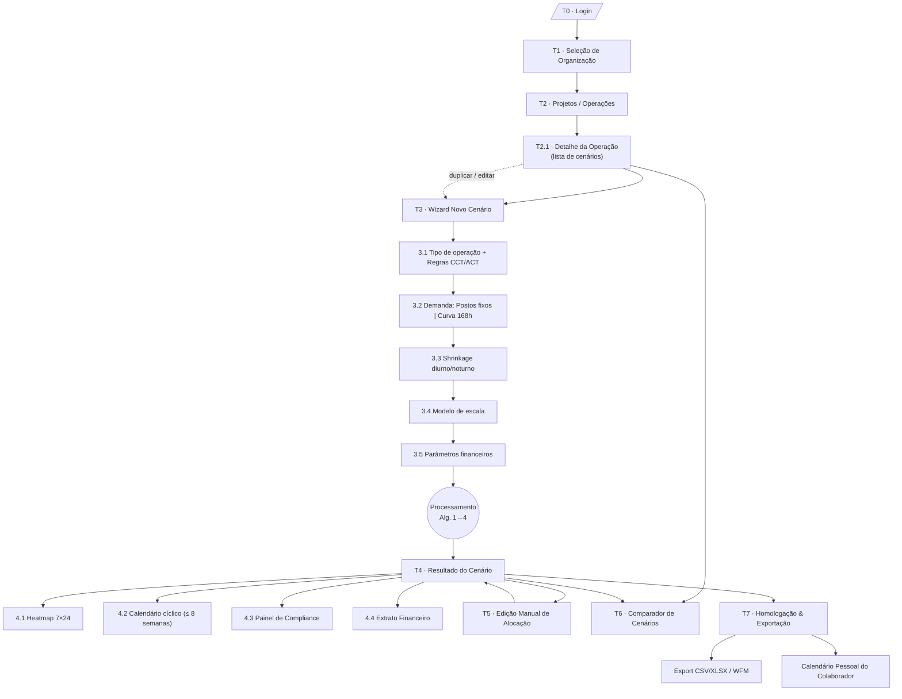
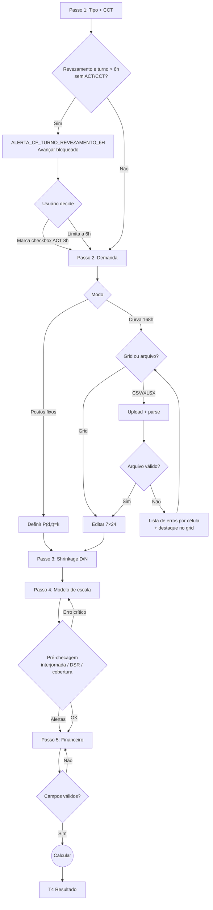
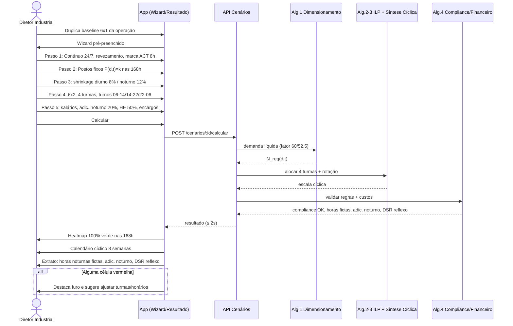
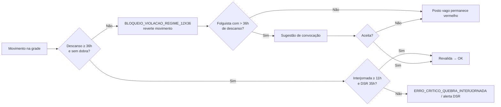
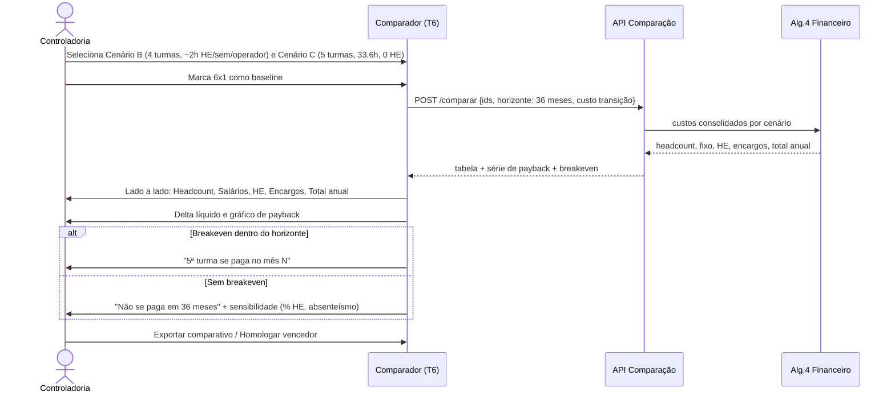
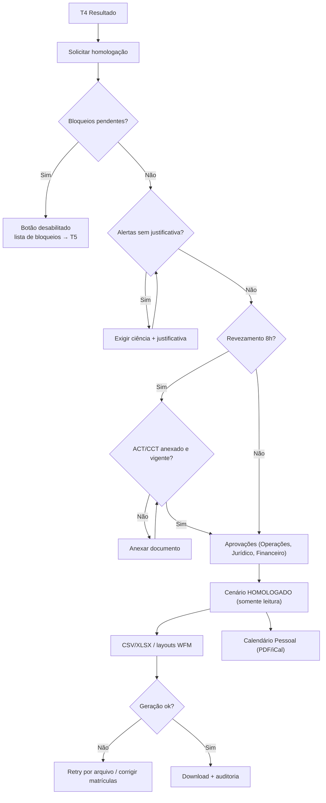

# 03 — Fluxo do App: Sitemap, Telas e Fluxos de Usuário

> Simulador de Escalas 24/7 (Workforce Shift Simulator) — CLT Brasil
> Fonte: `00-prd-original.md` (PRD v2.0). Este documento descreve navegação, telas, estados e fluxos (felizes, de erro e edge cases), cobrindo as Histórias 1, 2 e 3 do PRD (§9).

---

## 1. Mapa de Navegação (Sitemap)



Navegação global (header): Organização ▸ Operação ▸ Cenário (breadcrumb), troca de organização, menu do usuário (perfil, sair). Rotas sugeridas:

| Rota | Tela |
|---|---|
| `/login` | T0 |
| `/orgs` | T1 |
| `/o/:org/operacoes` | T2 |
| `/o/:org/operacoes/:op` | T2.1 |
| `/o/:org/operacoes/:op/cenarios/novo?passo=1..5` | T3 |
| `/o/:org/operacoes/:op/cenarios/:id` (abas `heatmap`, `calendario`, `compliance`, `financeiro`) | T4 |
| `/o/:org/operacoes/:op/cenarios/:id/editar` | T5 |
| `/o/:org/operacoes/:op/comparar?ids=...` | T6 |
| `/o/:org/operacoes/:op/cenarios/:id/homologar` | T7 |

---

## 2. Convenções de Estados

Toda tela implementa os 4 estados padrão:

| Estado | Padrão visual |
|---|---|
| **Vazio** | Ilustração + texto explicativo + CTA primário. |
| **Carregando** | Skeleton dos componentes; para cálculo, barra de progresso por etapa (Alg. 1…4). Meta NFR-01: ≤ 2 s para 1.000 colaboradores — acima de 2 s exibe progresso, acima de 15 s oferece "continuar em segundo plano". |
| **Erro** | Banner com mensagem acionável + "Tentar novamente"; erros de validação inline no campo; dados digitados nunca são descartados. |
| **Sucesso** | Toast efêmero (3–5 s) e/ou transição para a próxima tela. |

Códigos do motor exibidos ao usuário (sempre com tradução humana + referência legal):
`ERRO_CRITICO_QUEBRA_INTERJORNADA`, `BLOQUEIO_VIOLACAO_REGIME_12X36`, `ALERTA_CF_TURNO_REVEZAMENTO_6H`, alertas de DSR 35h e DSR dominical.

Severidades: **Bloqueio** (impede homologação), **Alerta** (exige ciência/justificativa), **Info**.

---

## 3. Telas

### T0 · Login
- **Objetivo:** autenticar o usuário.
- **Componentes:** e-mail, senha, "Entrar", "Esqueci a senha", SSO corporativo (opcional).
- **Dados exibidos:** nenhum dado de negócio.
- **Ações:** entrar, recuperar senha, entrar com SSO.
- **Estados:** vazio (formulário); carregando (botão com spinner, campos travados); erro (credenciais inválidas — mensagem genérica; conta bloqueada após N tentativas; falha de rede); sucesso (redireciona).
- **Validações:** e-mail válido, senha obrigatória.
- **Transições:** 1 organização → T2 direto; >1 → T1; sessão expirada em qualquer tela → T0 com retorno à URL original (`?next=`).

### T1 · Seleção de Organização
- **Objetivo:** escolher o tenant (empresa/grupo) de trabalho.
- **Componentes:** lista/cards de organizações, busca, papel do usuário (Gestor, Jurídico/BP, Financeiro, Visualizador).
- **Ações:** selecionar; "lembrar escolha".
- **Estados:** vazio ("Você não pertence a nenhuma organização — solicite convite"); carregando (skeleton); erro (falha ao listar).
- **Transições:** → T2.

### T2 · Projetos / Operações
- **Objetivo:** listar operações (planta, hospital, CD, NOC) e seus cenários.
- **Componentes:** tabela/cards com filtros (setor, status, regime 24/7 vs. não contínuo), busca, botão "Nova operação".
- **Dados exibidos:** nome, setor, regime, nº de cenários, cenário homologado vigente, headcount atual, última atualização.
- **Ações:** criar/editar/arquivar operação; abrir operação (T2.1).
- **Estados:** vazio ("Crie sua primeira operação" + CTA); carregando; erro; sucesso (toast "Operação criada").
- **Validações (nova operação):** nome obrigatório e único na org; setor obrigatório (define regras de DSR dominical — Lei 10.101/2000 comércio, Lei 605/1949 indústria/serviços).

### T2.1 · Detalhe da Operação
- **Componentes:** lista de cenários (status: Rascunho, Calculado, Com bloqueios, Homologado, Arquivado), checkbox para comparar (2–5), "Novo cenário", "Duplicar".
- **Ações:** abrir (T4), duplicar (T3 pré-preenchido), comparar (T6), excluir rascunho.
- **Estados:** vazio ("Nenhum cenário. Comece pelo baseline 6x1"); botão Comparar desabilitado com < 2 selecionados.

### T3 · Wizard de Novo Cenário
Stepper de 5 passos com salvamento automático de rascunho a cada passo; "Voltar" preserva dados; "Calcular" só no passo 5. Painel lateral "Resumo" mostra escolhas acumuladas e estimativa preliminar de turmas.

#### 3.1 Tipo de Operação e Regras Sindicais/CCT
- **Componentes:** radio Regime (Contínuo 24/7 | Não contínuo/janela fixa); setor/categoria; seleção ou cadastro de CCT/ACT (sindicato, vigência, upload PDF opcional); campos sindicais (% adic. noturno ≥ 20 %, frequência mínima de folga dominical `W_limite`, limite diário); **checkbox "Possui ACT/CCT autorizando jornada de 8h em turnos ininterruptos de revezamento"**; toggle rotação (rotativa M→T→N vs. turmas fixas de noite); feriados (calendário nacional/estadual/municipal).
- **Validações:**
  - Se regime revezamento (alterna dia/noite) **e** jornada prevista > 6h **e** checkbox desmarcado → `ALERTA_CF_TURNO_REVEZAMENTO_6H` (Art. 7º, XIV CF/88): bloqueia "Avançar" para modelos > 6h; oferece "Marcar ACT/CCT" ou "Limitar a turnos de 6h".
  - CCT com vigência expirada → alerta amarelo ("ACT vencido em dd/mm — o cenário será marcado como risco").
  - % adic. noturno < 20 % → erro inline.
- **Estados:** vazio (defaults legais pré-preenchidos); erro de upload de PDF (tamanho/formato) não bloqueia o passo.

#### 3.2 Demanda
- **Componentes:** seletor de modo:
  - **Postos fixos** (FR-02): `P(d,t)=k` — número de postos por função; atalho "igual em todas as 168h" ou por faixa (dia útil/fim de semana, diurno/noturno).
  - **Curva 168h** (FR-01/03): grid editável 7×24 (colar do Excel, arrastar para preencher, copiar dia), **upload CSV/XLSX** com template para download, conversão por UPH ou TMA/Erlang-C.
  - Pré-visualização do heatmap de demanda.
- **Validações:** valores inteiros ≥ 0 (postos) ou ≥ 0 decimais (volume); 168 células obrigatórias; ao menos 1 célula > 0.
- **Erros de upload (edge cases):** formato não suportado; arquivo > limite; cabeçalho ausente; linhas ≠ 7 ou colunas ≠ 24 (ou ≠ 168 linhas no formato longo); células não numéricas/negativas (lista "linha X, coluna Y" e destaca no grid); separador decimal vírgula vs. ponto (auto-detecção com confirmação); dias em formato divergente (seg/segunda/Mon); XLSX com múltiplas abas (perguntar qual); fuso/horário de verão ignorado — semana sempre 168h.
- **Estados:** vazio (grid zerado + "Baixar template"); carregando (parse do arquivo); sucesso (pré-visualização + "X células importadas").

#### 3.3 Shrinkage
- **Componentes:** sliders/inputs % diurno e % noturno (FR-04), opcional por componente (absenteísmo, férias, treinamento); faixa noturna fixa 22h–05h exibida.
- **Validações:** 0 ≤ % < 100 (recomendação: alerta se > 40 %); alerta informativo se noturno < diurno ("absenteísmo noturno costuma ser maior").
- **Dados exibidos:** demanda bruta vs. líquida (FTE) recalculada ao vivo, incluindo fator de hora ficta 60/52,5.

#### 3.4 Modelo de Escala
- **Componentes:** cards do catálogo — **12x36, 6x2, 4x2, 3x1 (3x2), 5 turmas (francês/petroquímico), 6x1 (baseline), 5x2, 4x3, Personalizado**; cada card mostra duração do turno, razão T/F, nº típico de turmas, carga média semanal; nº de turmas (A, B, C, D, E…); horário de início dos turnos; intervalo intrajornada; editor do Personalizado (sequência de T/F e turnos M/T/N por dia do ciclo, duração do ciclo).
- **Validações (pré-checagem antes do cálculo):**
  - Modelo incompatível com regime (ex.: 5x2 comercial sem turmas móveis em 24/7) → alerta "não cobre 168h".
  - Turno > 6h em revezamento sem ACT marcado no passo 1 → remete ao passo 1.
  - Personalizado: transições M→N/T→M com < 11h → `ERRO_CRITICO_QUEBRA_INTERJORNADA` já no editor; ciclo sem folga ≥ 35h → alerta DSR; ciclo > 8 semanas → aviso de visualização limitada.
  - Nº de turmas abaixo do teórico calculado → alerta "subcobertura provável" (permite seguir).
- **Recomendação:** selo "Recomendado" no modelo com melhor custo × compliance para a demanda informada.

#### 3.5 Parâmetros Financeiros
- **Componentes:** salário base por função; carga mensal (220h/180h/…); % adicional noturno (herdado da CCT, editável 20–40 %+); % HE (≥ 50 %; 100 % domingos/feriados conforme CCT); % encargos sociais; periculosidade (30 % sobre salário base) e/ou insalubridade (10/20/40 % sobre base definida); dias úteis e domingos/feriados do mês de referência (para DSR reflexo, Súmula 172).
- **Validações:** valores monetários > 0; % HE ≥ 50; periculosidade e insalubridade não cumulativas (aviso: escolher a mais vantajosa salvo CCT em contrário); salário ≥ piso da CCT/mínimo.
- **Ações:** "Calcular cenário".
- **Transição:** → processamento → T4.

#### Fluxo do wizard



### T4 · Resultado do Cenário
- **Objetivo:** apresentar cobertura, escala, compliance e custo do cenário calculado.
- **Componentes (abas + cabeçalho de KPIs):** KPIs (headcount total, nº de turmas, % horas cobertas, nº bloqueios/alertas, custo mensal e anual); ações "Editar alocação", "Comparar", "Duplicar", "Recalcular", "Homologar".
  - **4.1 Heatmap 7×24 (NFR-03):** célula = cobertura − demanda. **Verde** cobertura exata; **Azul** superdimensionamento/ociosidade; **Vermelho** posto vago/subcobertura crítica. Tooltip: demanda, alocados, delta, turmas presentes. Legenda acessível (padrões/ícones além da cor). Clique em célula vermelha → abre T5 filtrado naquele horário.
  - **4.2 Calendário cíclico:** matriz Turma × Dia por até **8 semanas** (História 1), código de cores M/T/N/Folga, domingos destacados, navegação por semana, filtro por turma/colaborador, marcador de folgas ≥ 35h.
  - **4.3 Painel de Compliance:** lista agrupada por severidade com código, regra, referência legal (FR-08 a FR-12, Súmula 60, Art. 7º XIV), turma/colaborador/data afetados, ação "Ver no calendário" / "Corrigir".
  - **4.4 Extrato Financeiro (FR-13):** salários fixos, horas noturnas fictas (×1,142857), adicional noturno, DSR reflexo sobre adicional noturno, prorrogação noturna (Súmula 60), HE, periculosidade/insalubridade, encargos, total mensal/anual; precisão de 6 casas antes do arredondamento (NFR-02), memória de cálculo expansível.
- **Estados:** carregando (progresso Alg. 1→4); vazio (cenário rascunho não calculado → "Calcular agora"); erro (solver sem solução viável → "Não há escala viável com N turmas: aumente turmas, reduza postos ou altere modelo" + atalho para passo 4; timeout → reprocessar); sucesso com bloqueios (badge vermelho, "Homologar" desabilitado); sucesso limpo.
- **Transições:** → T5, T6, T7, T3 (editar parâmetros cria nova versão).

### T5 · Edição Manual de Alocação
- **Objetivo:** ajustar alocações individuais (trocas, coberturas, folguistas) com validação em tempo real.
- **Componentes:** grade Colaborador × Dia (drag-and-drop de turnos), painel lateral de validação ao vivo, lista de folguistas/banco de horas com horas de descanso acumuladas, desfazer/refazer, "Salvar como nova versão", "Descartar".
- **Dados exibidos:** turno atual, horas na semana, descanso desde o último turno, impacto no heatmap e no custo (delta ao vivo).
- **Validações em tempo real (≤ 300 ms por movimento):** interjornada 11h; 36h de repouso no 12x36; dobra de turno; DSR 35h; domingo de folga dentro de `W_limite`; limite diário/semanal; HE gerada.
- **Estados:** carregando (skeleton da grade); conflito de edição concorrente ("Outro usuário alterou este cenário — recarregar/mesclar"); erro de salvamento (mantém alterações locais e oferece retry); sucesso ("Versão v3 salva").
- **Transições:** salvar → T4 recalculado; descartar → T4.

### T6 · Comparador de Cenários
- **Objetivo:** comparar lado a lado baseline 6x1 vs. Cenários A (12x36), B (6x2 4T), C (5 turmas 33,6h), D (4x3) — FR-14 e História 3.
- **Componentes:** seletor de 2–5 cenários (um marcado como Baseline); tabela com linhas **Headcount total, Custo fixo de salários, Custo variável de HE, Adicional noturno + DSR reflexo, Encargos consolidados, Total anual, Delta vs. baseline, nº bloqueios/alertas, % cobertura**; cartão **Breakeven 5ª turma** (custo de contratar a 5ª turma vs. economia de HE + passivo/absenteísmo); **gráfico de payback** (custo acumulado mês a mês com custos de transição: admissão, treinamento); destaque do melhor valor por linha.
- **Validações:** cenários da mesma operação e mesma demanda (se diferente → aviso "bases distintas, comparação indicativa"); cenários não calculados ou desatualizados → oferecer recalcular; cenário com bloqueio exibido com tarja vermelha.
- **Estados:** vazio ("Selecione ao menos 2 cenários"; atalho "Gerar A/B/C/D automaticamente a partir do baseline"); carregando; erro; sucesso.
- **Edge cases:** breakeven inexistente (5ª turma nunca se paga → "sem breakeven no horizonte de 36 meses"); payback imediato (mês 0); custo de transição zero.
- **Ações:** exportar comparativo (XLSX/PDF), abrir cenário, homologar o vencedor.

### T7 · Homologação & Exportação
- **Objetivo:** aprovar formalmente o cenário e gerar artefatos para ponto/WFM e colaboradores.
- **Componentes:** checklist de homologação (0 bloqueios; alertas com ciência e justificativa; ACT/CCT anexado se revezamento 8h; aprovadores — Operações, Jurídico/BP, Financeiro); trilha de auditoria; exportações: **CSV/XLSX** do mapa de alocação, layouts WFM (TOTVS, Senior, ADP, SAP SF, AFDT/ACJEF — NFR-04); **Calendário Pessoal do Colaborador** (visão anual de folgas e fins de semana livres; PDF individual/lote, iCal).
- **Validações:** botão "Homologar" desabilitado com bloqueio pendente; justificativa obrigatória por alerta; somente papéis com permissão aprovam; cenário homologado fica somente-leitura (alterações geram nova versão).
- **Estados:** carregando (geração assíncrona de arquivos com progresso); erro (falha na geração → retry por arquivo; layout WFM sem mapeamento de matrícula → lista colaboradores sem matrícula); sucesso (download + "Homologado em dd/mm por X").

---

## 4. Fluxos por História do PRD

### 4.1 História 1 — Planta industrial: 6x1 → 6x2 com 4 turmas



### 4.2 História 2 — Dobra 12x36 bloqueada + sugestão de folguista

```mermaid
sequenceDiagram
    actor U as Coordenador RH Hospitalar
    participant ED as Edição Manual (T5)
    participant V as Validador tempo real (Alg.4)
    participant S as Serviço de Sugestão
    U->>ED: Arrasta colaborador da Turma Diurna A para Noturna A (mesmo dia)
    ED->>V: validar(movimento)
    V-->>ED: BLOQUEIO_VIOLACAO_REGIME_12X36 (repouso < 36h / dobra)
    ED->>U: Movimento revertido + card vermelho com regra e horas de descanso
    ED->>S: buscar folguistas/banco de horas com descanso > 36h
    S-->>ED: lista ordenada (descanso acumulado, custo HE, habilitação)
    alt Há candidato elegível
        ED->>U: Sugere "Convocar Maria (48h de descanso)"
        U->>ED: Aceita sugestão
        ED->>V: validar(novo movimento)
        V-->>ED: OK (sem violação)
        ED->>U: Heatmap atualizado; delta de custo exibido
        U->>ED: Salvar nova versão
    else Nenhum candidato
        ED->>U: "Nenhum folguista elegível" + opções: manter posto vago (vermelho), ampliar turma, criar vaga
    end
    opt Usuário tenta forçar
        U->>ED: Tentar salvar mesmo assim
        ED->>U: Salvar permitido como rascunho; Homologação bloqueada
    end
```



### 4.3 História 3 — Viabilidade da 5ª turma (breakeven/payback)



---

## 5. Fluxo de Homologação e Exportação



---

## 6. Fluxos de Erro e Edge Cases (consolidado)

| # | Situação | Tela | Comportamento |
|---|---|---|---|
| E1 | Sessão expira durante wizard | T3 | Rascunho autosalvo; após login retorna ao mesmo passo. |
| E2 | CSV/XLSX malformado (dimensão, não numérico, negativo, aba errada) | 3.2 | Relatório por célula; nada é importado parcialmente sem confirmação. |
| E3 | Demanda toda zero | 3.2 | Bloqueia avanço: "informe ao menos um posto". |
| E4 | Revezamento > 6h sem ACT | 3.1/3.4 | `ALERTA_CF_TURNO_REVEZAMENTO_6H`; exige checkbox ou turno de 6h. |
| E5 | ACT/CCT vencido | 3.1/T7 | Alerta no resultado; bloqueia homologação até atualizar. |
| E6 | Personalizado com interjornada < 11h (ex.: T termina 22h, M começa 06h) | 3.4/T5 | `ERRO_CRITICO_QUEBRA_INTERJORNADA` com par de turnos destacado. |
| E7 | Ciclo sem folga ≥ 35h ou domingo de folga fora de `W_limite` | T4.3 | Alerta/bloqueio conforme categoria; link para turma/semana. |
| E8 | Turno noturno prorrogado após 05h | T4.4 | Súmula 60 aplicada automaticamente; linha específica no extrato. |
| E9 | Solver inviável (turmas insuficientes) | T4 | Erro explicativo + sugestão de nº mínimo teórico de turmas. |
| E10 | Cálculo > 2 s / timeout | T4 | Progresso; segundo plano com notificação; retry. |
| E11 | Feriado em domingo / mês com 5 domingos | T4.4 | DSR reflexo usa contagem real do mês de referência. |
| E12 | Dobra 12x36 sem folguista elegível | T5 | Posto vago vermelho; opções de ampliar turma ou criar vaga. |
| E13 | Edição concorrente | T5 | Detecção por versão; recarregar ou mesclar. |
| E14 | Comparar cenários com demandas diferentes | T6 | Aviso de base distinta. |
| E15 | Breakeven inexistente / imediato | T6 | Mensagens específicas; gráfico sem ponto de cruzamento. |
| E16 | Tentativa de editar cenário homologado | T4/T5 | Somente leitura; "Criar nova versão". |
| E17 | Usuário sem permissão de aprovar | T7 | Botão oculto; "Solicitar aprovação a…". |
| E18 | Colaborador sem matrícula na exportação WFM | T7 | Lista pendências; exporta demais ou bloqueia conforme layout. |
| E19 | Periculosidade + insalubridade marcadas | 3.5 | Aviso de não cumulatividade; escolha obrigatória salvo CCT. |
| E20 | Perda de conexão ao salvar edição manual | T5 | Mantém estado local, retry automático, indicador "não salvo". |

---

## 7. Rastreabilidade

| Requisito PRD | Telas |
|---|---|
| FR-01/02/03 Demanda 168h / postos / Erlang | 3.2 |
| FR-04 Shrinkage D/N | 3.3 |
| FR-05/06/07 Turmas e rotação | 3.4, 4.2 |
| FR-08/09 Hora ficta, Súmula 60 | 4.4 |
| FR-10/11/12 Interjornada, revezamento 6h, DSR | 3.1, 3.4, 4.3, T5 |
| FR-13 Extrato | 4.4 |
| FR-14 Substituição / 5ª turma | T6 |
| NFR-01/02/03/04 | T4 (desempenho, precisão, heatmap), T7 (export) |
| Histórias 1, 2, 3 | §4.1, §4.2, §4.3 |
