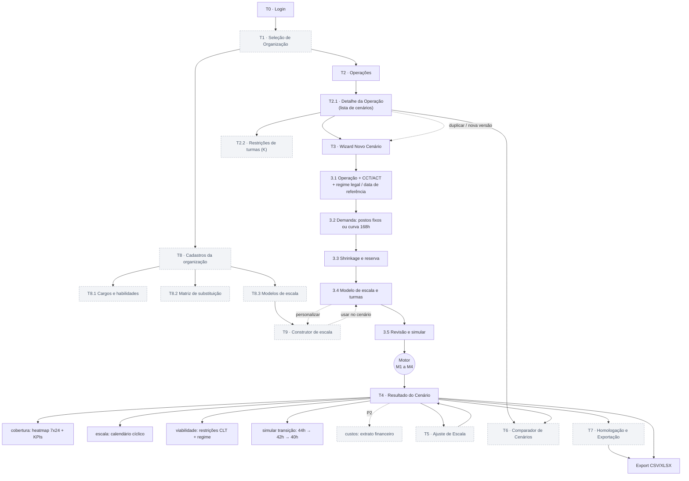
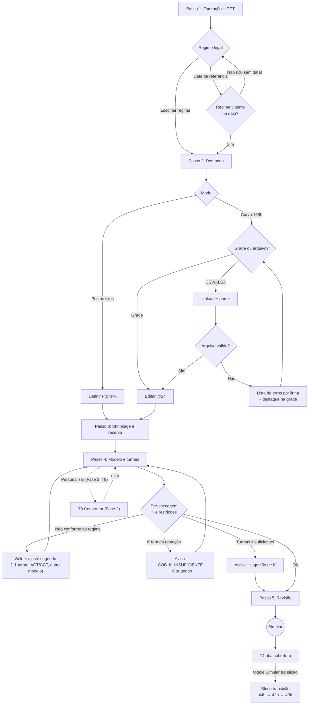
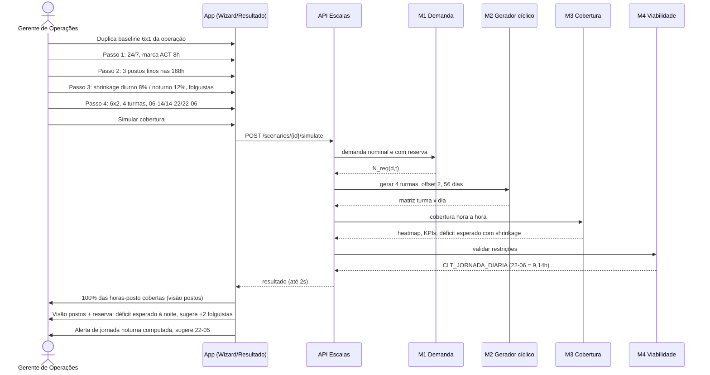
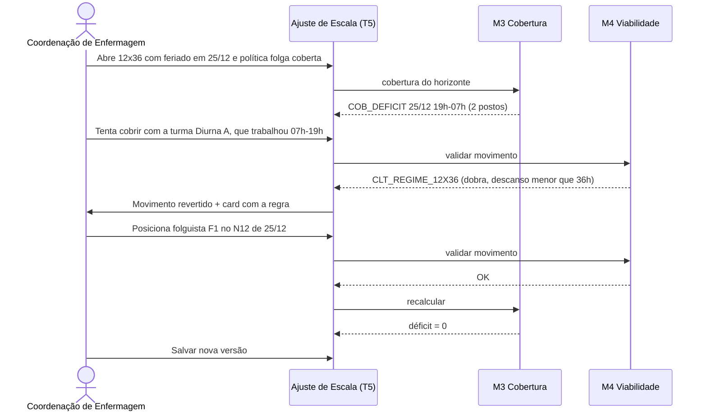
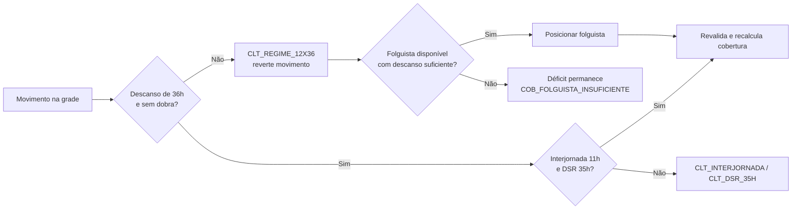
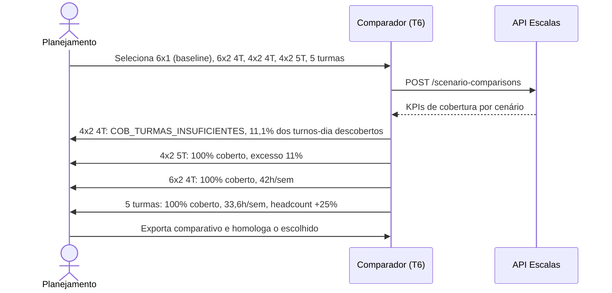
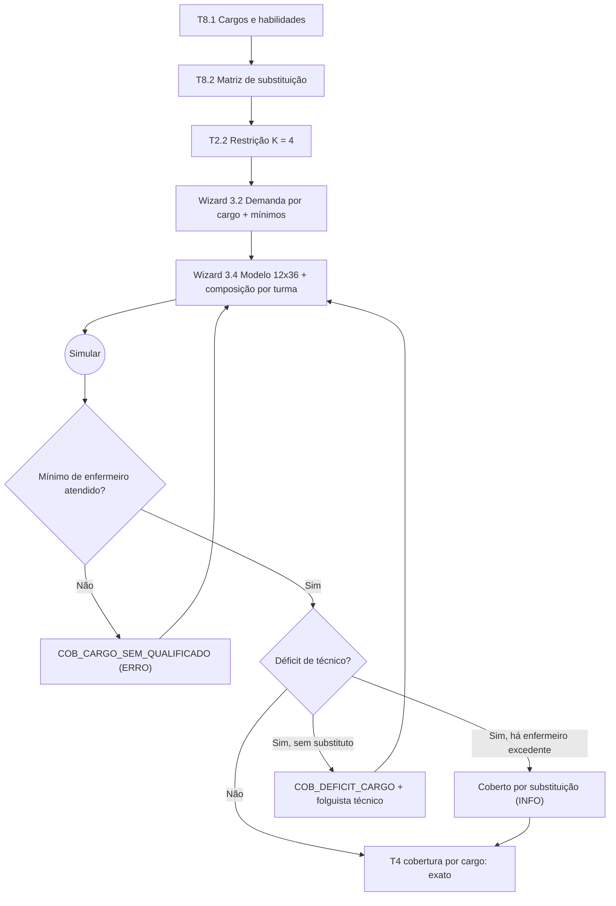
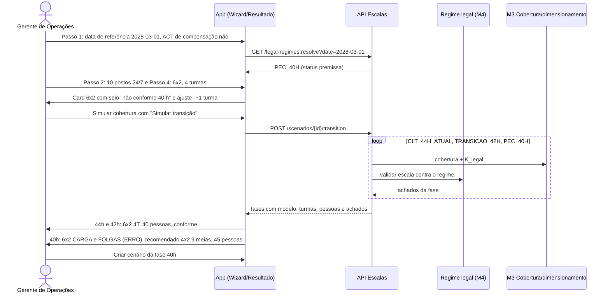
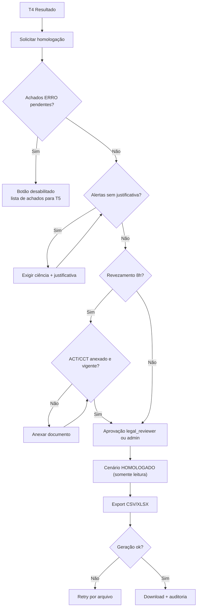

# 03 — Fluxo do App: Sitemap, Telas e Fluxos de Usuário

> Simulador Operacional de Cobertura 24/7 — CLT Brasil
> Fonte: `01-PRD.md` (PRD v3.4 — regime legal / fim da 6x1; IDs FR-xx canônicos). Este documento descreve navegação, telas, estados e fluxos (felizes, de erro e edge cases). O núcleo é **cobertura**: a tela de resultado abre no heatmap; viabilidade CLT é um painel de restrições; custos são módulo P2 (fase futura).

> **Corte do MVP (v3.3, 4 sprints — `06` §3):** telas, rotas e fluxos estão marcados **[MVP]**, **[MVP parcial]** ou **[Fase 2]**. **MVP = interface mínima:** T0 login, T2/T2.1 (lista simples de operações e cenários), T3 wizard de 5 passos (com cargos, matriz A→B e mínimos em **tabela simples** no passo 3.3; **v3.4:** passo 3.1 com **regime legal / data de referência** e selo de conformidade por regime nos cards do passo 3.4; o construtor básico saiu do MVP), T4 com abas `cobertura` (heatmap 7×24 + KPIs + filtro por cargo), `escala` (calendário de turmas) e `viabilidade` (painel de achados), bloco **"Simular transição"** (44 h → 42 h → 40 h) e botão **Exportar CSV/XLSX**. **Fase 2:** T1 (multi-org), T2.2, T5, T6, T7, T8.1–T8.3, T9, feriados, folguistas, furos de intervalo e camadas.

---

## 1. Mapa de Navegação (Sitemap)

Legenda: nós tracejados/cinza = **Fase 2** (ou P2); demais = **MVP**. No MVP o export sai direto de T4 (sem T7) e T0 leva direto a T2 (uma organização por usuário).

Navegação global (header): Organização ▸ Operação ▸ Cenário (breadcrumb), troca de organização, menu do usuário.

| Rota | Tela | Endpoint principal (`05-esquema-backend.md` §5.4, base `/api/v1/escalas`) | Fase |
|---|---|---|---|
| `/login` | T0 | `POST /auth/login` | **MVP** |
| `/orgs` | T1 | `GET /me` | *Fase 2* |
| `/o/:org/operacoes` | T2 | `GET /operations` | **MVP** |
| `/o/:org/operacoes/:op` | T2.1 | `GET /scenarios?operation_id=` | **MVP** |
| `/o/:org/operacoes/:op/restricoes` | T2.2 | `GET/POST/PATCH /operations/{id}/team-constraints` | *Fase 2* |
| `/o/:org/cadastros/cargos` | T8.1 | `/roles`, `/skills`, `/roles/{id}/skills` | *Fase 2* |
| `/o/:org/cadastros/matriz-substituicao` | T8.2 | `GET/PUT /substitution-rules` | *Fase 2* |
| `/o/:org/escalas/modelos` | T8.3 | `GET /schedule-models`, `GET /custom-schedule-patterns` | *Fase 2* |
| `/o/:org/escalas/modelos/novo?de=:codigo` · `/o/:org/escalas/modelos/:pid/editar` | T9 | `POST /custom-schedule-patterns/{id}:derive`, `POST /custom-schedule-patterns:validate`, `PATCH /custom-schedule-patterns/{id}` | *Fase 2* |
| `/o/:org/operacoes/:op/cenarios/novo?passo=1..5` | T3 | `POST /scenarios`, `PATCH /scenarios/{id}` | **MVP** |
| `/o/:org/operacoes/:op/cenarios/:id/:aba` (aba ∈ `cobertura` (padrão), `escala`, `viabilidade`, `custos`*) | T4 | `GET /scenarios/{id}/coverage`, `/assignments`, `/compliance-findings`, `/financials`* | **MVP (sem `custos`)** |
| `/o/:org/operacoes/:op/cenarios/:id/transicao` | T4 (bloco "Simular transição") | `POST /scenarios/{id}/transition`, `GET /legal-regimes` | **MVP (v3.4)** |
| `/o/:org/operacoes/:op/cenarios/:id/ajustar` | T5 | `PATCH /scenarios/{id}/assignments/{aid}` | *Fase 2* |
| `/o/:org/operacoes/:op/comparar?ids=...` | T6 | `POST /scenario-comparisons` | *Fase 2* |
| `/o/:org/operacoes/:op/cenarios/:id/homologar` | T7 | `POST /scenarios/{id}/approve`, `POST /scenarios/{id}/exports` | *Fase 2 (export: MVP via T4)* |

\* `custos` e `/financials` só existem quando o Módulo 6 (P2) for implementado.

---

## 2. Convenções de Estados

| Estado | Padrão visual |
|---|---|
| **Vazio** | Ilustração + texto explicativo + CTA primário. |
| **Carregando** | Skeleton; para cálculo, progresso por módulo do motor (M1 Demanda → M2 Gerador → M3 Cobertura → M4 Viabilidade). NFR-01: ≤ 2 s; acima de 2 s exibe progresso; acima de 15 s oferece "continuar em segundo plano". |
| **Erro** | Banner com mensagem acionável + "Tentar novamente"; erros de validação inline; dados digitados nunca são descartados. |
| **Sucesso** | Toast (3–5 s) e/ou transição. |

Status do cenário (enum `scenario_status`, `05` §3.1): `rascunho`, `calculando`, `calculado`, `em_revisao`, `homologado`, `arquivado`, `erro`. Um cenário `calculado` com achados `ERRO` exibe o selo **"inviável"**.

Códigos de achado exibidos (catálogo canônico: `01-PRD.md` Apêndice A), sempre com tradução humana + referência: cobertura `COB_DEFICIT`, `COB_DEFICIT_POSTO_CRITICO`, `COB_EXCESSO`, `COB_FURO_INTERVALO`, `COB_DEFICIT_ESPERADO_SHRINKAGE`, `COB_TURMAS_INSUFICIENTES`, `COB_FOLGUISTA_INSUFICIENTE`, `COB_PADRAO_NAO_EXATO`, `COB_K_INSUFICIENTE`, `COB_K_ACIMA_NECESSARIO`, `COB_TURMA_ABAIXO_MINIMO`, `COB_TURMA_ACIMA_MAXIMO`, `COB_CARGO_SEM_QUALIFICADO`, `COB_DEFICIT_CARGO`, `COB_COBERTURA_POR_SUBSTITUICAO`, `COB_LIMITE_FORA_CARGO`, `COB_PROPORCAO_VIOLADA` (P2); viabilidade `CLT_INTERJORNADA`, `CLT_DSR_35H`, `CLT_SETIMO_DIA`, `CLT_DOMINGO_PERIODICIDADE`, `CLT_REVEZAMENTO_6H`, `CLT_REGIME_12X36`, `CLT_JORNADA_DIARIA`, `CLT_MEDIA_SEMANAL`, `CLT_INTRAJORNADA`, `CLT_TEMPO_PARCIAL`, `INFO_DIVERGENCIA_59A_SUMULA60`.

Severidades: **ERRO** (escala inviável; impede homologação), **ALERTA** (exige ciência/justificativa), **INFO**.

Papéis (enum `member_role`, `05` §3.1): `owner`, `admin`, `planner` (planejador), `legal_reviewer` (Jurídico/BP — homologa e dispensa achados), `viewer`.

---

## 3. Telas

### T0 · Login [MVP]
- **Componentes:** e-mail, senha, "Entrar", "Esqueci a senha", SSO (opcional).
- **Estados:** carregando (spinner, campos travados); erro (credenciais inválidas — mensagem genérica; bloqueio após N tentativas; falha de rede).
- **Transições:** 1 organização → T2; > 1 → T1; sessão expirada → T0 com `?next=`.

### T1 · Seleção de Organização [Fase 2]
- Lista de organizações com papel do usuário; "lembrar escolha". Vazio: "Você não pertence a nenhuma organização — solicite convite". → T2.

### T2 · Operações [MVP — lista simples]
- **Objetivo:** listar operações (planta, hospital, CD, NOC).
- **Dados:** nome, setor, regime (24/7 ou não), nº de cenários, cenário homologado vigente, **% de cobertura do homologado**, headcount, última atualização.
- **Ações:** criar/editar/arquivar operação; abrir T2.1.
- **Validações:** nome único na org; setor obrigatório (define a regra de folga dominical — FR-17).

### T2.1 · Detalhe da Operação [MVP parcial: lista de cenários + "Novo cenário"; comparar/duplicar Fase 2]
- Lista de cenários (status §2, % cobertura, horas-posto em déficit, headcount, selo "inviável"), checkbox para comparar (2–5), "Novo cenário", "Duplicar".
- Vazio: "Nenhum cenário. Comece pelo baseline 6x1." Comparar desabilitado com < 2 selecionados.
- Atalho "Restrições de turmas" → T2.2 (mostra a faixa de K vigente no cabeçalho).

### T2.2 · Restrições de turmas da operação (v3.2) [Fase 2]
- **Objetivo:** fixar o número de turmas e o tamanho das turmas como **restrição** (FR-32, FR-33) antes de qualquer cenário.
- **Componentes:** escopo (operação | posto | cargo | camada); modo **Fixo / Faixa / Livre** (segmented); `K_min`/`K_max` ou `K`; tamanho mín./máx. por turma; "permitir meias-turmas"; tabela de exceções por posto/cargo. Indicador: "K\* do modelo atual" ao lado do limite.
- **Validações:** `K_min ≤ K_max ≤ 12`; restrição do posto/cargo dentro da faixa da operação; `tamanho_min ≤ tamanho_max`.
- **Efeito:** no passo 3.4, modelos que exigem K fora da faixa aparecem com selo "excede limite de turmas" (desabilitados em modo Fixo; selecionáveis com aviso em Faixa).

### T8 · Cadastros da organização: cargos, habilidades e matriz (v3.2) [Fase 2 — no MVP, cargos/matriz/mínimos ficam em tabela simples no passo 3.3]
- **T8.1 Cargos e habilidades (FR-34):** tabela de cargos (nome, nível 1–9, CBO, cor, habilidades padrão) e de habilidades/certificações (código, nome, exige validade). Seeds sugeridos por setor (saúde: enfermeiro, técnico de enfermagem, supervisor; indústria: operador, operador de caldeira NR-13, operador líder, supervisor). Exclusão bloqueada se o cargo está em uso (lista onde).
- **T8.2 Matriz de substituição (FR-35):** grade **cargo × cargo** (linhas = quem cobre, colunas = quem é coberto); cada célula: vazio (não cobre), ✓ 1,0, fração (P1), prioridade, "vale para mínimo"; diagonal travada. Atalhos: "nível superior cobre inferior" (preenche direcional pelo nível), "limpar linha". Painel lateral explica em linguagem natural: "Enfermeiro pode cobrir Técnico (prioridade 2). Técnico **não** cobre Enfermeiro." Validações: fator 0 < f ≤ 1; aviso em ciclos A↔B ("ambos se cobrem — confirme").
- **T8.3 Modelos de escala:** catálogo ampliado (`01` §6.1) em grupos (contínuos, não contínuos, complementares, variações) com filtros "cobre 24/7 exato", "viável sem CCT", nº de turmas; aba "Da organização" com templates (FR-31). Ações: "Duplicar e editar" → T9; "Usar em cenário".

### T9 · Construtor de escala (v3.2, FR-29) [Fase 2 — no MVP, construtor básico dentro do passo 3.4]
- **Componentes:** (1) **editor de sequência do ciclo** — trilha de chips arrastáveis M/T/N/D12/N12/INT/F/R com contador `L`; (2) **turnos** — tabela código/início/duração/intervalo/política (rendição, não computado, volante, escalonado) com régua 0–24 h mostrando sobreposições; (3) **turmas** — K, offsets por turma (arrastar a linha da turma no mini-calendário), tamanho por turma, meias-turmas; (4) **regras** — sentido da rotação, data-âncora, folgas fixas (P1), regra de feriado (P1); (5) **camadas** (P1, FR-30) — adicionar camada (ex.: reforço 5x2 INT); (6) **painel de validação ao vivo**: K\* e "exato/não exato", h/sem, maior sequência trabalhada, menor interjornada, maior descanso em 7 dias, domingos de folga, mini-heatmap de cobertura do ciclo.
- **Estados:** inválido (sequência vazia, sem F, código inexistente) → salvar desabilitado; validando (≤ 300 ms, spinner discreto); com achados (chip vermelho/amarelo apontando a posição da sequência).
- **Ações:** "Salvar template" (nova versão se já existe), "Usar neste cenário", "Restaurar modelo de origem".

### T3 · Wizard de Novo Cenário [MVP]
Stepper de 5 passos com autosalvamento; "Voltar" preserva dados; "Simular" só no passo 5. Painel lateral "Resumo" mostra demanda total (horas-posto/semana) e **estimativa de turmas/headcount** (FR-08) ao vivo.

#### 3.1 Operação e regras (CCT/ACT) e regime legal [MVP parcial: CCT/regime, contrato e **regime legal (v3.4)**; feriados, domingo e checkbox de revezamento Fase 2]
- **Componentes:** regime (Contínuo 24/7 | janela fixa); setor; CCT/ACT (sindicato, vigência); **checkbox "ACT/CCT autoriza 8 h em turnos ininterruptos de revezamento"** (FR-18); `N` de folga dominical (FR-17); calendário de feriados + política em feriado (FR-12); data inicial do horizonte.
- **Regime legal (v3.4, FR-39) [MVP]:** seletor segmentado **"Regime" | "Data de referência"**. *Regime*: `CLT_44H_ATUAL` (44 h — 6x1 permitida), `TRANSICAO_42H` (42 h), `PEC_40H` (40 h, ≥ 2 folgas/semana); *Data de referência*: date picker → o app chama `GET /legal-regimes:resolve?date=` e mostra o regime vigente. Abaixo, a **linha do tempo da transição** (`04` §8.14) com a fase escolhida destacada e o selo **"Premissa — texto promulgado não confirmado"** (`INFO_REGIME_PREMISSA`). Checkbox **"Há ACT/CCT de compensação de jornada"** (alimenta `CLT_VIAVEL_SOMENTE_COM_ACT`). Toggle **"Simular transição"**: após simular, T4 mostra o bloco por fase (FR-41).
- **Validações:** revezamento > 6 h sem checkbox → `CLT_REVEZAMENTO_6H` exibido como aviso (não bloqueia o avanço; o cenário sairá com ALERTA); CCT vencida → alerta; data de referência sem regime vigente (D0 sem data) → "Escolha o regime explicitamente" (não avança).

#### 3.2 Demanda [MVP: postos fixos, grade 168 h, upload CSV/XLSX; habilidades Fase 2]
- **Postos fixos** (FR-02): `P(d,t)=k` por faixa; atalho "igual em todas as 168 h"; marcação de **posto crítico**.
- **Curva 168 h** (FR-01): grade 7×24 editável (colar do Excel, arrastar, copiar dia), upload CSV/XLSX com template. Erlang-C/UPH (FR-04) aparece desabilitado com selo "Fase 2".
- **Demanda por cargo (v3.2, FR-34/36):** cada posto declara o cargo exigido e habilidades exigidas (ex.: posto "Caldeira" = Operador + `NR13_CALDEIRA`); bloco "Mínimos por turno" (ex.: ≥ 1 Enfermeiro por plantão; "aceita substituto" sim/não); proporções (FR-37) com selo "Fase 2". Sem cargos cadastrados, o passo funciona como antes (cargo único implícito).
- **Validações:** inteiros ≥ 0; 168 células; ≥ 1 célula > 0.
- **Erros de upload:** formato não suportado; > 5 MB; cabeçalho ausente; ≠ 168 linhas (formato longo) ou ≠ 7×24; não numérico/negativo (lista "linha X" e destaca no grid); separador decimal; XLSX com várias abas (perguntar qual).

#### 3.3 Shrinkage e reserva [MVP parcial: shrinkage D/N + "pessoas extras por turma"; turma de folguistas Fase 2; v3.3: inclui tabela simples de cargos, matriz A→B e mínimos por turno]
- **Componentes:** % diurno e % noturno (FR-03), opcional por componente (absenteísmo, férias, treinamento); faixa noturna 22h–05h exibida; **estratégia de reserva** (FR-11, FR-13): "pessoas extras por turma" | "turma de folguistas" | "nenhuma (só visualizar risco)".
- **Validações:** 0 ≤ % < 60; alerta informativo se > 40%.
- **Dados exibidos:** demanda nominal vs. demanda bruta com reserva, ao vivo.

#### 3.4 Modelo de escala e turmas [MVP parcial: catálogo essencial de 10 modelos com **selo de conformidade por regime** (v3.4), K fixo; sequência personalizada básica e K mínimo → Fase 2 (v3.4); resto Fase 2]
- **Componentes:** catálogo ampliado (FR-28, `01` §6.1) em grupos — *contínuos 24/7* (6x1, 12x36, 6x2, 4x2, 5 turmas, 3x1, 3x2, 6x3, 2x2, Pitman, Panamá, DuPont, Continental, 12x60, 24x48, 24x72, 5T francesa, 6 turmas), *não contínuos* (5x2, 5x1, 4x3), *complementares* (fim de semana 12 h, parcial 20/25/30 h, reforço de pico) e *variações* (fixo × rotativo, escalonado; 18x36 e split com selo P1); filtros "cobre 24/7 exato" e "viável sem CCT"; grupo "Da organização" (templates FR-31); botão **"Personalizar" → T9** (FR-29). Bloco **"Turmas"**: modo K herdado de T2.2 (editável se Livre), tamanho mín./máx., meias-turmas, **composição por cargo** de cada turma (FR-34). Bloco **"Camadas"** (P1, FR-30): "+ adicionar camada" (ex.: reforço 5x2). Cada card mostra turnos/dia, padrão, **K necessário**, h/sem média e ciclo calendário (`01` §6). Campos: nº de turmas (A, B, C…), horários dos turnos, **intervalo intrajornada** (computado com rendição | não computado sem rendição | coberto por volantes — FR-10), nº de folguistas (ou "calcular mínimo").
- **Pré-checagem (antes de simular):**
  - `K` informado < `K` necessário → `COB_TURMAS_INSUFICIENTES` com sugestão (ex.: 4x2 → 5 turmas ou 9 meias-turmas). Permite seguir para ver o déficit.
  - Modelo exige K fora da restrição (T2.2) → `COB_K_INSUFICIENTE` previsto e card desabilitado (modo Fixo) ou com aviso (Faixa).
  - Turma com tamanho fora de mín./máx. → `COB_TURMA_ABAIXO_MINIMO` / `COB_TURMA_ACIMA_MAXIMO`; mínimo de cargo impossível com a composição (ex.: 0 enfermeiros) → `COB_CARGO_SEM_QUALIFICADO` previsto.
  - Personalizado com transição < 11 h → `CLT_INTERJORNADA` já no editor; sem folga ≥ 35 h → `CLT_DSR_35H`.
  - **(v3.4) Regime legal:** cada card mostra o **selo de conformidade** do regime do passo 1 (`04` §8.15) e a mini-linha 44/42/40; modelo não conforme (ex.: 6x2 no 40 h → `CLT_CARGA_SEMANAL_EXCEDIDA` + `CLT_FOLGAS_SEMANAIS_INSUFICIENTES`) fica com o ajuste sugerido ("+1 turma → 5 turmas", "4x2 com 9 meias-turmas"); `6X1_BASE` fora do 44 h aparece só como **baseline de comparação** (`CLT_ESCALA_6X1_VEDADA`); modelos que dependem de acordo (4x3 10 h, 2x2 12 h) mostram o alerta "Só é viável com ACT/CCT".
  - **(v3.4)** K informado < **K mínimo legal** (ex.: 4 turmas em 24/7 de 8 h no 40 h; K_legal = 4,2) → `COB_TURMAS_INSUFICIENTES` com "5 turmas ou 9 meias-turmas".
- **Recomendação:** selo "Recomendado" no modelo com menor headcount que zera o déficit sem `ERRO` **no regime do cenário**.

#### 3.5 Revisão e simular [MVP]
- Resumo de todos os passos + seção recolhida **"Parâmetros de custo (opcional — Fase 2)"**, desabilitada no MVP.
- **Ação:** "Simular cobertura" → processamento → T4 (aba `cobertura`).

#### Fluxo do wizard

### T4 · Resultado do Cenário [MVP parcial: abas `cobertura` (com filtro por cargo), `escala` e `viabilidade` (painel de achados) + Exportar; furos de intervalo, feriados, folguistas e tabela cargo × KPI Fase 2]
- **Objetivo:** mostrar **se a operação está coberta**, onde estão os furos e o que é preciso para fechá-los.
- **Cabeçalho de KPIs (FR-14):** % horas-posto cobertas · horas-posto em déficit · pico de subcobertura (dia/hora) · headcount (atual / mínimo) · turmas (atual / necessárias) · furos no intervalo · violações ERRO/ALERTA. Ações: "Ajustar escala", "Comparar", "Duplicar", "Recalcular", "Homologar".
  - **Aba `cobertura` (padrão; FR-09, FR-10, FR-11, FR-12):** heatmap 7×24 de **déficit / exato / excesso**; alternância **"postos" | "postos + reserva"** e **"pior caso" | "média"** do horizonte; filtro por posto e **por cargo** ("Todos", cada cargo, "só substituições" — FR-35); camada por **camada de escala** (FR-30); camada "furos no intervalo"; tooltip com demanda, cobertura, diferença, turmas presentes e feriado; lista "Top 10 horas em déficit"; card **"Como fechar o déficit"** (ex.: "+1 turma", "+2 folguistas", "trocar para 5 turmas") (FR-08, FR-13). Clique em célula de déficit → T5 filtrado.
  - **Aba `escala` (FR-21):** calendário turma × dia do ciclo calendário completo (`mmc(L,7)`: 14/56/42/70/7 dias), códigos M/T/N/D/N12/F, domingos e feriados destacados, folguistas como linha própria, marcadores de déficit/violação.
  - **Cobertura por cargo (v3.2):** tabela cargo × KPIs (demanda, próprio, por substituição, déficit, horas sem qualificado); bloco "Turmas" mostra K usado vs. restrição e cobertura alcançável quando K é fixo (FR-32).
  - **Aba `viabilidade` (FR-15–FR-20, FR-40):** restrições agrupadas por severidade com código, regra, fonte normativa, turma/data, "Ver no calendário" / "Corrigir". **(v3.4)** Cabeçalho da aba com o **regime aplicado** (código, versão, vigência, selo "premissa") e os achados de regime (`CLT_CARGA_SEMANAL_EXCEDIDA`, `CLT_FOLGAS_SEMANAIS_INSUFICIENTES`, `CLT_ESCALA_6X1_VEDADA`, `CLT_VIAVEL_SOMENTE_COM_ACT`, `CLT_REGIME_PENDENTE_REGULAMENTACAO`).
  - **Bloco "Simular transição" (v3.4, FR-41) [MVP]:** linha do tempo `04` §8.14 + tabela fase × (modelo do cenário: conforme?/achados; modelo recomendado; turmas; pessoas; h/sem; Δ pessoas vs. 44 h). Ex. 10 postos 24/7: 40 → 40 → **45** pessoas (4x2 9 meias) ou 50 (5T). Ação "Criar cenário desta fase" (duplica com o regime e o modelo recomendado).
  - **Aba `custos` (P2, FR-25–27):** oculta no MVP.
- **Estados:** carregando (progresso M1→M4); rascunho não calculado → "Simular agora"; inviável (sem escala sem `ERRO` para os parâmetros) → "Não há escala viável com N turmas: aumente turmas, reduza postos ou troque o modelo" + atalho para 3.4; timeout → reprocessar.
- **Transições:** → T5, T6, T7, T3 (editar parâmetros cria nova versão).

### T5 · Ajuste de Escala [Fase 2]
- **Objetivo:** ajustar a escala gerada **por turma × dia** (MVP; por colaborador na Fase 2): trocar turno, mover folga, posicionar folguista, convocar turma de folga em feriado.
- **Componentes:** grade Turma × Dia (arrastar ou teclado), painel ao vivo com **delta de cobertura** (horas-posto em déficit antes/depois) e restrições, desfazer/refazer, "Salvar como nova versão".
- **Validação em tempo real (≤ 300 ms):** recalcula cobertura (M3) e restrições (M4): `CLT_INTERJORNADA`, `CLT_REGIME_12X36`, `CLT_DSR_35H`, `CLT_SETIMO_DIA`, `CLT_DOMINGO_PERIODICIDADE`, `CLT_JORNADA_DIARIA`.
- **Estados:** conflito de edição concorrente (ETag/`If-Match`) → recarregar/mesclar; erro de salvamento mantém alterações locais.

### T6 · Comparador de Cenários [Fase 2]
- **Objetivo:** comparar até 5 cenários pela **cobertura e headcount** (FR-22), ex.: baseline 6x1 · 12x36 · 6x2 (4T) · 4x2 (5T) · 5 turmas.
- **Linhas:** turmas; headcount sem/com reserva; h/sem média por pessoa; % horas-posto cobertas; horas-posto em déficit; pico de subcobertura; excesso (%); furos no intervalo; violações ERRO/ALERTA; delta vs. baseline; melhor valor marcado ★ + texto. Linhas de custo aparecem apenas com o Módulo 6 (P2).
- **Validações:** mesma operação e mesma demanda (senão aviso "bases distintas"); cenários desatualizados → recalcular; inviáveis com tarja.
- **Ações:** exportar comparativo (XLSX), abrir cenário, homologar o escolhido.

### T7 · Homologação e Exportação [Fase 2 — export CSV/XLSX é MVP via botão em T4]
- **Checklist:** 0 achados `ERRO` (ou dispensados por `legal_reviewer` com justificativa); alertas com ciência; ACT/CCT anexado se revezamento 8 h; aprovação.
- **Exportações (FR-23):** XLSX com abas `Escala`, `Cobertura168h`, `KPIs`, `Violacoes`, `Parametros`; CSV por aba. Layouts WFM/AFDT/ACJEF e calendário pessoal: **Fase 2/3**.
- **Validações:** "Homologar" desabilitado com `ERRO` pendente; cenário homologado é somente leitura (alterações geram nova versão).

---

## 4. Fluxos por cenário de uso

### 4.1 Cenário 1 — Planta industrial: 6x1 → 6x2 com 4 turmas [MVP]

### 4.2 Cenário 2 — Hospital 12x36: furo em feriado e folguista [Fase 2 — feriados, folguistas e T5]

### 4.3 Cenário 3 — Quantas turmas preciso? (4x2 vs. 5 turmas vs. 6x2) [MVP parcial: simular os cenários em sequência; comparador T6 Fase 2]

> O antigo fluxo "breakeven da 5ª turma" (custo) pertence ao Módulo 6 (P2, FR-27) e será reintroduzido quando o módulo existir.

---

### 4.4 Cenário 4 — UTI com cargos: enfermeiro cobre técnico, não o contrário (v3.2) [MVP — sem habilidades]

1. Gestor cadastra cargos em T8.1 (Enfermeiro nível 3, Técnico de enfermagem nível 2, Supervisor nível 4) e em T8.2 marca **Enfermeiro → Técnico ✓ 1,0 (prioridade 2)**, **Supervisor → Enfermeiro ✓ (vale para mínimo)**.
2. Em T2.2 fixa **K = 4** (modo Fixo) e tamanho máx. 6 por turma.
3. Wizard 3.2: demanda por cargo — 1 enfermeiro + 4 técnicos 24/7; mínimo "≥ 1 enfermeiro por plantão".
4. Wizard 3.4: escolhe 12x36 (K\* = 4 ✓ dentro do limite). Composição por turma: 1 enfermeiro + 4 técnicos.
5. T4 `cobertura`, filtro "Técnico": exato. Com shrinkage noturno, visão "postos + reserva" mostra déficit de técnico; card sugere **folguista técnico** (não enfermeiro, por prioridade).
6. Gestor reduz técnicos da turma C para 3 e sobe enfermeiros para 2 → filtro "Técnico" exato com marcador ↺ (substituição), `COB_COBERTURA_POR_SUBSTITUICAO` (INFO).
7. Teste inverso: turma D com 0 enfermeiros e 5 técnicos → `COB_CARGO_SEM_QUALIFICADO` (ERRO) nos plantões da D; selo "inviável" e homologação bloqueada.

### 4.5 Cenário 5 — K fixo pelo sindicato e escala personalizada (v3.2) [MVP parcial: K fixo + sequência personalizada no passo 3.4; T2.2/T9 Fase 2]

1. ACT limita a operação a **K = 4 turmas** (T2.2 modo Fixo). Demanda 3 postos 24/7.
2. Passo 3.4: 5 turmas e 3x2 aparecem "excede limite de turmas"; 4x2 com K = 4 mostra `COB_K_INSUFICIENTE` (11,1% dos turnos-dia descobertos).
3. Gestor abre T9 a partir do 6X2 ("Duplicar e editar"), troca para `[M,M,T,T,N,N,F,F]` com intervalo escalonado e adiciona camada de reforço 5x2 INT 10–18 (FR-30).
4. Validação ao vivo: K\* = 4 exato, 42 h/sem, menor interjornada 24 h → salva template "6x2 + reforço" para a organização (FR-31) e simula.

### 4.6 Cenário 6 — Mesma planta, fim da 6x1: simular a transição 44 h → 42 h → 40 h (v3.4) [MVP]

- Datas ilustrativas: D0 hipotético = 01/12/2026 ⇒ 42 h a partir de 30/01/2027 e 40 h a partir de 01/02/2028 (premissa `01` §8.1, PL3).
- Ponto de atenção: o painel mostra o selo "premissa — confirmar texto promulgado" em todas as fases.

## 5. Fluxo de Homologação e Exportação [Fase 2 — exceto export, MVP]

---

## 6. Fluxos de Erro e Edge Cases (consolidado)

| # | Situação | Tela | Comportamento |
|---|---|---|---|
| E1 | Sessão expira durante wizard | T3 | Rascunho autosalvo; volta ao mesmo passo após login. |
| E2 | CSV/XLSX malformado | 3.2 | Relatório por linha; nada é importado parcialmente. |
| E3 | Demanda toda zero | 3.2 | Bloqueia avanço: "informe ao menos um posto". |
| E4 | Revezamento > 6 h sem ACT | 3.1/T4 | `CLT_REVEZAMENTO_6H` (ALERTA; ERRO se > 8 h). |
| E5 | ACT/CCT vencido | 3.1/T7 | Alerta no resultado; bloqueia homologação até atualizar. |
| E6 | Personalizado com interjornada < 11 h | 3.4/T5 | `CLT_INTERJORNADA` com par de turnos destacado. |
| E7 | Nº de turmas < K necessário (ex.: 4x2 com 4) | 3.4/T4 | `COB_TURMAS_INSUFICIENTES` + heatmap com déficit + sugestão de K. |
| E8 | Intervalo não computado sem rendição | T4 | `COB_FURO_INTERVALO`; camada "furos no intervalo"; sugestão de volantes. |
| E9 | Feriado com política "folga coberta" e sem folguistas | T4 | `COB_DEFICIT` com contexto "feriado"; sugestão de folguistas. |
| E19 | K fixo menor que K\* | T2.2/3.4/T4 | `COB_K_INSUFICIENTE` com cobertura alcançável e déficit; sugestões com o mesmo K (folguistas, meias-turmas, outro modelo). |
| E20 | Nenhum qualificado no turno | 3.4/T4 | `COB_CARGO_SEM_QUALIFICADO` (ERRO) por turno/hora; bloqueia homologação. |
| E21 | Matriz com ciclo A↔B | T8.2 | Aviso de confirmação; permitido. |
| E22 | Excluir cargo em uso | T8.1 | Bloqueado com lista de postos/turmas/regras que o usam. |
| E23 | Template editado usado em cenários | T9 | Nova versão; cenários antigos mantêm a versão usada. |
| E24 | Sequência inválida no construtor (sem F, código inexistente) | T9 | Salvar desabilitado; posição destacada. |
| E25 | (v3.4) Data de referência sem regime vigente (promulgação sem data) | 3.1 | Pede a escolha explícita do regime; não avança. |
| E26 | (v3.4) Modelo não conforme ao regime (ex.: 6x2 no 40 h) | 3.4/T4 | Selo "não conforme" + ajuste sugerido; pode simular para comparar; achados ERRO bloqueiam homologação. |
| E27 | (v3.4) Escala só viável com ACT/CCT e checkbox desmarcado | 3.1/3.4/T4 | `CLT_VIAVEL_SOMENTE_COM_ACT` (ALERTA) com texto "Só é viável com acordo ou convenção coletiva"; marcar o checkbox rebaixa para INFO. |
| E28 | (v3.4) Seed do regime atualizado após cenário calculado | T4 | Cenário mantém a versão gravada; banner "Regime atualizado — recalcular cria nova versão". |
| E10 | Shrinkage derruba cobertura esperada | T4 | `COB_DEFICIT_ESPERADO_SHRINKAGE` na visão "postos + reserva". |
| E11 | Déficit em posto crítico | T4/T7 | `COB_DEFICIT_POSTO_CRITICO` (ERRO) bloqueia homologação. |
| E12 | Nenhuma escala viável sem `ERRO` | T4 | Mensagem explicativa + K mínimo teórico. |
| E13 | Cálculo > 2 s / timeout | T4 | Progresso; segundo plano (job); retry. |
| E14 | Edição concorrente | T5 | Detecção por `ETag`; recarregar ou mesclar. |
| E15 | Comparar cenários com demandas diferentes | T6 | Aviso de base distinta. |
| E16 | Editar cenário homologado | T4/T5 | Somente leitura; "Criar nova versão". |
| E17 | Usuário sem permissão de aprovar | T7 | Botão oculto; "Solicitar aprovação a…". |
| E18 | Perda de conexão ao salvar ajuste | T5 | Estado local mantido, retry, indicador "não salvo". |

---

## 7. Rastreabilidade

| Requisito (`01-PRD.md`) | Telas | Fase (v3.3) |
|---|---|---|
| FR-01/02 Curva 168 h / postos fixos | 3.2 | MVP |
| FR-03 Shrinkage D/N | 3.3 | MVP |
| FR-04 Erlang-C (P2) | 3.2 (desabilitado) | P2 |
| FR-05/06/07 Turmas, gerador, rotação customizada | 3.4, T4 `escala` | MVP (FR-07: Fase 2 na v3.4) |
| FR-08 Dimensionamento K/headcount | painel Resumo T3, 3.4, T4 card "Como fechar o déficit" | MVP |
| FR-09 Cobertura e heatmap | T4 `cobertura`, T2.1 | MVP |
| FR-10 Furos no intervalo | 3.4, T4 `cobertura` | Fase 2 |
| FR-11 Cobertura com shrinkage | 3.3, T4 `cobertura` | MVP |
| FR-12 Folgas e feriados | 3.1, T4 `cobertura`/`escala`, T5 | Fase 2 |
| FR-13 Folguistas/volantes | 3.3, 3.4, T4, T5 | Fase 2 |
| FR-14 KPIs de cobertura | cabeçalho T4, T6 | MVP (T6: Fase 2) |
| FR-15–FR-20 Viabilidade CLT | 3.1, 3.4, T4 `viabilidade`, T5 | MVP parcial (FR-15, 16, 20); FR-17–19 Fase 2 |
| FR-21 Calendário cíclico | T4 `escala` | MVP |
| FR-22 Comparador operacional | T6 | Fase 2 |
| FR-23 Export | T7 | MVP (botão em T4) |
| FR-24 Salvar/duplicar/versionar | T2.1, T3, T5 | MVP salvar; Fase 2 duplicar/versionar |
| FR-28 Catálogo ampliado | 3.4, T8.3 | MVP essencial (10 modelos) |
| FR-29 Construtor de escala | T9, 3.4 | Fase 2 (v3.4: básico saiu do MVP) |
| FR-30 Mix de camadas (P1) | 3.4, T9, T4 `cobertura` | Fase 2 |
| FR-31 Templates da organização (P1) | T8.3, T9 | Fase 2 |
| FR-32/33 K e tamanho de turma | T2.2, 3.4, T4 | MVP K fixo (3.4); K mínimo (v3.4), T2.2 e FR-33 Fase 2 |
| FR-39 Regime legal versionado | 3.1 | MVP (v3.4) |
| FR-40 Validação contra o regime | 3.4, T4 `viabilidade` | MVP (v3.4) |
| FR-41 Dimensionamento sob o regime / simular transição | 3.1 (toggle), T4 bloco transição, fluxo 4.6 | MVP (v3.4) |
| FR-42 Conformidade por regime no catálogo | 3.4 (selo nos cards) | MVP (v3.4) |
| FR-34 Cargos e habilidades | T8.1, 3.2, 3.4 | MVP cargos (3.3); T8.1/habilidades Fase 2 |
| FR-35 Matriz de substituição | T8.2, T4 `cobertura` (filtro por cargo) | MVP tabela (3.3) + filtro T4; T8.2 Fase 2 |
| FR-36 Mínimo por cargo | 3.2, T4 | MVP (3.3) |
| FR-37/38 Proporções, multi-skill (P2) | 3.2 (desabilitado), T8.2 | P2 |
| FR-25–27 Financeiro (P2) | T4 `custos`, 3.5 (oculto no MVP) | P2 |
| NFR-01/03/06 | T4 (desempenho, auditoria, acessibilidade) | MVP (NFR-01 com 200 colab) |
