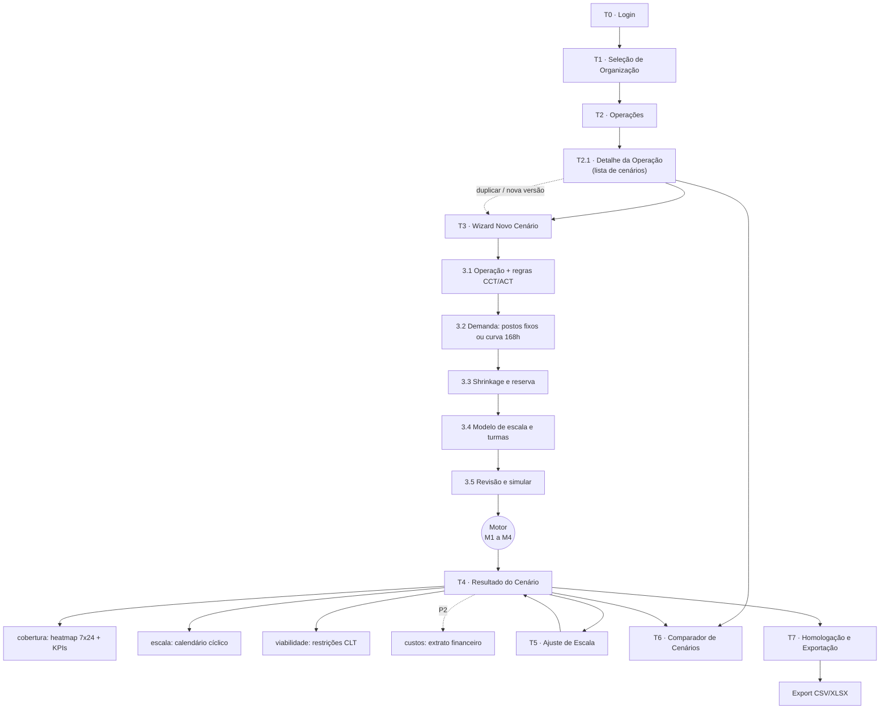
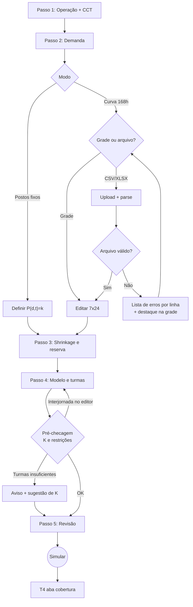
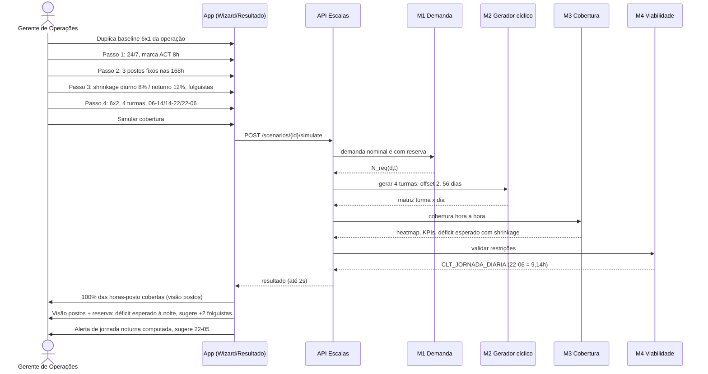
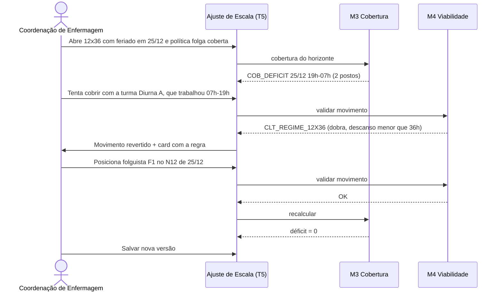
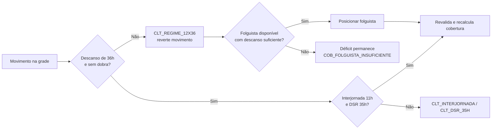
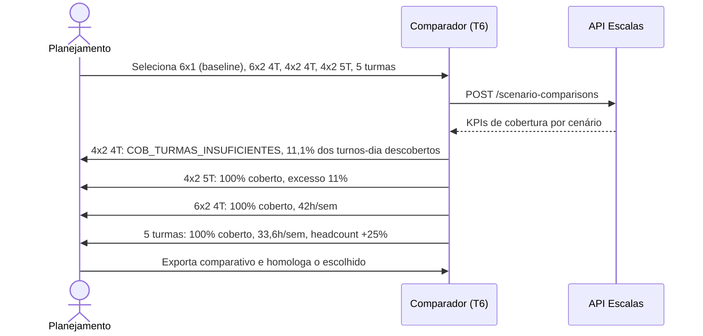
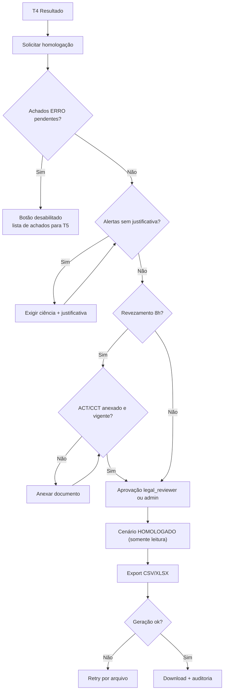

# 03 — Fluxo do App: Sitemap, Telas e Fluxos de Usuário

> Simulador Operacional de Cobertura 24/7 — CLT Brasil
> Fonte: `01-PRD.md` (PRD v3.1; IDs FR-xx canônicos). Este documento descreve navegação, telas, estados e fluxos (felizes, de erro e edge cases). O núcleo é **cobertura**: a tela de resultado abre no heatmap; viabilidade CLT é um painel de restrições; custos são módulo P2 (fase futura).

---

## 1. Mapa de Navegação (Sitemap)

Navegação global (header): Organização ▸ Operação ▸ Cenário (breadcrumb), troca de organização, menu do usuário.

| Rota | Tela | Endpoint principal (`05-esquema-backend.md` §5.4, base `/api/v1/escalas`) |
|---|---|---|
| `/login` | T0 | `POST /auth/login` |
| `/orgs` | T1 | `GET /me` |
| `/o/:org/operacoes` | T2 | `GET /operations` |
| `/o/:org/operacoes/:op` | T2.1 | `GET /scenarios?operation_id=` |
| `/o/:org/operacoes/:op/cenarios/novo?passo=1..5` | T3 | `POST /scenarios`, `PATCH /scenarios/{id}` |
| `/o/:org/operacoes/:op/cenarios/:id/:aba` (aba ∈ `cobertura` (padrão), `escala`, `viabilidade`, `custos`*) | T4 | `GET /scenarios/{id}/coverage`, `/assignments`, `/compliance-findings`, `/financials`* |
| `/o/:org/operacoes/:op/cenarios/:id/ajustar` | T5 | `PATCH /scenarios/{id}/assignments/{aid}` |
| `/o/:org/operacoes/:op/comparar?ids=...` | T6 | `POST /scenario-comparisons` |
| `/o/:org/operacoes/:op/cenarios/:id/homologar` | T7 | `POST /scenarios/{id}/approve`, `POST /scenarios/{id}/exports` |

\* `custos` e `/financials` só existem quando o Módulo 6 (P2) for implementado.

---

## 2. Convenções de Estados

| Estado | Padrão visual |
|---|---|
| **Vazio** | Ilustração + texto explicativo + CTA primário. |
| **Carregando** | Skeleton; para cálculo, progresso por módulo do motor (M1 Demanda → M2 Gerador → M3 Cobertura → M4 Viabilidade). NFR-01: ≤ 2 s; acima de 2 s exibe progresso; acima de 15 s oferece "continuar em segundo plano". |
| **Erro** | Banner com mensagem acionável + "Tentar novamente"; erros de validação inline; dados digitados nunca são descartados. |
| **Sucesso** | Toast (3–5 s) e/ou transição. |

Status do cenário (enum `scenario_status`, `05` §3.1): `rascunho`, `calculando`, `calculado`, `em_revisao`, `homologado`, `arquivado`, `erro`. Um cenário `calculado` com achados `ERRO` exibe o selo **"inviável"**.

Códigos de achado exibidos (catálogo canônico: `01-PRD.md` Apêndice A), sempre com tradução humana + referência: cobertura `COB_DEFICIT`, `COB_DEFICIT_POSTO_CRITICO`, `COB_EXCESSO`, `COB_FURO_INTERVALO`, `COB_DEFICIT_ESPERADO_SHRINKAGE`, `COB_TURMAS_INSUFICIENTES`, `COB_FOLGUISTA_INSUFICIENTE`; viabilidade `CLT_INTERJORNADA`, `CLT_DSR_35H`, `CLT_SETIMO_DIA`, `CLT_DOMINGO_PERIODICIDADE`, `CLT_REVEZAMENTO_6H`, `CLT_REGIME_12X36`, `CLT_JORNADA_DIARIA`, `CLT_MEDIA_SEMANAL`, `CLT_INTRAJORNADA`, `INFO_DIVERGENCIA_59A_SUMULA60`.

Severidades: **ERRO** (escala inviável; impede homologação), **ALERTA** (exige ciência/justificativa), **INFO**.

Papéis (enum `member_role`, `05` §3.1): `owner`, `admin`, `planner` (planejador), `legal_reviewer` (Jurídico/BP — homologa e dispensa achados), `viewer`.

---

## 3. Telas

### T0 · Login
- **Componentes:** e-mail, senha, "Entrar", "Esqueci a senha", SSO (opcional).
- **Estados:** carregando (spinner, campos travados); erro (credenciais inválidas — mensagem genérica; bloqueio após N tentativas; falha de rede).
- **Transições:** 1 organização → T2; > 1 → T1; sessão expirada → T0 com `?next=`.

### T1 · Seleção de Organização
- Lista de organizações com papel do usuário; "lembrar escolha". Vazio: "Você não pertence a nenhuma organização — solicite convite". → T2.

### T2 · Operações
- **Objetivo:** listar operações (planta, hospital, CD, NOC).
- **Dados:** nome, setor, regime (24/7 ou não), nº de cenários, cenário homologado vigente, **% de cobertura do homologado**, headcount, última atualização.
- **Ações:** criar/editar/arquivar operação; abrir T2.1.
- **Validações:** nome único na org; setor obrigatório (define a regra de folga dominical — FR-17).

### T2.1 · Detalhe da Operação
- Lista de cenários (status §2, % cobertura, horas-posto em déficit, headcount, selo "inviável"), checkbox para comparar (2–5), "Novo cenário", "Duplicar".
- Vazio: "Nenhum cenário. Comece pelo baseline 6x1." Comparar desabilitado com < 2 selecionados.

### T3 · Wizard de Novo Cenário
Stepper de 5 passos com autosalvamento; "Voltar" preserva dados; "Simular" só no passo 5. Painel lateral "Resumo" mostra demanda total (horas-posto/semana) e **estimativa de turmas/headcount** (FR-08) ao vivo.

#### 3.1 Operação e regras (CCT/ACT)
- **Componentes:** regime (Contínuo 24/7 | janela fixa); setor; CCT/ACT (sindicato, vigência); **checkbox "ACT/CCT autoriza 8 h em turnos ininterruptos de revezamento"** (FR-18); `N` de folga dominical (FR-17); calendário de feriados + política em feriado (FR-12); data inicial do horizonte.
- **Validações:** revezamento > 6 h sem checkbox → `CLT_REVEZAMENTO_6H` exibido como aviso (não bloqueia o avanço; o cenário sairá com ALERTA); CCT vencida → alerta.

#### 3.2 Demanda
- **Postos fixos** (FR-02): `P(d,t)=k` por faixa; atalho "igual em todas as 168 h"; marcação de **posto crítico**.
- **Curva 168 h** (FR-01): grade 7×24 editável (colar do Excel, arrastar, copiar dia), upload CSV/XLSX com template. Erlang-C/UPH (FR-04) aparece desabilitado com selo "Fase 2".
- **Validações:** inteiros ≥ 0; 168 células; ≥ 1 célula > 0.
- **Erros de upload:** formato não suportado; > 5 MB; cabeçalho ausente; ≠ 168 linhas (formato longo) ou ≠ 7×24; não numérico/negativo (lista "linha X" e destaca no grid); separador decimal; XLSX com várias abas (perguntar qual).

#### 3.3 Shrinkage e reserva
- **Componentes:** % diurno e % noturno (FR-03), opcional por componente (absenteísmo, férias, treinamento); faixa noturna 22h–05h exibida; **estratégia de reserva** (FR-11, FR-13): "pessoas extras por turma" | "turma de folguistas" | "nenhuma (só visualizar risco)".
- **Validações:** 0 ≤ % < 60; alerta informativo se > 40%.
- **Dados exibidos:** demanda nominal vs. demanda bruta com reserva, ao vivo.

#### 3.4 Modelo de escala e turmas
- **Componentes:** cards do catálogo MVP — **6x1 (baseline), 12x36, 6x2, 4x2, 5 turmas** (3x1, 3x2, 5x2, 4x3 e Personalizado avançado com selo "Fase 2"; Personalizado básico FR-07 é P1). Cada card mostra turnos/dia, padrão, **K necessário**, h/sem média e ciclo calendário (`01` §6). Campos: nº de turmas (A, B, C…), horários dos turnos, **intervalo intrajornada** (computado com rendição | não computado sem rendição | coberto por volantes — FR-10), nº de folguistas (ou "calcular mínimo").
- **Pré-checagem (antes de simular):**
  - `K` informado < `K` necessário → `COB_TURMAS_INSUFICIENTES` com sugestão (ex.: 4x2 → 5 turmas ou 9 meias-turmas). Permite seguir para ver o déficit.
  - Personalizado com transição < 11 h → `CLT_INTERJORNADA` já no editor; sem folga ≥ 35 h → `CLT_DSR_35H`.
- **Recomendação:** selo "Recomendado" no modelo com menor headcount que zera o déficit sem `ERRO`.

#### 3.5 Revisão e simular
- Resumo de todos os passos + seção recolhida **"Parâmetros de custo (opcional — Fase 2)"**, desabilitada no MVP.
- **Ação:** "Simular cobertura" → processamento → T4 (aba `cobertura`).

#### Fluxo do wizard

### T4 · Resultado do Cenário
- **Objetivo:** mostrar **se a operação está coberta**, onde estão os furos e o que é preciso para fechá-los.
- **Cabeçalho de KPIs (FR-14):** % horas-posto cobertas · horas-posto em déficit · pico de subcobertura (dia/hora) · headcount (atual / mínimo) · turmas (atual / necessárias) · furos no intervalo · violações ERRO/ALERTA. Ações: "Ajustar escala", "Comparar", "Duplicar", "Recalcular", "Homologar".
  - **Aba `cobertura` (padrão; FR-09, FR-10, FR-11, FR-12):** heatmap 7×24 de **déficit / exato / excesso**; alternância **"postos" | "postos + reserva"** e **"pior caso" | "média"** do horizonte; filtro por posto; camada "furos no intervalo"; tooltip com demanda, cobertura, diferença, turmas presentes e feriado; lista "Top 10 horas em déficit"; card **"Como fechar o déficit"** (ex.: "+1 turma", "+2 folguistas", "trocar para 5 turmas") (FR-08, FR-13). Clique em célula de déficit → T5 filtrado.
  - **Aba `escala` (FR-21):** calendário turma × dia do ciclo calendário completo (`mmc(L,7)`: 14/56/42/70/7 dias), códigos M/T/N/D/N12/F, domingos e feriados destacados, folguistas como linha própria, marcadores de déficit/violação.
  - **Aba `viabilidade` (FR-15–FR-20):** restrições agrupadas por severidade com código, regra, fonte normativa, turma/data, "Ver no calendário" / "Corrigir".
  - **Aba `custos` (P2, FR-25–27):** oculta no MVP.
- **Estados:** carregando (progresso M1→M4); rascunho não calculado → "Simular agora"; inviável (sem escala sem `ERRO` para os parâmetros) → "Não há escala viável com N turmas: aumente turmas, reduza postos ou troque o modelo" + atalho para 3.4; timeout → reprocessar.
- **Transições:** → T5, T6, T7, T3 (editar parâmetros cria nova versão).

### T5 · Ajuste de Escala
- **Objetivo:** ajustar a escala gerada **por turma × dia** (MVP; por colaborador na Fase 2): trocar turno, mover folga, posicionar folguista, convocar turma de folga em feriado.
- **Componentes:** grade Turma × Dia (arrastar ou teclado), painel ao vivo com **delta de cobertura** (horas-posto em déficit antes/depois) e restrições, desfazer/refazer, "Salvar como nova versão".
- **Validação em tempo real (≤ 300 ms):** recalcula cobertura (M3) e restrições (M4): `CLT_INTERJORNADA`, `CLT_REGIME_12X36`, `CLT_DSR_35H`, `CLT_SETIMO_DIA`, `CLT_DOMINGO_PERIODICIDADE`, `CLT_JORNADA_DIARIA`.
- **Estados:** conflito de edição concorrente (ETag/`If-Match`) → recarregar/mesclar; erro de salvamento mantém alterações locais.

### T6 · Comparador de Cenários
- **Objetivo:** comparar até 5 cenários pela **cobertura e headcount** (FR-22), ex.: baseline 6x1 · 12x36 · 6x2 (4T) · 4x2 (5T) · 5 turmas.
- **Linhas:** turmas; headcount sem/com reserva; h/sem média por pessoa; % horas-posto cobertas; horas-posto em déficit; pico de subcobertura; excesso (%); furos no intervalo; violações ERRO/ALERTA; delta vs. baseline; melhor valor marcado ★ + texto. Linhas de custo aparecem apenas com o Módulo 6 (P2).
- **Validações:** mesma operação e mesma demanda (senão aviso "bases distintas"); cenários desatualizados → recalcular; inviáveis com tarja.
- **Ações:** exportar comparativo (XLSX), abrir cenário, homologar o escolhido.

### T7 · Homologação e Exportação
- **Checklist:** 0 achados `ERRO` (ou dispensados por `legal_reviewer` com justificativa); alertas com ciência; ACT/CCT anexado se revezamento 8 h; aprovação.
- **Exportações (FR-23):** XLSX com abas `Escala`, `Cobertura168h`, `KPIs`, `Violacoes`, `Parametros`; CSV por aba. Layouts WFM/AFDT/ACJEF e calendário pessoal: **Fase 2/3**.
- **Validações:** "Homologar" desabilitado com `ERRO` pendente; cenário homologado é somente leitura (alterações geram nova versão).

---

## 4. Fluxos por cenário de uso

### 4.1 Cenário 1 — Planta industrial: 6x1 → 6x2 com 4 turmas

### 4.2 Cenário 2 — Hospital 12x36: furo em feriado e folguista

### 4.3 Cenário 3 — Quantas turmas preciso? (4x2 vs. 5 turmas vs. 6x2)

> O antigo fluxo "breakeven da 5ª turma" (custo) pertence ao Módulo 6 (P2, FR-27) e será reintroduzido quando o módulo existir.

---

## 5. Fluxo de Homologação e Exportação

---

## 6. Fluxos de Erro e Edge Cases (consolidado)

| # | Situação | Tela | Comportamento |
|---|---|---|---|
| E1 | Sessão expira durante wizard | T3 | Rascunho autosalvo; volta ao mesmo passo após login. |
| E2 | CSV/XLSX malformado | 3.2 | Relatório por linha; nada é importado parcialmente. |
| E3 | Demanda toda zero | 3.2 | Bloqueia avanço: "informe ao menos um posto". |
| E4 | Revezamento > 6 h sem ACT | 3.1/T4 | `CLT_REVEZAMENTO_6H` (ALERTA; ERRO se > 8 h). |
| E5 | ACT/CCT vencido | 3.1/T7 | Alerta no resultado; bloqueia homologação até atualizar. |
| E6 | Personalizado com interjornada < 11 h | 3.4/T5 | `CLT_INTERJORNADA` com par de turnos destacado. |
| E7 | Nº de turmas < K necessário (ex.: 4x2 com 4) | 3.4/T4 | `COB_TURMAS_INSUFICIENTES` + heatmap com déficit + sugestão de K. |
| E8 | Intervalo não computado sem rendição | T4 | `COB_FURO_INTERVALO`; camada "furos no intervalo"; sugestão de volantes. |
| E9 | Feriado com política "folga coberta" e sem folguistas | T4 | `COB_DEFICIT` com contexto "feriado"; sugestão de folguistas. |
| E10 | Shrinkage derruba cobertura esperada | T4 | `COB_DEFICIT_ESPERADO_SHRINKAGE` na visão "postos + reserva". |
| E11 | Déficit em posto crítico | T4/T7 | `COB_DEFICIT_POSTO_CRITICO` (ERRO) bloqueia homologação. |
| E12 | Nenhuma escala viável sem `ERRO` | T4 | Mensagem explicativa + K mínimo teórico. |
| E13 | Cálculo > 2 s / timeout | T4 | Progresso; segundo plano (job); retry. |
| E14 | Edição concorrente | T5 | Detecção por `ETag`; recarregar ou mesclar. |
| E15 | Comparar cenários com demandas diferentes | T6 | Aviso de base distinta. |
| E16 | Editar cenário homologado | T4/T5 | Somente leitura; "Criar nova versão". |
| E17 | Usuário sem permissão de aprovar | T7 | Botão oculto; "Solicitar aprovação a…". |
| E18 | Perda de conexão ao salvar ajuste | T5 | Estado local mantido, retry, indicador "não salvo". |

---

## 7. Rastreabilidade

| Requisito (`01-PRD.md`) | Telas |
|---|---|
| FR-01/02 Curva 168 h / postos fixos | 3.2 |
| FR-03 Shrinkage D/N | 3.3 |
| FR-04 Erlang-C (P2) | 3.2 (desabilitado) |
| FR-05/06/07 Turmas, gerador, rotação customizada | 3.4, T4 `escala` |
| FR-08 Dimensionamento K/headcount | painel Resumo T3, 3.4, T4 card "Como fechar o déficit" |
| FR-09 Cobertura e heatmap | T4 `cobertura`, T2.1 |
| FR-10 Furos no intervalo | 3.4, T4 `cobertura` |
| FR-11 Cobertura com shrinkage | 3.3, T4 `cobertura` |
| FR-12 Folgas e feriados | 3.1, T4 `cobertura`/`escala`, T5 |
| FR-13 Folguistas/volantes | 3.3, 3.4, T4, T5 |
| FR-14 KPIs de cobertura | cabeçalho T4, T6 |
| FR-15–FR-20 Viabilidade CLT | 3.1, 3.4, T4 `viabilidade`, T5 |
| FR-21 Calendário cíclico | T4 `escala` |
| FR-22 Comparador operacional | T6 |
| FR-23 Export | T7 |
| FR-24 Salvar/duplicar/versionar | T2.1, T3, T5 |
| FR-25–27 Financeiro (P2) | T4 `custos`, 3.5 (oculto no MVP) |
| NFR-01/03/06 | T4 (desempenho, auditoria, acessibilidade) |
