# 05 — Esquema de Backend: Simulador de Escalas 24/7 (CLT Brasil)

> Base: `01-PRD.md` (PRD v3.4 — regime legal versionado / fim da 6x1, FR-39–42; v3.3 — MVP enxuto em 4 sprints; v3.2 — simulador operacional de cobertura; IDs FR-xx canônicos) e `02-TRD.md` (módulos M1–M6). **Este documento é a fonte da verdade de tabelas e endpoints.** Backend alvo: o FastAPI existente em `backend/` (hoje `app/main.py`, `app/api/v1/escalas/endpoints/atas.py`, `app/schemas/ata.py`, `app/services/ata_excel_service.py`). O simulador entra como um **novo módulo** sob o prefixo **`/api/v1/escalas`**, sem quebrar o router `atas` (`/api/v1/atas`).

> **Corte do MVP (v3.3 — `06` §3.3):** cada `CREATE TABLE` traz o comentário `-- [MVP]` ou `-- [Fase 2]`, e cada endpoint da §5.4 começa com **MVP** ou *Fase 2*/*P2*. Tabelas **MVP:** `organizations`, `users`, `memberships`, `labor_agreements` (mínima), `operations`, `positions`, `demand_curves`, `demand_slots`, `shrinkage_profiles`, `shift_templates`, `schedule_models` (seeds só dos 10 modelos essenciais), `rotation_patterns`, `scenarios`, `scenario_shift_templates`, `teams`, `assignments` (por turma), `coverage_results`, `compliance_rules`, `compliance_findings`, **`legal_regimes` (v3.4, §3.13)**, `roles`, `team_constraints` (modo `fixo` por operação; `minimo` → Fase 2 na v3.4), `substitution_rules` (fator 1,0), `role_coverage_requirements` (mínimo por cargo), `team_role_composition`, `coverage_role_results`. RLS em todas (`legal_regimes` é catálogo global somente leitura). *(v3.4: `custom_schedule_patterns` passa a Fase 2 junto com o construtor básico.)* Simulação **síncrona** (§7 Celery = Fase 2). Colunas existentes que só servem à Fase 2 (folguistas, feriados, camadas, versões) permanecem no DDL com default neutro.

## Sumário
1. Princípios de modelagem
2. Diagrama ER (mermaid)
3. DDL PostgreSQL completo
4. Multi-tenancy com RLS
5. Contratos da API REST
6. Estrutura de pastas FastAPI
7. Jobs assíncronos
8. Versionamento (API, cenários, motor, regras)

---

## 1. Princípios de modelagem

| Decisão | Motivo (PRD) |
|---|---|
| PK `bigint GENERATED ALWAYS AS IDENTITY` + `public_id uuid` exposto na API | IDs sequenciais indexam bem; UUID evita enumeração externa. |
| `NUMERIC(18,6)` em toda grandeza de hora, FTE, percentual e dinheiro intermediário | NFR-02: 6 casas antes do arredondamento contábil. Valores finais contábeis também guardados em `NUMERIC(18,2)`. |
| Percentuais em fração (`0.200000` = 20%) | Evita ambiguidade 20 vs 0.20. CHECK de faixa. |
| `organization_id` em **toda** tabela de domínio + RLS | Multi-tenant seguro mesmo com bug na camada de aplicação. |
| `JSONB` só para dados semiestruturados/versionáveis: parâmetros do motor, padrões de rotação, detalhes de findings, snapshot de entradas, breakdown financeiro | Estruturas que mudam com o motor; o que é filtrado/agregado fica em colunas. |
| Slots de demanda normalizados (`demand_slots`) **e** opcionalmente `values numeric[]` no cabeçalho | 168 (1h) ou 336 (30 min) slots; tabela permite heatmap/SQL, array permite carga rápida. Fonte da verdade = `demand_slots`. |
| `timestamptz` sempre; datas civis em `date` com `timezone` da operação | Turno T3 cruza meia-noite; DST não existe no BR atual, mas guardamos tz. |
| Cenário calculado/homologado é **imutável** (trigger) | Auditoria trabalhista: o que foi homologado não muda; edita-se criando nova versão. |
| Soft delete (`deleted_at`) apenas em cadastros; resultados nunca são apagados, só cenário inteiro arquivado | Rastreabilidade. |

Convenções: tabelas em `snake_case` plural; enums como tipos PostgreSQL (`CREATE TYPE`) para estados estáveis; códigos de regra em `text` com CHECK de formato (catálogo evolui).

---

## 2. Diagrama ER

```mermaid
erDiagram
    organizations ||--o{ memberships : tem
    users ||--o{ memberships : participa
    organizations ||--o{ labor_agreements : negocia
    organizations ||--o{ operations : possui
    operations ||--o{ positions : define
    labor_agreements ||--o{ operations : "rege (padrão)"
    positions ||--o{ demand_curves : "tem curvas"
    demand_curves ||--o{ demand_slots : "168/336 slots"
    organizations ||--o{ shrinkage_profiles : calibra
    organizations ||--o{ shift_templates : cadastra
    schedule_models ||--o{ rotation_patterns : "padrões base"
    organizations ||--o{ employees : emprega
    operations ||--o{ scenarios : simula
    legal_regimes ||--o{ scenarios : "regime legal (v3.4)"
    legal_regimes ||--o{ legal_regimes : "supersedes (nova versão)"
    scenarios ||--o{ scenarios : "parent_version"
    scenarios }o--|| schedule_models : usa
    scenarios }o--|| labor_agreements : "snapshot de regras"
    scenarios }o--o| shrinkage_profiles : aplica
    scenarios }o--|| demand_curves : dimensiona
    scenarios ||--o{ scenario_shift_templates : "turnos usados"
    shift_templates ||--o{ scenario_shift_templates : ""
    scenarios ||--o{ teams : "turmas A..F"
    scenarios ||--|| rotation_patterns : "matriz cíclica"
    teams ||--o{ team_members : compõe
    employees ||--o{ team_members : ""
    scenarios ||--o{ assignments : gera
    teams ||--o{ assignments : ""
    employees ||--o{ assignments : ""
    shift_templates ||--o{ assignments : ""
    scenarios ||--o{ compliance_findings : valida
    scenarios ||--o{ coverage_results : "heatmap 168h"
    scenarios ||--|| financial_results : custeia
    scenario_comparisons ||--o{ scenario_comparison_items : compara
    scenarios ||--o{ scenario_comparison_items : ""
    scenarios ||--o{ simulation_jobs : processa
    scenarios ||--o{ exports : exporta
    organizations ||--o{ audit_log : registra
    organizations ||--o{ roles : "cargos (v3.2)"
    organizations ||--o{ skills : habilidades
    roles ||--o{ role_skills : ""
    skills ||--o{ role_skills : ""
    positions ||--o{ position_skills : "exige certificação"
    employees ||--o{ employee_skills : "Fase 2"
    roles ||--o{ substitution_rules : "cobre A→B"
    roles ||--o{ positions : "cargo exigido"
    operations ||--o{ role_coverage_requirements : "mínimos/proporções"
    operations ||--o{ team_constraints : "K e tamanho"
    organizations ||--o{ custom_schedule_patterns : templates
    custom_schedule_patterns ||--o{ custom_schedule_pattern_versions : versões
    scenarios ||--o{ scenario_layers : "camadas (mix)"
    scenario_layers ||--o{ teams : ""
    teams ||--o{ team_role_composition : "pessoas por cargo"
    scenarios ||--o{ coverage_role_results : "cobertura por cargo"
```



---

## 3. DDL PostgreSQL completo

> PostgreSQL ≥ 15. Ordem de execução: extensões → tipos → tabelas → índices → triggers → RLS. Será dividido em migrations Alembic (`0001_core`, `0002_catalog`, `0003_scenarios`, `0004_results`, `0005_rls`).

### 3.1 Extensões, schema e tipos

```sql
CREATE EXTENSION IF NOT EXISTS pgcrypto;   -- gen_random_uuid()
CREATE EXTENSION IF NOT EXISTS citext;     -- e-mail case-insensitive
CREATE EXTENSION IF NOT EXISTS btree_gist; -- exclusão por intervalo

CREATE SCHEMA IF NOT EXISTS wss;  -- workforce shift simulator
SET search_path = wss, public;

CREATE TYPE member_role       AS ENUM ('owner','admin','planner','legal_reviewer','viewer');
CREATE TYPE scenario_status   AS ENUM ('rascunho','calculando','calculado','em_revisao','homologado','arquivado','erro');
CREATE TYPE demand_mode       AS ENUM ('postos_fixos','curva_168h','volume_uph','erlang_c');  -- volume_uph/erlang_c: Fase 2 (FR-04)
CREATE TYPE slot_granularity  AS ENUM ('60','30');            -- minutos: 168 ou 336 slots
CREATE TYPE finding_severity  AS ENUM ('info','alerta','erro');   -- erro = escala inviável / bloqueia homologação
CREATE TYPE job_status        AS ENUM ('queued','running','succeeded','failed','cancelled');
CREATE TYPE export_format     AS ENUM ('xlsx','csv','pdf','totvs_rm','totvs_protheus','senior_ronda','adp','sap_sf','afdt','acjef');  -- MVP: xlsx, csv (FR-23); demais Fase 2/3
CREATE TYPE break_policy      AS ENUM ('computado_rendicao','nao_computado','volante');  -- FR-10
CREATE TYPE team_kind         AS ENUM ('regular','folguista');                           -- FR-13
CREATE TYPE holiday_policy    AS ENUM ('escala_normal','folga_coberta');                 -- FR-12
CREATE TYPE sunday_rule_basis AS ENUM ('lei_10101_comercio','lei_605_1949','portaria_mte','cct_especifica');
```

### 3.2 Núcleo: organizações, usuários, papéis

```sql
CREATE TABLE organizations (   -- [MVP]
  id           bigint GENERATED ALWAYS AS IDENTITY PRIMARY KEY,
  public_id    uuid NOT NULL DEFAULT gen_random_uuid() UNIQUE,
  name         text NOT NULL CHECK (length(name) BETWEEN 2 AND 200),
  cnpj         char(14) UNIQUE CHECK (cnpj ~ '^\d{14}$'),
  timezone     text NOT NULL DEFAULT 'America/Sao_Paulo',
  settings     jsonb NOT NULL DEFAULT '{}'::jsonb,
  created_at   timestamptz NOT NULL DEFAULT now(),
  updated_at   timestamptz NOT NULL DEFAULT now(),
  deleted_at   timestamptz
);

CREATE TABLE users (   -- [MVP]
  id            bigint GENERATED ALWAYS AS IDENTITY PRIMARY KEY,
  public_id     uuid NOT NULL DEFAULT gen_random_uuid() UNIQUE,
  email         citext NOT NULL UNIQUE,
  full_name     text NOT NULL,
  password_hash text,                          -- NULL quando SSO
  is_superuser  boolean NOT NULL DEFAULT false,
  last_login_at timestamptz,
  created_at    timestamptz NOT NULL DEFAULT now(),
  updated_at    timestamptz NOT NULL DEFAULT now(),
  deleted_at    timestamptz
);

CREATE TABLE memberships (   -- [MVP]
  id              bigint GENERATED ALWAYS AS IDENTITY PRIMARY KEY,
  organization_id bigint NOT NULL REFERENCES organizations(id) ON DELETE CASCADE,
  user_id         bigint NOT NULL REFERENCES users(id) ON DELETE CASCADE,
  role            member_role NOT NULL DEFAULT 'viewer',
  operation_scope bigint[],                    -- NULL = todas as operações
  created_at      timestamptz NOT NULL DEFAULT now(),
  UNIQUE (organization_id, user_id)
);
CREATE INDEX ix_memberships_user ON memberships (user_id);
```

### 3.3 Acordos coletivos (CCT/ACT)

```sql
CREATE TABLE labor_agreements (   -- [MVP]
  id                        bigint GENERATED ALWAYS AS IDENTITY PRIMARY KEY,
  public_id                 uuid NOT NULL DEFAULT gen_random_uuid() UNIQUE,
  organization_id           bigint NOT NULL REFERENCES organizations(id) ON DELETE CASCADE,
  name                      text NOT NULL,                     -- "CCT Metalúrgicos SP 2026/2027"
  kind                      text NOT NULL CHECK (kind IN ('CLT_PADRAO','CCT','ACT')),
  union_name                text,
  registration_number       text,                              -- Mediador MTE
  valid_from                date NOT NULL,
  valid_to                  date,
  -- Adicionais (fração) — usados só pelo M6 financeiro (P2)
  night_premium_pct         numeric(18,6) NOT NULL DEFAULT 0.200000
                            CHECK (night_premium_pct BETWEEN 0.200000 AND 1.000000), -- mín. legal 20% urbano
  night_start               time NOT NULL DEFAULT '22:00',
  night_end                 time NOT NULL DEFAULT '05:00',
  night_hour_factor         numeric(18,6) NOT NULL DEFAULT 1.142857, -- só exibição; motor usa Fraction(8,7) exato (FR-20, NFR-02)
  apply_sumula_60           boolean NOT NULL DEFAULT true,          -- prorrogação noturna (FR-20, Q3/Q4)
  overtime_pct              numeric(18,6) NOT NULL DEFAULT 0.500000 CHECK (overtime_pct >= 0.500000),
  overtime_sunday_pct       numeric(18,6) NOT NULL DEFAULT 1.000000 CHECK (overtime_sunday_pct >= 0),
  hazard_pct                numeric(18,6) NOT NULL DEFAULT 0 CHECK (hazard_pct BETWEEN 0 AND 1),     -- periculosidade
  unhealthy_pct             numeric(18,6) NOT NULL DEFAULT 0 CHECK (unhealthy_pct BETWEEN 0 AND 1),  -- insalubridade
  social_charges_pct        numeric(18,6) NOT NULL DEFAULT 0.680000 CHECK (social_charges_pct >= 0),
  -- Jornada
  weekly_hours_limit        numeric(18,6) NOT NULL DEFAULT 44.000000,
  daily_overtime_max_hours  numeric(18,6) NOT NULL DEFAULT 2.000000,
  allows_8h_rotating        boolean NOT NULL DEFAULT false,         -- Art. 7º XIV CF (FR-18)
  allows_12x36              boolean NOT NULL DEFAULT true,          -- Art. 59-A CLT
  min_interjornada_hours    numeric(18,6) NOT NULL DEFAULT 11.000000 CHECK (min_interjornada_hours >= 11),
  min_weekly_rest_hours     numeric(18,6) NOT NULL DEFAULT 35.000000, -- 24h DSR + 11h (FR-16)
  -- Domingo
  sunday_rule_basis         sunday_rule_basis NOT NULL DEFAULT 'lei_605_1949',
  sunday_off_max_interval_weeks smallint NOT NULL DEFAULT 7 CHECK (sunday_off_max_interval_weeks BETWEEN 1 AND 12), -- N de FR-17
  holiday_calendar          text NOT NULL DEFAULT 'BR-NACIONAL',     -- ex. 'BR-SP-SAO_PAULO'
  extra_rules               jsonb NOT NULL DEFAULT '{}'::jsonb,      -- cláusulas não modeladas
  rules_version             integer NOT NULL DEFAULT 1,
  created_at                timestamptz NOT NULL DEFAULT now(),
  updated_at                timestamptz NOT NULL DEFAULT now(),
  deleted_at                timestamptz,
  CHECK (valid_to IS NULL OR valid_to >= valid_from)
);
CREATE INDEX ix_labor_agreements_org ON labor_agreements (organization_id) WHERE deleted_at IS NULL;
```

### 3.4 Operações, postos, demanda, shrinkage

```sql
CREATE TABLE operations (   -- [MVP]
  id                   bigint GENERATED ALWAYS AS IDENTITY PRIMARY KEY,
  public_id            uuid NOT NULL DEFAULT gen_random_uuid() UNIQUE,
  organization_id      bigint NOT NULL REFERENCES organizations(id) ON DELETE CASCADE,
  name                 text NOT NULL,                       -- "CD Cajamar", "UTI Adulto"
  sector               text NOT NULL CHECK (sector IN ('saude','logistica','industria','varejo','ti_noc','contact_center','saneamento','outro')),
  is_24x7              boolean NOT NULL DEFAULT true,
  timezone             text NOT NULL DEFAULT 'America/Sao_Paulo',
  city_ibge_code       char(7),                             -- feriados municipais
  default_agreement_id bigint REFERENCES labor_agreements(id),
  created_at           timestamptz NOT NULL DEFAULT now(),
  updated_at           timestamptz NOT NULL DEFAULT now(),
  deleted_at           timestamptz,
  UNIQUE (organization_id, name)
);
CREATE INDEX ix_operations_agreement ON operations (default_agreement_id);

CREATE TABLE positions (                                   -- [MVP] postos de trabalho
  id                 bigint GENERATED ALWAYS AS IDENTITY PRIMARY KEY,
  public_id          uuid NOT NULL DEFAULT gen_random_uuid() UNIQUE,
  organization_id    bigint NOT NULL REFERENCES organizations(id) ON DELETE CASCADE,
  operation_id       bigint NOT NULL REFERENCES operations(id) ON DELETE CASCADE,
  name               text NOT NULL,                        -- "Operador de Caldeira"
  cbo_code           char(6),
  base_salary        numeric(18,6) CHECK (base_salary > 0),        -- opcional; usado só pelo M6 (P2)
  monthly_hours      numeric(18,6) NOT NULL DEFAULT 220.000000 CHECK (monthly_hours > 0), -- CargaMensal
  hazard_applies     boolean NOT NULL DEFAULT false,
  unhealthy_applies  boolean NOT NULL DEFAULT false,
  is_mandatory_presence boolean NOT NULL DEFAULT false,   -- posto crítico: déficit gera COB_DEFICIT_POSTO_CRITICO (FR-02)
  created_at         timestamptz NOT NULL DEFAULT now(),
  updated_at         timestamptz NOT NULL DEFAULT now(),
  deleted_at         timestamptz,
  UNIQUE (operation_id, name)
);
CREATE INDEX ix_positions_org_op ON positions (organization_id, operation_id);

CREATE TABLE demand_curves (   -- [MVP]
  id               bigint GENERATED ALWAYS AS IDENTITY PRIMARY KEY,
  public_id        uuid NOT NULL DEFAULT gen_random_uuid() UNIQUE,
  organization_id  bigint NOT NULL REFERENCES organizations(id) ON DELETE CASCADE,
  position_id      bigint NOT NULL REFERENCES positions(id) ON DELETE CASCADE,
  name             text NOT NULL,
  mode             demand_mode NOT NULL,
  granularity      slot_granularity NOT NULL DEFAULT '60',
  -- parâmetros do modo (UPH, TMA, nível de serviço, tempo-alvo) - FR-04 (Fase 2)
  params           jsonb NOT NULL DEFAULT '{}'::jsonb,
  source           text NOT NULL DEFAULT 'manual' CHECK (source IN ('manual','upload_csv','upload_xlsx','api')),
  checksum         char(64),                               -- sha256 dos slots (cache do motor)
  version          integer NOT NULL DEFAULT 1,
  created_by       bigint REFERENCES users(id),
  created_at       timestamptz NOT NULL DEFAULT now(),
  updated_at       timestamptz NOT NULL DEFAULT now(),
  deleted_at       timestamptz
);
CREATE INDEX ix_demand_curves_position ON demand_curves (organization_id, position_id);

CREATE TABLE demand_slots (   -- [MVP]
  organization_id  bigint NOT NULL REFERENCES organizations(id) ON DELETE CASCADE,
  demand_curve_id  bigint NOT NULL REFERENCES demand_curves(id) ON DELETE CASCADE,
  slot_index       smallint NOT NULL CHECK (slot_index BETWEEN 0 AND 335),  -- 0 = seg 00:00
  weekday          smallint NOT NULL CHECK (weekday BETWEEN 1 AND 7),       -- ISO: 1=seg, 7=dom
  start_minute     smallint NOT NULL CHECK (start_minute BETWEEN 0 AND 1439),
  required_value   numeric(18,6) NOT NULL CHECK (required_value >= 0),     -- postos, volume ou chamadas
  is_night         boolean NOT NULL,                                       -- slot ∩ [22h,05h)
  PRIMARY KEY (demand_curve_id, slot_index)
);
-- Coerência slot ↔ granularidade é validada por trigger (slot_index < 168 quando granularity='60').

CREATE TABLE shrinkage_profiles (                         -- [MVP] FR-03, FR-11
  id               bigint GENERATED ALWAYS AS IDENTITY PRIMARY KEY,
  public_id        uuid NOT NULL DEFAULT gen_random_uuid() UNIQUE,
  organization_id  bigint NOT NULL REFERENCES organizations(id) ON DELETE CASCADE,
  operation_id     bigint REFERENCES operations(id) ON DELETE CASCADE,
  name             text NOT NULL,
  day_pct          numeric(18,6) NOT NULL CHECK (day_pct   >= 0 AND day_pct   < 0.6),
  night_pct        numeric(18,6) NOT NULL CHECK (night_pct >= 0 AND night_pct < 0.6),
  breakdown        jsonb NOT NULL DEFAULT '{}'::jsonb,  -- {"absenteismo":0.05,"ferias":0.083,"treinamento":0.01,...}
  created_at       timestamptz NOT NULL DEFAULT now(),
  updated_at       timestamptz NOT NULL DEFAULT now(),
  deleted_at       timestamptz
);
```

### 3.5 Catálogos: turnos, modelos de escala, padrões de rotação

```sql
CREATE TABLE shift_templates (   -- [MVP]
  id                 bigint GENERATED ALWAYS AS IDENTITY PRIMARY KEY,
  public_id          uuid NOT NULL DEFAULT gen_random_uuid() UNIQUE,
  organization_id    bigint REFERENCES organizations(id) ON DELETE CASCADE, -- NULL = catálogo global
  code               text NOT NULL CHECK (code ~ '^[A-Z0-9_]{1,12}$'),     -- M,T,N,D12,N12,INT (mesmos códigos do calendário e do export)
  name               text NOT NULL,
  start_time         time NOT NULL,
  duration_minutes   smallint NOT NULL CHECK (duration_minutes BETWEEN 60 AND 1440),
  break_minutes      smallint NOT NULL DEFAULT 60 CHECK (break_minutes BETWEEN 0 AND 120),
  break_policy       break_policy NOT NULL DEFAULT 'computado_rendicao',  -- FR-10; 'nao_computado' gera COB_FURO_INTERVALO
  -- derivados, calculados na aplicação e persistidos para consulta
  night_clock_minutes  smallint NOT NULL DEFAULT 0,
  crosses_midnight   boolean GENERATED ALWAYS AS
                     ((extract(epoch FROM start_time)/60 + duration_minutes) > 1440) STORED,
  color_hex          char(7),
  created_at         timestamptz NOT NULL DEFAULT now(),
  deleted_at         timestamptz
);
CREATE UNIQUE INDEX ux_shift_templates_code ON shift_templates (COALESCE(organization_id, 0), code)
  WHERE deleted_at IS NULL;

-- Seeds globais
INSERT INTO shift_templates (organization_id, code, name, start_time, duration_minutes, break_minutes, night_clock_minutes) VALUES
 (NULL,'M','Manhã 06-14','06:00',480,60,0),
 (NULL,'T','Tarde 14-22','14:00',480,60,0),
 (NULL,'N','Noite 22-06','22:00',480,60,420),
 (NULL,'D12','Diurno 07-19','07:00',720,60,0),
 (NULL,'N12','Noturno 19-07','19:00',720,60,420),
 (NULL,'INT','Intermediário 10-18','10:00',480,60,0);

CREATE TABLE schedule_models (                            -- [MVP] v3.3: seeds MVP só dos 10 modelos essenciais; demais Fase 2 (catálogo ampliado do 01 §6.1 (colunas extras e seeds em §3.12)
  id                 bigint GENERATED ALWAYS AS IDENTITY PRIMARY KEY,
  code               text NOT NULL UNIQUE CHECK (code ~ '^[A-Z0-9_]{2,24}$'),  -- '12X36','6X2','4X2','5T','6X1_BASE'
  name               text NOT NULL,
  work_days          smallint NOT NULL CHECK (work_days > 0),
  off_days           smallint NOT NULL CHECK (off_days >= 0),
  cycle_length_days  smallint NOT NULL CHECK (cycle_length_days > 0),
  typical_teams      smallint[] NOT NULL,                  -- K necessário: 12X36 {4}, 6X2 {4}, 4X2 {5} (ou 9 meias), 5T {5}, 6X1 {4}+folguistas
  calendar_cycle_days smallint NOT NULL,                   -- mmc(L,7): 14, 56, 42, 70, 7
  daily_hours        numeric(18,6) NOT NULL,
  avg_weekly_hours   numeric(18,6) NOT NULL,               -- 12X36 42, 6X2 42, 4X2 37.333333, 5T 33.6, 6X1 48
  is_continuous_24x7 boolean NOT NULL,
  is_rotating        boolean NOT NULL,                     -- dispara FR-18
  requires_agreement boolean NOT NULL DEFAULT false,
  legal_basis        text,                                 -- 'CLT art. 59-A'
  default_params     jsonb NOT NULL DEFAULT '{}'::jsonb,
  is_active          boolean NOT NULL DEFAULT true
);

CREATE TABLE rotation_patterns (   -- [MVP]
  id                 bigint GENERATED ALWAYS AS IDENTITY PRIMARY KEY,
  public_id          uuid NOT NULL DEFAULT gen_random_uuid() UNIQUE,
  organization_id    bigint REFERENCES organizations(id) ON DELETE CASCADE, -- NULL = padrão de catálogo
  schedule_model_id  bigint NOT NULL REFERENCES schedule_models(id),
  name               text NOT NULL,
  cycle_length_days  smallint NOT NULL CHECK (cycle_length_days BETWEEN 1 AND 730),
  team_count         smallint NOT NULL CHECK (team_count BETWEEN 1 AND 12),
  -- matriz turma × dia do ciclo: {"A":["M","M","T","T","N","N","F","F"], "B":[...]}
  matrix             jsonb NOT NULL,
  team_offsets       jsonb NOT NULL DEFAULT '{}'::jsonb,  -- {"A":0,"B":2,"C":4,"D":6}
  is_generated       boolean NOT NULL DEFAULT false,      -- true = produzido pelo motor
  created_at         timestamptz NOT NULL DEFAULT now(),
  CHECK (jsonb_typeof(matrix) = 'object')
);
CREATE INDEX ix_rotation_patterns_model ON rotation_patterns (schedule_model_id);
CREATE INDEX ix_rotation_patterns_org   ON rotation_patterns (organization_id);
```

### 3.6 Colaboradores

```sql
-- Fase 2 (alocação nominal, NFR-08): no MVP a tabela existe mas não é usada; o motor trabalha por turma.
CREATE TABLE employees (   -- [Fase 2]
  id               bigint GENERATED ALWAYS AS IDENTITY PRIMARY KEY,
  public_id        uuid NOT NULL DEFAULT gen_random_uuid() UNIQUE,
  organization_id  bigint NOT NULL REFERENCES organizations(id) ON DELETE CASCADE,
  operation_id     bigint REFERENCES operations(id),
  position_id      bigint REFERENCES positions(id),
  registration     text NOT NULL,                        -- matrícula
  full_name        text NOT NULL,
  cpf_hash         char(64),                             -- LGPD: só hash, nunca CPF em claro
  pis_hash         char(64),
  contract_weekly_hours numeric(18,6) NOT NULL DEFAULT 44.000000,
  base_salary      numeric(18,6),                        -- sobrepõe o do posto
  is_virtual       boolean NOT NULL DEFAULT false,       -- vaga a contratar (headcount simulado)
  restrictions     jsonb NOT NULL DEFAULT '{}'::jsonb,   -- {"no_night":true,"pcd":true}
  hired_at         date,
  terminated_at    date,
  created_at       timestamptz NOT NULL DEFAULT now(),
  updated_at       timestamptz NOT NULL DEFAULT now(),
  deleted_at       timestamptz,
  UNIQUE (organization_id, registration)
);
CREATE INDEX ix_employees_org_op ON employees (organization_id, operation_id) WHERE deleted_at IS NULL;
CREATE INDEX ix_employees_position ON employees (position_id);
```

### 3.7 Cenários e versionamento

```sql
CREATE TABLE scenarios (   -- [MVP]
  id                  bigint GENERATED ALWAYS AS IDENTITY PRIMARY KEY,
  public_id           uuid NOT NULL DEFAULT gen_random_uuid() UNIQUE,
  organization_id     bigint NOT NULL REFERENCES organizations(id) ON DELETE CASCADE,
  operation_id        bigint NOT NULL REFERENCES operations(id),
  lineage_id          uuid NOT NULL DEFAULT gen_random_uuid(), -- agrupa versões do mesmo cenário
  version             integer NOT NULL DEFAULT 1 CHECK (version >= 1),
  parent_scenario_id  bigint REFERENCES scenarios(id),
  name                text NOT NULL,
  description         text,
  is_baseline         boolean NOT NULL DEFAULT false,
  status              scenario_status NOT NULL DEFAULT 'rascunho',
  schedule_model_id   bigint NOT NULL REFERENCES schedule_models(id),
  labor_agreement_id  bigint NOT NULL REFERENCES labor_agreements(id),
  shrinkage_profile_id bigint REFERENCES shrinkage_profiles(id),
  demand_curve_id     bigint NOT NULL REFERENCES demand_curves(id),
  rotation_pattern_id bigint REFERENCES rotation_patterns(id),
  team_count          smallint NOT NULL CHECK (team_count BETWEEN 1 AND 12),
  horizon_start       date NOT NULL,
  horizon_weeks       smallint NOT NULL DEFAULT 8 CHECK (horizon_weeks BETWEEN 1 AND 104),
  agreement_8h_confirmed boolean NOT NULL DEFAULT false,   -- ACT/CCT autoriza 8h em revezamento (FR-18)
  holiday_policy      holiday_policy NOT NULL DEFAULT 'escala_normal', -- FR-12
  floater_count       smallint CHECK (floater_count BETWEEN 0 AND 50), -- NULL = motor calcula o mínimo (FR-13)
  params              jsonb NOT NULL DEFAULT '{}'::jsonb,   -- solver, tolerâncias, pesos
  inputs_snapshot     jsonb,          -- cópia congelada de CCT, curva, turnos no cálculo
  inputs_hash         char(64),       -- sha256 do snapshot (cache/idempotência)
  engine_version      text,           -- '1.4.0'
  rules_version       text,           -- 'compliance-2026.11'
  -- KPIs desnormalizados para listagem
  -- KPIs de cobertura desnormalizados para listagem (FR-14)
  coverage_pct        numeric(18,6),   -- % horas-posto cobertas
  deficit_post_hours  numeric(18,6),   -- horas-posto em déficit no horizonte
  peak_undercoverage  numeric(18,6),   -- maior déficit numa hora
  deficit_hours       integer,         -- nº de horas com déficit
  headcount_min       integer,         -- headcount mínimo que zera o déficit
  teams_required      numeric(18,6),   -- K*
  blocking_findings   integer NOT NULL DEFAULT 0,  -- achados severidade 'erro' não dispensados
  total_monthly_cost  numeric(18,2),   -- P2 (M6); NULL no MVP
  calculated_at       timestamptz,
  approved_at         timestamptz,
  approved_by         bigint REFERENCES users(id),
  created_by          bigint REFERENCES users(id),
  created_at          timestamptz NOT NULL DEFAULT now(),
  updated_at          timestamptz NOT NULL DEFAULT now(),
  row_version         integer NOT NULL DEFAULT 1,           -- otimistic locking (If-Match)
  UNIQUE (lineage_id, version),
  CHECK (status <> 'homologado' OR (approved_at IS NOT NULL AND approved_by IS NOT NULL AND blocking_findings = 0))
);
CREATE INDEX ix_scenarios_org_op_status ON scenarios (organization_id, operation_id, status, created_at DESC);
CREATE INDEX ix_scenarios_lineage ON scenarios (lineage_id, version DESC);
CREATE INDEX ix_scenarios_inputs_hash ON scenarios (organization_id, inputs_hash);
CREATE INDEX ix_scenarios_fks ON scenarios (schedule_model_id, labor_agreement_id, demand_curve_id);
-- Só um homologado vigente por linhagem
CREATE UNIQUE INDEX ux_scenarios_one_approved ON scenarios (lineage_id) WHERE status = 'homologado';

CREATE TABLE scenario_shift_templates (   -- [MVP]
  scenario_id       bigint NOT NULL REFERENCES scenarios(id) ON DELETE CASCADE,
  shift_template_id bigint NOT NULL REFERENCES shift_templates(id),
  organization_id   bigint NOT NULL REFERENCES organizations(id),
  PRIMARY KEY (scenario_id, shift_template_id)
);

CREATE TABLE teams (                                     -- [MVP] turmas
  id               bigint GENERATED ALWAYS AS IDENTITY PRIMARY KEY,
  organization_id  bigint NOT NULL REFERENCES organizations(id) ON DELETE CASCADE,
  scenario_id      bigint NOT NULL REFERENCES scenarios(id) ON DELETE CASCADE,
  code             text NOT NULL CHECK (code ~ '^[A-Z0-9]{1,3}$'), -- A..F; folguistas FL1..
  kind             team_kind NOT NULL DEFAULT 'regular',          -- FR-13
  label            text,                                          -- "Diurna A", "Folguista 1"
  cycle_offset_days smallint NOT NULL DEFAULT 0,
  size_required    numeric(18,6) NOT NULL DEFAULT 0,              -- FTE calculado
  size_assigned    integer NOT NULL DEFAULT 0,
  UNIQUE (scenario_id, code)
);

CREATE TABLE team_members (   -- [Fase 2]
  organization_id bigint NOT NULL REFERENCES organizations(id) ON DELETE CASCADE,
  team_id         bigint NOT NULL REFERENCES teams(id) ON DELETE CASCADE,
  employee_id     bigint NOT NULL REFERENCES employees(id),
  PRIMARY KEY (team_id, employee_id)
);
CREATE INDEX ix_team_members_employee ON team_members (employee_id);
```

### 3.8 Alocações (colaborador × dia × turno)

Volume: 1.000 colaboradores × 8 semanas × 7 dias = 56 mil linhas/cenário. Particionamento por `HASH (scenario_id)` mantém consultas de um cenário em uma partição.

```sql
CREATE TABLE assignments (   -- [MVP]
  id                bigint GENERATED ALWAYS AS IDENTITY,
  organization_id   bigint NOT NULL,
  scenario_id       bigint NOT NULL,
  team_id           bigint,
  employee_id       bigint,                      -- NULL = slot de turma ainda sem pessoa
  work_date         date NOT NULL,               -- data de INÍCIO do turno
  shift_template_id bigint,                      -- NULL quando folga
  is_day_off        boolean NOT NULL DEFAULT false,
  is_dsr            boolean NOT NULL DEFAULT false,
  starts_at         timestamptz,
  ends_at           timestamptz,
  clock_minutes     smallint NOT NULL DEFAULT 0,
  night_clock_minutes smallint NOT NULL DEFAULT 0,
  fictitious_night_hours numeric(18,6) NOT NULL DEFAULT 0, -- × 1,142857
  overtime_hours    numeric(18,6) NOT NULL DEFAULT 0,
  is_holiday        boolean NOT NULL DEFAULT false,
  source            text NOT NULL DEFAULT 'engine' CHECK (source IN ('engine','manual_override')),
  PRIMARY KEY (scenario_id, id),
  CHECK (is_day_off = (shift_template_id IS NULL)),
  CHECK (ends_at IS NULL OR ends_at > starts_at)
) PARTITION BY HASH (scenario_id);

DO $$ BEGIN
  FOR i IN 0..15 LOOP
    EXECUTE format('CREATE TABLE assignments_p%s PARTITION OF assignments FOR VALUES WITH (MODULUS 16, REMAINDER %s)', i, i);
  END LOOP;
END $$;

ALTER TABLE assignments
  ADD FOREIGN KEY (scenario_id) REFERENCES scenarios(id) ON DELETE CASCADE,
  ADD FOREIGN KEY (team_id) REFERENCES teams(id) ON DELETE CASCADE,
  ADD FOREIGN KEY (employee_id) REFERENCES employees(id),
  ADD FOREIGN KEY (shift_template_id) REFERENCES shift_templates(id);

CREATE UNIQUE INDEX ux_assign_emp_day ON assignments (scenario_id, employee_id, work_date)
  WHERE employee_id IS NOT NULL;
CREATE INDEX ix_assign_team_day ON assignments (scenario_id, team_id, work_date);
CREATE INDEX ix_assign_shift ON assignments (shift_template_id);
-- Sem sobreposição de turnos do mesmo colaborador (dobra ilegal é finding, sobreposição física é erro)
ALTER TABLE assignments ADD CONSTRAINT ex_assign_no_overlap
  EXCLUDE USING gist (scenario_id WITH =, employee_id WITH =, tstzrange(starts_at, ends_at) WITH &&)
  WHERE (employee_id IS NOT NULL AND starts_at IS NOT NULL);
```

### 3.9 Resultados: cobertura, compliance, financeiro, comparação

```sql
CREATE TABLE coverage_results (                          -- [MVP] heatmap 7×24 agregado do horizonte (FR-09–FR-12)
  organization_id  bigint NOT NULL REFERENCES organizations(id) ON DELETE CASCADE,
  scenario_id      bigint NOT NULL REFERENCES scenarios(id) ON DELETE CASCADE,
  slot_index       smallint NOT NULL CHECK (slot_index BETWEEN 0 AND 335),
  required_net     numeric(18,6) NOT NULL,   -- N_req com fator noturno
  required_gross   numeric(18,6) NOT NULL,   -- / (1 - shrinkage)
  scheduled_worst  numeric(18,6) NOT NULL,   -- menor cobertura dessa hora da semana no horizonte (Q10)
  scheduled_mean   numeric(18,6) NOT NULL,   -- cobertura média dessa hora da semana
  expected_worst   numeric(18,6) NOT NULL,   -- cobertura esperada após shrinkage (FR-11)
  break_gap        numeric(18,6) NOT NULL DEFAULT 0,  -- postos descobertos por intervalo (FR-10)
  deficit_occurrences smallint NOT NULL DEFAULT 0,    -- nº de semanas do horizonte com déficit nessa hora
  gap              numeric(18,6) GENERATED ALWAYS AS (scheduled_worst - break_gap - required_net) STORED,
  status           text NOT NULL CHECK (status IN ('deficit','exata','excesso')),
  PRIMARY KEY (scenario_id, slot_index)
);

CREATE TABLE compliance_rules (                          -- [MVP] catálogo versionado de regras
  code            text PRIMARY KEY CHECK (code ~ '^[A-Z0-9_]{3,64}$'),
  default_severity finding_severity NOT NULL,
  title           text NOT NULL,
  legal_reference text NOT NULL,           -- 'CLT art. 66', 'Súmula 60 TST', 'CF art. 7º XIV'
  rules_version   text NOT NULL,
  is_blocking     boolean NOT NULL DEFAULT false
);
-- Catálogo canônico: 01-PRD.md Apêndice A (COB_* emitidos pelo M3; CLT_* pelo M4)
INSERT INTO compliance_rules VALUES
 ('COB_DEFICIT','alerta','Cobertura abaixo da demanda','FR-09/FR-12','compliance-2026.11',false),
 ('COB_DEFICIT_POSTO_CRITICO','erro','Déficit em posto crítico','FR-02','compliance-2026.11',true),
 ('COB_EXCESSO','info','Cobertura acima da demanda','FR-09','compliance-2026.11',false),
 ('COB_FURO_INTERVALO','alerta','Posto descoberto no intervalo intrajornada','FR-10; CLT art. 71','compliance-2026.11',false),
 ('COB_DEFICIT_ESPERADO_SHRINKAGE','alerta','Déficit esperado após absenteísmo','FR-11','compliance-2026.11',false),
 ('COB_TURMAS_INSUFICIENTES','erro','Nº de turmas abaixo do K necessário','FR-08','compliance-2026.11',true),
 ('COB_FOLGUISTA_INSUFICIENTE','alerta','Folguistas não zeram o déficit','FR-13','compliance-2026.11',false),
 ('CLT_INTERJORNADA','erro','Interjornada < 11h','CLT art. 66','compliance-2026.11',true),
 ('CLT_DSR_35H','erro','Repouso semanal < 35h (24h DSR + 11h)','CLT art. 67; Lei 605/1949; Súmula 110 TST','compliance-2026.11',true),
 ('CLT_SETIMO_DIA','erro','7 dias consecutivos de trabalho','OJ 410 SDI-1 TST','compliance-2026.11',true),
 ('CLT_DOMINGO_PERIODICIDADE','alerta','Intervalo entre domingos de folga > N','Lei 605/1949; Lei 10.101/2000 art. 6º; Portaria MTP 671/2021','compliance-2026.11',false),
 ('CLT_REVEZAMENTO_6H','alerta','Revezamento > 6h sem ACT/CCT (erro se > 8h)','CF art. 7º, XIV; Súmula 423 TST','compliance-2026.11',false),
 ('CLT_REGIME_12X36','erro','12x36: dobra, jornada > 12h ou descanso < 36h','CLT art. 59-A','compliance-2026.11',true),
 ('CLT_JORNADA_DIARIA','alerta','Jornada computada > 8h (erro se > 10h fora de 12x36)','CLT arts. 58, 59, 73','compliance-2026.11',false),
 ('CLT_MEDIA_SEMANAL','alerta','Média semanal > carga contratual','CF art. 7º, XIII','compliance-2026.11',false),
 ('CLT_INTRAJORNADA','alerta','Intervalo intrajornada insuficiente','CLT art. 71; 611-A, III','compliance-2026.11',false),
 ('INFO_DIVERGENCIA_59A_SUMULA60','info','Divergência art. 59-A × Súmula 60 em 12x36','CLT art. 59-A; Súmula 60, II TST','compliance-2026.11',false);
-- is_blocking = true apenas para severidade padrão 'erro'; regras com severidade dinâmica (CLT_REVEZAMENTO_6H, CLT_JORNADA_DIARIA) gravam severity no finding.

CREATE TABLE compliance_findings (   -- [MVP]
  id               bigint GENERATED ALWAYS AS IDENTITY PRIMARY KEY,
  organization_id  bigint NOT NULL REFERENCES organizations(id) ON DELETE CASCADE,
  scenario_id      bigint NOT NULL REFERENCES scenarios(id) ON DELETE CASCADE,
  rule_code        text NOT NULL REFERENCES compliance_rules(code),
  severity         finding_severity NOT NULL,
  legal_reference  text NOT NULL,                  -- desnormalizado (imutável no laudo)
  team_id          bigint REFERENCES teams(id) ON DELETE CASCADE,
  employee_id      bigint REFERENCES employees(id),
  occurs_on        date,
  message          text NOT NULL,
  details          jsonb NOT NULL DEFAULT '{}'::jsonb,  -- {"rest_hours":8.0,"from":"T","to":"M"}
  waived           boolean NOT NULL DEFAULT false,      -- dispensado por jurídico c/ justificativa
  waived_by        bigint REFERENCES users(id),
  waiver_reason    text,
  created_at       timestamptz NOT NULL DEFAULT now(),
  CHECK (NOT waived OR (waived_by IS NOT NULL AND waiver_reason IS NOT NULL))
);
CREATE INDEX ix_findings_scenario_sev ON compliance_findings (scenario_id, severity, rule_code);
CREATE INDEX ix_findings_team ON compliance_findings (team_id);
CREATE INDEX ix_findings_employee ON compliance_findings (employee_id);
CREATE INDEX ix_findings_details ON compliance_findings USING gin (details jsonb_path_ops);

-- P2 (M6 financeiro, FR-25–FR-27): tabela criada só na migração da Fase 2.
CREATE TABLE financial_results (   -- [P2]
  scenario_id            bigint PRIMARY KEY REFERENCES scenarios(id) ON DELETE CASCADE,
  organization_id        bigint NOT NULL REFERENCES organizations(id) ON DELETE CASCADE,
  reference_month        date NOT NULL,                -- 1º dia do mês-base
  headcount              numeric(18,6) NOT NULL,
  fixed_cost             numeric(18,6) NOT NULL,
  night_premium_cost     numeric(18,6) NOT NULL,
  night_dsr_reflex_cost  numeric(18,6) NOT NULL,       -- Súmula 172 TST
  overtime_cost          numeric(18,6) NOT NULL,
  hazard_cost            numeric(18,6) NOT NULL DEFAULT 0,
  unhealthy_cost         numeric(18,6) NOT NULL DEFAULT 0,
  social_charges_cost    numeric(18,6) NOT NULL,
  total_cost             numeric(18,6) NOT NULL,
  total_cost_rounded     numeric(18,2) NOT NULL,       -- arredondamento contábil final
  fictitious_night_hours numeric(18,6) NOT NULL,
  overtime_hours         numeric(18,6) NOT NULL,
  business_days          smallint NOT NULL,
  sundays_holidays       smallint NOT NULL,
  breakdown              jsonb NOT NULL DEFAULT '{}'::jsonb,  -- por turma, posto, mês
  created_at             timestamptz NOT NULL DEFAULT now(),
  CHECK (total_cost >= 0)
);

CREATE TABLE scenario_comparisons (   -- [Fase 2]
  id                 bigint GENERATED ALWAYS AS IDENTITY PRIMARY KEY,
  public_id          uuid NOT NULL DEFAULT gen_random_uuid() UNIQUE,
  organization_id    bigint NOT NULL REFERENCES organizations(id) ON DELETE CASCADE,
  name               text NOT NULL,
  baseline_scenario_id bigint NOT NULL REFERENCES scenarios(id),
  result             jsonb,          -- deltas de KPIs de cobertura, headcount, violações (FR-22); custo/breakeven só na P2
  created_by         bigint REFERENCES users(id),
  created_at         timestamptz NOT NULL DEFAULT now()
);
CREATE TABLE scenario_comparison_items (   -- [Fase 2]
  comparison_id   bigint NOT NULL REFERENCES scenario_comparisons(id) ON DELETE CASCADE,
  scenario_id     bigint NOT NULL REFERENCES scenarios(id),
  organization_id bigint NOT NULL REFERENCES organizations(id),
  position        smallint NOT NULL,
  PRIMARY KEY (comparison_id, scenario_id)
);
CREATE INDEX ix_comparison_items_scenario ON scenario_comparison_items (scenario_id);
```

### 3.10 Jobs, exportações e auditoria

```sql
CREATE TABLE simulation_jobs (   -- [Fase 2]
  id               bigint GENERATED ALWAYS AS IDENTITY PRIMARY KEY,
  public_id        uuid NOT NULL DEFAULT gen_random_uuid() UNIQUE,
  organization_id  bigint NOT NULL REFERENCES organizations(id) ON DELETE CASCADE,
  scenario_id      bigint REFERENCES scenarios(id) ON DELETE CASCADE,
  kind             text NOT NULL CHECK (kind IN ('simulate','compare','export','import_demand')),
  status           job_status NOT NULL DEFAULT 'queued',
  idempotency_key  text,
  progress_pct     numeric(18,6) NOT NULL DEFAULT 0 CHECK (progress_pct BETWEEN 0 AND 100),
  stage            text,                        -- 'demanda','gerador','cobertura','viabilidade' ('financeiro' na P2)
  payload          jsonb NOT NULL DEFAULT '{}'::jsonb,
  error            jsonb,
  attempts         smallint NOT NULL DEFAULT 0,
  queued_at        timestamptz NOT NULL DEFAULT now(),
  started_at       timestamptz,
  finished_at      timestamptz,
  created_by       bigint REFERENCES users(id),
  UNIQUE (organization_id, idempotency_key)
);
CREATE INDEX ix_jobs_queue ON simulation_jobs (status, queued_at) WHERE status IN ('queued','running');
CREATE INDEX ix_jobs_scenario ON simulation_jobs (scenario_id);

CREATE TABLE exports (   -- [Fase 2]
  id               bigint GENERATED ALWAYS AS IDENTITY PRIMARY KEY,
  public_id        uuid NOT NULL DEFAULT gen_random_uuid() UNIQUE,
  organization_id  bigint NOT NULL REFERENCES organizations(id) ON DELETE CASCADE,
  scenario_id      bigint NOT NULL REFERENCES scenarios(id) ON DELETE CASCADE,
  job_id           bigint REFERENCES simulation_jobs(id),
  format           export_format NOT NULL,
  storage_key      text,                         -- s3://bucket/org/... 
  size_bytes       bigint,
  sha256           char(64),
  expires_at       timestamptz,
  created_by       bigint REFERENCES users(id),
  created_at       timestamptz NOT NULL DEFAULT now()
);
CREATE INDEX ix_exports_scenario ON exports (scenario_id, created_at DESC);

CREATE TABLE audit_log (   -- [Fase 2]
  id               bigint GENERATED ALWAYS AS IDENTITY,
  organization_id  bigint NOT NULL,
  actor_user_id    bigint,
  action           text NOT NULL,          -- 'scenario.approve','finding.waive','agreement.update'
  entity_type      text NOT NULL,
  entity_id        bigint,
  before           jsonb,
  after            jsonb,
  ip               inet,
  request_id       uuid,
  occurred_at      timestamptz NOT NULL DEFAULT now(),
  PRIMARY KEY (occurred_at, id)
) PARTITION BY RANGE (occurred_at);
CREATE TABLE audit_log_2026 PARTITION OF audit_log FOR VALUES FROM ('2026-01-01') TO ('2027-01-01');
CREATE TABLE audit_log_2027 PARTITION OF audit_log FOR VALUES FROM ('2027-01-01') TO ('2028-01-01');
CREATE INDEX ix_audit_entity ON audit_log (organization_id, entity_type, entity_id, occurred_at DESC);
CREATE INDEX ix_audit_time_brin ON audit_log USING brin (occurred_at);
-- append-only: aplicação não tem UPDATE/DELETE
REVOKE UPDATE, DELETE ON audit_log FROM app_user;
```

### 3.11 Triggers

```sql
CREATE OR REPLACE FUNCTION touch_updated_at() RETURNS trigger LANGUAGE plpgsql AS $$
BEGIN NEW.updated_at := now(); RETURN NEW; END $$;
-- aplicado a organizations, users, labor_agreements, operations, positions, demand_curves,
-- shrinkage_profiles, employees, scenarios
CREATE TRIGGER trg_scenarios_touch BEFORE UPDATE ON scenarios FOR EACH ROW EXECUTE FUNCTION touch_updated_at();

-- Imutabilidade de cenário calculado/homologado (só transições de status permitidas)
CREATE OR REPLACE FUNCTION guard_scenario_immutable() RETURNS trigger LANGUAGE plpgsql AS $$
BEGIN
  IF OLD.status IN ('calculado','em_revisao','homologado','arquivado') THEN
    IF (NEW.params, NEW.demand_curve_id, NEW.labor_agreement_id, NEW.schedule_model_id,
        NEW.team_count, NEW.horizon_start, NEW.horizon_weeks, NEW.inputs_snapshot)
       IS DISTINCT FROM
       (OLD.params, OLD.demand_curve_id, OLD.labor_agreement_id, OLD.schedule_model_id,
        OLD.team_count, OLD.horizon_start, OLD.horizon_weeks, OLD.inputs_snapshot) THEN
      RAISE EXCEPTION 'scenario % is %, create a new version', OLD.public_id, OLD.status
        USING ERRCODE = 'P0409';
    END IF;
  END IF;
  -- Máquina de estados
  IF NOT (OLD.status = NEW.status OR (OLD.status, NEW.status) IN (
      ('rascunho','calculando'), ('calculando','calculado'), ('calculando','erro'),
      ('erro','calculando'), ('calculado','calculando'), ('calculado','em_revisao'),
      ('em_revisao','homologado'), ('em_revisao','calculado'),
      ('homologado','arquivado'), ('calculado','arquivado'), ('rascunho','arquivado'))) THEN
    RAISE EXCEPTION 'invalid transition % -> %', OLD.status, NEW.status USING ERRCODE = 'P0409';
  END IF;
  NEW.row_version := OLD.row_version + 1;
  RETURN NEW;
END $$;
CREATE TRIGGER trg_scenarios_guard BEFORE UPDATE ON scenarios FOR EACH ROW EXECUTE FUNCTION guard_scenario_immutable();

-- Granularidade de slot
CREATE OR REPLACE FUNCTION check_slot_granularity() RETURNS trigger LANGUAGE plpgsql AS $$
DECLARE g slot_granularity;
BEGIN
  SELECT granularity INTO g FROM demand_curves WHERE id = NEW.demand_curve_id;
  IF g = '60' AND NEW.slot_index > 167 THEN
    RAISE EXCEPTION 'slot_index % out of range for 60-min curve', NEW.slot_index;
  END IF;
  RETURN NEW;
END $$;
CREATE TRIGGER trg_demand_slots_gran BEFORE INSERT OR UPDATE ON demand_slots
  FOR EACH ROW EXECUTE FUNCTION check_slot_granularity();
```

### 3.12 Repertório de escalas, turmas como restrição e cargos (v3.2 — FR-28–FR-38)

```sql
CREATE TYPE team_count_mode AS ENUM ('fixo','minimo','faixa','livre');           -- FR-32 (MVP: fixo; Fase 2: minimo (v3.4), faixa, livre)
CREATE TYPE constraint_scope AS ENUM ('operacao','posto','cargo','camada');
CREATE TYPE rotation_direction AS ENUM ('frente','tras','nenhuma');               -- FR-29
CREATE TYPE cycle_unit AS ENUM ('days','hours');                                  -- 18x36 (P1)
CREATE TYPE requirement_kind AS ENUM ('minimo','proporcao');                      -- FR-36 / FR-37 (P2)

-- Catálogo ampliado: colunas novas em schedule_models (FR-28)
ALTER TABLE schedule_models
  ADD COLUMN catalog_group        text NOT NULL DEFAULT 'continuo'
       CHECK (catalog_group IN ('continuo','nao_continuo','complementar','variacao')),
  ADD COLUMN shifts_per_day       smallint NOT NULL DEFAULT 3,           -- s
  ADD COLUMN teams_24x7           numeric(18,6),                         -- K* = s·L/w (NULL se n/a)
  ADD COLUMN exact_24x7           boolean NOT NULL DEFAULT false,        -- verificado pelo golden
  ADD COLUMN exact_alternative    text,                                  -- '9_meias', '7_meias', '5_turmas_excesso_11'
  ADD COLUMN teams_non_continuous numeric(18,6),
  ADD COLUMN legal_status         text NOT NULL DEFAULT 'viavel'
       CHECK (legal_status IN ('viavel','exige_cct','inviavel_clt')),
  ADD COLUMN cycle_unit           cycle_unit NOT NULL DEFAULT 'days',   -- 'hours': cycle_length_days passa a guardar horas (18X36 = 54)
  ADD COLUMN phase                text NOT NULL DEFAULT 'mvp' CHECK (phase IN ('mvp','p1','fase2'));

CREATE TABLE custom_schedule_patterns (                    -- [MVP] templates do construtor (FR-29, FR-31)
  id                 bigint GENERATED ALWAYS AS IDENTITY PRIMARY KEY,
  public_id          uuid NOT NULL DEFAULT gen_random_uuid() UNIQUE,
  organization_id    bigint NOT NULL REFERENCES organizations(id) ON DELETE CASCADE,
  name               text NOT NULL,
  derived_from_code  text REFERENCES schedule_models(code),  -- "duplicar do catálogo"
  current_version    integer NOT NULL DEFAULT 1,
  is_shared          boolean NOT NULL DEFAULT true,          -- visível para toda a org
  created_by         bigint REFERENCES users(id),
  created_at         timestamptz NOT NULL DEFAULT now(),
  updated_at         timestamptz NOT NULL DEFAULT now(),
  deleted_at         timestamptz,
  UNIQUE (organization_id, name)
);

CREATE TABLE custom_schedule_pattern_versions (            -- [Fase 2] imutável; cenários apontam para a versão
  id                 bigint GENERATED ALWAYS AS IDENTITY PRIMARY KEY,
  organization_id    bigint NOT NULL REFERENCES organizations(id) ON DELETE CASCADE,
  pattern_id         bigint NOT NULL REFERENCES custom_schedule_patterns(id) ON DELETE CASCADE,
  version            integer NOT NULL,
  sequence           text[] NOT NULL CHECK (cardinality(sequence) BETWEEN 1 AND 84),  -- {M,M,T,T,N,N,F,F,F}
  cycle_unit         cycle_unit NOT NULL DEFAULT 'days',
  shifts             jsonb NOT NULL,       -- [{"code":"M","start":"06:00","duration_min":480,"break_min":60,"break_policy":"escalonado","stagger_min":30}]
  team_offsets       jsonb NOT NULL DEFAULT '{}'::jsonb,   -- {"A":0,"B":2,...}
  rotation           rotation_direction NOT NULL DEFAULT 'frente',
  anchor_date        date,                 -- dia absoluto 0 do ciclo
  fixed_off_weekdays smallint[] NOT NULL DEFAULT '{}',     -- ISO 1..7 (P1)
  holiday_rule       holiday_policy,                         -- NULL = herda do cenário (P1)
  validation         jsonb NOT NULL DEFAULT '{}'::jsonb,   -- último relatório do :validate (K*, exato, h/sem, achados)
  created_by         bigint REFERENCES users(id),
  created_at         timestamptz NOT NULL DEFAULT now(),
  UNIQUE (pattern_id, version)
);

CREATE TABLE scenario_layers (                             -- [Fase 2] mix de modelos na mesma operação (FR-30)
  id                 bigint GENERATED ALWAYS AS IDENTITY PRIMARY KEY,
  organization_id    bigint NOT NULL REFERENCES organizations(id) ON DELETE CASCADE,
  scenario_id        bigint NOT NULL REFERENCES scenarios(id) ON DELETE CASCADE,
  code               text NOT NULL CHECK (code ~ '^[A-Z0-9_]{1,16}$'),   -- 'NUCLEO','REFORCO'
  schedule_model_id  bigint REFERENCES schedule_models(id),
  pattern_version_id bigint REFERENCES custom_schedule_pattern_versions(id),
  position_id        bigint REFERENCES positions(id),
  active_weekdays    smallint[] NOT NULL DEFAULT '{1,2,3,4,5,6,7}',
  sort_order         smallint NOT NULL DEFAULT 0,
  CHECK (num_nonnulls(schedule_model_id, pattern_version_id) = 1),
  UNIQUE (scenario_id, code)
);
ALTER TABLE teams ADD COLUMN layer_id bigint REFERENCES scenario_layers(id) ON DELETE CASCADE,
                  ADD COLUMN parent_team_code text,          -- meia-turma: A1/A2 → 'A' (FR-33)
                  ADD COLUMN size_min integer, ADD COLUMN size_max integer;

CREATE TABLE roles (                                       -- [MVP] cargos/funções (FR-34)
  id                 bigint GENERATED ALWAYS AS IDENTITY PRIMARY KEY,
  public_id          uuid NOT NULL DEFAULT gen_random_uuid() UNIQUE,
  organization_id    bigint NOT NULL REFERENCES organizations(id) ON DELETE CASCADE,
  code               text NOT NULL CHECK (code ~ '^[A-Z0-9_]{2,24}$'),  -- 'ENF','TEC_ENF','OP_CALD','SUP'
  name               text NOT NULL,
  hierarchy_level    smallint NOT NULL DEFAULT 1 CHECK (hierarchy_level BETWEEN 1 AND 9),
  cbo_code           char(6),
  created_at         timestamptz NOT NULL DEFAULT now(),
  deleted_at         timestamptz,
  UNIQUE (organization_id, code)
);
ALTER TABLE positions ADD COLUMN required_role_id bigint REFERENCES roles(id);   -- posto exige cargo

CREATE TABLE team_constraints (                            -- [MVP] K e tamanho como restrição (FR-32, FR-33)
  id                 bigint GENERATED ALWAYS AS IDENTITY PRIMARY KEY,
  organization_id    bigint NOT NULL REFERENCES organizations(id) ON DELETE CASCADE,
  operation_id       bigint NOT NULL REFERENCES operations(id) ON DELETE CASCADE,
  scope              constraint_scope NOT NULL DEFAULT 'operacao',
  position_id        bigint REFERENCES positions(id) ON DELETE CASCADE,
  role_id            bigint REFERENCES roles(id) ON DELETE CASCADE,
  mode               team_count_mode NOT NULL DEFAULT 'livre',
  k_min              smallint CHECK (k_min BETWEEN 1 AND 12),
  k_max              smallint CHECK (k_max BETWEEN 1 AND 12),
  team_size_min      integer CHECK (team_size_min >= 0),
  team_size_max      integer CHECK (team_size_max >= 1),
  allow_half_teams   boolean NOT NULL DEFAULT true,
  source_note        text,                                   -- "ACT 2026 cláusula 12"
  CHECK (k_min IS NULL OR k_max IS NULL OR k_min <= k_max),
  CHECK (mode <> 'fixo' OR k_min = k_max),
  CHECK (team_size_min IS NULL OR team_size_max IS NULL OR team_size_min <= team_size_max),
  CHECK ((scope = 'posto') = (position_id IS NOT NULL) AND (scope = 'cargo') = (role_id IS NOT NULL))
);
CREATE UNIQUE INDEX ux_team_constraints_scope ON team_constraints
  (operation_id, scope, COALESCE(position_id,0), COALESCE(role_id,0));


CREATE TABLE skills (                                      -- [Fase 2] habilidades/certificações
  id                 bigint GENERATED ALWAYS AS IDENTITY PRIMARY KEY,
  organization_id    bigint NOT NULL REFERENCES organizations(id) ON DELETE CASCADE,
  code               text NOT NULL CHECK (code ~ '^[A-Z0-9_]{2,32}$'),  -- 'NR13_CALDEIRA','COREN_ENF'
  name               text NOT NULL,
  requires_expiry    boolean NOT NULL DEFAULT false,
  UNIQUE (organization_id, code)
);

CREATE TABLE role_skills (                                 -- [Fase 2] habilidades padrão do cargo
  organization_id    bigint NOT NULL REFERENCES organizations(id) ON DELETE CASCADE,
  role_id            bigint NOT NULL REFERENCES roles(id) ON DELETE CASCADE,
  skill_id           bigint NOT NULL REFERENCES skills(id) ON DELETE CASCADE,
  PRIMARY KEY (role_id, skill_id)
);

CREATE TABLE position_skills (                             -- [Fase 2] posto exige certificação (FR-34)
  organization_id    bigint NOT NULL REFERENCES organizations(id) ON DELETE CASCADE,
  position_id        bigint NOT NULL REFERENCES positions(id) ON DELETE CASCADE,
  skill_id           bigint NOT NULL REFERENCES skills(id) ON DELETE CASCADE,
  min_count          smallint NOT NULL DEFAULT 1 CHECK (min_count >= 1),
  PRIMARY KEY (position_id, skill_id)
);

CREATE TABLE employee_skills (                             -- [Fase 2] Fase 2 (alocação nominal; multi-skill FR-38)
  organization_id    bigint NOT NULL REFERENCES organizations(id) ON DELETE CASCADE,
  employee_id        bigint NOT NULL REFERENCES employees(id) ON DELETE CASCADE,
  skill_id           bigint NOT NULL REFERENCES skills(id) ON DELETE CASCADE,
  valid_until        date,
  PRIMARY KEY (employee_id, skill_id)
);
ALTER TABLE employees ADD COLUMN role_id bigint REFERENCES roles(id);            -- Fase 2

CREATE TABLE substitution_rules (                          -- [MVP] matriz "quem cobre quem" (FR-35)
  id                 bigint GENERATED ALWAYS AS IDENTITY PRIMARY KEY,
  organization_id    bigint NOT NULL REFERENCES organizations(id) ON DELETE CASCADE,
  from_role_id       bigint NOT NULL REFERENCES roles(id) ON DELETE CASCADE,   -- quem cobre
  to_role_id         bigint NOT NULL REFERENCES roles(id) ON DELETE CASCADE,   -- quem é coberto
  coverage_factor    numeric(18,6) NOT NULL DEFAULT 1 CHECK (coverage_factor > 0 AND coverage_factor <= 1),  -- < 1: P1
  priority           smallint NOT NULL DEFAULT 1 CHECK (priority BETWEEN 1 AND 9),   -- 1 = preferida
  counts_for_minimum boolean NOT NULL DEFAULT false,         -- vale para FR-36
  max_hours_per_week numeric(18,6) CHECK (max_hours_per_week >= 0),                -- P1
  substitution_cost  numeric(18,6) CHECK (substitution_cost >= 0),                 -- P2 (FR-38)
  CHECK (from_role_id <> to_role_id),                       -- diagonal implícita = 1
  UNIQUE (from_role_id, to_role_id)
);

CREATE TABLE role_coverage_requirements (                  -- [MVP] mínimos por turno e proporções (FR-36, FR-37)
  id                 bigint GENERATED ALWAYS AS IDENTITY PRIMARY KEY,
  organization_id    bigint NOT NULL REFERENCES organizations(id) ON DELETE CASCADE,
  operation_id       bigint NOT NULL REFERENCES operations(id) ON DELETE CASCADE,
  position_id        bigint REFERENCES positions(id) ON DELETE CASCADE,       -- NULL = operação inteira
  kind               requirement_kind NOT NULL DEFAULT 'minimo',
  role_id            bigint REFERENCES roles(id),                              -- cargo exigido ...
  skill_id           bigint REFERENCES skills(id),                             -- ... ou habilidade exigida
  min_count          smallint CHECK (min_count >= 1),                          -- kind = minimo
  ratio_per_role_id  bigint REFERENCES roles(id),                              -- kind = proporcao: 1 role para cada N ratio_per
  ratio_denominator  smallint CHECK (ratio_denominator >= 1),
  accepts_substitute boolean NOT NULL DEFAULT false,
  shift_codes        text[],                                                   -- NULL = todos os turnos
  weekdays           smallint[] NOT NULL DEFAULT '{1,2,3,4,5,6,7}',
  severity           finding_severity NOT NULL DEFAULT 'erro',
  CHECK (num_nonnulls(role_id, skill_id) = 1),
  CHECK ((kind = 'minimo') = (min_count IS NOT NULL)),
  CHECK ((kind = 'proporcao') = (ratio_per_role_id IS NOT NULL AND ratio_denominator IS NOT NULL))
);

CREATE TABLE team_role_composition (                       -- [MVP] pessoas por cargo em cada turma (FR-34)
  organization_id    bigint NOT NULL REFERENCES organizations(id) ON DELETE CASCADE,
  team_id            bigint NOT NULL REFERENCES teams(id) ON DELETE CASCADE,
  role_id            bigint NOT NULL REFERENCES roles(id),
  headcount          integer NOT NULL CHECK (headcount >= 0),
  PRIMARY KEY (team_id, role_id)
);

CREATE TABLE coverage_role_results (                       -- [MVP] heatmap por cargo (FR-09 + FR-35)
  organization_id    bigint NOT NULL REFERENCES organizations(id) ON DELETE CASCADE,
  scenario_id        bigint NOT NULL REFERENCES scenarios(id) ON DELETE CASCADE,
  role_id            bigint NOT NULL REFERENCES roles(id),
  slot_index         smallint NOT NULL CHECK (slot_index BETWEEN 0 AND 335),
  required_worst     numeric(18,6) NOT NULL,
  own_worst          numeric(18,6) NOT NULL,       -- coberto pelo próprio cargo
  substituted_worst  numeric(18,6) NOT NULL,       -- coberto por substituição (já com fator)
  qualified_present  smallint NOT NULL DEFAULT 0,  -- p/ mínimos (FR-36)
  status             text NOT NULL CHECK (status IN ('deficit','exata','excesso')),
  PRIMARY KEY (scenario_id, role_id, slot_index)
);

ALTER TABLE scenarios ADD COLUMN substitution_post_hours numeric(18,6),   -- KPI: h-posto cobertas por substituição
                      ADD COLUMN unqualified_hours      integer,          -- KPI: horas sem qualificado
                      ADD COLUMN team_count_achievable_pct numeric(18,6); -- cobertura alcançável com K fixo

-- RLS: todas as tabelas acima recebem a mesma política tenant_isolation do §4.
```

**v3.3:** `phase = 'mvp'` só para `6X1_BASE`, `5X2`, `12X36`, `6X2`, `4X2`, `2X2_12H`, `5T`, `4X3`, `FIXO_D`, `FIXO_N`; todos os demais códigos recebem `phase = 'fase2'` (o seed existe, mas o wizard do MVP não os lista). Seeds do catálogo ampliado: uma linha por código da `01` §6.1 (`5X2`, `5X1`, `6X1_BASE`, `4X3`, `4X2`, `6X2`, `6X3`, `3X1`, `3X2`, `2X2_12H`, `PITMAN`, `PANAMA`, `DUPONT`, `CONTINENTAL_8H`, `12X36`, `12X60`, `24X48`, `24X72`, `18X36`, `5T`, `5T_FR`, `6T`, `6T_6H`, `SDF_12H`, `PARCIAL_20`, `PARCIAL_25`, `PARCIAL_30`, `FIXO_N`, `FIXO_D`, `ROT_FRENTE`, `ROT_TRAS`, `INT_PICO`, `ESCALONADO`, `SPLIT`), cada uma com o `rotation_patterns` canônico. Exemplo:

```sql
INSERT INTO schedule_models (code,name,work_days,off_days,cycle_length_days,typical_teams,calendar_cycle_days,daily_hours,avg_weekly_hours,
  is_continuous_24x7,is_rotating,requires_agreement,legal_basis,catalog_group,shifts_per_day,teams_24x7,exact_24x7,exact_alternative,teams_non_continuous,legal_status,phase,cycle_unit) VALUES
 ('3X1','3x1 (M→T→N)',3,1,4,'{4}',28,8,42,true,true,true,'CF art. 7º XIV; Súmula 423','continuo',3,4,true,NULL,1.333333,'exige_cct','fase2','days'),
 ('6X3','6x3',6,3,9,'{5,9}',63,8,37.333333,true,true,true,'Súmula 423','continuo',3,4.5,false,'9_meias',1.5,'exige_cct','fase2','days'),
 ('DUPONT','DuPont 12 h',14,14,28,'{4}',28,12,42,true,true,true,'Súmula 423 (> 8 h em revezamento)','continuo',2,4,true,NULL,NULL,'inviavel_clt','fase2','days'),
 ('18X36','18x36',1,0,54,'{3}',63,18,56,true,false,true,'CLT arts. 58/59','continuo',1,3,true,NULL,NULL,'inviavel_clt','p1','hours');
```

### 3.13 Regime legal versionado — fim da escala 6x1 (v3.4 — FR-39–FR-42)

Parâmetros legais como **dados versionados** (ADR-005/ADR-011 do `02`). Os valores abaixo são **premissas** (reportagens; texto promulgado não confirmado — `01` §8.1); a vigência é ancorada em `D0` = data da promulgação enquanto ela não for conhecida (`valid_from` NULL + `anchor_offset`).

```sql
CREATE TYPE legal_regime_status AS ENUM ('vigente','previsto','premissa');
CREATE TYPE rest_days_criterion AS ENUM ('media_ciclo','toda_janela_7d');          -- Q15
CREATE TYPE special_regime_policy AS ENUM ('autorizado','autorizado_pendente_lei','vedado');

CREATE TABLE legal_regimes (   -- [MVP] catálogo global, versionado; somente leitura para app_user
  id                      bigint GENERATED ALWAYS AS IDENTITY PRIMARY KEY,
  code                    text NOT NULL CHECK (code ~ '^[A-Z0-9_]{3,40}$'),       -- 'PEC_40H'
  version                 integer NOT NULL DEFAULT 1 CHECK (version >= 1),
  name                    text NOT NULL,
  status                  legal_regime_status NOT NULL,
  valid_from              date,                         -- NULL = ainda ancorado em D0 (promulgação sem data)
  valid_to                date,
  anchor                  text CHECK (anchor IN ('promulgacao')),
  anchor_offset_from      interval,                     -- ex.: '60 days', '14 months'
  anchor_offset_to        interval,
  weekly_hours_max        numeric(18,6) NOT NULL CHECK (weekly_hours_max BETWEEN 1 AND 60),   -- 44 / 42 / 40
  daily_hours_max         numeric(18,6) NOT NULL DEFAULT 8.000000,
  min_rest_days_per_week  numeric(18,6) NOT NULL CHECK (min_rest_days_per_week BETWEEN 0 AND 7), -- 1 / 1 / 2 (premissa)
  rest_days_criterion     rest_days_criterion NOT NULL DEFAULT 'media_ciclo',
  allows_6x1              boolean NOT NULL,
  allows_compensation_agreement boolean NOT NULL DEFAULT true,  -- compensação/redução por ACT/CCT
  special_regimes         jsonb NOT NULL DEFAULT '{}'::jsonb,   -- {"12X36":"autorizado_pendente_lei"}
  legal_reference         text NOT NULL,
  assumption_note         text,                                 -- texto da premissa + fontes
  supersedes_id           bigint REFERENCES legal_regimes(id),  -- nova versão após texto promulgado
  created_at              timestamptz NOT NULL DEFAULT now(),
  UNIQUE (code, version),
  CHECK (valid_to IS NULL OR valid_from IS NULL OR valid_to >= valid_from),
  CHECK (valid_from IS NOT NULL OR anchor IS NOT NULL)
);
-- Sem sobreposição de vigência entre regimes ativos com data (btree_gist)
CREATE EXTENSION IF NOT EXISTS btree_gist;
ALTER TABLE legal_regimes ADD CONSTRAINT ex_legal_regimes_no_overlap
  EXCLUDE USING gist (daterange(valid_from, valid_to, '[]') WITH &&)
  WHERE (valid_from IS NOT NULL AND status <> 'previsto');
REVOKE INSERT, UPDATE, DELETE ON legal_regimes FROM app_user;

INSERT INTO legal_regimes (code,version,name,status,valid_from,valid_to,anchor,anchor_offset_from,anchor_offset_to,
  weekly_hours_max,daily_hours_max,min_rest_days_per_week,rest_days_criterion,allows_6x1,allows_compensation_agreement,special_regimes,legal_reference,assumption_note) VALUES
 ('CLT_44H_ATUAL',1,'CLT atual — 44 h','vigente','1988-10-05',NULL,'promulgacao',NULL,'59 days',
   44,8,1,'toda_janela_7d',true,true,'{"12X36":"autorizado"}','CF art. 7º XIII; CLT arts. 58, 59, 59-A, 67',
   'Vigente até D0 + 59 dias (D0 = promulgação da EC do fim da 6x1)'),
 ('TRANSICAO_42H',1,'Transição — 42 h','premissa',NULL,NULL,'promulgacao','60 days','14 months - 1 day',
   42,8,1,'media_ciclo',false,true,'{"12X36":"autorizado"}','EC fim da 6x1 (versão Câmara; texto promulgado a confirmar)',
   'Premissa: 42 h após 60 dias; vedação da 6x1 já nesta fase a validar (Q14). Fontes: Agência Brasil mai/2026; O Tempo 14/10/2026'),
 ('PEC_40H',1,'Regime-alvo — 40 h (5x2 referência)','premissa',NULL,NULL,'promulgacao','14 months',NULL,
   40,8,2,'media_ciclo',false,true,'{"12X36":"autorizado_pendente_lei"}','EC fim da 6x1 (texto promulgado a confirmar); lei ordinária p/ regimes diferenciados',
   'Premissa: 40 h e 8 h/dia com compensação por ACT/CCT; ≥ 2 folgas/semana (a validar, Q14); 12x36 segue autorizada até lei ordinária; 36 h/4x3 fora da versão aprovada');
-- Quando D0 for conhecido: migração cria version = 2 de cada regime com valid_from/valid_to preenchidos e status 'vigente'/'previsto'
-- (supersedes_id = versão 1). Nunca UPDATE destrutivo: cenários antigos referenciam a versão usada.

ALTER TABLE scenarios                                       -- [MVP] vínculo do cenário ao regime
  ADD COLUMN legal_regime_id        bigint REFERENCES legal_regimes(id),   -- escolha explícita; NULL = resolve pela data
  ADD COLUMN legal_reference_date   date,                                   -- NULL = horizon_start
  ADD COLUMN legal_regime_resolved_id bigint REFERENCES legal_regimes(id), -- regime efetivamente aplicado (gravado no cálculo)
  ADD COLUMN compensation_agreement_declared boolean NOT NULL DEFAULT false, -- ACT/CCT de compensação (CLT_VIAVEL_SOMENTE_COM_ACT)
  ADD COLUMN overtime_planned       boolean NOT NULL DEFAULT false,          -- he_planejada (Q8/Q16; só CLT_44H_ATUAL)
  ADD COLUMN simulate_transition    boolean NOT NULL DEFAULT false,
  ADD CONSTRAINT ck_scenarios_regime CHECK (legal_regime_id IS NOT NULL OR legal_reference_date IS NOT NULL OR legal_regime_resolved_id IS NOT NULL OR status = 'rascunho');
CREATE INDEX ix_scenarios_legal_regime ON scenarios (legal_regime_resolved_id);

CREATE TABLE scenario_transition_results (   -- [MVP] uma linha por fase da "simular transição" (FR-41)
  scenario_id        bigint NOT NULL REFERENCES scenarios(id) ON DELETE CASCADE,
  organization_id    bigint NOT NULL REFERENCES organizations(id),
  legal_regime_id    bigint NOT NULL REFERENCES legal_regimes(id),
  phase_order        smallint NOT NULL,
  scenario_model_code text NOT NULL,
  scenario_model_compliant boolean NOT NULL,
  recommended_model_code text,
  teams_required     numeric(18,6) NOT NULL,          -- K*_efetivo (pode ser 4.5 = 9 meias)
  headcount          integer NOT NULL,
  avg_weekly_hours   numeric(18,6) NOT NULL,
  k_legal            numeric(18,6) NOT NULL,          -- 168/40 = 4.200000
  findings_summary   jsonb NOT NULL DEFAULT '{}'::jsonb,   -- {"erro":2,"alerta":0,"codes":[...]}
  PRIMARY KEY (scenario_id, legal_regime_id)
);

-- Conformidade por regime no catálogo (FR-42): cache dos valores da 01 §6.2, conferido por teste golden
ALTER TABLE schedule_models ADD COLUMN regime_compliance jsonb NOT NULL DEFAULT '{}'::jsonb;
-- formato: {"CLT_44H_ATUAL":{"status":"conforme"},"PEC_40H":{"status":"nao_conforme","codes":[...],"adjustment":"..."}}
-- status ∈ conforme | so_com_act | regime_especial | nao_conforme | baseline
UPDATE schedule_models SET regime_compliance = v.rc::jsonb FROM (VALUES
 ('6X1_BASE','{"CLT_44H_ATUAL":{"status":"conforme","note":"só 7h20 (44 h); 8 h = 48 h → CLT_CARGA_SEMANAL_EXCEDIDA"},"TRANSICAO_42H":{"status":"baseline","codes":["CLT_ESCALA_6X1_VEDADA","CLT_CARGA_SEMANAL_EXCEDIDA"]},"PEC_40H":{"status":"baseline","codes":["CLT_ESCALA_6X1_VEDADA","CLT_CARGA_SEMANAL_EXCEDIDA"],"adjustment":"4X2 9 meias ou 5T (24/7); 5X2 (não contínuo)"}}'),
 ('5X2','{"CLT_44H_ATUAL":{"status":"conforme"},"TRANSICAO_42H":{"status":"conforme"},"PEC_40H":{"status":"conforme","note":"8 h = 40 h; 8h48 só no 44 h"}}'),
 ('12X36','{"CLT_44H_ATUAL":{"status":"conforme"},"TRANSICAO_42H":{"status":"conforme"},"PEC_40H":{"status":"regime_especial","codes":["CLT_REGIME_PENDENTE_REGULAMENTACAO"],"adjustment":"se a lei exigir ≤ 40 h: 5ª turma (33,6 h)"}}'),
 ('6X2','{"CLT_44H_ATUAL":{"status":"conforme"},"TRANSICAO_42H":{"status":"conforme"},"PEC_40H":{"status":"nao_conforme","codes":["CLT_CARGA_SEMANAL_EXCEDIDA","CLT_FOLGAS_SEMANAIS_INSUFICIENTES"],"adjustment":"+1 turma → 5T (33,6 h) ou 4X2 9 meias (37,33 h)"}}'),
 ('4X2','{"CLT_44H_ATUAL":{"status":"conforme"},"TRANSICAO_42H":{"status":"conforme"},"PEC_40H":{"status":"conforme"}}'),
 ('2X2_12H','{"CLT_44H_ATUAL":{"status":"so_com_act"},"TRANSICAO_42H":{"status":"so_com_act"},"PEC_40H":{"status":"nao_conforme","codes":["CLT_CARGA_SEMANAL_EXCEDIDA","CLT_VIAVEL_SOMENTE_COM_ACT"],"adjustment":"5 turmas 12 h [D,D,F,F,F] (33,6 h) ou 12X36"}}'),
 ('5T','{"CLT_44H_ATUAL":{"status":"conforme"},"TRANSICAO_42H":{"status":"conforme"},"PEC_40H":{"status":"conforme"}}'),
 ('4X3','{"CLT_44H_ATUAL":{"status":"so_com_act"},"TRANSICAO_42H":{"status":"so_com_act"},"PEC_40H":{"status":"so_com_act","codes":["CLT_VIAVEL_SOMENTE_COM_ACT"],"adjustment":"sem ACT/CCT: 4x3 de 8 h (32 h) ou 5X2"}}'),
 ('FIXO_D','{"*":{"status":"modelo_base"}}'),
 ('FIXO_N','{"*":{"status":"modelo_base"}}')
) AS v(code, rc) WHERE schedule_models.code = v.code;
-- Códigos Fase 2: valores da coluna "Conformidade" da 01 §6.1 (ex.: 3X1 e PITMAN → nao_conforme no PEC_40H; 3X2, 6X3, 5T_FR, 6T → conforme).

INSERT INTO compliance_rules VALUES
 ('CLT_CARGA_SEMANAL_EXCEDIDA','erro','Média semanal no ciclo acima da carga máxima do regime','CF art. 7º XIII; EC fim da 6x1 (premissa)','compliance-2026.11+regimes-1',true),
 ('CLT_FOLGAS_SEMANAIS_INSUFICIENTES','erro','Folgas por semana abaixo do mínimo do regime','EC fim da 6x1 (premissa)','compliance-2026.11+regimes-1',true),
 ('CLT_ESCALA_6X1_VEDADA','erro','Escala 6x1 vedada neste regime','EC fim da 6x1 (premissa)','compliance-2026.11+regimes-1',true),
 ('CLT_VIAVEL_SOMENTE_COM_ACT','alerta','Escala só é viável com ACT/CCT (compensação de jornada/carga)','CLT art. 59 §2º; EC fim da 6x1 (premissa)','compliance-2026.11+regimes-1',false),
 ('CLT_REGIME_PENDENTE_REGULAMENTACAO','alerta','Regime diferenciado pendente de lei ordinária','CLT art. 59-A; EC fim da 6x1 (premissa)','compliance-2026.11+regimes-1',false),
 ('INFO_REGIME_PREMISSA','info','Regime legal baseado em premissa (texto promulgado não confirmado)','01-PRD §8.1','compliance-2026.11+regimes-1',false);
-- CLT_CARGA_SEMANAL_EXCEDIDA grava severity 'alerta' no finding quando overtime_planned = true em CLT_44H_ATUAL (Q16).
-- RLS: scenario_transition_results recebe a política tenant_isolation do §4; legal_regimes é global (como schedule_models).
```

---

## 4. Multi-tenancy com RLS [MVP]

Estratégia: **pool compartilhado** com `organization_id` + RLS. A aplicação conecta como `app_user` (sem `BYPASSRLS`), e a cada transação executa `SET LOCAL app.org_id = '<id>'` e `SET LOCAL app.user_id = '<id>'` (dependência FastAPI `get_tenant_session`). Workers de jobs fazem o mesmo com o `organization_id` do job.

```sql
CREATE ROLE app_user NOLOGIN;
CREATE ROLE app_migrator NOLOGIN BYPASSRLS;
REVOKE ALL ON SCHEMA public FROM public;
GRANT USAGE ON SCHEMA wss TO app_user;
GRANT SELECT, INSERT, UPDATE, DELETE ON ALL TABLES IN SCHEMA wss TO app_user;

CREATE OR REPLACE FUNCTION current_org_id() RETURNS bigint
LANGUAGE sql STABLE AS $$ SELECT nullif(current_setting('app.org_id', true), '')::bigint $$;

-- Aplica política padrão a todas as tabelas tenant-scoped
DO $$
DECLARE t text;
BEGIN
  FOREACH t IN ARRAY ARRAY[
    'labor_agreements','operations','positions','demand_curves','demand_slots','shrinkage_profiles',
    'employees','scenarios','scenario_shift_templates','teams','team_members','assignments',
    'coverage_results','compliance_findings','financial_results','scenario_comparisons',
    'scenario_comparison_items','simulation_jobs','exports','audit_log','memberships']
  LOOP
    EXECUTE format('ALTER TABLE %I ENABLE ROW LEVEL SECURITY', t);
    EXECUTE format('ALTER TABLE %I FORCE ROW LEVEL SECURITY', t);
    EXECUTE format($p$CREATE POLICY tenant_isolation ON %I
                     USING (organization_id = (SELECT current_org_id()))
                     WITH CHECK (organization_id = (SELECT current_org_id()))$p$, t);
  END LOOP;
END $$;

-- Catálogos com linhas globais (organization_id NULL) legíveis por todos, graváveis só pelo tenant
ALTER TABLE shift_templates ENABLE ROW LEVEL SECURITY;
CREATE POLICY st_read  ON shift_templates FOR SELECT
  USING (organization_id IS NULL OR organization_id = (SELECT current_org_id()));
CREATE POLICY st_write ON shift_templates FOR ALL
  USING (organization_id = (SELECT current_org_id()))
  WITH CHECK (organization_id = (SELECT current_org_id()));
-- idem para rotation_patterns. schedule_models e compliance_rules: globais, somente leitura para app_user.
REVOKE INSERT, UPDATE, DELETE ON schedule_models, compliance_rules, legal_regimes FROM app_user;

ALTER TABLE organizations ENABLE ROW LEVEL SECURITY;
CREATE POLICY org_self ON organizations USING (id = (SELECT current_org_id()));
```

Notas:
- `(SELECT current_org_id())` é avaliado uma vez por query (initplan), evitando custo por linha.
- Todos os índices de tabelas de domínio começam por `organization_id` ou por `scenario_id` (já restrito ao tenant).
- Autorização por **papel** (owner/admin/planner/legal_reviewer/viewer) fica na camada de serviço; RLS garante só isolamento de tenant. Homologar exige `legal_reviewer` ou `admin`; dispensar finding exige `legal_reviewer`.
- Teste obrigatório de CI: com `app.org_id = A`, nenhum SELECT retorna linha de B (pytest sobre todas as tabelas da lista).

---

## 5. Contratos da API REST

### 5.1 Convenções

- Base: **`/api/v1/escalas`** (o `/api/v1` já é usado por `atas`). Todas as rotas abaixo são relativas a esse prefixo, com o tenant implícito pelo token (claim `org`) ou header `X-Organization-Id` para usuários multi-org.
- Auth: `Authorization: Bearer <JWT>`. URLs kebab-case, plural; campos JSON `snake_case` (padrão Pydantic do projeto).
- IDs públicos: `uuid` (`public_id`). Nunca expor `bigint`.
- Números decimais trafegam como **string** (`"0.200000"`) para preservar NUMERIC(18,6); Pydantic `Decimal`.
- Envelope: `{"data": ...}`; listas `{"data": [...], "meta": {...}, "links": {...}}`.
- Concorrência: respostas trazem `ETag: "<row_version>"`; `PATCH` exige `If-Match` em cenários (412 se divergir).
- Idempotência: `POST` de ações caras aceita `Idempotency-Key`.

### 5.2 Paginação, filtro e ordenação

- Cadastros (poucos registros): offset — `?page=1&per_page=50` (máx. 200).
- Volumosos (`assignments`, `compliance-findings`, `audit-log`): cursor — `?limit=500&cursor=<opaco>`.
- Filtros: `?status=calculado,homologado&operation_id=<uuid>&created_at[gte]=2026-11-01`; ordenação `?sort=-created_at,name`.

```json
{
  "data": [ { "id": "6c1e...", "name": "6x2 4 turmas v3", "status": "calculado" } ],
  "meta": { "page": 1, "per_page": 50, "total": 7, "total_pages": 1 },
  "links": { "self": "/api/v1/escalas/scenarios?page=1&per_page=50", "next": null }
}
```
```json
{ "data": [ ... ], "meta": { "limit": 500, "has_next": true, "next_cursor": "eyJ3ZCI6IjIwMjYtMTEtMTAiLCJpZCI6OTkxfQ" } }
```

### 5.3 Formato de erro e códigos

```json
{
  "error": {
    "code": "validation_error",
    "message": "Request validation failed",
    "request_id": "0b7f3c2e-...",
    "details": [
      { "field": "slots[171].required_value", "code": "out_of_range", "message": "slot_index > 167 em curva de 60 min" }
    ]
  }
}
```

| HTTP | `code` | Quando |
|---|---|---|
| 400 | `invalid_json`, `invalid_cursor` | corpo/cursor malformado |
| 401 | `unauthenticated` | token ausente/expirado |
| 403 | `forbidden`, `role_required` | papel insuficiente (ex.: homologar sem `legal_reviewer`) |
| 404 | `not_found` | inexistente **ou** de outro tenant (nunca 403 para não vazar existência) |
| 409 | `scenario_immutable` | editar cenário calculado/homologado → crie nova versão |
| 409 | `invalid_status_transition` | ex.: homologar `rascunho` |
| 409 | `duplicate` | nome/matrícula já existente |
| 409 | `job_in_progress` | já há simulação rodando para o cenário |
| 412 | `precondition_failed` | `If-Match` divergente |
| 422 | `validation_error` | regra de domínio (ex.: 336 slots em curva de 60 min) |
| 422 | `demand_infeasible` | nenhuma escala sem achado `erro` para os parâmetros (ex.: K < K*) |
| 422 | `blocking_findings` | homologar com findings `erro` não dispensados |
| 429 | `rate_limit_exceeded` | com `Retry-After` |
| 500 | `internal_error` | sem detalhes internos |
| 503 | `engine_unavailable` | fila indisponível, com `Retry-After` |

### 5.4 Endpoints

**Auth / tenant**

| Método | Rota | Descrição |
|---|---|---|
| POST | `/auth/login` | **MVP** e-mail/senha → JWT de acesso (refresh *Fase 2*) |
| POST | `/auth/refresh` | *Fase 2* renova token |
| GET | `/me` | **MVP** usuário + memberships |
| GET/PATCH | `/organization` | *Fase 2* organização corrente |
| GET/POST | `/organization/members` | *Fase 2* lista/convida membros |
| PATCH/DELETE | `/organization/members/{user_id}` | *Fase 2* altera papel / remove |

**Cadastros** (CRUD padrão: `GET` lista, `POST` cria → 201 + `Location`, `GET /{id}`, `PATCH /{id}`, `DELETE /{id}` → 204 soft delete)

| Recurso | Rota |
|---|---|
| Acordos CCT/ACT | **MVP** `/labor-agreements` |
| Operações | **MVP** `/operations` |
| Postos | **MVP** `/operations/{operation_id}/positions` |
| Curvas de demanda | **MVP** `/positions/{position_id}/demand-curves` |
| Slots da curva | **MVP** `GET/PUT /demand-curves/{id}/slots` (PUT substitui os 168/336) |
| Import de curva | **MVP** `POST /demand-curves/{id}/slots:import` (multipart CSV/XLSX; síncrono no MVP, 202 job *Fase 2*) |
| Shrinkage | **MVP** `/shrinkage-profiles` |
| Turnos | **MVP** `/shift-templates` (globais aparecem com `"scope":"global"`, somente leitura) |
| Modelos de escala | **MVP** `GET /schedule-models`, `GET /schedule-models/{code}` (catálogo, leitura) |
| Padrões de rotação | *Fase 2* `/rotation-patterns`, `POST /rotation-patterns:preview` |
| Colaboradores (Fase 2) | *Fase 2* `/employees`, `POST /employees:bulk` (até 5.000) |
| Regras de compliance | **MVP** `GET /compliance-rules` |
| Regimes legais (v3.4) | **MVP** `GET /legal-regimes` (lista com vigência/status/parâmetros), `GET /legal-regimes/{code}?version=`, `GET /legal-regimes:resolve?date=AAAA-MM-DD` (regime vigente; 422 `REGIME_NAO_RESOLVIDO` se nenhum ou vários) |

**Cenários**

| Método | Rota | Descrição |
|---|---|---|
| GET | `/scenarios` | **MVP** lista (filtros `operation_id`, `status`, `lineage_id`, `is_baseline`) |
| POST | `/scenarios` | **MVP** cria rascunho |
| GET | `/scenarios/{id}` | **MVP** detalhe + KPIs |
| PATCH | `/scenarios/{id}` | **MVP** edita (só `rascunho`/`erro`; `If-Match`) |
| DELETE | `/scenarios/{id}` | **MVP** arquiva |
| POST | `/scenarios/{id}/versions` | *Fase 2* nova versão (clona como rascunho, `version+1`) |
| GET | `/scenarios/{id}/versions` | *Fase 2* histórico da linhagem |
| POST | `/scenarios/{id}/simulate` | **MVP** dispara cálculo; síncrono (200) no MVP; 202 + job *Fase 2* |
| POST | `/scenarios/{id}/submit-review` | *Fase 2* `calculado → em_revisao` |
| POST | `/scenarios/{id}/approve` | *Fase 2* homologa (`legal_reviewer`/`admin`) |
| POST | `/scenarios/{id}/reject` | *Fase 2* `em_revisao → calculado` com comentário |
| GET | `/scenarios/{id}/teams` | **MVP** turmas e tamanhos |
| PUT | `/scenarios/{id}/teams/{code}/members` | *Fase 2* define colaboradores da turma (Fase 2) |
| GET | `/scenarios/{id}/assignments` | **MVP** cursor; filtros `employee_id`, `team`, `date[gte]`, `date[lte]` |
| PATCH | `/scenarios/{id}/assignments/{assignment_id}` | *Fase 2* ajuste manual turma × dia (só rascunho; recalcula cobertura e viabilidade) — T5 |
| POST | `/scenarios/{id}/transition` | **MVP (v3.4)** simula a mesma operação em cada regime da linha do tempo (padrão: os 3 seeds) → fases com modelo, K\*, K_legal, pessoas, h/sem e achados; persiste em `scenario_transition_results` (FR-41) |
| POST | `/scenarios/{id}/sizing` | **MVP** dimensionamento: K*, headcount mínimo, folguistas mínimos *Fase 2* (FR-08, FR-13) |
| GET | `/scenarios/{id}/coverage` | **MVP** KPIs (FR-14) + heatmap 7×24 (`?view=postos|reserva&agg=pior|media`) — aba `cobertura` da T4 |
| GET | `/scenarios/{id}/compliance-findings` | **MVP** cursor; filtros `severity`, `rule_code` (`COB_*`, `CLT_*`) — aba `viabilidade` |
| POST | `/scenarios/{id}/compliance-findings/{fid}/waive` | *Fase 2* dispensa com justificativa |
| GET | `/scenarios/{id}/financials` | *P2* extrato de custos — **P2** (FR-26) |
| POST | `/scenarios/{id}/exports` | **MVP** gera exportação (síncrona no MVP; 202 + job *Fase 2*) |
| GET | `/exports/{id}` | *Fase 2* status + URL assinada (expira em 15 min) |

**Repertório, turmas e cargos (v3.2)**

| Método | Rota | Descrição | FR |
|---|---|---|---|
| GET | `/schedule-models?group=continuo|nao_continuo|complementar|variacao&exact_24x7=true&legal_status=&regime=PEC_40H` | **MVP** Catálogo (MVP: 10 modelos essenciais; restante *Fase 2*); v3.4: `regime_compliance` por regime e filtro `regime` | FR-28, FR-42 |
| GET/POST | `/custom-schedule-patterns` | *Fase 2 (v3.4)* Lista/cria padrão personalizado (templates/versões *Fase 2*) | FR-29, FR-31 |
| GET/PATCH/DELETE | `/custom-schedule-patterns/{id}` | *Fase 2 (v3.4)* GET; *Fase 2* PATCH (cria nova versão `current_version+1`) e DELETE | FR-29, FR-31 |
| GET | `/custom-schedule-patterns/{id}/versions` | *Fase 2* Histórico de versões | FR-31 |
| POST | `/custom-schedule-patterns/{id}:derive` | *Fase 2* Duplica de um código do catálogo (`{id}` = código) ou de outro template | FR-31 |
| POST | `/custom-schedule-patterns:validate` | *Fase 2 (v3.4)* Validação em tempo real (sem persistir), ≤ 300 ms | FR-29 |
| GET/POST/PATCH/DELETE | `/operations/{operation_id}/team-constraints` | **MVP** K fixo por operação (mínimo (v3.4), faixa/livre, escopo e tamanho *Fase 2*) | FR-32, FR-33 |
| CRUD | `/roles`, `/skills` | **MVP** `/roles` (cargo + nível); *Fase 2* `/skills` | FR-34 |
| GET/PUT | `/roles/{id}/skills` | *Fase 2* Habilidades padrão do cargo | FR-34 |
| GET/PUT | `/positions/{id}/skills` | *Fase 2* Certificações exigidas pelo posto | FR-34 |
| GET/PUT | `/substitution-rules` | **MVP** Matriz completa (PUT substitui atomicamente; `If-Match`) | FR-35 |
| CRUD | `/operations/{operation_id}/role-requirements` | **MVP** Mínimos por cargo (habilidade *Fase 2*; proporções P2) | FR-36, FR-37 |
| GET/PUT | `/scenarios/{id}/layers` | *Fase 2* Camadas do cenário (mix de modelos) | FR-30 |
| PUT | `/scenarios/{id}/teams/{code}/composition` | **MVP** Pessoas por cargo na turma | FR-34 |
| GET | `/scenarios/{id}/coverage?role=ENF&layer=NUCLEO` | **MVP** Heatmap/KPIs por cargo (`layer` *Fase 2*) | FR-09, FR-35 |

**Comparações, jobs e auditoria**

| Método | Rota | Descrição |
|---|---|---|
| POST | `/scenario-comparisons` | *Fase 2* compara baseline × até 4 cenários (5 no total, FR-22) |
| GET | `/scenario-comparisons/{id}` | *Fase 2* resultado |
| GET | `/jobs/{id}` | *Fase 2* status/progresso |
| POST | `/jobs/{id}/cancel` | *Fase 2* cancela |
| GET | `/jobs/{id}/events` | *Fase 2* SSE de progresso |
| GET | `/audit-log` | *Fase 2* cursor; `entity_type`, `entity_id`, `actor` (admin) |

### 5.5 Exemplos de payload

**POST `/api/v1/escalas/labor-agreements`** — **[MVP (mínimo)]**
```json
{
  "name": "ACT Petroquímica 2026/2027",
  "kind": "ACT",
  "union_name": "Sindiquímica",
  "valid_from": "2026-09-01",
  "valid_to": "2027-08-31",
  "night_premium_pct": "0.350000",
  "overtime_pct": "0.600000",
  "overtime_sunday_pct": "1.000000",
  "hazard_pct": "0.300000",
  "social_charges_pct": "0.712000",
  "allows_8h_rotating": true,
  "allows_12x36": true,
  "sunday_rule_basis": "portaria_mte",
  "sunday_off_max_interval_weeks": 7,
  "holiday_calendar": "BR-BA-CAMACARI"
}
```
→ `201 Created`, `Location: /api/v1/escalas/labor-agreements/9b2d...`
```json
{ "data": { "id": "9b2d1f0a-...", "name": "ACT Petroquímica 2026/2027", "night_hour_factor": "1.142857",
  "min_interjornada_hours": "11.000000", "min_weekly_rest_hours": "35.000000", "rules_version": 1,
  "created_at": "2026-11-08T13:02:11Z" } }
```

**PUT `/api/v1/escalas/demand-curves/{id}/slots`** (modo postos fixos, 168 slots) — **[MVP]**
```json
{
  "granularity": "60",
  "slots": [
    { "slot_index": 0, "required_value": "4.000000" },
    { "slot_index": 1, "required_value": "4.000000" }
  ]
}
```
Alternativa compacta aceita: `{ "granularity": "60", "values": ["4","4","4", "... 168 itens"] }`. Validação: exatamente 168 ou 336 itens. Resposta `200` com `{"data":{"checksum":"ab12...","slot_count":168,"night_slots":49}}`.

**POST `/api/v1/escalas/scenarios`** — **[MVP]**
```json
{
  "name": "Cenário B - 6x2 Revezamento 4 turmas",
  "operation_id": "3f9a...",
  "schedule_model_code": "6X2",
  "labor_agreement_id": "9b2d...",
  "demand_curve_id": "aa71...",
  "shrinkage_profile_id": "c0de...",
  "shift_template_codes": ["M","T","N"],
  "team_count": 4,
  "horizon_start": "2027-01-04",
  "horizon_weeks": 8,
  "agreement_8h_confirmed": true,
  "legal_regime_code": null,
  "legal_reference_date": "2028-03-01",
  "compensation_agreement_declared": false,
  "simulate_transition": true,
  "params": { "solver": "ilp", "time_limit_s": 20, "overstaff_weight": "0.200000", "fixed_night_teams": false }
}
```
→ `201`
```json
{ "data": { "id": "51e0...", "lineage_id": "e2c4...", "version": 1, "status": "rascunho", "row_version": 1 } }
```

**POST `/api/v1/escalas/scenarios/{id}/simulate`** (header `Idempotency-Key: 7d1c...`) — **[MVP (síncrono)]**
```json
{ "mode": "auto", "stages": ["demanda","gerador","cobertura","viabilidade"], "assign_employees": false }
```
Pequeno (≤ 300 colaboradores e ≤ 12 semanas): `200` com resumo. Grande: `202 Accepted`, `Location: /api/v1/escalas/jobs/8f3e...`
```json
{ "data": { "job_id": "8f3e...", "status": "queued", "scenario_status": "calculando",
  "links": { "self": "/api/v1/escalas/jobs/8f3e...", "events": "/api/v1/escalas/jobs/8f3e.../events" } } }
```

**GET `/api/v1/escalas/jobs/{id}`** — **[Fase 2]**
```json
{ "data": { "id": "8f3e...", "kind": "simulate", "status": "running", "stage": "cobertura",
  "progress_pct": "62.500000", "queued_at": "2026-11-08T13:10:00Z", "started_at": "2026-11-08T13:10:01Z" } }
```

**GET `/api/v1/escalas/scenarios/{id}`** (calculado) — **[MVP]**
```json
{
  "data": {
    "id": "51e0...", "name": "Cenário B - 6x2 Revezamento 4 turmas", "version": 1, "status": "calculado",
    "schedule_model": { "code": "6X2", "avg_weekly_hours": "42.000000" },
    "engine_version": "1.0.0", "rules_version": "compliance-2026.11",
    "kpis": {
      "teams_required": "4.000000",
      "coverage_pct": "0.982143", "deficit_post_hours": "6.000000", "peak_undercoverage": "1.000000",
      "deficit_hours": 6, "headcount_min": 12, "blocking_findings": 0, "warnings": 3,
      "total_monthly_cost": null
    },
    "teams": [ { "code": "A", "kind": "regular", "size_required": "3.000000", "size_assigned": 3, "cycle_offset_days": 0 },
               { "code": "FL1", "kind": "folguista", "size_required": "1.000000", "size_assigned": 1, "cycle_offset_days": 0 } ],
    "calculated_at": "2026-11-08T13:10:03Z"
  }
}
```

**GET `/api/v1/escalas/scenarios/{id}/coverage`** — **[MVP]**
```json
{ "data": { "granularity": "60", "view": "postos", "agg": "pior",
  "kpis": { "pct_hours_covered": "0.982143", "deficit_post_hours": "6.000000", "peak_undercoverage": { "value": "1.000000", "at": "2027-01-10T03:00" },
            "deficit_hours": 6, "excess_post_hours": "0.000000", "break_gap_post_hours": "0.000000", "headcount_min": 12, "teams_required": "4.000000" },
  "slots": [
  { "slot_index": 22, "weekday": 1, "start": "22:00", "required_net": "3.000000", "required_gross": "3.333333",
    "scheduled_worst": "3.000000", "scheduled_mean": "3.000000", "expected_worst": "2.700000", "break_gap": "0.000000",
    "deficit_occurrences": 0, "gap": "0.000000", "status": "exata" } ] } }
```

**GET `/api/v1/escalas/scenarios/{id}/compliance-findings?severity=erro`** — **[MVP]**
```json
{ "data": [ {
  "id": "f01a...", "rule_code": "CLT_INTERJORNADA", "severity": "erro",
  "legal_reference": "CLT art. 66", "team": "C", "employee_id": null, "occurs_on": "2027-01-12",
  "message": "Transição T (término 22:00) → M (início 06:00): descanso de 8h < 11h",
  "details": { "rest_hours": "8.000000", "from_shift": "T", "to_shift": "M" }, "waived": false } ],
  "meta": { "limit": 100, "has_next": false, "next_cursor": null } }
```

**GET `/api/v1/escalas/scenarios/{id}/financials`** — P2 (fase futura)
```json
{ "data": {
  "reference_month": "2027-01-01", "headcount": "26.000000",
  "fixed_cost": "98800.000000", "night_premium_cost": "11425.714286",
  "night_dsr_reflex_cost": "2856.428571", "overtime_cost": "7980.000000",
  "hazard_cost": "29640.000000", "social_charges_cost": "33830.025714",
  "total_cost": "184532.168571", "total_cost_rounded": "184532.17",
  "fictitious_night_hours": "1600.000000", "overtime_hours": "208.000000",
  "business_days": 24, "sundays_holidays": 7 } }
```

**POST `/api/v1/escalas/scenarios/{id}/approve`** (header `If-Match: "4"`) — **[Fase 2]**
```json
{ "comment": "Validado com jurídico; ACT cláusula 12 autoriza 8h em revezamento." }
```
→ `200` `{"data":{"status":"homologado","approved_at":"...","approved_by":"..."}}` ou `422 blocking_findings`.

**POST `/api/v1/escalas/scenario-comparisons`** — **[Fase 2]**
```json
{ "name": "6x2 4T vs 5 turmas", "baseline_scenario_id": "51e0...", "scenario_ids": ["77aa...","88bb..."] }
```
→ `201`
```json
{ "data": { "id": "cmp1...", "items": [
  { "scenario_id": "77aa...", "label": "5 turmas 33,6h", "delta_coverage_pct": "0.017857", "delta_deficit_post_hours": "-6.000000",
    "delta_headcount": "3.000000", "delta_avg_weekly_hours": "-8.400000", "delta_blocking_findings": 0 } ] } }
```

**POST `/api/v1/escalas/scenarios/{id}/exports`** — **[MVP]**
```json
{ "format": "xlsx", "options": { "sheets": ["Escala","Cobertura168h","KPIs","Violacoes","Parametros"], "date_range": ["2027-01-04","2027-02-28"] } }
```
→ `202` com `job_id` e `export_id`; `GET /exports/{id}` devolve `download_url` quando pronto.

**POST `/api/v1/escalas/custom-schedule-patterns:validate`** (FR-29) — **[Fase 2 (v3.4)]**
```json
{
  "sequence": ["M","M","T","T","N","N","F","F","F"],
  "shifts": [
    {"code":"M","start":"06:00","duration_min":480,"break_min":60,"break_policy":"computado_rendicao"},
    {"code":"T","start":"14:00","duration_min":480,"break_min":60,"break_policy":"computado_rendicao"},
    {"code":"N","start":"22:00","duration_min":480,"break_min":60,"break_policy":"escalonado","stagger_min":30}
  ],
  "shifts_per_day": 3, "rotation": "frente", "anchor_date": "2026-12-07"
}
```
```json
{ "data": {
  "cycle_length": 9, "work_days": 6, "teams_required": "4.500000", "exact": false,
  "exact_alternatives": [{"kind":"meias_turmas","teams":9}, {"kind":"turmas_inteiras","teams":5,"excess_pct":"0.111111"}],
  "avg_weekly_hours": "37.333333", "max_consecutive_work_days": 6, "min_rest_between_shifts_h": "24.000000",
  "max_weekly_rest_h": "80.000000", "calendar_cycle_days": 63,
  "findings": [{"rule_code":"COB_PADRAO_NAO_EXATO","severity":"info","message":"Sequência exige 4,5 turmas"}]
} }
```

**PUT `/api/v1/escalas/operations/{id}/team-constraints`** (FR-32, FR-33) — **[MVP (fixo; mínimo Fase 2 na v3.4)]**
```json
{ "items": [
  {"scope":"operacao","mode":"fixo","k_min":4,"k_max":4,"team_size_min":3,"team_size_max":6,"allow_half_teams":false,"source_note":"ACT 2026 cl. 12"},
  {"scope":"cargo","role_code":"SUP","mode":"faixa","k_min":2,"k_max":4}
] }
```

**PUT `/api/v1/escalas/substitution-rules`** (FR-35) — **[MVP]**
```json
{ "rules": [
  {"from_role":"ENF","to_role":"TEC_ENF","coverage_factor":"1.000000","priority":2,"counts_for_minimum":false},
  {"from_role":"SUP","to_role":"ENF","coverage_factor":"1.000000","priority":1,"counts_for_minimum":true},
  {"from_role":"OP","to_role":"OP_LIDER","coverage_factor":"0.500000","priority":3,"max_hours_per_week":"8.000000"}
] }
```
`422 validation_failed` se `from_role = to_role`, fator fora de (0, 1] ou cargo inexistente; ciclo A↔B é aceito e devolvido em `meta.warnings`.

**POST `/api/v1/escalas/operations/{id}/role-requirements`** (FR-36) — **[MVP (por cargo)]**
```json
{"kind":"minimo","role_code":"ENF","min_count":1,"accepts_substitute":true,"shift_codes":["D12","N12"],"severity":"erro"}
```

**GET `/api/v1/escalas/legal-regimes:resolve?date=2028-03-01`** (FR-39) — **[MVP (v3.4)]**
```json
{ "data": { "code": "PEC_40H", "version": 1, "status": "premissa", "valid_from": null,
  "anchor": "promulgacao", "anchor_offset_from": "14 months",
  "weekly_hours_max": "40.000000", "daily_hours_max": "8.000000", "min_rest_days_per_week": "2.000000",
  "rest_days_criterion": "media_ciclo", "allows_6x1": false, "allows_compensation_agreement": true,
  "special_regimes": {"12X36": "autorizado_pendente_lei"},
  "assumption_note": "Premissa: … confirmar texto promulgado (01 §8.1)" } }
```
> Enquanto `valid_from` for NULL, o resolve usa `D0` configurado em `settings.LEGAL_D0` (hipotético em ambiente de demo: 2026-12-01); sem `LEGAL_D0`, datas até hoje resolvem para `CLT_44H_ATUAL` e datas futuras → `422 REGIME_NAO_RESOLVIDO` (o wizard pede a escolha explícita). Quando D0 for conhecido, a versão 2 do `CLT_44H_ATUAL` ganha `valid_to = D0 + 59 dias`.

**POST `/api/v1/escalas/scenarios/{id}/transition`** (FR-41) — **[MVP (v3.4)]**
```json
{ "regimes": ["CLT_44H_ATUAL", "TRANSICAO_42H", "PEC_40H"], "recommend": true, "allow_half_teams": true }
```
→ `200` (10 postos 24/7, 3 × 8 h, cenário com 6x2 4T — valores do golden GT-REG-05)
```json
{ "data": { "phases": [
  { "regime": "CLT_44H_ATUAL@1", "k_legal": "3.818182", "scenario_model": {"code":"6X2","compliant":true,"teams":4,"headcount":40,"avg_weekly_hours":"42.000000","findings":[]} },
  { "regime": "TRANSICAO_42H@1", "k_legal": "4.000000", "scenario_model": {"code":"6X2","compliant":true,"teams":4,"headcount":40,"avg_weekly_hours":"42.000000","findings":[{"rule_code":"INFO_REGIME_PREMISSA","severity":"info"}]} },
  { "regime": "PEC_40H@1", "k_legal": "4.200000",
    "scenario_model": {"code":"6X2","compliant":false,"teams":4,"headcount":40,"avg_weekly_hours":"42.000000",
      "findings":[{"rule_code":"CLT_CARGA_SEMANAL_EXCEDIDA","severity":"erro","excess_hours":"2.000000"},
                  {"rule_code":"CLT_FOLGAS_SEMANAIS_INSUFICIENTES","severity":"erro","rest_days_per_week":"1.750000"},
                  {"rule_code":"INFO_REGIME_PREMISSA","severity":"info"}]},
    "recommended": {"code":"4X2","half_teams":true,"teams_required":"4.500000","headcount":45,"avg_weekly_hours":"37.333333","delta_headcount_vs_first":5},
    "alternatives": [{"code":"5T","teams_required":"5.000000","headcount":50,"avg_weekly_hours":"33.600000"}] } ] } }
```

**POST `/api/v1/escalas/scenarios/{id}/simulate`** — trecho v3.2 (camadas, K, composição) — **[MVP parcial: K e composição MVP; camadas Fase 2]**
```json
{
  "layers": [
    {"code":"NUCLEO","schedule_model":"12X36","teams":[
      {"code":"A","composition":{"ENF":1,"TEC_ENF":4}}, {"code":"B","composition":{"ENF":1,"TEC_ENF":4}},
      {"code":"C","composition":{"ENF":2,"TEC_ENF":3}}, {"code":"D","composition":{"ENF":0,"TEC_ENF":5}}]},
    {"code":"REFORCO","pattern_version_id":"6f1c…","active_weekdays":[1,2,3,4,5]}
  ],
  "team_count": {"mode":"fixo","k":4}
}
```
**200** (trecho):
```json
{ "data": {
  "team_count": {"mode":"fixo","k_used":4,"k_required":"4.000000","achievable_pct":"1.000000"},
  "coverage_by_role": [
    {"role":"TEC_ENF","pct_hours_covered":"1.000000","own_post_hours":"658.000000","substituted_post_hours":"14.000000","deficit_post_hours":"0.000000"},
    {"role":"ENF","pct_hours_covered":"0.750000","deficit_post_hours":"42.000000","unqualified_hours":42}
  ],
  "findings": [
    {"rule_code":"COB_CARGO_SEM_QUALIFICADO","severity":"erro","team":"D","role":"ENF","hours":42},
    {"rule_code":"COB_COBERTURA_POR_SUBSTITUICAO","severity":"info","role":"TEC_ENF","post_hours":"14.000000"}
  ] } }
```
> Números ilustrativos (não golden), como os demais exemplos desta seção.

---

## 6. Estrutura de pastas FastAPI proposta

Mantém o que existe (`atas`) e adiciona o módulo do simulador em camadas: **router → service → engine (puro) / repository → DB**. O `engine` não importa FastAPI nem SQLAlchemy (testável e executável em worker).

```
backend/
├── alembic/                          # migrations (0001_core ... 0005_rls)
├── app/
│   ├── main.py                       # inclui routers atas + simulador; handlers de erro
│   ├── core/
│   │   ├── config.py                 # Settings (pydantic-settings)
│   │   ├── security.py               # JWT, hashing
│   │   ├── errors.py                 # AppError(code,status) + exception handlers → envelope
│   │   └── pagination.py             # Page/Cursor params e encoder
│   ├── db/
│   │   ├── session.py                # async engine; get_tenant_session (SET LOCAL app.org_id)
│   │   └── models/                   # SQLAlchemy 2.0 ORM (um arquivo por agregado)
│   ├── api/
│   │   ├── deps.py                   # current_user, current_org, require_role(...)
│   │   └── v1/
│   │       ├── router.py             # agrega todos os routers
│   │       └── endpoints/
│   │           ├── atas.py           # existente
│   │           ├── auth.py
│   │           ├── organization.py
│   │           ├── labor_agreements.py
│   │           ├── operations.py      # + positions
│   │           ├── demand_curves.py
│   │           ├── shrinkage_profiles.py
│   │           ├── catalog.py         # shift-templates, schedule-models, rotation-patterns, compliance-rules
│   │           ├── custom_patterns.py # construtor/templates + :validate, :derive (FR-29–31)
│   │           ├── roles.py           # roles, skills, substitution-rules, role-requirements (FR-34–37)
│   │           ├── team_constraints.py # K e tamanho de turma (FR-32/33)
│   │           ├── legal_regimes.py   # v3.4: GET /legal-regimes, :resolve (FR-39)
│   │           ├── employees.py
│   │           ├── scenarios.py       # CRUD, versions, simulate, approve, teams, assignments
│   │           ├── scenario_results.py # coverage, sizing, findings (financials: P2)
│   │           ├── comparisons.py
│   │           ├── exports.py
│   │           ├── jobs.py            # status, cancel, SSE
│   │           └── audit.py
│   ├── schemas/
│   │   ├── ata.py                    # existente
│   │   ├── common.py                 # Envelope[T], Page[T], CursorPage[T], ErrorBody, Dec6 = condecimal(max_digits=18, decimal_places=6)
│   │   ├── labor_agreement.py        # LaborAgreementCreate/Update/Out
│   │   ├── operation.py, position.py, demand.py, shrinkage.py, catalog.py, employee.py
│   │   ├── scenario.py               # ScenarioCreate/Patch/Out, SimulateRequest, ApproveRequest
│   │   ├── results.py                # CoverageOut, FindingOut, FinancialsOut
│   │   ├── comparison.py, export.py, job.py
│   ├── repositories/                 # acesso a dados; único lugar com SQL
│   │   ├── base.py                   # BaseRepository[T] (get_by_public_id, list_page, list_cursor)
│   │   ├── labor_agreements.py, operations.py, demand.py, employees.py
│   │   ├── scenarios.py              # clone_version, transition_status (lock FOR UPDATE)
│   │   ├── results.py                # bulk insert via COPY (assignments, coverage, findings)
│   │   └── jobs.py                   # enqueue, claim (SKIP LOCKED), update_progress
│   ├── services/
│   │   ├── ata_excel_service.py      # existente
│   │   ├── scenario_service.py       # orquestra: snapshot → engine → persistência → KPIs
│   │   ├── approval_service.py       # máquina de estados + regras de papel + audit
│   │   ├── comparison_service.py
│   │   ├── export_service.py         # adapters por formato (writers/)
│   │   ├── audit_service.py
│   │   └── engine/                   # núcleo puro, Decimal/NumPy, sem I/O
│   │       ├── __init__.py           # run_simulation(inputs: EngineInputs) -> EngineResult
│   │       ├── types.py              # dataclasses imutáveis de entrada/saída
│   │       ├── version.py            # ENGINE_VERSION = "1.0.0"
│   │       ├── demanda.py, shrinkage.py          # M1 (FR-01–03); erlang_c.py Fase 2 (FR-04)
│   │       ├── gerador.py                        # M2 (FR-05–07): padrões 6x1, 12x36, 6x2, 4x2, 5T
│   │       ├── catalogo.py, construtor.py         # M2b catálogo ampliado e validação do construtor (FR-28–31)
│   │       ├── cobertura.py, dimensionamento.py, folguistas.py   # M3 núcleo (FR-08–14)
│   │       ├── turmas_k.py, cobertura_cargos.py   # M3 K como restrição (FR-32/33) e matriz de cargos (FR-34–38)
│   │       ├── noturno.py                        # Fraction(8,7), Súmula 60 (FR-20)
│   │       ├── regime_legal.py                   # v3.4: resolver_regime, validar_regime, k_legal, simular_transicao (FR-39–42)
│   │       ├── compliance/                       # M4 (FR-15–20)
│   │       │   ├── registro.py       # @regra("CLT_INTERJORNADA", ...)
│   │       │   ├── rules_version.py  # RULES_VERSION = "compliance-2026.11"
│   │       │   ├── interjornada.py, dsr_35h.py, setimo_dia.py, domingo.py,
│   │       │   ├── revezamento.py, regime_12x36.py, jornada.py
│   │       ├── otimizador.py                     # M5 CP-SAT (Fase 2)
│   │       ├── financeiro.py                     # M6 (P2): AN, DSR reflexo, HE, encargos
│   │       └── calendar/holidays.py  # feriados nacionais/estaduais/municipais
│   ├── workers/
│   │   ├── celery_app.py             # (ou arq) broker Redis
│   │   └── tasks.py                  # simulate_scenario, run_comparison, build_export, import_demand
│   └── writers/                      # exportadores: xlsx, csv, pdf, totvs, senior, adp, sap, afdt, acjef
└── tests/
    ├── engine/                       # testes de propriedade e golden files (exemplos de aceite do 01-PRD §5)
    ├── api/                          # contrato (httpx AsyncClient)
    └── db/test_rls.py                # isolamento entre tenants
```

Pydantic (exemplo de tipo decimal e envelope):
```python
Dec6 = Annotated[Decimal, Field(max_digits=18, decimal_places=6)]

class Envelope(BaseModel, Generic[T]):
    data: T

class ScenarioCreate(BaseModel):
    name: str = Field(min_length=2, max_length=200)
    operation_id: UUID
    schedule_model_code: Literal["6X1_BASE","12X36","6X2","4X2","5T"]   # MVP; Fase 2 amplia o catálogo
    labor_agreement_id: UUID
    demand_curve_id: UUID
    shrinkage_profile_id: UUID | None = None
    shift_template_codes: list[str] = Field(min_length=1, max_length=8)
    team_count: int = Field(ge=1, le=12)
    horizon_start: date
    horizon_weeks: int = Field(8, ge=1, le=104)
    agreement_8h_confirmed: bool = False
    holiday_policy: Literal["escala_normal","folga_coberta"] = "escala_normal"
    floater_count: int | None = Field(None, ge=0, le=50)   # None = motor calcula o mínimo
    params: dict[str, Any] = {}
    model_config = ConfigDict(json_encoders={Decimal: str})
```

---

## 7. Jobs assíncronos [Fase 2 — MVP só síncrono]

**Política de execução** (`SimulateRequest.mode = "auto"`):
- *Síncrono* (dentro do request, timeout 5 s) quando `colaboradores ≤ 300` e `horizon_weeks ≤ 12` — atende NFR-01 (≤ 2 s para 1.000 colaboradores no motor, com folga para I/O).
- *Assíncrono* acima disso, em comparações, exportações e imports.

**Fila**: Celery (ou `arq`) com Redis como broker; `simulation_jobs` no Postgres é a fonte de verdade de status (o broker só transporta o `job_id`). Fallback sem Redis: worker em loop fazendo `claim` com `FOR UPDATE SKIP LOCKED`:
```sql
UPDATE simulation_jobs SET status='running', started_at=now(), attempts=attempts+1
WHERE id = (SELECT id FROM simulation_jobs WHERE status='queued'
            ORDER BY queued_at FOR UPDATE SKIP LOCKED LIMIT 1)
RETURNING *;
```

**Fluxo `simulate_scenario(job_id)`**:
1. Transação curta: cenário `rascunho|calculado|erro → calculando`; grava `inputs_snapshot` + `inputs_hash`.
2. Se outro cenário do mesmo tenant tiver o mesmo `inputs_hash` + `engine_version` + `rules_version` e estiver calculado → copia resultados (cache).
3. `engine.run_simulation(inputs)` por estágios (`demanda → gerador → cobertura → viabilidade`; `financeiro` só na P2), publicando `progress_pct`/`stage` (Redis pub/sub → SSE `/jobs/{id}/events`).
4. Transação de persistência: apaga resultados anteriores do cenário, `COPY` em `assignments`, `coverage_results`, `compliance_findings`; (P2: upsert `financial_results`); atualiza KPIs de cobertura; status `calculado`. Tudo ou nada.
5. Falha: status `erro`, `simulation_jobs.error = {"code":"demand_infeasible","message":"..."}`; até 3 tentativas com backoff exponencial só para erros transitórios (DB/rede); erros de domínio (inviável) não reexecutam.

**Garantias**: `Idempotency-Key` único por org; um job `queued|running` por cenário (409 `job_in_progress`); cancelamento cooperativo (o motor checa flag entre estágios); `time_limit` do solver ILP vem de `params.time_limit_s` (máx. 120 s); jobs > 15 min são marcados `failed` por um reaper. Exports geram arquivo no storage S3-compatível com URL assinada.

---

## 8. Versionamento

| Camada | Estratégia |
|---|---|
| **API** | Versão no path (`/api/v1/escalas`). Mudanças aditivas (campos, endpoints, filtros opcionais) não mudam versão. Quebras → `/api/v2`, convivendo no máx. 2 versões; `Deprecation` + `Sunset` headers com 6 meses. OpenAPI publicado em `/api/v1/escalas/openapi.json`. |
| **Cenários** | `lineage_id` + `version` incremental + `parent_scenario_id`. Calculado/homologado é imutável (trigger); editar = `POST /scenarios/{id}/versions`. Um único homologado por linhagem (índice parcial); homologar nova versão arquiva a anterior na mesma transação. `row_version` + `ETag/If-Match` para edição concorrente de rascunhos. |
| **Motor** | `ENGINE_VERSION` (semver) gravado em cada cenário; resultados nunca são recalculados silenciosamente — recalcular com motor novo gera nova versão do cenário. |
| **Regras legais** | `compliance_rules.rules_version` (ex.: `compliance-2026.11`) gravado no cenário e em cada finding com `legal_reference` desnormalizada, para o laudo ficar reprodutível mesmo após mudanças legislativas (ex.: fim da 6x1). **v3.4:** `legal_regimes` (`code`, `version`, `supersedes_id`) — o cenário grava `legal_regime_resolved_id` e o `rules_version` inclui `regime.code@version`; texto promulgado = nova versão, nunca `UPDATE`. |
| **CCT/ACT e curvas** | `rules_version`/`version` incrementados a cada alteração; o cenário usa o `inputs_snapshot` congelado, não a linha viva. |
| **Banco** | Alembic com migrations reversíveis; expand → migrate → contract para mudanças de coluna; RLS e grants em migration própria e testados em CI. |
| **Auditoria** | `audit_log` append-only particionado por ano: criação/edição de CCT, transições de status, homologação, dispensa de finding, exportações. |
