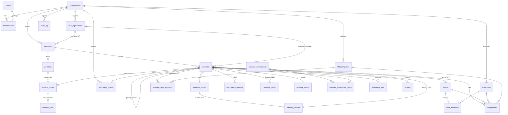

# 05 — Esquema de Backend: Simulador de Escalas 24/7 (CLT Brasil)

> Base: `00-prd-original.md` (PRD v2.0). Backend alvo: o FastAPI existente em `backend/` (hoje `app/main.py`, `app/api/v1/endpoints/atas.py`, `app/schemas/ata.py`, `app/services/ata_excel_service.py`). O simulador entra como um **novo módulo** sob o mesmo `/api/v1`, sem quebrar o router `atas`.

## Sumário
1. Princípios de modelagem
2. Diagrama ER (mermaid)
3. DDL PostgreSQL completo
4. Multi-tenancy com RLS
5. Contratos da API REST
6. Estrutura de pastas FastAPI
7. Jobs assíncronos
8. Versionamento (API, cenários, motor, regras)

---

## 1. Princípios de modelagem

| Decisão | Motivo (PRD) |
|---|---|
| PK `bigint GENERATED ALWAYS AS IDENTITY` + `public_id uuid` exposto na API | IDs sequenciais indexam bem; UUID evita enumeração externa. |
| `NUMERIC(18,6)` em toda grandeza de hora, FTE, percentual e dinheiro intermediário | NFR-02: 6 casas antes do arredondamento contábil. Valores finais contábeis também guardados em `NUMERIC(18,2)`. |
| Percentuais em fração (`0.200000` = 20%) | Evita ambiguidade 20 vs 0.20. CHECK de faixa. |
| `organization_id` em **toda** tabela de domínio + RLS | Multi-tenant seguro mesmo com bug na camada de aplicação. |
| `JSONB` só para dados semiestruturados/versionáveis: parâmetros do motor, padrões de rotação, detalhes de findings, snapshot de entradas, breakdown financeiro | Estruturas que mudam com o motor; o que é filtrado/agregado fica em colunas. |
| Slots de demanda normalizados (`demand_slots`) **e** opcionalmente `values numeric[]` no cabeçalho | 168 (1h) ou 336 (30 min) slots; tabela permite heatmap/SQL, array permite carga rápida. Fonte da verdade = `demand_slots`. |
| `timestamptz` sempre; datas civis em `date` com `timezone` da operação | Turno T3 cruza meia-noite; DST não existe no BR atual, mas guardamos tz. |
| Cenário calculado/homologado é **imutável** (trigger) | Auditoria trabalhista: o que foi homologado não muda; edita-se criando nova versão. |
| Soft delete (`deleted_at`) apenas em cadastros; resultados nunca são apagados, só cenário inteiro arquivado | Rastreabilidade. |

Convenções: tabelas em `snake_case` plural; enums como tipos PostgreSQL (`CREATE TYPE`) para estados estáveis; códigos de regra em `text` com CHECK de formato (catálogo evolui).

---

## 2. Diagrama ER



---

## 3. DDL PostgreSQL completo

> PostgreSQL ≥ 15. Ordem de execução: extensões → tipos → tabelas → índices → triggers → RLS. Será dividido em migrations Alembic (`0001_core`, `0002_catalog`, `0003_scenarios`, `0004_results`, `0005_rls`).

### 3.1 Extensões, schema e tipos

```sql
CREATE EXTENSION IF NOT EXISTS pgcrypto;   -- gen_random_uuid()
CREATE EXTENSION IF NOT EXISTS citext;     -- e-mail case-insensitive
CREATE EXTENSION IF NOT EXISTS btree_gist; -- exclusão por intervalo

CREATE SCHEMA IF NOT EXISTS wss;  -- workforce shift simulator
SET search_path = wss, public;

CREATE TYPE member_role       AS ENUM ('owner','admin','planner','legal_reviewer','viewer');
CREATE TYPE scenario_status   AS ENUM ('rascunho','calculando','calculado','em_revisao','homologado','arquivado','erro');
CREATE TYPE demand_mode       AS ENUM ('postos_fixos','volume_uph','erlang_c');
CREATE TYPE slot_granularity  AS ENUM ('60','30');            -- minutos: 168 ou 336 slots
CREATE TYPE finding_severity  AS ENUM ('info','alerta','erro','critico');
CREATE TYPE job_status        AS ENUM ('queued','running','succeeded','failed','cancelled');
CREATE TYPE export_format     AS ENUM ('xlsx','csv','pdf','totvs_rm','totvs_protheus','senior_ronda','adp','sap_sf','afdt','acjef');
CREATE TYPE sunday_rule_basis AS ENUM ('lei_10101_comercio','lei_605_1949','portaria_mte','cct_especifica');
```

### 3.2 Núcleo: organizações, usuários, papéis

```sql
CREATE TABLE organizations (
  id           bigint GENERATED ALWAYS AS IDENTITY PRIMARY KEY,
  public_id    uuid NOT NULL DEFAULT gen_random_uuid() UNIQUE,
  name         text NOT NULL CHECK (length(name) BETWEEN 2 AND 200),
  cnpj         char(14) UNIQUE CHECK (cnpj ~ '^\d{14}$'),
  timezone     text NOT NULL DEFAULT 'America/Sao_Paulo',
  settings     jsonb NOT NULL DEFAULT '{}'::jsonb,
  created_at   timestamptz NOT NULL DEFAULT now(),
  updated_at   timestamptz NOT NULL DEFAULT now(),
  deleted_at   timestamptz
);

CREATE TABLE users (
  id            bigint GENERATED ALWAYS AS IDENTITY PRIMARY KEY,
  public_id     uuid NOT NULL DEFAULT gen_random_uuid() UNIQUE,
  email         citext NOT NULL UNIQUE,
  full_name     text NOT NULL,
  password_hash text,                          -- NULL quando SSO
  is_superuser  boolean NOT NULL DEFAULT false,
  last_login_at timestamptz,
  created_at    timestamptz NOT NULL DEFAULT now(),
  updated_at    timestamptz NOT NULL DEFAULT now(),
  deleted_at    timestamptz
);

CREATE TABLE memberships (
  id              bigint GENERATED ALWAYS AS IDENTITY PRIMARY KEY,
  organization_id bigint NOT NULL REFERENCES organizations(id) ON DELETE CASCADE,
  user_id         bigint NOT NULL REFERENCES users(id) ON DELETE CASCADE,
  role            member_role NOT NULL DEFAULT 'viewer',
  operation_scope bigint[],                    -- NULL = todas as operações
  created_at      timestamptz NOT NULL DEFAULT now(),
  UNIQUE (organization_id, user_id)
);
CREATE INDEX ix_memberships_user ON memberships (user_id);
```

### 3.3 Acordos coletivos (CCT/ACT)

```sql
CREATE TABLE labor_agreements (
  id                        bigint GENERATED ALWAYS AS IDENTITY PRIMARY KEY,
  public_id                 uuid NOT NULL DEFAULT gen_random_uuid() UNIQUE,
  organization_id           bigint NOT NULL REFERENCES organizations(id) ON DELETE CASCADE,
  name                      text NOT NULL,                     -- "CCT Metalúrgicos SP 2026/2027"
  kind                      text NOT NULL CHECK (kind IN ('CLT_PADRAO','CCT','ACT')),
  union_name                text,
  registration_number       text,                              -- Mediador MTE
  valid_from                date NOT NULL,
  valid_to                  date,
  -- Adicionais (fração)
  night_premium_pct         numeric(18,6) NOT NULL DEFAULT 0.200000
                            CHECK (night_premium_pct BETWEEN 0.200000 AND 1.000000), -- mín. legal 20% urbano
  night_start               time NOT NULL DEFAULT '22:00',
  night_end                 time NOT NULL DEFAULT '05:00',
  night_hour_factor         numeric(18,6) NOT NULL DEFAULT 1.142857, -- 60/52,5 (FR-08)
  apply_sumula_60           boolean NOT NULL DEFAULT true,          -- prorrogação noturna (FR-09)
  overtime_pct              numeric(18,6) NOT NULL DEFAULT 0.500000 CHECK (overtime_pct >= 0.500000),
  overtime_sunday_pct       numeric(18,6) NOT NULL DEFAULT 1.000000 CHECK (overtime_sunday_pct >= 0),
  hazard_pct                numeric(18,6) NOT NULL DEFAULT 0 CHECK (hazard_pct BETWEEN 0 AND 1),     -- periculosidade
  unhealthy_pct             numeric(18,6) NOT NULL DEFAULT 0 CHECK (unhealthy_pct BETWEEN 0 AND 1),  -- insalubridade
  social_charges_pct        numeric(18,6) NOT NULL DEFAULT 0.680000 CHECK (social_charges_pct >= 0),
  -- Jornada
  weekly_hours_limit        numeric(18,6) NOT NULL DEFAULT 44.000000,
  daily_overtime_max_hours  numeric(18,6) NOT NULL DEFAULT 2.000000,
  allows_8h_rotating        boolean NOT NULL DEFAULT false,         -- Art. 7º XIV CF (FR-11)
  allows_12x36              boolean NOT NULL DEFAULT true,          -- Art. 59-A CLT
  min_interjornada_hours    numeric(18,6) NOT NULL DEFAULT 11.000000 CHECK (min_interjornada_hours >= 11),
  min_weekly_rest_hours     numeric(18,6) NOT NULL DEFAULT 35.000000, -- 24h DSR + 11h (FR-12)
  -- Domingo
  sunday_rule_basis         sunday_rule_basis NOT NULL DEFAULT 'lei_605_1949',
  sunday_off_max_interval_weeks smallint NOT NULL DEFAULT 7 CHECK (sunday_off_max_interval_weeks BETWEEN 1 AND 12), -- W_limite
  holiday_calendar          text NOT NULL DEFAULT 'BR-NACIONAL',     -- ex. 'BR-SP-SAO_PAULO'
  extra_rules               jsonb NOT NULL DEFAULT '{}'::jsonb,      -- cláusulas não modeladas
  rules_version             integer NOT NULL DEFAULT 1,
  created_at                timestamptz NOT NULL DEFAULT now(),
  updated_at                timestamptz NOT NULL DEFAULT now(),
  deleted_at                timestamptz,
  CHECK (valid_to IS NULL OR valid_to >= valid_from)
);
CREATE INDEX ix_labor_agreements_org ON labor_agreements (organization_id) WHERE deleted_at IS NULL;
```

### 3.4 Operações, postos, demanda, shrinkage

```sql
CREATE TABLE operations (
  id                   bigint GENERATED ALWAYS AS IDENTITY PRIMARY KEY,
  public_id            uuid NOT NULL DEFAULT gen_random_uuid() UNIQUE,
  organization_id      bigint NOT NULL REFERENCES organizations(id) ON DELETE CASCADE,
  name                 text NOT NULL,                       -- "CD Cajamar", "UTI Adulto"
  sector               text NOT NULL CHECK (sector IN ('saude','logistica','industria','varejo','ti_noc','contact_center','saneamento','outro')),
  is_24x7              boolean NOT NULL DEFAULT true,
  timezone             text NOT NULL DEFAULT 'America/Sao_Paulo',
  city_ibge_code       char(7),                             -- feriados municipais
  default_agreement_id bigint REFERENCES labor_agreements(id),
  created_at           timestamptz NOT NULL DEFAULT now(),
  updated_at           timestamptz NOT NULL DEFAULT now(),
  deleted_at           timestamptz,
  UNIQUE (organization_id, name)
);
CREATE INDEX ix_operations_agreement ON operations (default_agreement_id);

CREATE TABLE positions (                                   -- postos de trabalho
  id                 bigint GENERATED ALWAYS AS IDENTITY PRIMARY KEY,
  public_id          uuid NOT NULL DEFAULT gen_random_uuid() UNIQUE,
  organization_id    bigint NOT NULL REFERENCES organizations(id) ON DELETE CASCADE,
  operation_id       bigint NOT NULL REFERENCES operations(id) ON DELETE CASCADE,
  name               text NOT NULL,                        -- "Operador de Caldeira"
  cbo_code           char(6),
  base_salary        numeric(18,6) NOT NULL CHECK (base_salary > 0),
  monthly_hours      numeric(18,6) NOT NULL DEFAULT 220.000000 CHECK (monthly_hours > 0), -- CargaMensal
  hazard_applies     boolean NOT NULL DEFAULT false,
  unhealthy_applies  boolean NOT NULL DEFAULT false,
  is_mandatory_presence boolean NOT NULL DEFAULT false,   -- FR-02 postos fixos
  created_at         timestamptz NOT NULL DEFAULT now(),
  updated_at         timestamptz NOT NULL DEFAULT now(),
  deleted_at         timestamptz,
  UNIQUE (operation_id, name)
);
CREATE INDEX ix_positions_org_op ON positions (organization_id, operation_id);

CREATE TABLE demand_curves (
  id               bigint GENERATED ALWAYS AS IDENTITY PRIMARY KEY,
  public_id        uuid NOT NULL DEFAULT gen_random_uuid() UNIQUE,
  organization_id  bigint NOT NULL REFERENCES organizations(id) ON DELETE CASCADE,
  position_id      bigint NOT NULL REFERENCES positions(id) ON DELETE CASCADE,
  name             text NOT NULL,
  mode             demand_mode NOT NULL,
  granularity      slot_granularity NOT NULL DEFAULT '60',
  -- parâmetros do modo (UPH, TMA, nível de serviço, tempo-alvo) - FR-03
  params           jsonb NOT NULL DEFAULT '{}'::jsonb,
  source           text NOT NULL DEFAULT 'manual' CHECK (source IN ('manual','upload_csv','upload_xlsx','api')),
  checksum         char(64),                               -- sha256 dos slots (cache do motor)
  version          integer NOT NULL DEFAULT 1,
  created_by       bigint REFERENCES users(id),
  created_at       timestamptz NOT NULL DEFAULT now(),
  updated_at       timestamptz NOT NULL DEFAULT now(),
  deleted_at       timestamptz
);
CREATE INDEX ix_demand_curves_position ON demand_curves (organization_id, position_id);

CREATE TABLE demand_slots (
  organization_id  bigint NOT NULL REFERENCES organizations(id) ON DELETE CASCADE,
  demand_curve_id  bigint NOT NULL REFERENCES demand_curves(id) ON DELETE CASCADE,
  slot_index       smallint NOT NULL CHECK (slot_index BETWEEN 0 AND 335),  -- 0 = seg 00:00
  weekday          smallint NOT NULL CHECK (weekday BETWEEN 1 AND 7),       -- ISO: 1=seg, 7=dom
  start_minute     smallint NOT NULL CHECK (start_minute BETWEEN 0 AND 1439),
  required_value   numeric(18,6) NOT NULL CHECK (required_value >= 0),     -- postos, volume ou chamadas
  is_night         boolean NOT NULL,                                       -- slot ∩ [22h,05h)
  PRIMARY KEY (demand_curve_id, slot_index)
);
-- Coerência slot ↔ granularidade é validada por trigger (slot_index < 168 quando granularity='60').

CREATE TABLE shrinkage_profiles (                         -- FR-04
  id               bigint GENERATED ALWAYS AS IDENTITY PRIMARY KEY,
  public_id        uuid NOT NULL DEFAULT gen_random_uuid() UNIQUE,
  organization_id  bigint NOT NULL REFERENCES organizations(id) ON DELETE CASCADE,
  operation_id     bigint REFERENCES operations(id) ON DELETE CASCADE,
  name             text NOT NULL,
  day_pct          numeric(18,6) NOT NULL CHECK (day_pct   >= 0 AND day_pct   < 0.9),
  night_pct        numeric(18,6) NOT NULL CHECK (night_pct >= 0 AND night_pct < 0.9),
  breakdown        jsonb NOT NULL DEFAULT '{}'::jsonb,  -- {"absenteismo":0.05,"ferias":0.083,"treinamento":0.01,...}
  created_at       timestamptz NOT NULL DEFAULT now(),
  updated_at       timestamptz NOT NULL DEFAULT now(),
  deleted_at       timestamptz
);
```

### 3.5 Catálogos: turnos, modelos de escala, padrões de rotação

```sql
CREATE TABLE shift_templates (
  id                 bigint GENERATED ALWAYS AS IDENTITY PRIMARY KEY,
  public_id          uuid NOT NULL DEFAULT gen_random_uuid() UNIQUE,
  organization_id    bigint REFERENCES organizations(id) ON DELETE CASCADE, -- NULL = catálogo global
  code               text NOT NULL CHECK (code ~ '^[A-Z0-9_]{1,12}$'),     -- T1,T2,T3,D12,N12,INT
  name               text NOT NULL,
  start_time         time NOT NULL,
  duration_minutes   smallint NOT NULL CHECK (duration_minutes BETWEEN 60 AND 1440),
  break_minutes      smallint NOT NULL DEFAULT 60 CHECK (break_minutes BETWEEN 0 AND 120),
  break_counts_as_work boolean NOT NULL DEFAULT false,
  -- derivados, calculados na aplicação e persistidos para consulta
  night_clock_minutes  smallint NOT NULL DEFAULT 0,
  crosses_midnight   boolean GENERATED ALWAYS AS
                     ((extract(epoch FROM start_time)/60 + duration_minutes) > 1440) STORED,
  color_hex          char(7),
  created_at         timestamptz NOT NULL DEFAULT now(),
  deleted_at         timestamptz
);
CREATE UNIQUE INDEX ux_shift_templates_code ON shift_templates (COALESCE(organization_id, 0), code)
  WHERE deleted_at IS NULL;

-- Seeds globais
INSERT INTO shift_templates (organization_id, code, name, start_time, duration_minutes, break_minutes, night_clock_minutes) VALUES
 (NULL,'T1','Manhã 06-14','06:00',480,60,0),
 (NULL,'T2','Tarde 14-22','14:00',480,60,0),
 (NULL,'T3','Noite 22-06','22:00',480,60,420),
 (NULL,'D12','Diurno 07-19','07:00',720,60,0),
 (NULL,'N12','Noturno 19-07','19:00',720,60,420),
 (NULL,'INT','Intermediário 10-18','10:00',480,60,0);

CREATE TABLE schedule_models (                            -- catálogo 12x36, 6x2, 4x2, 5x2, 4x3, 3x1, 5T...
  id                 bigint GENERATED ALWAYS AS IDENTITY PRIMARY KEY,
  code               text NOT NULL UNIQUE CHECK (code ~ '^[A-Z0-9_]{2,24}$'),  -- '12X36','6X2','5T_FRANCES'
  name               text NOT NULL,
  work_days          smallint NOT NULL CHECK (work_days > 0),
  off_days           smallint NOT NULL CHECK (off_days >= 0),
  cycle_length_days  smallint NOT NULL CHECK (cycle_length_days > 0),
  typical_teams      smallint[] NOT NULL,                  -- {4} ou {4,5}
  daily_hours        numeric(18,6) NOT NULL,
  avg_weekly_hours   numeric(18,6) NOT NULL,               -- 42, 36, 33.6...
  is_continuous_24x7 boolean NOT NULL,
  is_rotating        boolean NOT NULL,                     -- dispara FR-11
  requires_agreement boolean NOT NULL DEFAULT false,
  legal_basis        text,                                 -- 'CLT art. 59-A'
  default_params     jsonb NOT NULL DEFAULT '{}'::jsonb,
  is_active          boolean NOT NULL DEFAULT true
);

CREATE TABLE rotation_patterns (
  id                 bigint GENERATED ALWAYS AS IDENTITY PRIMARY KEY,
  public_id          uuid NOT NULL DEFAULT gen_random_uuid() UNIQUE,
  organization_id    bigint REFERENCES organizations(id) ON DELETE CASCADE, -- NULL = padrão de catálogo
  schedule_model_id  bigint NOT NULL REFERENCES schedule_models(id),
  name               text NOT NULL,
  cycle_length_days  smallint NOT NULL CHECK (cycle_length_days BETWEEN 1 AND 730),
  team_count         smallint NOT NULL CHECK (team_count BETWEEN 1 AND 12),
  -- matriz turma × dia do ciclo: {"A":["T1","T1","T2","T2","T3","T3","F","F"], "B":[...]}
  matrix             jsonb NOT NULL,
  team_offsets       jsonb NOT NULL DEFAULT '{}'::jsonb,  -- {"A":0,"B":2,"C":4,"D":6}
  is_generated       boolean NOT NULL DEFAULT false,      -- true = produzido pelo motor
  created_at         timestamptz NOT NULL DEFAULT now(),
  CHECK (jsonb_typeof(matrix) = 'object')
);
CREATE INDEX ix_rotation_patterns_model ON rotation_patterns (schedule_model_id);
CREATE INDEX ix_rotation_patterns_org   ON rotation_patterns (organization_id);
```

### 3.6 Colaboradores

```sql
CREATE TABLE employees (
  id               bigint GENERATED ALWAYS AS IDENTITY PRIMARY KEY,
  public_id        uuid NOT NULL DEFAULT gen_random_uuid() UNIQUE,
  organization_id  bigint NOT NULL REFERENCES organizations(id) ON DELETE CASCADE,
  operation_id     bigint REFERENCES operations(id),
  position_id      bigint REFERENCES positions(id),
  registration     text NOT NULL,                        -- matrícula
  full_name        text NOT NULL,
  cpf_hash         char(64),                             -- LGPD: só hash, nunca CPF em claro
  pis_hash         char(64),
  contract_weekly_hours numeric(18,6) NOT NULL DEFAULT 44.000000,
  base_salary      numeric(18,6),                        -- sobrepõe o do posto
  is_virtual       boolean NOT NULL DEFAULT false,       -- vaga a contratar (headcount simulado)
  restrictions     jsonb NOT NULL DEFAULT '{}'::jsonb,   -- {"no_night":true,"pcd":true}
  hired_at         date,
  terminated_at    date,
  created_at       timestamptz NOT NULL DEFAULT now(),
  updated_at       timestamptz NOT NULL DEFAULT now(),
  deleted_at       timestamptz,
  UNIQUE (organization_id, registration)
);
CREATE INDEX ix_employees_org_op ON employees (organization_id, operation_id) WHERE deleted_at IS NULL;
CREATE INDEX ix_employees_position ON employees (position_id);
```

### 3.7 Cenários e versionamento

```sql
CREATE TABLE scenarios (
  id                  bigint GENERATED ALWAYS AS IDENTITY PRIMARY KEY,
  public_id           uuid NOT NULL DEFAULT gen_random_uuid() UNIQUE,
  organization_id     bigint NOT NULL REFERENCES organizations(id) ON DELETE CASCADE,
  operation_id        bigint NOT NULL REFERENCES operations(id),
  lineage_id          uuid NOT NULL DEFAULT gen_random_uuid(), -- agrupa versões do mesmo cenário
  version             integer NOT NULL DEFAULT 1 CHECK (version >= 1),
  parent_scenario_id  bigint REFERENCES scenarios(id),
  name                text NOT NULL,
  description         text,
  is_baseline         boolean NOT NULL DEFAULT false,
  status              scenario_status NOT NULL DEFAULT 'rascunho',
  schedule_model_id   bigint NOT NULL REFERENCES schedule_models(id),
  labor_agreement_id  bigint NOT NULL REFERENCES labor_agreements(id),
  shrinkage_profile_id bigint REFERENCES shrinkage_profiles(id),
  demand_curve_id     bigint NOT NULL REFERENCES demand_curves(id),
  rotation_pattern_id bigint REFERENCES rotation_patterns(id),
  team_count          smallint NOT NULL CHECK (team_count BETWEEN 1 AND 12),
  horizon_start       date NOT NULL,
  horizon_weeks       smallint NOT NULL DEFAULT 8 CHECK (horizon_weeks BETWEEN 1 AND 104),
  agreement_8h_confirmed boolean NOT NULL DEFAULT false,   -- aceite explícito (risco FR-11)
  params              jsonb NOT NULL DEFAULT '{}'::jsonb,   -- solver, tolerâncias, pesos
  inputs_snapshot     jsonb,          -- cópia congelada de CCT, curva, turnos no cálculo
  inputs_hash         char(64),       -- sha256 do snapshot (cache/idempotência)
  engine_version      text,           -- '1.4.0'
  rules_version       text,           -- 'compliance-2026.11'
  -- KPIs desnormalizados para listagem
  required_headcount  numeric(18,6),
  coverage_pct        numeric(18,6),
  critical_findings   integer NOT NULL DEFAULT 0,
  total_monthly_cost  numeric(18,2),
  calculated_at       timestamptz,
  approved_at         timestamptz,
  approved_by         bigint REFERENCES users(id),
  created_by          bigint REFERENCES users(id),
  created_at          timestamptz NOT NULL DEFAULT now(),
  updated_at          timestamptz NOT NULL DEFAULT now(),
  row_version         integer NOT NULL DEFAULT 1,           -- otimistic locking (If-Match)
  UNIQUE (lineage_id, version),
  CHECK (status <> 'homologado' OR (approved_at IS NOT NULL AND approved_by IS NOT NULL AND critical_findings = 0))
);
CREATE INDEX ix_scenarios_org_op_status ON scenarios (organization_id, operation_id, status, created_at DESC);
CREATE INDEX ix_scenarios_lineage ON scenarios (lineage_id, version DESC);
CREATE INDEX ix_scenarios_inputs_hash ON scenarios (organization_id, inputs_hash);
CREATE INDEX ix_scenarios_fks ON scenarios (schedule_model_id, labor_agreement_id, demand_curve_id);
-- Só um homologado vigente por linhagem
CREATE UNIQUE INDEX ux_scenarios_one_approved ON scenarios (lineage_id) WHERE status = 'homologado';

CREATE TABLE scenario_shift_templates (
  scenario_id       bigint NOT NULL REFERENCES scenarios(id) ON DELETE CASCADE,
  shift_template_id bigint NOT NULL REFERENCES shift_templates(id),
  organization_id   bigint NOT NULL REFERENCES organizations(id),
  PRIMARY KEY (scenario_id, shift_template_id)
);

CREATE TABLE teams (                                     -- turmas
  id               bigint GENERATED ALWAYS AS IDENTITY PRIMARY KEY,
  organization_id  bigint NOT NULL REFERENCES organizations(id) ON DELETE CASCADE,
  scenario_id      bigint NOT NULL REFERENCES scenarios(id) ON DELETE CASCADE,
  code             text NOT NULL CHECK (code ~ '^[A-Z]{1,2}$'),   -- A..F
  label            text,                                          -- "Diurna A", "Noturna B"
  cycle_offset_days smallint NOT NULL DEFAULT 0,
  size_required    numeric(18,6) NOT NULL DEFAULT 0,              -- FTE calculado
  size_assigned    integer NOT NULL DEFAULT 0,
  UNIQUE (scenario_id, code)
);

CREATE TABLE team_members (
  organization_id bigint NOT NULL REFERENCES organizations(id) ON DELETE CASCADE,
  team_id         bigint NOT NULL REFERENCES teams(id) ON DELETE CASCADE,
  employee_id     bigint NOT NULL REFERENCES employees(id),
  PRIMARY KEY (team_id, employee_id)
);
CREATE INDEX ix_team_members_employee ON team_members (employee_id);
```

### 3.8 Alocações (colaborador × dia × turno)

Volume: 1.000 colaboradores × 8 semanas × 7 dias = 56 mil linhas/cenário. Particionamento por `HASH (scenario_id)` mantém consultas de um cenário em uma partição.

```sql
CREATE TABLE assignments (
  id                bigint GENERATED ALWAYS AS IDENTITY,
  organization_id   bigint NOT NULL,
  scenario_id       bigint NOT NULL,
  team_id           bigint,
  employee_id       bigint,                      -- NULL = slot de turma ainda sem pessoa
  work_date         date NOT NULL,               -- data de INÍCIO do turno
  shift_template_id bigint,                      -- NULL quando folga
  is_day_off        boolean NOT NULL DEFAULT false,
  is_dsr            boolean NOT NULL DEFAULT false,
  starts_at         timestamptz,
  ends_at           timestamptz,
  clock_minutes     smallint NOT NULL DEFAULT 0,
  night_clock_minutes smallint NOT NULL DEFAULT 0,
  fictitious_night_hours numeric(18,6) NOT NULL DEFAULT 0, -- × 1,142857
  overtime_hours    numeric(18,6) NOT NULL DEFAULT 0,
  is_holiday        boolean NOT NULL DEFAULT false,
  source            text NOT NULL DEFAULT 'engine' CHECK (source IN ('engine','manual_override')),
  PRIMARY KEY (scenario_id, id),
  CHECK (is_day_off = (shift_template_id IS NULL)),
  CHECK (ends_at IS NULL OR ends_at > starts_at)
) PARTITION BY HASH (scenario_id);

DO $$ BEGIN
  FOR i IN 0..15 LOOP
    EXECUTE format('CREATE TABLE assignments_p%s PARTITION OF assignments FOR VALUES WITH (MODULUS 16, REMAINDER %s)', i, i);
  END LOOP;
END $$;

ALTER TABLE assignments
  ADD FOREIGN KEY (scenario_id) REFERENCES scenarios(id) ON DELETE CASCADE,
  ADD FOREIGN KEY (team_id) REFERENCES teams(id) ON DELETE CASCADE,
  ADD FOREIGN KEY (employee_id) REFERENCES employees(id),
  ADD FOREIGN KEY (shift_template_id) REFERENCES shift_templates(id);

CREATE UNIQUE INDEX ux_assign_emp_day ON assignments (scenario_id, employee_id, work_date)
  WHERE employee_id IS NOT NULL;
CREATE INDEX ix_assign_team_day ON assignments (scenario_id, team_id, work_date);
CREATE INDEX ix_assign_shift ON assignments (shift_template_id);
-- Sem sobreposição de turnos do mesmo colaborador (dobra ilegal é finding, sobreposição física é erro)
ALTER TABLE assignments ADD CONSTRAINT ex_assign_no_overlap
  EXCLUDE USING gist (scenario_id WITH =, employee_id WITH =, tstzrange(starts_at, ends_at) WITH &&)
  WHERE (employee_id IS NOT NULL AND starts_at IS NOT NULL);
```

### 3.9 Resultados: cobertura, compliance, financeiro, comparação

```sql
CREATE TABLE coverage_results (                          -- heatmap 168/336 (NFR-03)
  organization_id  bigint NOT NULL REFERENCES organizations(id) ON DELETE CASCADE,
  scenario_id      bigint NOT NULL REFERENCES scenarios(id) ON DELETE CASCADE,
  slot_index       smallint NOT NULL CHECK (slot_index BETWEEN 0 AND 335),
  required_net     numeric(18,6) NOT NULL,   -- N_req com fator noturno
  required_gross   numeric(18,6) NOT NULL,   -- / (1 - shrinkage)
  scheduled        numeric(18,6) NOT NULL,
  gap              numeric(18,6) GENERATED ALWAYS AS (scheduled - required_gross) STORED,
  status           text NOT NULL CHECK (status IN ('exata','sobre','sub','critica')),
  PRIMARY KEY (scenario_id, slot_index)
);

CREATE TABLE compliance_rules (                          -- catálogo versionado de regras
  code            text PRIMARY KEY CHECK (code ~ '^[A-Z0-9_]{3,64}$'),
  default_severity finding_severity NOT NULL,
  title           text NOT NULL,
  legal_reference text NOT NULL,           -- 'CLT art. 66', 'Súmula 60 TST', 'CF art. 7º XIV'
  rules_version   text NOT NULL,
  is_blocking     boolean NOT NULL DEFAULT false
);
INSERT INTO compliance_rules VALUES
 ('ERRO_CRITICO_QUEBRA_INTERJORNADA','critico','Interjornada < 11h','CLT art. 66','compliance-2026.11',true),
 ('ERRO_DSR_35H','erro','Repouso semanal < 35h (24h DSR + 11h)','CLT art. 67; Lei 605/1949','compliance-2026.11',true),
 ('ALERTA_CF_TURNO_REVEZAMENTO_6H','critico','Revezamento > 6h sem ACT/CCT','CF art. 7º, XIV; Súmula 423 TST','compliance-2026.11',true),
 ('ALERTA_DOMINGO_W_LIMITE','erro','Intervalo entre domingos de folga > W_limite','Lei 605/1949; Lei 10.101/2000 art. 6º; Portaria MTE 671/2021','compliance-2026.11',true),
 ('ALERTA_PRORROGACAO_NOTURNA','info','Prorrogação noturna com adicional','Súmula 60, II TST','compliance-2026.11',false),
 ('ALERTA_HE_LIMITE_DIARIO','erro','HE acima de 2h/dia','CLT art. 59','compliance-2026.11',true),
 ('ALERTA_12X36_SEM_PREVISAO','critico','12x36 sem previsão em acordo','CLT art. 59-A','compliance-2026.11',true),
 ('ALERTA_DOBRA_TURNO','critico','Dobra de turno (jornada > 12h)','CLT arts. 59 e 66','compliance-2026.11',true);

CREATE TABLE compliance_findings (
  id               bigint GENERATED ALWAYS AS IDENTITY PRIMARY KEY,
  organization_id  bigint NOT NULL REFERENCES organizations(id) ON DELETE CASCADE,
  scenario_id      bigint NOT NULL REFERENCES scenarios(id) ON DELETE CASCADE,
  rule_code        text NOT NULL REFERENCES compliance_rules(code),
  severity         finding_severity NOT NULL,
  legal_reference  text NOT NULL,                  -- desnormalizado (imutável no laudo)
  team_id          bigint REFERENCES teams(id) ON DELETE CASCADE,
  employee_id      bigint REFERENCES employees(id),
  occurs_on        date,
  message          text NOT NULL,
  details          jsonb NOT NULL DEFAULT '{}'::jsonb,  -- {"rest_hours":8.0,"from":"T2","to":"T1"}
  waived           boolean NOT NULL DEFAULT false,      -- dispensado por jurídico c/ justificativa
  waived_by        bigint REFERENCES users(id),
  waiver_reason    text,
  created_at       timestamptz NOT NULL DEFAULT now(),
  CHECK (NOT waived OR (waived_by IS NOT NULL AND waiver_reason IS NOT NULL))
);
CREATE INDEX ix_findings_scenario_sev ON compliance_findings (scenario_id, severity, rule_code);
CREATE INDEX ix_findings_team ON compliance_findings (team_id);
CREATE INDEX ix_findings_employee ON compliance_findings (employee_id);
CREATE INDEX ix_findings_details ON compliance_findings USING gin (details jsonb_path_ops);

CREATE TABLE financial_results (
  scenario_id            bigint PRIMARY KEY REFERENCES scenarios(id) ON DELETE CASCADE,
  organization_id        bigint NOT NULL REFERENCES organizations(id) ON DELETE CASCADE,
  reference_month        date NOT NULL,                -- 1º dia do mês-base
  headcount              numeric(18,6) NOT NULL,
  fixed_cost             numeric(18,6) NOT NULL,
  night_premium_cost     numeric(18,6) NOT NULL,
  night_dsr_reflex_cost  numeric(18,6) NOT NULL,       -- Súmula 172 TST
  overtime_cost          numeric(18,6) NOT NULL,
  hazard_cost            numeric(18,6) NOT NULL DEFAULT 0,
  unhealthy_cost         numeric(18,6) NOT NULL DEFAULT 0,
  social_charges_cost    numeric(18,6) NOT NULL,
  total_cost             numeric(18,6) NOT NULL,
  total_cost_rounded     numeric(18,2) NOT NULL,       -- arredondamento contábil final
  fictitious_night_hours numeric(18,6) NOT NULL,
  overtime_hours         numeric(18,6) NOT NULL,
  business_days          smallint NOT NULL,
  sundays_holidays       smallint NOT NULL,
  breakdown              jsonb NOT NULL DEFAULT '{}'::jsonb,  -- por turma, posto, mês
  created_at             timestamptz NOT NULL DEFAULT now(),
  CHECK (total_cost >= 0)
);

CREATE TABLE scenario_comparisons (
  id                 bigint GENERATED ALWAYS AS IDENTITY PRIMARY KEY,
  public_id          uuid NOT NULL DEFAULT gen_random_uuid() UNIQUE,
  organization_id    bigint NOT NULL REFERENCES organizations(id) ON DELETE CASCADE,
  name               text NOT NULL,
  baseline_scenario_id bigint NOT NULL REFERENCES scenarios(id),
  result             jsonb,          -- deltas de custo, HC, cobertura, risco; breakeven 5ª turma
  created_by         bigint REFERENCES users(id),
  created_at         timestamptz NOT NULL DEFAULT now()
);
CREATE TABLE scenario_comparison_items (
  comparison_id   bigint NOT NULL REFERENCES scenario_comparisons(id) ON DELETE CASCADE,
  scenario_id     bigint NOT NULL REFERENCES scenarios(id),
  organization_id bigint NOT NULL REFERENCES organizations(id),
  position        smallint NOT NULL,
  PRIMARY KEY (comparison_id, scenario_id)
);
CREATE INDEX ix_comparison_items_scenario ON scenario_comparison_items (scenario_id);
```

### 3.10 Jobs, exportações e auditoria

```sql
CREATE TABLE simulation_jobs (
  id               bigint GENERATED ALWAYS AS IDENTITY PRIMARY KEY,
  public_id        uuid NOT NULL DEFAULT gen_random_uuid() UNIQUE,
  organization_id  bigint NOT NULL REFERENCES organizations(id) ON DELETE CASCADE,
  scenario_id      bigint REFERENCES scenarios(id) ON DELETE CASCADE,
  kind             text NOT NULL CHECK (kind IN ('simulate','compare','export','import_demand')),
  status           job_status NOT NULL DEFAULT 'queued',
  idempotency_key  text,
  progress_pct     numeric(18,6) NOT NULL DEFAULT 0 CHECK (progress_pct BETWEEN 0 AND 100),
  stage            text,                        -- 'demand','rotation','compliance','finance'
  payload          jsonb NOT NULL DEFAULT '{}'::jsonb,
  error            jsonb,
  attempts         smallint NOT NULL DEFAULT 0,
  queued_at        timestamptz NOT NULL DEFAULT now(),
  started_at       timestamptz,
  finished_at      timestamptz,
  created_by       bigint REFERENCES users(id),
  UNIQUE (organization_id, idempotency_key)
);
CREATE INDEX ix_jobs_queue ON simulation_jobs (status, queued_at) WHERE status IN ('queued','running');
CREATE INDEX ix_jobs_scenario ON simulation_jobs (scenario_id);

CREATE TABLE exports (
  id               bigint GENERATED ALWAYS AS IDENTITY PRIMARY KEY,
  public_id        uuid NOT NULL DEFAULT gen_random_uuid() UNIQUE,
  organization_id  bigint NOT NULL REFERENCES organizations(id) ON DELETE CASCADE,
  scenario_id      bigint NOT NULL REFERENCES scenarios(id) ON DELETE CASCADE,
  job_id           bigint REFERENCES simulation_jobs(id),
  format           export_format NOT NULL,
  storage_key      text,                         -- s3://bucket/org/... 
  size_bytes       bigint,
  sha256           char(64),
  expires_at       timestamptz,
  created_by       bigint REFERENCES users(id),
  created_at       timestamptz NOT NULL DEFAULT now()
);
CREATE INDEX ix_exports_scenario ON exports (scenario_id, created_at DESC);

CREATE TABLE audit_log (
  id               bigint GENERATED ALWAYS AS IDENTITY,
  organization_id  bigint NOT NULL,
  actor_user_id    bigint,
  action           text NOT NULL,          -- 'scenario.approve','finding.waive','agreement.update'
  entity_type      text NOT NULL,
  entity_id        bigint,
  before           jsonb,
  after            jsonb,
  ip               inet,
  request_id       uuid,
  occurred_at      timestamptz NOT NULL DEFAULT now(),
  PRIMARY KEY (occurred_at, id)
) PARTITION BY RANGE (occurred_at);
CREATE TABLE audit_log_2026 PARTITION OF audit_log FOR VALUES FROM ('2026-01-01') TO ('2027-01-01');
CREATE TABLE audit_log_2027 PARTITION OF audit_log FOR VALUES FROM ('2027-01-01') TO ('2028-01-01');
CREATE INDEX ix_audit_entity ON audit_log (organization_id, entity_type, entity_id, occurred_at DESC);
CREATE INDEX ix_audit_time_brin ON audit_log USING brin (occurred_at);
-- append-only: aplicação não tem UPDATE/DELETE
REVOKE UPDATE, DELETE ON audit_log FROM app_user;
```

### 3.11 Triggers

```sql
CREATE OR REPLACE FUNCTION touch_updated_at() RETURNS trigger LANGUAGE plpgsql AS $$
BEGIN NEW.updated_at := now(); RETURN NEW; END $$;
-- aplicado a organizations, users, labor_agreements, operations, positions, demand_curves,
-- shrinkage_profiles, employees, scenarios
CREATE TRIGGER trg_scenarios_touch BEFORE UPDATE ON scenarios FOR EACH ROW EXECUTE FUNCTION touch_updated_at();

-- Imutabilidade de cenário calculado/homologado (só transições de status permitidas)
CREATE OR REPLACE FUNCTION guard_scenario_immutable() RETURNS trigger LANGUAGE plpgsql AS $$
BEGIN
  IF OLD.status IN ('calculado','em_revisao','homologado','arquivado') THEN
    IF (NEW.params, NEW.demand_curve_id, NEW.labor_agreement_id, NEW.schedule_model_id,
        NEW.team_count, NEW.horizon_start, NEW.horizon_weeks, NEW.inputs_snapshot)
       IS DISTINCT FROM
       (OLD.params, OLD.demand_curve_id, OLD.labor_agreement_id, OLD.schedule_model_id,
        OLD.team_count, OLD.horizon_start, OLD.horizon_weeks, OLD.inputs_snapshot) THEN
      RAISE EXCEPTION 'scenario % is %, create a new version', OLD.public_id, OLD.status
        USING ERRCODE = 'P0409';
    END IF;
  END IF;
  -- Máquina de estados
  IF NOT (OLD.status = NEW.status OR (OLD.status, NEW.status) IN (
      ('rascunho','calculando'), ('calculando','calculado'), ('calculando','erro'),
      ('erro','calculando'), ('calculado','calculando'), ('calculado','em_revisao'),
      ('em_revisao','homologado'), ('em_revisao','calculado'),
      ('homologado','arquivado'), ('calculado','arquivado'), ('rascunho','arquivado'))) THEN
    RAISE EXCEPTION 'invalid transition % -> %', OLD.status, NEW.status USING ERRCODE = 'P0409';
  END IF;
  NEW.row_version := OLD.row_version + 1;
  RETURN NEW;
END $$;
CREATE TRIGGER trg_scenarios_guard BEFORE UPDATE ON scenarios FOR EACH ROW EXECUTE FUNCTION guard_scenario_immutable();

-- Granularidade de slot
CREATE OR REPLACE FUNCTION check_slot_granularity() RETURNS trigger LANGUAGE plpgsql AS $$
DECLARE g slot_granularity;
BEGIN
  SELECT granularity INTO g FROM demand_curves WHERE id = NEW.demand_curve_id;
  IF g = '60' AND NEW.slot_index > 167 THEN
    RAISE EXCEPTION 'slot_index % out of range for 60-min curve', NEW.slot_index;
  END IF;
  RETURN NEW;
END $$;
CREATE TRIGGER trg_demand_slots_gran BEFORE INSERT OR UPDATE ON demand_slots
  FOR EACH ROW EXECUTE FUNCTION check_slot_granularity();
```

---

## 4. Multi-tenancy com RLS

Estratégia: **pool compartilhado** com `organization_id` + RLS. A aplicação conecta como `app_user` (sem `BYPASSRLS`), e a cada transação executa `SET LOCAL app.org_id = '<id>'` e `SET LOCAL app.user_id = '<id>'` (dependência FastAPI `get_tenant_session`). Workers de jobs fazem o mesmo com o `organization_id` do job.

```sql
CREATE ROLE app_user NOLOGIN;
CREATE ROLE app_migrator NOLOGIN BYPASSRLS;
REVOKE ALL ON SCHEMA public FROM public;
GRANT USAGE ON SCHEMA wss TO app_user;
GRANT SELECT, INSERT, UPDATE, DELETE ON ALL TABLES IN SCHEMA wss TO app_user;

CREATE OR REPLACE FUNCTION current_org_id() RETURNS bigint
LANGUAGE sql STABLE AS $$ SELECT nullif(current_setting('app.org_id', true), '')::bigint $$;

-- Aplica política padrão a todas as tabelas tenant-scoped
DO $$
DECLARE t text;
BEGIN
  FOREACH t IN ARRAY ARRAY[
    'labor_agreements','operations','positions','demand_curves','demand_slots','shrinkage_profiles',
    'employees','scenarios','scenario_shift_templates','teams','team_members','assignments',
    'coverage_results','compliance_findings','financial_results','scenario_comparisons',
    'scenario_comparison_items','simulation_jobs','exports','audit_log','memberships']
  LOOP
    EXECUTE format('ALTER TABLE %I ENABLE ROW LEVEL SECURITY', t);
    EXECUTE format('ALTER TABLE %I FORCE ROW LEVEL SECURITY', t);
    EXECUTE format($p$CREATE POLICY tenant_isolation ON %I
                     USING (organization_id = (SELECT current_org_id()))
                     WITH CHECK (organization_id = (SELECT current_org_id()))$p$, t);
  END LOOP;
END $$;

-- Catálogos com linhas globais (organization_id NULL) legíveis por todos, graváveis só pelo tenant
ALTER TABLE shift_templates ENABLE ROW LEVEL SECURITY;
CREATE POLICY st_read  ON shift_templates FOR SELECT
  USING (organization_id IS NULL OR organization_id = (SELECT current_org_id()));
CREATE POLICY st_write ON shift_templates FOR ALL
  USING (organization_id = (SELECT current_org_id()))
  WITH CHECK (organization_id = (SELECT current_org_id()));
-- idem para rotation_patterns. schedule_models e compliance_rules: globais, somente leitura para app_user.
REVOKE INSERT, UPDATE, DELETE ON schedule_models, compliance_rules FROM app_user;

ALTER TABLE organizations ENABLE ROW LEVEL SECURITY;
CREATE POLICY org_self ON organizations USING (id = (SELECT current_org_id()));
```

Notas:
- `(SELECT current_org_id())` é avaliado uma vez por query (initplan), evitando custo por linha.
- Todos os índices de tabelas de domínio começam por `organization_id` ou por `scenario_id` (já restrito ao tenant).
- Autorização por **papel** (owner/admin/planner/legal_reviewer/viewer) fica na camada de serviço; RLS garante só isolamento de tenant. Homologar exige `legal_reviewer` ou `admin`; dispensar finding exige `legal_reviewer`.
- Teste obrigatório de CI: com `app.org_id = A`, nenhum SELECT retorna linha de B (pytest sobre todas as tabelas da lista).

---

## 5. Contratos da API REST

### 5.1 Convenções

- Base: `/api/v1` (já usada por `atas`). Recursos do simulador sob `/api/v1/` direto, com o tenant implícito pelo token (claim `org`) ou header `X-Organization-Id` para usuários multi-org.
- Auth: `Authorization: Bearer <JWT>`. URLs kebab-case, plural; campos JSON `snake_case` (padrão Pydantic do projeto).
- IDs públicos: `uuid` (`public_id`). Nunca expor `bigint`.
- Números decimais trafegam como **string** (`"0.200000"`) para preservar NUMERIC(18,6); Pydantic `Decimal`.
- Envelope: `{"data": ...}`; listas `{"data": [...], "meta": {...}, "links": {...}}`.
- Concorrência: respostas trazem `ETag: "<row_version>"`; `PATCH` exige `If-Match` em cenários (412 se divergir).
- Idempotência: `POST` de ações caras aceita `Idempotency-Key`.

### 5.2 Paginação, filtro e ordenação

- Cadastros (poucos registros): offset — `?page=1&per_page=50` (máx. 200).
- Volumosos (`assignments`, `compliance-findings`, `audit-log`): cursor — `?limit=500&cursor=<opaco>`.
- Filtros: `?status=calculado,homologado&operation_id=<uuid>&created_at[gte]=2026-11-01`; ordenação `?sort=-created_at,name`.

```json
{
  "data": [ { "id": "6c1e...", "name": "6x2 4 turmas v3", "status": "calculado" } ],
  "meta": { "page": 1, "per_page": 50, "total": 7, "total_pages": 1 },
  "links": { "self": "/api/v1/scenarios?page=1&per_page=50", "next": null }
}
```
```json
{ "data": [ ... ], "meta": { "limit": 500, "has_next": true, "next_cursor": "eyJ3ZCI6IjIwMjYtMTEtMTAiLCJpZCI6OTkxfQ" } }
```

### 5.3 Formato de erro e códigos

```json
{
  "error": {
    "code": "validation_error",
    "message": "Request validation failed",
    "request_id": "0b7f3c2e-...",
    "details": [
      { "field": "slots[171].required_value", "code": "out_of_range", "message": "slot_index > 167 em curva de 60 min" }
    ]
  }
}
```

| HTTP | `code` | Quando |
|---|---|---|
| 400 | `invalid_json`, `invalid_cursor` | corpo/cursor malformado |
| 401 | `unauthenticated` | token ausente/expirado |
| 403 | `forbidden`, `role_required` | papel insuficiente (ex.: homologar sem `legal_reviewer`) |
| 404 | `not_found` | inexistente **ou** de outro tenant (nunca 403 para não vazar existência) |
| 409 | `scenario_immutable` | editar cenário calculado/homologado → crie nova versão |
| 409 | `invalid_status_transition` | ex.: homologar `rascunho` |
| 409 | `duplicate` | nome/matrícula já existente |
| 409 | `job_in_progress` | já há simulação rodando para o cenário |
| 412 | `precondition_failed` | `If-Match` divergente |
| 422 | `validation_error` | regra de domínio (ex.: 336 slots em curva de 60 min) |
| 422 | `agreement_confirmation_required` | revezamento 8h sem `agreement_8h_confirmed` (FR-11) |
| 422 | `blocking_findings` | homologar com findings críticos não dispensados |
| 429 | `rate_limit_exceeded` | com `Retry-After` |
| 500 | `internal_error` | sem detalhes internos |
| 503 | `engine_unavailable` | fila indisponível, com `Retry-After` |

### 5.4 Endpoints

**Auth / tenant**

| Método | Rota | Descrição |
|---|---|---|
| POST | `/auth/login` | e-mail/senha → JWT + refresh |
| POST | `/auth/refresh` | renova token |
| GET | `/me` | usuário + memberships |
| GET/PATCH | `/organization` | organização corrente |
| GET/POST | `/organization/members` | lista/convida membros |
| PATCH/DELETE | `/organization/members/{user_id}` | altera papel / remove |

**Cadastros** (CRUD padrão: `GET` lista, `POST` cria → 201 + `Location`, `GET /{id}`, `PATCH /{id}`, `DELETE /{id}` → 204 soft delete)

| Recurso | Rota |
|---|---|
| Acordos CCT/ACT | `/labor-agreements` |
| Operações | `/operations` |
| Postos | `/operations/{operation_id}/positions` |
| Curvas de demanda | `/positions/{position_id}/demand-curves` |
| Slots da curva | `GET/PUT /demand-curves/{id}/slots` (PUT substitui os 168/336) |
| Import de curva | `POST /demand-curves/{id}/slots:import` (multipart CSV/XLSX → 202 job) |
| Shrinkage | `/shrinkage-profiles` |
| Turnos | `/shift-templates` (globais aparecem com `"scope":"global"`, somente leitura) |
| Modelos de escala | `GET /schedule-models`, `GET /schedule-models/{code}` (catálogo, leitura) |
| Padrões de rotação | `/rotation-patterns`, `POST /rotation-patterns:preview` |
| Colaboradores | `/employees`, `POST /employees:bulk` (até 5.000) |
| Regras de compliance | `GET /compliance-rules` |

**Cenários**

| Método | Rota | Descrição |
|---|---|---|
| GET | `/scenarios` | lista (filtros `operation_id`, `status`, `lineage_id`, `is_baseline`) |
| POST | `/scenarios` | cria rascunho |
| GET | `/scenarios/{id}` | detalhe + KPIs |
| PATCH | `/scenarios/{id}` | edita (só `rascunho`/`erro`; `If-Match`) |
| DELETE | `/scenarios/{id}` | arquiva |
| POST | `/scenarios/{id}/versions` | nova versão (clona como rascunho, `version+1`) |
| GET | `/scenarios/{id}/versions` | histórico da linhagem |
| POST | `/scenarios/{id}/simulate` | dispara cálculo; síncrono se pequeno (200), senão 202 + job |
| POST | `/scenarios/{id}/submit-review` | `calculado → em_revisao` |
| POST | `/scenarios/{id}/approve` | homologa (`legal_reviewer`/`admin`) |
| POST | `/scenarios/{id}/reject` | `em_revisao → calculado` com comentário |
| GET | `/scenarios/{id}/teams` | turmas e tamanhos |
| PUT | `/scenarios/{id}/teams/{code}/members` | define colaboradores da turma |
| GET | `/scenarios/{id}/assignments` | cursor; filtros `employee_id`, `team`, `date[gte]`, `date[lte]` |
| PATCH | `/scenarios/{id}/assignments/{assignment_id}` | override manual (só rascunho; recalcula compliance) |
| GET | `/scenarios/{id}/coverage` | heatmap 168/336 |
| GET | `/scenarios/{id}/compliance-findings` | cursor; filtros `severity`, `rule_code` |
| POST | `/scenarios/{id}/compliance-findings/{fid}/waive` | dispensa com justificativa |
| GET | `/scenarios/{id}/financials` | extrato de custos |
| POST | `/scenarios/{id}/exports` | gera exportação (202 + job) |
| GET | `/exports/{id}` | status + URL assinada (expira em 15 min) |

**Comparações, jobs e auditoria**

| Método | Rota | Descrição |
|---|---|---|
| POST | `/scenario-comparisons` | compara baseline × N cenários (≤ 6) |
| GET | `/scenario-comparisons/{id}` | resultado |
| GET | `/jobs/{id}` | status/progresso |
| POST | `/jobs/{id}/cancel` | cancela |
| GET | `/jobs/{id}/events` | SSE de progresso |
| GET | `/audit-log` | cursor; `entity_type`, `entity_id`, `actor` (admin) |

### 5.5 Exemplos de payload

**POST `/api/v1/labor-agreements`**
```json
{
  "name": "ACT Petroquímica 2026/2027",
  "kind": "ACT",
  "union_name": "Sindiquímica",
  "valid_from": "2026-09-01",
  "valid_to": "2027-08-31",
  "night_premium_pct": "0.350000",
  "overtime_pct": "0.600000",
  "overtime_sunday_pct": "1.000000",
  "hazard_pct": "0.300000",
  "social_charges_pct": "0.712000",
  "allows_8h_rotating": true,
  "allows_12x36": true,
  "sunday_rule_basis": "portaria_mte",
  "sunday_off_max_interval_weeks": 7,
  "holiday_calendar": "BR-BA-CAMACARI"
}
```
→ `201 Created`, `Location: /api/v1/labor-agreements/9b2d...`
```json
{ "data": { "id": "9b2d1f0a-...", "name": "ACT Petroquímica 2026/2027", "night_hour_factor": "1.142857",
  "min_interjornada_hours": "11.000000", "min_weekly_rest_hours": "35.000000", "rules_version": 1,
  "created_at": "2026-11-08T13:02:11Z" } }
```

**PUT `/api/v1/demand-curves/{id}/slots`** (modo postos fixos, 168 slots)
```json
{
  "granularity": "60",
  "slots": [
    { "slot_index": 0, "required_value": "4.000000" },
    { "slot_index": 1, "required_value": "4.000000" }
  ]
}
```
Alternativa compacta aceita: `{ "granularity": "60", "values": ["4","4","4", "... 168 itens"] }`. Validação: exatamente 168 ou 336 itens. Resposta `200` com `{"data":{"checksum":"ab12...","slot_count":168,"night_slots":49}}`.

**POST `/api/v1/scenarios`**
```json
{
  "name": "Cenário B - 6x2 Revezamento 4 turmas",
  "operation_id": "3f9a...",
  "schedule_model_code": "6X2",
  "labor_agreement_id": "9b2d...",
  "demand_curve_id": "aa71...",
  "shrinkage_profile_id": "c0de...",
  "shift_template_codes": ["T1","T2","T3"],
  "team_count": 4,
  "horizon_start": "2027-01-04",
  "horizon_weeks": 8,
  "agreement_8h_confirmed": true,
  "params": { "solver": "ilp", "time_limit_s": 20, "overstaff_weight": "0.200000", "fixed_night_teams": false }
}
```
→ `201`
```json
{ "data": { "id": "51e0...", "lineage_id": "e2c4...", "version": 1, "status": "rascunho", "row_version": 1 } }
```

**POST `/api/v1/scenarios/{id}/simulate`** (header `Idempotency-Key: 7d1c...`)
```json
{ "mode": "auto", "stages": ["demand","rotation","compliance","finance"], "assign_employees": true }
```
Pequeno (≤ 300 colaboradores e ≤ 12 semanas): `200` com resumo. Grande: `202 Accepted`, `Location: /api/v1/jobs/8f3e...`
```json
{ "data": { "job_id": "8f3e...", "status": "queued", "scenario_status": "calculando",
  "links": { "self": "/api/v1/jobs/8f3e...", "events": "/api/v1/jobs/8f3e.../events" } } }
```

**GET `/api/v1/jobs/{id}`**
```json
{ "data": { "id": "8f3e...", "kind": "simulate", "status": "running", "stage": "compliance",
  "progress_pct": "62.500000", "queued_at": "2026-11-08T13:10:00Z", "started_at": "2026-11-08T13:10:01Z" } }
```

**GET `/api/v1/scenarios/{id}`** (calculado)
```json
{
  "data": {
    "id": "51e0...", "name": "Cenário B - 6x2 Revezamento 4 turmas", "version": 1, "status": "calculado",
    "schedule_model": { "code": "6X2", "avg_weekly_hours": "42.000000" },
    "engine_version": "1.0.0", "rules_version": "compliance-2026.11",
    "kpis": {
      "required_headcount": "26.000000", "theoretical_teams_k": "4.000000",
      "coverage_pct": "0.982143", "critical_findings": 0, "warnings": 3,
      "total_monthly_cost": "184532.17"
    },
    "teams": [ { "code": "A", "size_required": "6.500000", "size_assigned": 7, "cycle_offset_days": 0 } ],
    "calculated_at": "2026-11-08T13:10:03Z"
  }
}
```

**GET `/api/v1/scenarios/{id}/coverage`**
```json
{ "data": { "granularity": "60", "slots": [
  { "slot_index": 22, "weekday": 1, "start": "22:00", "required_net": "4.571428", "required_gross": "5.442176",
    "scheduled": "6.000000", "gap": "0.557824", "status": "sobre" } ] } }
```

**GET `/api/v1/scenarios/{id}/compliance-findings?severity=critico`**
```json
{ "data": [ {
  "id": "f01a...", "rule_code": "ERRO_CRITICO_QUEBRA_INTERJORNADA", "severity": "critico",
  "legal_reference": "CLT art. 66", "team": "C", "employee_id": null, "occurs_on": "2027-01-12",
  "message": "Transição T2 (término 22:00) → T1 (início 06:00): descanso de 8h < 11h",
  "details": { "rest_hours": "8.000000", "from_shift": "T2", "to_shift": "T1" }, "waived": false } ],
  "meta": { "limit": 100, "has_next": false, "next_cursor": null } }
```

**GET `/api/v1/scenarios/{id}/financials`**
```json
{ "data": {
  "reference_month": "2027-01-01", "headcount": "26.000000",
  "fixed_cost": "98800.000000", "night_premium_cost": "11425.714286",
  "night_dsr_reflex_cost": "2856.428571", "overtime_cost": "7980.000000",
  "hazard_cost": "29640.000000", "social_charges_cost": "33830.025714",
  "total_cost": "184532.168571", "total_cost_rounded": "184532.17",
  "fictitious_night_hours": "1600.000000", "overtime_hours": "208.000000",
  "business_days": 24, "sundays_holidays": 7 } }
```

**POST `/api/v1/scenarios/{id}/approve`** (header `If-Match: "4"`)
```json
{ "comment": "Validado com jurídico; ACT cláusula 12 autoriza 8h em revezamento." }
```
→ `200` `{"data":{"status":"homologado","approved_at":"...","approved_by":"..."}}` ou `422 blocking_findings`.

**POST `/api/v1/scenario-comparisons`**
```json
{ "name": "4 turmas + HE vs 5ª turma", "baseline_scenario_id": "51e0...", "scenario_ids": ["77aa...","88bb..."] }
```
→ `201`
```json
{ "data": { "id": "cmp1...", "items": [
  { "scenario_id": "77aa...", "label": "5 turmas 33,6h", "delta_cost": "-3120.550000", "delta_headcount": "6.000000",
    "delta_overtime_hours": "-208.000000", "delta_critical_findings": 0, "breakeven_months": "11.400000" } ] } }
```

**POST `/api/v1/scenarios/{id}/exports`**
```json
{ "format": "senior_ronda", "options": { "include_employees": true, "date_range": ["2027-01-04","2027-02-28"] } }
```
→ `202` com `job_id` e `export_id`; `GET /exports/{id}` devolve `download_url` quando pronto.

---

## 6. Estrutura de pastas FastAPI proposta

Mantém o que existe (`atas`) e adiciona o módulo do simulador em camadas: **router → service → engine (puro) / repository → DB**. O `engine` não importa FastAPI nem SQLAlchemy (testável e executável em worker).

```
backend/
├── alembic/                          # migrations (0001_core ... 0005_rls)
├── app/
│   ├── main.py                       # inclui routers atas + simulador; handlers de erro
│   ├── core/
│   │   ├── config.py                 # Settings (pydantic-settings)
│   │   ├── security.py               # JWT, hashing
│   │   ├── errors.py                 # AppError(code,status) + exception handlers → envelope
│   │   └── pagination.py             # Page/Cursor params e encoder
│   ├── db/
│   │   ├── session.py                # async engine; get_tenant_session (SET LOCAL app.org_id)
│   │   └── models/                   # SQLAlchemy 2.0 ORM (um arquivo por agregado)
│   ├── api/
│   │   ├── deps.py                   # current_user, current_org, require_role(...)
│   │   └── v1/
│   │       ├── router.py             # agrega todos os routers
│   │       └── endpoints/
│   │           ├── atas.py           # existente
│   │           ├── auth.py
│   │           ├── organization.py
│   │           ├── labor_agreements.py
│   │           ├── operations.py      # + positions
│   │           ├── demand_curves.py
│   │           ├── shrinkage_profiles.py
│   │           ├── catalog.py         # shift-templates, schedule-models, rotation-patterns, compliance-rules
│   │           ├── employees.py
│   │           ├── scenarios.py       # CRUD, versions, simulate, approve, teams, assignments
│   │           ├── scenario_results.py # coverage, findings, financials
│   │           ├── comparisons.py
│   │           ├── exports.py
│   │           ├── jobs.py            # status, cancel, SSE
│   │           └── audit.py
│   ├── schemas/
│   │   ├── ata.py                    # existente
│   │   ├── common.py                 # Envelope[T], Page[T], CursorPage[T], ErrorBody, Dec6 = condecimal(max_digits=18, decimal_places=6)
│   │   ├── labor_agreement.py        # LaborAgreementCreate/Update/Out
│   │   ├── operation.py, position.py, demand.py, shrinkage.py, catalog.py, employee.py
│   │   ├── scenario.py               # ScenarioCreate/Patch/Out, SimulateRequest, ApproveRequest
│   │   ├── results.py                # CoverageOut, FindingOut, FinancialsOut
│   │   ├── comparison.py, export.py, job.py
│   ├── repositories/                 # acesso a dados; único lugar com SQL
│   │   ├── base.py                   # BaseRepository[T] (get_by_public_id, list_page, list_cursor)
│   │   ├── labor_agreements.py, operations.py, demand.py, employees.py
│   │   ├── scenarios.py              # clone_version, transition_status (lock FOR UPDATE)
│   │   ├── results.py                # bulk insert via COPY (assignments, coverage, findings)
│   │   └── jobs.py                   # enqueue, claim (SKIP LOCKED), update_progress
│   ├── services/
│   │   ├── ata_excel_service.py      # existente
│   │   ├── scenario_service.py       # orquestra: snapshot → engine → persistência → KPIs
│   │   ├── approval_service.py       # máquina de estados + regras de papel + audit
│   │   ├── comparison_service.py
│   │   ├── export_service.py         # adapters por formato (writers/)
│   │   ├── audit_service.py
│   │   └── engine/                   # núcleo puro, Decimal/NumPy, sem I/O
│   │       ├── __init__.py           # run_simulation(inputs: EngineInputs) -> EngineResult
│   │       ├── types.py              # dataclasses imutáveis de entrada/saída
│   │       ├── version.py            # ENGINE_VERSION = "1.0.0"
│   │       ├── demand/
│   │       │   ├── night_factor.py   # φ(t) = 60/52,5 em slots noturnos
│   │       │   ├── fixed_posts.py    # FR-02
│   │       │   ├── productivity.py   # UPH/TMA
│   │       │   ├── erlang_c.py       # FR-03
│   │       │   └── shrinkage.py      # N_bruto = N / (1 - s_dia|s_noite)
│   │       ├── rotation/
│   │       │   ├── teams_k.py        # K = 168 / J_sem
│   │       │   ├── ilp_cover.py      # OR-Tools CP-SAT / PuLP
│   │       │   ├── patterns.py       # 12x36, 6x2, 4x2, 5 turmas, 4x3...
│   │       │   └── assign.py         # turma → colaboradores
│   │       ├── compliance/
│   │       │   ├── registry.py       # @rule("ERRO_CRITICO_QUEBRA_INTERJORNADA")
│   │       │   ├── rules_version.py  # RULES_VERSION = "compliance-2026.11"
│   │       │   ├── interjornada.py, dsr_35h.py, sunday_wlimit.py,
│   │       │   ├── rotating_6h.py, overtime_limits.py, sumula60.py
│   │       ├── finance/
│   │       │   ├── night_premium.py, dsr_reflex.py, overtime.py,
│   │       │   ├── hazards.py, charges.py, rounding.py   # ROUND_HALF_EVEN só no final
│   │       └── calendar/holidays.py  # feriados nacionais/estaduais/municipais
│   ├── workers/
│   │   ├── celery_app.py             # (ou arq) broker Redis
│   │   └── tasks.py                  # simulate_scenario, run_comparison, build_export, import_demand
│   └── writers/                      # exportadores: xlsx, csv, pdf, totvs, senior, adp, sap, afdt, acjef
└── tests/
    ├── engine/                       # testes de propriedade e golden files (casos do PRD §9)
    ├── api/                          # contrato (httpx AsyncClient)
    └── db/test_rls.py                # isolamento entre tenants
```

Pydantic (exemplo de tipo decimal e envelope):
```python
Dec6 = Annotated[Decimal, Field(max_digits=18, decimal_places=6)]

class Envelope(BaseModel, Generic[T]):
    data: T

class ScenarioCreate(BaseModel):
    name: str = Field(min_length=2, max_length=200)
    operation_id: UUID
    schedule_model_code: Literal["12X36","6X2","4X2","3X1","3X2","5T_FRANCES","5X2_CONT","4X3_CONT","6X1_BASE"]
    labor_agreement_id: UUID
    demand_curve_id: UUID
    shrinkage_profile_id: UUID | None = None
    shift_template_codes: list[str] = Field(min_length=1, max_length=8)
    team_count: int = Field(ge=1, le=12)
    horizon_start: date
    horizon_weeks: int = Field(8, ge=1, le=104)
    agreement_8h_confirmed: bool = False
    params: dict[str, Any] = {}
    model_config = ConfigDict(json_encoders={Decimal: str})
```

---

## 7. Jobs assíncronos

**Política de execução** (`SimulateRequest.mode = "auto"`):
- *Síncrono* (dentro do request, timeout 5 s) quando `colaboradores ≤ 300` e `horizon_weeks ≤ 12` — atende NFR-01 (≤ 2 s para 1.000 colaboradores no motor, com folga para I/O).
- *Assíncrono* acima disso, em comparações, exportações e imports.

**Fila**: Celery (ou `arq`) com Redis como broker; `simulation_jobs` no Postgres é a fonte de verdade de status (o broker só transporta o `job_id`). Fallback sem Redis: worker em loop fazendo `claim` com `FOR UPDATE SKIP LOCKED`:
```sql
UPDATE simulation_jobs SET status='running', started_at=now(), attempts=attempts+1
WHERE id = (SELECT id FROM simulation_jobs WHERE status='queued'
            ORDER BY queued_at FOR UPDATE SKIP LOCKED LIMIT 1)
RETURNING *;
```

**Fluxo `simulate_scenario(job_id)`**:
1. Transação curta: cenário `rascunho|calculado|erro → calculando`; grava `inputs_snapshot` + `inputs_hash`.
2. Se outro cenário do mesmo tenant tiver o mesmo `inputs_hash` + `engine_version` + `rules_version` e estiver calculado → copia resultados (cache).
3. `engine.run_simulation(inputs)` por estágios (`demand → rotation → compliance → finance`), publicando `progress_pct`/`stage` (Redis pub/sub → SSE `/jobs/{id}/events`).
4. Transação de persistência: apaga resultados anteriores do cenário, `COPY` em `assignments`, `coverage_results`, `compliance_findings`; upsert `financial_results`; atualiza KPIs; status `calculado`. Tudo ou nada.
5. Falha: status `erro`, `simulation_jobs.error = {"code":"solver_infeasible","message":"..."}`; até 3 tentativas com backoff exponencial só para erros transitórios (DB/rede); erros de domínio (inviável) não reexecutam.

**Garantias**: `Idempotency-Key` único por org; um job `queued|running` por cenário (409 `job_in_progress`); cancelamento cooperativo (o motor checa flag entre estágios); `time_limit` do solver ILP vem de `params.time_limit_s` (máx. 120 s); jobs > 15 min são marcados `failed` por um reaper. Exports geram arquivo no storage S3-compatível com URL assinada.

---

## 8. Versionamento

| Camada | Estratégia |
|---|---|
| **API** | Versão no path (`/api/v1`). Mudanças aditivas (campos, endpoints, filtros opcionais) não mudam versão. Quebras → `/api/v2`, convivendo no máx. 2 versões; `Deprecation` + `Sunset` headers com 6 meses. OpenAPI publicado em `/api/v1/openapi.json`. |
| **Cenários** | `lineage_id` + `version` incremental + `parent_scenario_id`. Calculado/homologado é imutável (trigger); editar = `POST /scenarios/{id}/versions`. Um único homologado por linhagem (índice parcial); homologar nova versão arquiva a anterior na mesma transação. `row_version` + `ETag/If-Match` para edição concorrente de rascunhos. |
| **Motor** | `ENGINE_VERSION` (semver) gravado em cada cenário; resultados nunca são recalculados silenciosamente — recalcular com motor novo gera nova versão do cenário. |
| **Regras legais** | `compliance_rules.rules_version` (ex.: `compliance-2026.11`) gravado no cenário e em cada finding com `legal_reference` desnormalizada, para o laudo ficar reprodutível mesmo após mudanças legislativas (ex.: fim da 6x1). |
| **CCT/ACT e curvas** | `rules_version`/`version` incrementados a cada alteração; o cenário usa o `inputs_snapshot` congelado, não a linha viva. |
| **Banco** | Alembic com migrations reversíveis; expand → migrate → contract para mudanças de coluna; RLS e grants em migration própria e testados em CI. |
| **Auditoria** | `audit_log` append-only particionado por ano: criação/edição de CCT, transições de status, homologação, dispensa de finding, exportações. |
