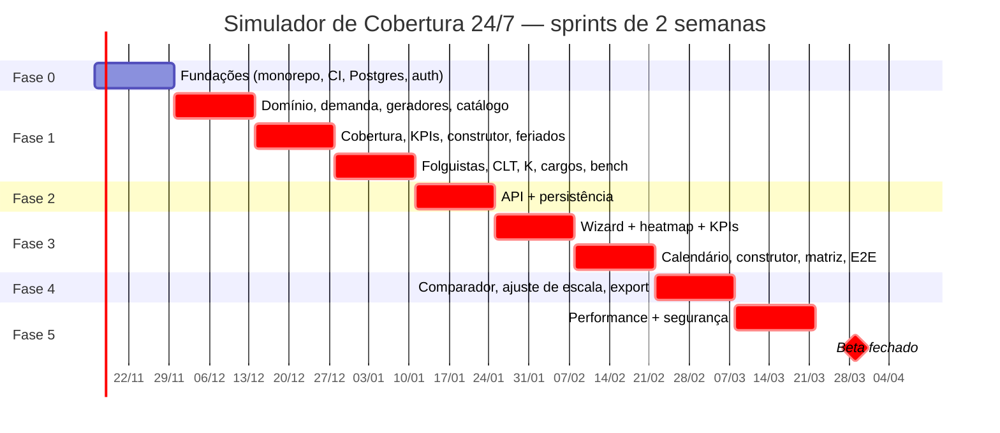

# 06 — Plano de Implementação: Simulador Operacional de Cobertura 24/7 (CLT Brasil)

> Fonte: `01-PRD.md` (PRD v3.2 — IDs FR-01…FR-38, NFR-01…NFR-09 canônicos), `02-TRD.md` (módulos do motor M1–M6), `03-fluxo-do-app.md` (telas T0–T9), `05-esquema-backend.md` (tabelas e endpoints). Estrutura inspirada nos guias `ecc:plan` / `product-management:sprint-planning`.
> **Foco do MVP: cobertura.** O caminho crítico é demanda → gerador de turmas → cobertura hora a hora → heatmap. Viabilidade CLT entra no motor como restrição. O **financeiro (Módulo 6) sai do MVP** e vai para a "Fase futura" (§3, último bloco).
> Estado atual do repositório: `frontend/` (React 19 + TS 5.9 + Vite 7 + Tailwind 4, app inicial) e `backend/` (FastAPI com módulo de atas, `requirements.txt` sem versões fixadas, sem Alembic, sem testes, sem CI em `.github/`).

## 1. Premissas
- Sprints de **2 semanas**; capacidade ~**40 pontos/sprint** (equipe da seção 6). 1 ponto ≈ meio dia de dev focado.
- Motor de cálculo é **Python puro** em `backend/app/services/engine/` (sem FastAPI/DB; árvore em `05` §6), determinístico, tempo em minutos inteiros e hora noturna em `Fraction(8,7)` (NFR-02), testes golden.
- Módulo isolado do código de atas; prefixo de API **`/api/v1/escalas`**.
- Fora do MVP: ILP (M5), financeiro (M6), alocação nominal, calendário pessoal, layouts WFM/AFDT — ver "Fase futura".

## 2. Visão das fases

| Fase | Sprints | Objetivo | FRs/NFRs (`01-PRD.md`) |
|---|---|---|---|
| 0 Fundações | S1 | Monorepo, CI, Postgres/Alembic, auth | base |
| 1 Motor de cobertura | S2–S4 | M1 demanda, M2 geradores + **catálogo ampliado/construtor**, **M3 cobertura/dimensionamento + K + cargos**, M4 viabilidade | FR-01–03, FR-05–21, FR-28–36, NFR-01/02/04 |
| 2 API + persistência | S5 | Endpoints, modelos, jobs (+ cargos, matriz, K, templates) | FR-01, FR-02, FR-05–20, FR-24, FR-28–36, NFR-03/05 |
| 3 Frontend | S6–S7 | Wizard, heatmap + KPIs (por cargo), calendário, viabilidade, construtor, matriz | FR-01–03, FR-05–21, FR-28–36, NFR-06/07 |
| 4 Comparador, ajuste e export | S8 | Comparador operacional, ajuste de escala (T5), CSV/XLSX; P1 do construtor (camadas, templates, substituição parcial) | FR-12, FR-13, FR-22–24, FR-29 P1, FR-30, FR-31, FR-35 P1 |
| 5 Hardening + beta | S9–S10 | 1.000 colab ≤ 2 s, segurança, beta | NFR-01, todos |
| Futura | pós-beta | Financeiro (M6), Erlang-C, ILP (com K e cargos), proporções, multi-skill, nominal, WFM | FR-04, FR-25–27, FR-37, FR-38 |

Total MVP: **10 sprints (~20 semanas)**.

## 3. Backlog detalhado por fase

Legenda: **Pts** = pontos; **Dep** = dependências; **DoD** = critério de pronto específico.

### Fase 0 — Fundações (Sprint 1)

| ID | Item / tarefas | Dep | Pts | DoD | FR |
|---|---|---|---|---|---|
| F0-1 | Monorepo: `pyproject.toml` (uv/poetry) com versões fixadas; deps pesadas em extra; `Makefile` `dev`, `test`, `lint` | — | 3 | `make test` roda back e front do zero | — |
| F0-2 | Qualidade: ruff + mypy (strict em `services/engine/`), pytest + coverage; ESLint/Prettier, Vitest + Testing Library | F0-1 | 3 | lint/types sem erro na main | — |
| F0-3 | CI GitHub Actions: back (lint, mypy, pytest), front (lint, tsc, vitest, build); required checks | F0-2 | 5 | PR bloqueado se qualquer job falha | — |
| F0-4 | Postgres 16 via docker-compose; SQLAlchemy 2; Alembic com migração inicial | F0-1 | 5 | `alembic upgrade head` em CI | — |
| F0-5 | Auth JWT (access+refresh); `users`, `organizations`, `memberships`; papéis `owner/admin/planner/legal_reviewer/viewer` | F0-4 | 8 | rotas protegidas 401/403 em testes | — |
| F0-6 | pydantic-settings; logging JSON; `/health` | F0-1 | 3 | `/health` verde em CI e compose | — |
| F0-7 | Frontend: React Router, cliente tipado (openapi-typescript), TanStack Query, layout base, login | F0-5 | 8 | login + rota protegida E2E local | — |
| F0-8 | ADRs: tempo em minutos + Fraction(8,7), engine puro, formato canônico de escala (turma × dia) | — | 2 | ADRs em `docs/simulador-escalas/adr/` | NFR-02 |

**Total ≈ 37 pts.** Demo: login + health + pipeline verde.

### Fase 1 — Motor de cobertura em Python puro (Sprints 2–4)

| ID | Item / tarefas | Dep | Pts | DoD | FR |
|---|---|---|---|---|---|
| F1-1 | Domínio: `Turno`, `Turma(kind=regular|folguista)`, `Padrao`, `Escala`, `Achado`; dataclasses frozen; minutos absolutos | F0-8 | 5 | 100% tipado | base |
| F1-2 | M1 demanda: curva 168 h, postos fixos (com posto crítico), shrinkage D/N (`N_bruto`) | F1-1 | 5 | exemplos FR-01–03 do PRD | FR-01–03 |
| F1-3 | M2 gerador cíclico genérico por **dia absoluto** + padrões 6x1, 12x36 (4T, L=2, ciclo 14 d), 6x2 (4T, L=8, 56 d) | F1-1 | 8 | 6x2: 1 turma em M/T/N/F por dia em 56 d; 12x36 sem 2 dias seguidos na virada 31→1 | FR-05, FR-06 |
| F1-4 | M2 padrões 4x2 (**5 turmas** L=6 e **9 meias-turmas** L=18) e **5 turmas** (L=10, **33,6 h**, 70 d) | F1-3 | 5 | 4x2 5T excedente 11,1%; 9 meias exata; 5T 33,6 h | FR-05, FR-06 |
| F1-5 | Golden-test harness: fixtures YAML em `tests/engine/golden/`, revisão por SME de operações + CLT | F1-2 | 3 | ≥ 30 casos golden assinados | NFR-04 |
| F1-6 | **M3 cobertura hora a hora** do horizonte + agregação 7×24 (pior caso/média) + status déficit/exato/excesso | F1-3 | 8 | 12x36 2 postos: 168/168 h; 4x2 4T: déficit 11,1% dos turnos-dia | FR-09 |
| F1-7 | **M3 KPIs**: % horas-posto cobertas, déficit, pico (dia/hora), horas com déficit, excesso | F1-6 | 3 | KPIs = soma das células (propriedade) | FR-14 |
| F1-8 | **M3 dimensionamento**: `K* = s·L/w`, headcount mínimo com/sem reserva, `COB_TURMAS_INSUFICIENTES` | F1-6 | 3 | 6x2 3 postos → K=4, HC=12; 4x2 4T → sugere 5T ou 9 meias | FR-07 (P1), FR-08 |
| F1-9 | **M3 furos no intervalo** (computado com rendição / não computado / volantes) | F1-6 | 5 | 6x2 3 postos não computado = 63 h-posto/semana | FR-10 |
| F1-10 | **M3 cobertura com shrinkage** (visão "postos + reserva") | F1-6, F1-2 | 3 | exemplo FR-11 (déficit esperado 0,3 posto à noite) | FR-11 |
| F1-11 | **M3 calendário real**: feriados (nacionais + manuais) e política em feriado | F1-6 | 3 | exemplo FR-12 | FR-12 |
| F1-12 | **M3 folguistas/volantes**: heurística gulosa + "calcular mínimo" (usa F1-15 `valida_incremental`) | F1-6, F1-15 | 8 | 6x1 baseline → 4 turmas + N folguistas, déficit 0 | FR-13 |
| F1-13 | M4 interjornada (timestamps absolutos), DSR 35 h, 7º dia | F1-1 | 5 | `CLT_INTERJORNADA` no caso 06h→14h; `CLT_SETIMO_DIA` | FR-15, FR-16 |
| F1-14 | M4 domingo periódico, revezamento 6 h/8 h, 12x36 (dobra/36 h), jornada computada com 8/7 e Súmula 60, média semanal | F1-13 | 8 | 22–06 = 9,142857 h → `CLT_JORNADA_DIARIA`; 6x2 contrato 40 h → `CLT_MEDIA_SEMANAL` | FR-17–20 |
| F1-15 | M4 `valida_incremental` (vizinhança ±7 dias) | F1-13 | 2 | ≤ 300 ms por movimento | FR-13, T5 |
| F1-16 | Testes de propriedade (Hypothesis): escalas do catálogo sem `CLT_*` ERRO; `K < K*` ⇒ déficit; KPIs consistentes | F1-6..14 | 3 | 1.000 exemplos sem falha | FR-08, FR-09 |
| F1-17 | Benchmark (pytest-benchmark) 1.000 colab × 8 semanas | F1-6..14 | 2 | baseline registrado; motor < 1,5 s | NFR-01 |

| F1-18 | **M2b catálogo ampliado**: seeds + golden de todos os códigos da `01` §6.1 (K\*, exato, h/sem); variantes meias-turmas (6x1 7 meias, 6x3 9 meias) e estado `R` | F1-3, F1-5 | 5 | tabela §6.1 reproduzida por teste; DuPont/Panamá → `CLT_REVEZAMENTO_6H` ERRO; Continental → `CLT_SETIMO_DIA` | FR-28 |
| F1-19 | **M2b construtor** `validar_padrao` (K\*, exato, h/sem, máx. consecutivos, interjornada cíclica, 7 d), gerador de blocos frente/trás, data-âncora, turnos sobrepostos/tamanhos diferentes | F1-3, F1-13 | 5 | `[M,M,T,T,N,N,F,F,F]` → 4,5 + `COB_PADRAO_NAO_EXATO`; N→T → `CLT_INTERJORNADA`; ≤ 50 ms | FR-29 |
| F1-20 | Intervalo **escalonado** (política FR-10) e `CLT_TEMPO_PARCIAL`, split > 2 h em `CLT_INTRAJORNADA` | F1-9, F1-14 | 3 | golden por caso | FR-10, FR-28 |
| F1-21 | **M3 K como restrição**: fixo (busca de offsets que maximiza cobertura), faixa/livre (menor K), tamanho mín./máx., meias-turmas, turmas de tamanhos diferentes | F1-8 | 8 | 6x2 K=3 → 75% e 126 h-posto/sem; 4x2 faixa 4–6 → K=5; `COB_K_INSUFICIENTE`, `COB_TURMA_ABAIXO_MINIMO` | FR-32, FR-33 |
| F1-22 | **M3 cobertura por cargo**: oferta por cargo, min-cost-flow por hora com cache de perfis (ADR-009), mínimos por cargo/habilidade, KPIs por cargo | F1-6 | 8 | enfermeiro→técnico cobre, inverso não; `COB_CARGO_SEM_QUALIFICADO`; ≤ 50 ms 20 cargos | FR-34–36 |
| F1-23 | **Folguistas com cargo** (respeita matriz e prioridade) | F1-12, F1-22 | 3 | folguista técnico nunca cobre enfermeiro | FR-13, FR-35 |
| F1-24 | Propriedades: matriz direcional nunca cobre B→A sem regra; uma pessoa-hora usada uma vez; K mínimo é monótono | F1-21, F1-22 | 2 | 1.000 exemplos | FR-32, FR-35 |

**Total ≈ 113 pts** (S2: F1-1..5, F1-18; S3: F1-6..11, F1-19, F1-20; S4: F1-12..17, F1-21..24) — dentro da capacidade de 3 sprints (~120). Demo S4: CLI `python -m app.services.engine simulate 6x2 --turmas 4 --postos 3` imprime KPIs de cobertura, heatmap ASCII e achados (fluxo 4.1 do `03`).

### Fase 2 — API + persistência (Sprint 5)

| ID | Item / tarefas | Dep | Pts | DoD | FR |
|---|---|---|---|---|---|
| F2-1 | Migrações conforme `05` §3: `operations`, `positions`, `demand_curves`, `demand_slots`, `shrinkage_profiles`, `shift_templates`, `schedule_models`, `rotation_patterns`, `scenarios`, `teams`, `assignments`, `coverage_results`, `compliance_rules`, `compliance_findings`, `simulation_jobs`, `exports`, `audit_log` + RLS | F0-4, F1-1 | 8 | up/down testada; RLS testado | FR-01, FR-05, FR-24 |
| F2-2 | CRUD de operações/postos/curvas/cenários + `slots:import` CSV/XLSX (168 linhas) | F2-1 | 5 | erros 422 legíveis | FR-01, FR-02, FR-24 |
| F2-3 | `POST /scenarios/{id}/simulate` → motor M1→M4, persiste; síncrono ≤ 2 s, fallback Celery | F2-1, F1 | 8 | contrato OpenAPI; integração | FR-05–20 |
| F2-4 | `GET /scenarios/{id}/coverage` (KPIs + heatmap `view`/`agg`) e `POST /scenarios/{id}/sizing` | F2-3 | 3 | payload ≤ 50 KB | FR-08–14 |
| F2-5 | `GET /compliance-findings`, `PATCH /assignments/{id}` com revalidação incremental | F1-15, F2-3 | 3 | retorna delta de cobertura + achados | FR-12, FR-13, FR-15–20 |
| F2-6 | Auditoria/reprodutibilidade: `inputs_hash`, `engine_version`, `rules_version` | F2-3 | 3 | resultado reproduzível por hash | NFR-03 |
| F2-7 | Autorização por organização em todas as rotas | F0-5 | 3 | org A não lê org B | segurança |
| F2-8 | Tipos TS gerados do OpenAPI no CI | F2-3, F0-7 | 2 | diff falha CI se desatualizado | NFR-05 |
| F2-9 | Migrações `05` §3.12: `roles`, `skills`, `role_skills`, `position_skills`, `employee_skills` (vazia), `substitution_rules`, `role_coverage_requirements`, `team_constraints`, `custom_schedule_patterns(_versions)`, `scenario_layers`, `team_role_composition`, `coverage_role_results` + seeds do catálogo + RLS | F2-1 | 3 | up/down + RLS testados | FR-28–36 |
| F2-10 | Endpoints de cargos/habilidades/matriz/mínimos e `team-constraints` | F2-9 | 3 | `PUT /substitution-rules` atômico; 422 em diagonal | FR-32–36 |
| F2-11 | `custom-schedule-patterns` CRUD + `:validate` + `:derive`; `coverage?role=` | F2-9, F1-19 | 3 | `:validate` ≤ 300 ms p95 | FR-29, FR-31, FR-35 |

**Total ≈ 44 pts** (≈ 10% acima da capacidade; F2-11 pode escorregar para o início da S6 sem afetar o caminho crítico). Demo: Swagger simulando 4x2 com 4 turmas → `COB_TURMAS_INSUFICIENTES` e heatmap com déficit.

### Fase 3 — Frontend: wizard, heatmap, calendário (Sprints 6–7)

| ID | Item / tarefas | Dep | Pts | DoD | FR |
|---|---|---|---|---|---|
| F3-1 | Tokens Tailwind (`04` §14, incl. turma B escuro `#CF7A24`), componentes base | F0-7 | 5 | catálogo de componentes | NFR-06 |
| F3-2 | Wizard passo 1 (Operação e regras CCT/ACT, feriados, política em feriado) | F3-1, F2-2 | 3 | zod | FR-12, FR-17, FR-18 |
| F3-3 | Passo 2 Demanda: postos fixos + grade 168 h + upload + colar do Excel | F3-2 | 8 | 168 células fluidas; RTL | FR-01, FR-02 |
| F3-4 | Passo 3 Shrinkage e reserva | F3-2 | 3 | defaults do PRD | FR-03, FR-11, FR-13 |
| F3-5 | Passo 4 Modelo e turmas (catálogo MVP, K sugerido, intervalo, folguistas) + Passo 5 Revisão | F3-2, F2-4 | 5 | sugestão de K vinda da API | FR-05–08, FR-10 |
| F3-6 | **Heatmap 7×24** com toggles postos/reserva e pior/média, camadas intervalo/feriado, tooltip, "Ver como tabela" | F2-4 | 8 | contraste AA; teclado; teste visual | FR-09–12 |
| F3-7 | **Cabeçalho de KPIs** + card "Como fechar o déficit" | F2-4 | 3 | KPIs batem com API | FR-08, FR-13, FR-14 |
| F3-8 | Calendário cíclico `mmc(L,7)` com folguistas, domingos/feriados, marcadores | F2-3 | 8 | 5 turmas × 70 dias < 200 ms | FR-21 |
| F3-9 | Aba viabilidade com link para a célula do calendário | F3-8 | 3 | clique foca a data | FR-15–20 |
| F3-10 | E2E Playwright wizard → T4 aba cobertura | F3-2..7 | 3 | roda no CI | fluxo 4.1 |
| F3-11 | T8.1 cargos/habilidades + T8.2 **matriz cargo × cargo** (`04` §8.11) | F2-10, F3-1 | 5 | teclado + leitura em linguagem natural | FR-34, FR-35 |
| F3-12 | T2.2 restrições de turmas + controle K (`04` §8.13) no passo 3.4 | F2-10, F3-5 | 3 | K\* marcado no slider | FR-32, FR-33 |
| F3-13 | T9 **construtor**: editor de sequência arrastável, régua de turnos, painel de validação ao vivo (`04` §8.9–8.10) | F2-11, F3-1 | 8 | validação ≤ 300 ms; acessível por teclado | FR-29 |
| F3-14 | Passo 3.2 demanda por cargo + mínimos; passo 3.4 composição por turma; catálogo ampliado agrupado (T8.3) | F3-3, F3-5 | 5 | filtros "exato" e "viável sem CCT" | FR-28, FR-34, FR-36 |
| F3-15 | Heatmap filtrável por cargo + tabela cargo × KPI (`04` §8.12) | F3-6 | 3 | glifo ↺ de substituição | FR-09, FR-35 |

**Total ≈ 73 pts** (S6: F3-1..5, F3-11, F3-12, F3-14; S7: F3-6..10, F3-13, F3-15). Demo S7: fluxo 4.1 (6x1 → 6x2) ponta a ponta no navegador.

### Fase 4 — Comparador operacional, ajuste de escala e export (Sprint 8)

| ID | Item / tarefas | Dep | Pts | DoD | FR |
|---|---|---|---|---|---|
| F4-1 | `POST /scenario-comparisons` (até 5) com deltas de KPIs de cobertura | F2-4 | 3 | contrato + testes | FR-22 |
| F4-2 | UI comparador (T6) + gráfico de déficit/headcount | F4-1, F3-1 | 5 | fluxo 4.3 do `03` reproduzido | FR-22 |
| F4-3 | Ajuste de escala (T5): turma × dia, folguista, feriado; revalidação < 300 ms; nova versão | F2-5, F3-8 | 8 | fluxo 4.2 do `03` (12x36 feriado) E2E | FR-12, FR-13, FR-24 |
| F4-4 | Export XLSX/CSV (`Escala`, `Cobertura168h`, `KPIs`, `Violacoes`, `Parametros`) | F2-3 | 5 | round-trip; 6x2 = 4 × 56 | FR-23 |
| F4-5 | Homologação (T7): checklist, `approve`, somente leitura | F2-3 | 3 | `blocking_findings` 422 testado | FR-24 |
| F4-6 | Histórico de alterações (`audit_log`) | F4-3 | 3 | quem/quando/o quê | NFR-03 |
| F4-7 | (P1) Construtor avançado: folgas fixas, regra de feriado por modelo, ciclo em horas (18x36) | F1-19, F3-13 | 5 | domingo fixo no 6x2 mostra déficit de domingo | FR-29 P1 |
| F4-8 | (P1) **Camadas** (mix 12x36 + reforço 5x2) no motor e na UI | F1-19, F3-13 | 5 | exemplo FR-30 com 168/168 h | FR-30 |
| F4-9 | (P1) Templates da organização versionados | F2-11 | 2 | cenário mantém versão usada | FR-31 |
| F4-10 | (P1) Substituição parcial (GLOP) e limite de horas fora do cargo | F1-22 | 3 | 2 operadores f = 0,5 cobrem 1 líder | FR-35 P1 |
| F4-11 | Comparador com "h cobertas por substituição" e "h sem qualificado" | F4-1, F1-22 | 1 | — | FR-22, FR-35 |

**Total ≈ 43 pts** (F4-7..F4-10 são P1 — cortáveis sem afetar o MVP P0). Demo: "quantas turmas preciso?" comparando 6x1, 6x2, 4x2 4T/5T e 5 turmas.

### Fase 5 — Hardening, performance, segurança, beta (Sprints 9–10)

| ID | Item / tarefas | Dep | Pts | DoD | FR |
|---|---|---|---|---|---|
| F5-1 | Perf: profiling, vetorização, cache por `inputs_hash` | F1-17 | 8 | p95 simulate 1.000 colab ≤ 2,0 s | NFR-01 |
| F5-2 | Teste de carga (k6/Locust): 20 usuários simultâneos | F5-1 | 5 | p95 dentro do SLO | NFR-01 |
| F5-3 | Segurança: OWASP ASVS L1, rate limit, CORS, headers, limites de upload, `pip-audit`/`npm audit`, Bandit | F0-5 | 8 | zero high/critical | — |
| F5-4 | Observabilidade (Prometheus/OTel por módulo M1–M4), alertas | F0-6 | 5 | dashboard de latência | — |
| F5-5 | Deploy staging/produção (Docker, migrações, backup) | F0-4 | 5 | rollback testado | — |
| F5-6 | Acessibilidade WCAG 2.2 AA e UX review | F3 | 3 | axe sem violações sérias | NFR-06 |
| F5-7 | Beta fechado com 2–3 operações, coleta de KPIs (§3.3 do PRD) | todos | 13 | time-to-coverage e redução de horas-posto descobertas medidos | KPIs |

**Total ≈ 47 pts.**

### Fase futura (pós-MVP — PRD Fase 2/3)

| ID | Item | FR | Observação |
|---|---|---|---|
| FX-1 | **M6 financeiro**: adicional noturno, DSR reflexo, HE, periculosidade/insalubridade, encargos (Decimal) | FR-25, FR-26 | Depende de Q1, Q3, Q6 e planilha de referência do DP |
| FX-2 | Comparador financeiro + "4 turmas + HE vs. 5ª turma" (breakeven/payback) e aba `custos` | FR-27 | Antiga Fase 4 do plano v1 |
| FX-3 | Erlang-C / UPH-TMA | FR-04 | — |
| FX-4 | M5 ILP CP-SAT (turnos livres, folguistas ótimos) | — | Feature flag |
| FX-5 | Alocação nominal, calendário pessoal (.ics/PDF), LGPD completa | NFR-08 | — |
| FX-6 | CLT rural; split shift multibloco completo | FR-28 | Catálogo ampliado entrou no MVP (v3.2) |
| FX-8 | **Proporções entre cargos** (1 enfermeiro : 4 técnicos) como restrição | FR-37 | M3 só verifica no MVP; CP-SAT resolve |
| FX-9 | **Multi-skill avançado** e custo de substituição; `employee_skills` | FR-38 | Exige alocação nominal (FX-5) |
| FX-10 | CP-SAT com K, tamanho, autômato de padrão e cargos (`02` §5.6 v3.2) | FR-32–38 | Modo "escala livre" |
| FX-7 | Layouts WFM (TOTVS, Senior, ADP, SAP) e AFDT/ACJEF | — | PRD Fase 3 |

## 4. Caminho crítico

`F0-1 → F0-4 → F1-1 → F1-3 → F1-6 → (F1-8..F1-12, F1-21, F1-22) → F1-13 → F2-1 → F2-3 → F2-4 → F3-6/F3-7 → F4-3 → F5-1 → F5-7 (beta)`

Pontos sensíveis: (a) validação dos golden de cobertura e viabilidade pelo SME (F1-5); (b) contrato de `simulate`/`coverage` (F2-3/F2-4) — bloqueia todo o frontend de resultados; (c) heurística de folguistas (F1-12) e sua versão por cargo (F1-23); (d) performance (F5-1), agora incluindo a alocação por cargo (F1-22); (e) construtor ao vivo (F3-13) depende de `:validate` (F2-11).

## 5. Gantt

## 6. Equipe sugerida

| Papel | Dedicação | Responsabilidade |
|---|---|---|
| Tech lead / backend sênior (Python) | 100% | motor (M1–M4), arquitetura, ADRs |
| Backend pleno | 100% | API, persistência, export |
| Frontend sênior (React/TS) | 100% (a partir de S3) | wizard, heatmap, calendário |
| QA/automação | 50% | golden harness, Playwright, carga |
| SME de operações 24/7 + especialista CLT | 20% | casos golden de cobertura e viabilidade |
| Product manager / designer | 50% | backlog, UX, beta |
| DevOps | 20% | CI, deploy, observabilidade |

## 7. Riscos e mitigação

| Risco | Prob. | Impacto | Mitigação |
|---|---|---|---|
| KPIs de cobertura não refletirem a operação real (pior caso vs. média, feriados) | Média | Alto | Q10/Q11 decididos com pilotos; toggles na UI; golden assinados pelo SME de operações |
| Heurística de folguistas subótima | Média | Médio | Reportar "mínimo encontrado"; CP-SAT na fase futura |
| Interpretação jurídica (Súmula 60, domingo, CCT) | Média | Médio | Regras parametrizáveis; disclaimer; fonte exibida |
| Performance 1.000 colab > 2 s | Média | Alto | benchmark desde F1-17; simular por turma; cache; job assíncrono |
| Turnos cruzando meia-noite / virada de mês | Média | Médio | minutos e dia absolutos; testes de propriedade |
| Pressão para trazer custo ao MVP | Média | Médio | Módulo 6 especificado (FR-25–27) e planejado como FX-1/FX-2 |
| Escopo v3.2 (catálogo, construtor, K, cargos) estoura sprints | Média | Médio | P1 isolados em F4-7..F4-10; catálogo é dado (ADR-010); cortar P1 antes de mexer no caminho crítico |
| Matriz de substituição mal entendida (direção) | Média | Alto | Rótulos explícitos de direção, leitura em linguagem natural, golden "enfermeiro→técnico" |
| Backend existente com deps sem versão | Alta | Baixo | lock em F0-1 |
| Equipe pequena / dependência do tech lead | Média | Médio | ADRs, pareamento, tarefas pequenas para agentes |

## 8. Estratégia de testes por fase

| Fase | Testes |
|---|---|
| 0 | smoke de CI, migração, auth (401/403) |
| 1 | unitários ≥ 90% em `engine/` (NFR-04); **golden** de cobertura (KPIs exatos) e de viabilidade; propriedade (Hypothesis); benchmark |
| 2 | integração FastAPI + Postgres; contrato OpenAPI; isolamento multi-tenant (RLS) |
| 3 | Vitest + RTL; Playwright do wizard; regressão visual do heatmap; axe |
| 4 | E2E do comparador e do ajuste com violação; round-trip CSV/XLSX |
| 5 | carga, SAST/DAST, auditoria de deps, recuperação de backup |

## 9. Marcos e demos

| Marco | Fim de | Demo |
|---|---|---|
| M0 Fundações | S1 | login, `/health`, CI verde |
| M1 Motor de cobertura | S4 | CLI: 6x2 4T 100% coberto; 4x2 4T com déficit e sugestão de 5T; 6x1 + folguistas; catálogo §6.1 completo; K fixo = 3 no 6x2; UTI enfermeiro→técnico |
| M2 API | S5 | Swagger: criar cenário, simular, ver cobertura e achados |
| M3 MVP visual | S7 | wizard → heatmap + KPIs (por cargo) → calendário; construtor e matriz de substituição no navegador |
| M4 Decisão operacional | S8 | comparador "quantas turmas?", ajuste de feriado com folguista, export XLSX |
| M5 Beta | S10 | 1.000 colab ≤ 2 s; beta com operações piloto |

## 10. Checklist de Definição de Pronto (DoD)

- [ ] Código revisado por ≥ 1 pessoa (ou humano revisando PR de agente)
- [ ] Lint, tipos (mypy/tsc) e testes passando no CI
- [ ] Cobertura de testes: engine ≥ 90% (NFR-04), backend ≥ 85%, frontend ≥ 70%
- [ ] Regras de cobertura e viabilidade com caso golden aprovado pelo SME e fonte citada
- [ ] Tempo em minutos inteiros e hora noturna em `Fraction(8,7)` (NFR-02)
- [ ] Migração Alembic com upgrade e downgrade testados (se houver)
- [ ] Contrato OpenAPI atualizado e tipos TS regenerados
- [ ] Autorização por organização verificada
- [ ] Sem regressão no benchmark do motor (> 10% falha)
- [ ] Acessibilidade (teclado, contraste) em telas novas
- [ ] Critério de aceite do item e FR ligado demonstrados

## 11. Ordem sugerida para agentes de código

Cada tarefa: pequena (≤ 1 PR, ≤ ~300 linhas), com verificação objetiva. Executar na ordem; tarefas no mesmo nível podem ser paralelas. Caminhos do motor relativos a `backend/app/services/engine/`.

1. **A01** `backend/pyproject.toml` com deps fixadas; `requirements.txt` gerado. *Verif.:* `pip install -e .[dev]` e `python -c "import app.main"`.
2. **A02** ruff + mypy + pytest com `tests/test_health.py`. *Verif.:* verdes.
3. **A03** `/health` em `app/main.py`. *Verif.:* TestClient 200.
4. **A04** `.github/workflows/ci.yml` (back + front). *Verif.:* PR verde.
5. **A05** Vitest + RTL com 1 teste de `App`. *Verif.:* `npm test` verde.
6. **A06** docker-compose Postgres + Alembic. *Verif.:* `alembic upgrade head && alembic downgrade base`.
7. **A07** `users`/`organizations`/`memberships` + JWT. *Verif.:* 401/403/200.
8. **A08** `types.py` (Turno, Turma, Padrao, Escala, Achado). *Verif.:* mypy strict.
9. **A09** `demanda.py`, `shrinkage.py`. *Verif.:* exemplos FR-01–03.
10. **A10** `gerador.py` (dia absoluto) + 6x1, 12x36, 6x2. *Verif.:* 6x2 56 dias 1 turma/turno; 12x36 virada 31→1.
11. **A11** padrões 4x2 (5T e 9 meias) e 5T. *Verif.:* 33,6 h; excedente 11,1%.
12. **A12** Harness golden `tests/engine/golden/*.yaml`. *Verif.:* `pytest -k golden` ≥ 10 casos.
13. **A13** `cobertura.py` (horizonte, 7×24 pior/média, status). *Verif.:* 12x36 2 postos 168/168.
14. **A14** KPIs em `cobertura.py`. *Verif.:* propriedade KPIs = soma das células.
15. **A15** `dimensionamento.py` (K*, headcount). *Verif.:* 6x2 → 4/12; 4x2 4T → `COB_TURMAS_INSUFICIENTES`.
16. **A16** Furos no intervalo + shrinkage esperado + feriados. *Verif.:* 63 h-posto; exemplo FR-11; exemplo FR-12.
17. **A17** `compliance/` interjornada, DSR 35 h, 7º dia + `valida_incremental`. *Verif.:* 06h→14h = 8 h.
18. **A18** `compliance/` domingo, revezamento, 12x36, jornada (`noturno.py` 8/7 + Súmula 60), média semanal. *Verif.:* 22–06 = 9,142857.
19. **A19** `folguistas.py` (gulosa + mínimo). *Verif.:* 6x1 baseline déficit 0.
20. **A20** Hypothesis + pytest-benchmark. *Verif.:* < 1,5 s.
20a. **A35** `catalogo.py` + seeds YAML de todos os códigos da `01` §6.1 e golden de K\*/exato/h/sem. *Verif.:* `pytest -k catalogo` reproduz a tabela (inclui 6x1 7 meias e 6x3 9 meias exatos).
20b. **A36** `construtor.py` `validar_padrao` + gerador de blocos frente/trás. *Verif.:* `[M,M,T,T,N,N,F,F,F]` → K\* 9/2 + `COB_PADRAO_NAO_EXATO`; rotação para trás sem folga → `CLT_INTERJORNADA`.
20c. **A37** `turmas_k.py` (fixo/faixa/livre, tamanho, meias-turmas). *Verif.:* 6x2 K=3 → 126 h-posto/sem de déficit; 4x2 faixa 4–6 → 5.
20d. **A38** `cobertura_cargos.py` (min-cost-flow por hora, cache de perfis, mínimos). *Verif.:* golden UTI (enfermeiro cobre técnico; inverso não; plantão sem enfermeiro → `COB_CARGO_SEM_QUALIFICADO`); benchmark ≤ 50 ms.
20e. **A39** Folguistas por cargo em `folguistas.py`. *Verif.:* propriedade "folguista só cobre cargos permitidos".
21. **A21** Migrações de domínio (`05` §3, incluindo §3.12). *Verif.:* up/down + RLS em todas as tabelas novas.
22. **A22** CRUD + upload 168 h. *Verif.:* integração.
23. **A23** `simulate`, `coverage`, `sizing`, `compliance-findings`, `PATCH assignments`. *Verif.:* OpenAPI snapshot.
23a. **A40** `roles.py`, `team_constraints.py`, `custom_patterns.py` (`:validate`, `:derive`). *Verif.:* exemplos JSON do `05` §5.5 como testes de contrato.
24. **A24** Tipos TS no CI. *Verif.:* diff vazio.
25. **A25** Frontend: router, TanStack Query, login. *Verif.:* Playwright login.
26. **A26** Wizard passos 1–5 (um PR por passo). *Verif.:* RTL por passo.
27. **A27** `Heatmap7x24` + cabeçalho de KPIs. *Verif.:* render + axe.
28. **A28** `ScheduleCalendar` + aba viabilidade. *Verif.:* foco na violação.
28a. **A41** `SubstitutionMatrix` (T8.2) + cadastro de cargos (T8.1). *Verif.:* RTL + axe; leitura em linguagem natural confere com a API.
28b. **A42** `CycleSequenceEditor` + `ShiftRuler` + painel de validação (T9). *Verif.:* teclado completo; debounce ≤ 300 ms.
28c. **A43** Filtro por cargo no `Heatmap7x24` + `TeamCountControl` (T2.2/3.4). *Verif.:* fluxo 4.4 do `03` em Playwright.
29. **A29** Comparador operacional (API + UI). *Verif.:* fluxo 4.3.
30. **A30** Ajuste de escala (T5). *Verif.:* E2E fluxo 4.2.
31. **A31** Export XLSX/CSV. *Verif.:* round-trip.
32. **A32** Homologação (T7). *Verif.:* 422 `blocking_findings`.
33. **A33** Performance guiada pelo benchmark. *Verif.:* p95 ≤ 2 s.
34. **A34** Hardening (rate limit, headers, upload, audits no CI). *Verif.:* CI verde sem high.

Regras para agentes: não alterar o módulo de atas; não pular testes golden; cada PR referencia ID (A##) e FR; sem commit direto na main; não implementar FR-25–27 (financeiro) nem FR-37/38 (proporções, multi-skill) antes da fase futura; novos modelos de escala entram como dados (seed + golden), nunca como `if modelo == …` (ADR-010).
