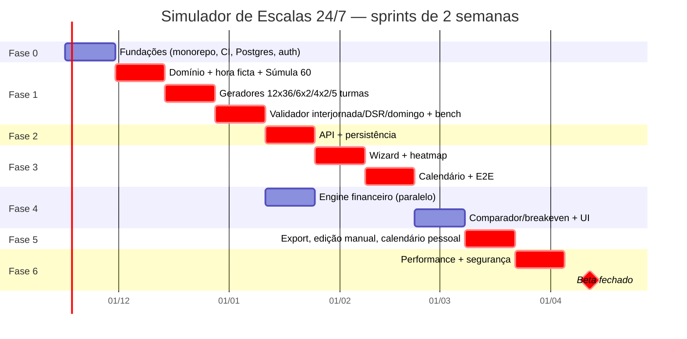

# 06 — Plano de Implementação: Simulador de Escalas 24/7 (CLT Brasil)

> Fonte: `00-prd-original.md` (FR-01…FR-14, NFR-01…NFR-04, Histórias 1–3). Estrutura inspirada nos guias `ecc:plan` / `product-management:sprint-planning`.
> Estado atual do repositório: `frontend/` (React 19 + TS 5.9 + Vite 7 + Tailwind 4, app inicial) e `backend/` (FastAPI com módulo de atas, `requirements.txt` sem versões fixadas, sem Alembic, sem testes, sem CI em `.github/`).

## 1. Premissas
- Sprints de **2 semanas**; capacidade ~**40 pontos/sprint** (equipe de seção 6). 1 ponto ≈ meio dia de dev focado.
- Motor de cálculo é **Python puro** (`backend/app/engine/`, sem FastAPI/DB), determinístico, com `Decimal` (6 casas — NFR-02) e testes golden.
- Módulo isolado do código de atas existente; prefixo de API `/api/v1/escalas`.
- Fora do escopo do MVP: ILP completo (Algoritmo 6.2) — entra como item opcional na Fase 6; usamos heurística por geradores de matriz.

## 2. Visão das fases

| Fase | Sprints | Objetivo | FRs/NFRs |
|---|---|---|---|
| 0 Fundações | S1 | Monorepo, CI, Postgres/Alembic, auth | base para todos |
| 1 Motor puro | S2–S4 | Hora ficta, Súmula 60, geradores, validador | FR-05…FR-12, NFR-01/02 |
| 2 API + persistência | S5 | Endpoints, modelos, jobs | FR-01, FR-02, FR-05 |
| 3 Frontend | S6–S7 | Wizard, heatmap, calendário | FR-01…FR-06, NFR-03 |
| 4 Financeiro | S8 | Extrato, comparador, breakeven | FR-13, FR-14, FR-03, FR-04 |
| 5 Export/edição | S9 | CSV/XLSX, edição manual validada, calendário pessoal | NFR-04, FR-10/12 |
| 6 Hardening + beta | S10–S11 | 1.000 colab ≤ 2s, segurança, beta | NFR-01, todos |

Total: **11 sprints (~22 semanas)**.

## 3. Backlog detalhado por fase

Legenda: **Pts** = pontos; **Dep** = dependências; **DoD** = critério de pronto específico.

### Fase 0 — Fundações (Sprint 1)

| ID | Item / tarefas | Dep | Pts | DoD | FR |
|---|---|---|---|---|---|
| F0-1 | Monorepo: `pyproject.toml` (uv/poetry) com versões fixadas; separar deps pesadas (shap, sklearn) em extra; `Makefile`/scripts `dev`, `test`, `lint` na raiz | — | 3 | `make test` roda back e front do zero | — |
| F0-2 | Qualidade: ruff + mypy (strict em `engine/`), pytest + coverage; ESLint/Prettier, Vitest + Testing Library | F0-1 | 3 | lint/types sem erro na main | — |
| F0-3 | CI GitHub Actions: jobs back (lint, mypy, pytest), front (lint, tsc, vitest, build), cache; required checks | F0-2 | 5 | PR bloqueado se qualquer job falha | — |
| F0-4 | Postgres 16 via docker-compose; SQLAlchemy 2 async; Alembic configurado com migração inicial vazia | F0-1 | 5 | `alembic upgrade head` em CI (service container) | — |
| F0-5 | Auth: JWT (access+refresh) ou OIDC; tabelas `users`, `organizations`; RBAC (admin, planejador, leitor); dependência `current_user` | F0-4 | 8 | rotas protegidas retornam 401/403 em testes | — |
| F0-6 | Config/segredos via pydantic-settings; logging estruturado JSON; `/health` | F0-1 | 3 | `/health` verde em CI e compose | — |
| F0-7 | Frontend: roteamento (React Router), cliente API tipado (openapi-typescript), TanStack Query, layout base, tela de login | F0-5 | 8 | login e rota protegida funcionando E2E local | — |
| F0-8 | ADRs: Decimal vs float, engine puro, formato de escala canônico (`Shift`, `Assignment`) | — | 2 | 3 ADRs em `docs/simulador-escalas/adr/` | NFR-02 |

**Total ≈ 37 pts.** Demo: login + health + pipeline verde.

### Fase 1 — Motor de cálculo puro Python (Sprints 2–4)

| ID | Item / tarefas | Dep | Pts | DoD | FR |
|---|---|---|---|---|---|
| F1-1 | Modelo de domínio: `Shift(start,end,tz)`, `Team`, `Employee`, `Schedule`, `Violation`; dataclasses frozen; timezone America/Sao_Paulo | F0-8 | 5 | 100% tipado, testes de construção/serialização | base |
| F1-2 | Hora noturna ficta 22h–05h: minutos de relógio → horas fictas (×60/52,5), turnos cruzando meia-noite | F1-1 | 5 | golden: 22h–05h = 8h fictas; 19h–07h; 23h–06h; precisão 6 casas | FR-08, NFR-02 |
| F1-3 | Súmula 60 TST: prorrogação após 05h quando jornada integral noturna cumprida; flag de CCT para desabilitar | F1-2 | 5 | golden: 22h–07h → adicional/ficta também 05–07h; 00h–07h não aplica (jornada não integral) | FR-09 |
| F1-4 | Golden-test harness: fixtures YAML/JSON em `tests/golden/`, runner parametrizado, revisão por especialista CLT | F1-2 | 3 | ≥30 casos golden assinados pelo SME | NFR-02 |
| F1-5 | Gerador 12x36 (4 turmas, dia/noite, ciclo 4 dias) | F1-1 | 5 | cobertura 24/7 exata 1 turma/turno; média 42h/sem | FR-05, FR-06, FR-07 |
| F1-6 | Gerador 6x2 revezamento 8h (4 turmas, M→T→N) | F1-1 | 5 | ciclo 8 dias, 3 turnos cobertos sempre | FR-06 |
| F1-7 | Gerador 4x2 (4 ou 5 turmas) | F1-1 | 5 | cobertura e média semanal conferem com PRD 6.3-C | FR-06 |
| F1-8 | Gerador 5 turmas (modelo francês/petroquímico, 33,6–36h) | F1-1 | 8 | média semanal ∈ [33,6; 36]; cobertura 24/7 | FR-05, FR-06 |
| F1-9 | Nº teórico de turmas (6.3-1) e defasagem de início por turma (offset) | F1-5..8 | 3 | fórmula coberta por testes de propriedade | FR-05 |
| F1-10 | Validador interjornada ≥11h entre turnos | F1-1 | 5 | caso do PRD (sai 06h, entra 14h) gera `Violation(INTERJORNADA, 8h)` | FR-10, Hist. 2 |
| F1-11 | Validador DSR: descanso ≥35h (11+24) semanal; domingo ao menos 1×/período configurável (ex. 1 a cada 7 semanas / regra CCT) | F1-1 | 8 | golden por escala; parâmetro de periodicidade | FR-12 |
| F1-12 | Alerta turnos ininterruptos de revezamento (6h salvo CCT/ACT), limite 12x36 e dobra ilegal | F1-10 | 3 | alertas com severidade e base legal | FR-11, FR-07, Hist. 2 |
| F1-13 | Dimensionamento N_req(d,t): demanda 168h, postos fixos, UPH/TMA, Erlang-C, shrinkage dia/noite, φ(t) | F1-2 | 8 | casos de 6.1 reproduzidos; Erlang-C vs tabela de referência | FR-01..04 |
| F1-14 | Testes de propriedade (Hypothesis): nenhuma escala gerada viola regras por padrão; idempotência | F1-5..12 | 5 | 1.000 exemplos sem falha | FR-10, FR-12 |
| F1-15 | Benchmark inicial (pytest-benchmark) 1.000 colab × 168h | F1-5..12 | 3 | baseline registrado; alvo < 1,5s motor | NFR-01 |

**Total ≈ 76 pts** (S2: F1-1..4,5; S3: F1-6..10; S4: F1-11..15). Demo S4: CLI `python -m app.engine simulate 6x2 --turmas 4` imprime escala + violações (História 1).

### Fase 2 — API + persistência (Sprint 5)

| ID | Item / tarefas | Dep | Pts | DoD | FR |
|---|---|---|---|---|---|
| F2-1 | Modelos/migrações: `scenario`, `demand_curve` (168 valores), `team`, `employee`, `schedule`, `assignment`, `violation`, `cct_params`, multi-tenant por `organization_id` | F0-4, F1-1 | 8 | migração up/down testada | FR-01, FR-05 |
| F2-2 | CRUD de cenários e upload de demanda CSV/XLSX (validação 168 linhas) | F2-1 | 5 | erros 422 legíveis; arquivo de exemplo | FR-01, FR-02 |
| F2-3 | `POST /scenarios/{id}/simulate` → chama engine, persiste resultado; síncrono ≤2s, fallback assíncrono (Celery/Redis já em deps) | F2-1, F1 | 8 | contrato OpenAPI; teste de integração | FR-05..12 |
| F2-4 | `GET` heatmap agregado (7×24: demanda, alocado, gap, % noturno) | F2-3 | 3 | payload ≤ 50KB | NFR-03 |
| F2-5 | `POST /validate` para escala arbitrária (base da edição manual) | F1-10..12 | 3 | retorna lista de violações | FR-10..12 |
| F2-6 | Auditoria: versão do motor + parâmetros salvos com cada resultado | F2-3 | 3 | resultado reproduzível por hash | NFR-02 |
| F2-7 | Autorização por organização em todas as rotas + testes | F0-5 | 3 | teste: usuário de org A não lê org B | segurança |
| F2-8 | Geração de tipos TS a partir do OpenAPI no CI | F2-3, F0-7 | 2 | diff de tipos falha CI se desatualizado | — |

**Total ≈ 35 pts.** Demo: Swagger simulando 12x36 e retornando violações.

### Fase 3 — Frontend: wizard, heatmap, calendário (Sprints 6–7)

| ID | Item / tarefas | Dep | Pts | DoD | FR |
|---|---|---|---|---|---|
| F3-1 | Design tokens Tailwind, componentes base (Stepper, Table, Alert, Badge de violação) | F0-7 | 5 | Storybook ou página de catálogo | — |
| F3-2 | Wizard passo 1: operação (24/7, postos fixos vs demanda) | F3-1, F2-2 | 5 | validação de formulário (zod) | FR-02 |
| F3-3 | Passo 2: demanda 168h — grade editável + upload + colar do Excel | F3-2 | 8 | edição de 168 células fluida; teste RTL | FR-01, FR-03 |
| F3-4 | Passo 3: shrinkage dia/noite, UPH/TMA, parâmetros CCT (Súmula 60, 6h/8h, domingo) | F3-2 | 5 | defaults do PRD; tooltips com base legal | FR-04, FR-09, FR-11 |
| F3-5 | Passo 4: escolha de modelo (12x36, 6x2, 4x2, 5 turmas) + nº de turmas sugerido | F3-2, F1-9 | 5 | sugestão vinda da API | FR-05, FR-06 |
| F3-6 | Heatmap 7×24 (demanda vs alocado, gap, horas noturnas) acessível (cores + texto, tooltips) | F2-4 | 8 | contraste AA; teste visual | NFR-03 |
| F3-7 | Calendário da escala por turma (mês/ciclo), cores de turno, marcação de violações | F2-3 | 8 | render 5 turmas × 56 dias < 200ms | FR-06, FR-10, FR-12 |
| F3-8 | Painel de violações/alertas com link para a célula do calendário | F3-7 | 3 | clique foca a data | FR-10..12 |
| F3-9 | Lista/gestão de cenários (salvar, duplicar) | F2-2 | 3 | E2E Playwright | — |
| F3-10 | E2E Playwright do fluxo wizard → resultado | F3-2..7 | 5 | roda no CI | Hist. 1 |

**Total ≈ 55 pts.** Demo S7: História 1 ponta a ponta no navegador.

### Fase 4 — Financeiro e comparador/breakeven (Sprint 8)

| ID | Item / tarefas | Dep | Pts | DoD | FR |
|---|---|---|---|---|---|
| F4-1 | Engine financeiro: adicional noturno (20%+), HE 50/100%, DSR sobre variáveis, reflexos (férias+1/3, 13º, FGTS, encargos) — 6.4-2 | F1-3 | 8 | golden validado por contador/SME; Decimal | FR-13, NFR-02 |
| F4-2 | Extrato de custos noturnos por turma/colaborador | F4-1 | 3 | soma = total do cenário | FR-13 |
| F4-3 | Comparador 4 turmas + HE vs 5ª turma; breakeven (nº HE/mês onde 5ª turma empata) | F4-1 | 8 | História 3 reproduzida com números do PRD | FR-14, Hist. 3 |
| F4-4 | API `/financials` e `/compare` | F4-1..3 | 3 | contrato + testes | FR-13, FR-14 |
| F4-5 | UI: extrato, gráfico de comparação, curva de breakeven | F4-4, F3-1 | 8 | eixos/legendas claros; export PNG opcional | FR-14 |
| F4-6 | Parâmetros salariais por cargo/turma (form + persistência) | F2-1 | 3 | migração + validação | FR-13 |

**Total ≈ 33 pts.** Demo: decisão "contratar 5ª turma?" com breakeven.

### Fase 5 — Export, edição manual, calendário pessoal (Sprint 9)

| ID | Item / tarefas | Dep | Pts | DoD | FR |
|---|---|---|---|---|---|
| F5-1 | Export CSV/XLSX (openpyxl) da alocação + extrato financeiro | F2-3, F4-1 | 5 | abre no Excel/LibreOffice; teste de round-trip | NFR-04 |
| F5-2 | Layouts de integração (perfil genérico + TOTVS/Senior como mapeamentos configuráveis; AFDT/ACJEF como etapa posterior) | F5-1 | 5 | spec de colunas documentada | NFR-04 |
| F5-3 | Edição manual: drag/troca de turno no calendário com revalidação imediata (`/validate`), bloqueio ou override com justificativa | F2-5, F3-7 | 8 | troca ilegal mostra violação < 300ms; override auditado | FR-10, FR-12, Hist. 2 |
| F5-4 | Histórico de alterações (quem/quando/o quê) | F5-3 | 3 | tabela `schedule_change` | NFR-02 |
| F5-5 | Calendário pessoal do colaborador (visão por pessoa, export .ics) | F3-7 | 5 | .ics importa no Google/Outlook | FR-06 |
| F5-6 | Alocação nominal colaborador → turma (import lista) | F2-1 | 3 | 1.000 nomes importados | FR-05 |

**Total ≈ 29 pts.**

### Fase 6 — Hardening, performance, segurança, beta (Sprints 10–11)

| ID | Item / tarefas | Dep | Pts | DoD | FR |
|---|---|---|---|---|---|
| F6-1 | Perf: profiling, vetorização (numpy) do validador, cache por hash de parâmetros | F1-15 | 8 | p95 simulate+validate 1.000 colab ≤ 2,0s no ambiente alvo | NFR-01 |
| F6-2 | Teste de carga (Locust/k6): 20 usuários simultâneos | F6-1 | 5 | sem erro, p95 dentro do SLO | NFR-01 |
| F6-3 | Segurança: OWASP ASVS L1, rate limit, CORS restrito, headers, limites de upload, `pip-audit`/`npm audit`, Bandit, dependabot | F0-5 | 8 | zero high/critical aberto | — |
| F6-4 | LGPD: minimização de dados de colaborador, retenção, exportação/exclusão | F2-1 | 5 | checklist LGPD assinado | — |
| F6-5 | Observabilidade: métricas (Prometheus/OTel), tracing do motor, alertas | F0-6 | 5 | dashboard com latência do motor | — |
| F6-6 | Deploy staging/produção (Docker, migrações automáticas, backup Postgres) | F0-4 | 5 | rollback testado | — |
| F6-7 | Acessibilidade e UX review; ajuda contextual com base legal | F3 | 3 | axe sem violações sérias | NFR-03 |
| F6-8 | (Opcional) Otimizador ILP (OR-Tools/PuLP) 6.2 atrás de feature flag | F1 | 8 | resultado ≤ custo heurística em casos teste | 6.2 |
| F6-9 | Beta fechado com 2–3 clientes, coleta de feedback, correções | todos | 13 | NPS/KPIs da seção 3 medidos | KPIs |

**Total ≈ 60 pts (sem F6-8: 52).**

## 4. Caminho crítico

`F0-1 → F0-4 → F1-1 → F1-2 → F1-3 → (F1-5..8) → F1-10 → F1-11 → F2-1 → F2-3 → F2-4 → F3-6/F3-7 → F5-3 → F6-1 → F6-9 (beta)`

Pontos sensíveis: (a) validação jurídica dos golden tests (F1-4) — bloqueia confiança em F4; (b) F2-3 contrato da simulação — bloqueia todo o frontend de resultados; (c) F6-1 performance. O financeiro (F4) roda em paralelo a F3 a partir de F1-3, com folga de ~1 sprint.

## 5. Gantt

## 6. Equipe sugerida

| Papel | Dedicação | Responsabilidade |
|---|---|---|
| Tech lead / backend sênior (Python) | 100% | motor, arquitetura, ADRs |
| Backend pleno | 100% | API, persistência, export |
| Frontend sênior (React/TS) | 100% (a partir de S3) | wizard, heatmap, calendário |
| QA/automação | 50% | golden harness, Playwright, carga |
| Especialista CLT / DP (SME) | 20% | casos golden, revisão de regras e CCT |
| Product manager / designer | 50% | backlog, UX, beta |
| DevOps | 20% | CI, deploy, observabilidade |

Agentes de código podem executar boa parte das tarefas da seção 11 sob revisão humana.

## 7. Riscos e mitigação

| Risco | Prob. | Impacto | Mitigação |
|---|---|---|---|
| Interpretação jurídica errada (Súmula 60, DSR dominical, CCT) | Média | Alto | SME assina golden tests; regras parametrizáveis por CCT; disclaimer; base legal exibida |
| Variação de CCT entre sindicatos | Alta | Médio | `cct_params` versionado por cenário; defaults conservadores |
| Performance 1.000 colab > 2s | Média | Alto | benchmark desde F1-15; numpy; cache; job assíncrono fallback |
| Erros de arredondamento | Média | Alto | `Decimal` com 6 casas, arredondamento só no fim (ADR) |
| Escopo de integrações WFM (TOTVS, Senior, ADP, SAP, AFDT) | Alta | Médio | MVP com CSV/XLSX genérico + mapeamentos; layouts oficiais pós-beta |
| Fuso/horário de verão e turnos cruzando meia-noite | Média | Médio | datetimes tz-aware; testes específicos |
| Backend existente com deps pesadas/sem versão | Alta | Baixo | extras opcionais e lock em F0-1 |
| Dados pessoais (LGPD) | Média | Alto | F6-4, RBAC, multi-tenant desde F2 |
| Equipe pequena / dependência do tech lead | Média | Médio | ADRs, pareamento, tarefas pequenas para agentes |

## 8. Estratégia de testes por fase

| Fase | Testes |
|---|---|
| 0 | smoke de CI, teste de migração, testes de auth (401/403) |
| 1 | unitários ≥ 95% de cobertura em `engine/`; **golden** (YAML assinados pelo SME); propriedade (Hypothesis); benchmark |
| 2 | integração FastAPI + Postgres (testcontainers/service); contrato OpenAPI; isolamento multi-tenant |
| 3 | Vitest + RTL por componente; Playwright E2E do wizard; regressão visual do heatmap; axe |
| 4 | golden financeiro (planilha de referência do contador); reconciliação de totais |
| 5 | round-trip CSV/XLSX; E2E de edição manual com violação; validação de .ics |
| 6 | carga (k6/Locust), SAST/DAST (Bandit, ZAP baseline), auditoria de deps, testes de recuperação de backup |

## 9. Marcos e demos

| Marco | Fim de | Demo |
|---|---|---|
| M0 Fundações | S1 | login, `/health`, CI verde |
| M1 Motor confiável | S4 | CLI gera 6x2 de 4 turmas e bloqueia 12x36 com interjornada quebrada (Hist. 1 e 2) |
| M2 API | S5 | Swagger: criar cenário, simular, ver violações |
| M3 MVP visual | S7 | wizard → heatmap → calendário no navegador |
| M4 Decisão financeira | S8 | comparador 4 vs 5 turmas com breakeven (Hist. 3) |
| M5 Operável | S9 | export XLSX, edição manual validada, .ics pessoal |
| M6 Beta | S11 | 1.000 colab ≤ 2s; beta com clientes |

## 10. Checklist de Definição de Pronto (DoD)

- [ ] Código revisado por ≥1 pessoa (ou humano revisando PR de agente)
- [ ] Lint, tipos (mypy/tsc) e testes passando no CI
- [ ] Cobertura: engine ≥ 95%, backend ≥ 85%, frontend ≥ 70%
- [ ] Regras trabalhistas com caso golden aprovado pelo SME e base legal citada
- [ ] Cálculos monetários/horários em `Decimal`, 6 casas (NFR-02)
- [ ] Migração Alembic com upgrade e downgrade testados (se houver)
- [ ] Contrato OpenAPI atualizado e tipos TS regenerados
- [ ] Autorização por organização verificada
- [ ] Sem regressão no benchmark do motor (> 10% falha)
- [ ] Acessibilidade básica (teclado, contraste) em telas novas
- [ ] Documentação/ADR atualizada quando houver decisão
- [ ] Critério de aceite do item e FR ligado demonstrados

## 11. Ordem sugerida para agentes de código

Cada tarefa: pequena (≤ 1 PR, ≤ ~300 linhas), com verificação objetiva. Executar na ordem; tarefas no mesmo nível podem ser paralelas.

1. **A01** Criar `backend/pyproject.toml` com deps fixadas e extras `ml`; manter `requirements.txt` gerado. *Verif.:* `pip install -e .[dev]` e `python -c "import app.main"`.
2. **A02** Configurar ruff + mypy + pytest com `tests/test_health.py`. *Verif.:* `ruff check`, `mypy app`, `pytest` verdes.
3. **A03** Adicionar `/health` em `app/main.py`. *Verif.:* teste com TestClient 200.
4. **A04** Workflow `.github/workflows/ci.yml` (back + front). *Verif.:* job local com `act` ou PR verde.
5. **A05** Vitest + RTL no frontend com 1 teste de `App`. *Verif.:* `npm test` verde.
6. **A06** docker-compose Postgres + Alembic init + migração vazia. *Verif.:* `alembic upgrade head && alembic downgrade base`.
7. **A07** Modelos `users`/`organizations` + JWT. *Verif.:* testes 401/403/200.
8. **A08** `app/engine/domain.py` (Shift, Team, Employee, Schedule, Violation). *Verif.:* mypy strict + testes.
9. **A09** `engine/night.py`: `fictitious_night_hours(shift) -> Decimal`. *Verif.:* golden 22–05 = 8,000000; 19–07; 23–06.
10. **A10** `engine/sumula60.py`: prorrogação. *Verif.:* golden 22–07 vs 00–07.
11. **A11** Harness golden `tests/golden/*.yaml` + runner. *Verif.:* `pytest -k golden` lista ≥ 10 casos.
12. **A12** `engine/generators/g12x36.py`. *Verif.:* cobertura 24/7 em 28 dias, média 42h.
13. **A13** `generators/g6x2.py`. *Verif.:* ciclo 8 dias, 3 turnos cobertos.
14. **A14** `generators/g4x2.py` (4|5 turmas). *Verif.:* testes paramétricos.
15. **A15** `generators/g5turmas.py`. *Verif.:* média ∈ [33,6; 36].
16. **A16** `engine/validators/interjornada.py`. *Verif.:* caso 06h→14h gera violação de 8h.
17. **A17** `validators/dsr.py` (35h) e `validators/domingo.py`. *Verif.:* golden por gerador.
18. **A18** `validators/revezamento.py` (6h salvo CCT) e dobra ilegal 12x36. *Verif.:* alertas com `base_legal`.
19. **A19** `engine/sizing.py` (N_req, Erlang-C, shrinkage, φ). *Verif.:* exemplo do PRD 6.1.
20. **A20** Testes Hypothesis + `pytest-benchmark` 1.000 colab. *Verif.:* relatório de tempo < 1,5s.
21. **A21** Migrações de domínio (scenario, demand_curve, schedule…). *Verif.:* up/down.
22. **A22** Endpoints CRUD cenário + upload 168h. *Verif.:* testes de integração.
23. **A23** `POST /simulate`, `GET /heatmap`, `POST /validate`. *Verif.:* testes + OpenAPI snapshot.
24. **A24** Geração de tipos TS (`openapi-typescript`) + check no CI. *Verif.:* diff vazio.
25. **A25** Frontend: router, TanStack Query, login. *Verif.:* Playwright login.
26. **A26** Wizard passos 1–4 (um PR por passo). *Verif.:* RTL por passo.
27. **A27** Componente `Heatmap7x24`. *Verif.:* teste de render + axe.
28. **A28** Componente `ScheduleCalendar` + painel de violações. *Verif.:* teste de foco na violação.
29. **A29** `engine/finance.py` (adicional, HE, DSR, reflexos). *Verif.:* golden do contador.
30. **A30** `engine/compare.py` + breakeven; endpoints. *Verif.:* História 3.
31. **A31** UI comparador/breakeven. *Verif.:* RTL + snapshot.
32. **A32** Export CSV/XLSX. *Verif.:* round-trip em teste.
33. **A33** Edição manual com revalidação + override auditado. *Verif.:* E2E troca ilegal.
34. **A34** Calendário pessoal + .ics. *Verif.:* parse do .ics com `icalendar`.
35. **A35** Otimização de performance guiada pelo benchmark. *Verif.:* p95 ≤ 2s.
36. **A36** Hardening: rate limit, headers, limites de upload, `pip-audit`/`npm audit` no CI. *Verif.:* CI verde sem high.

Regras para agentes: não alterar o módulo de atas; não pular testes golden; cada PR referencia ID (A##) e FR; sem commit direto na main.
