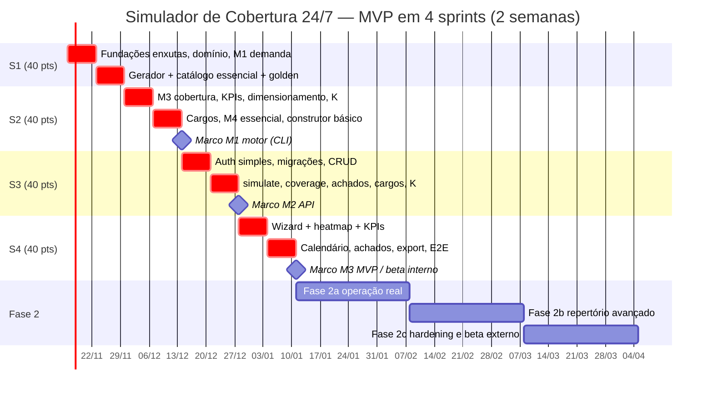

# 06 — Plano de Implementação: Simulador Operacional de Cobertura 24/7 (CLT Brasil)

> Fonte: `01-PRD.md` (PRD v3.3 — IDs FR-01…FR-38, NFR-01…NFR-09 canônicos; **P0 = MVP de 4 sprints**), `02-TRD.md` (módulos do motor M1–M6), `03-fluxo-do-app.md` (telas T0–T9), `05-esquema-backend.md` (tabelas e endpoints). Estrutura inspirada nos guias `ecc:plan` / `product-management:sprint-planning`.
> **v3.3 — MVP enxuto ponta a ponta em 4 sprints (~160 pts).** Entrega: motor de cobertura (M1 → M2 → M3 → M4 essencial) + API + persistência mínima + interface mínima (wizard, heatmap 7×24, calendário de turmas, painel de achados) + export CSV/XLSX. Todo o resto foi **reclassificado para a Fase 2** (§3.5) — nada foi apagado; os IDs `F*-*` antigos foram mantidos (itens reduzidos levam o sufixo **"enxuto"** e o restante do item aparece na Fase 2 como **"(resto)"**).
> Estado atual do repositório: `frontend/` (React 19 + TS 5.9 + Vite 7 + Tailwind 4, app inicial) e `backend/` (FastAPI com módulo de atas, `requirements.txt` sem versões fixadas, sem Alembic, sem testes, sem CI em `.github/`).

## 1. Premissas
- Sprints de **2 semanas**; capacidade ~**40 pontos/sprint** (equipe da seção 6). 1 ponto ≈ meio dia de dev focado. **MVP = 4 sprints = 160 pts, sem folga** (ver risco R1, §7).
- Motor de cálculo é **Python puro** em `backend/app/services/engine/` (sem FastAPI/DB; árvore em `05` §6), determinístico, tempo em minutos inteiros e hora noturna em `Fraction(8,7)` (NFR-02), testes golden.
- Módulo isolado do código de atas; prefixo de API **`/api/v1/escalas`**.
- **Corte do MVP (decisão do usuário, v3.3):**
  - **Catálogo essencial (10 modelos, FR-28 essencial):** `6X1_BASE`, `5X2`, `12X36`, `6X2`, `4X2` (5 turmas e 9 meias-turmas), `2X2_12H`, `5T`, `4X3`, `FIXO_D`, `FIXO_N`. Os demais códigos da `01` §6.1 vão para a Fase 2 (entram só como seed + golden, ADR-010).
  - **Construtor básico (FR-29 básico):** sequência + horários dos turnos + offsets, com validação (K\*, exato, h/sem, interjornada cíclica) no passo 4 do wizard. Sem camadas/mix (FR-30), sem templates (FR-31), sem editor arrastável/T9 dedicada.
  - **K como restrição (FR-32 enxuto):** modos **fixo** e **mínimo** por operação. Faixa/livre por posto/cargo/camada e tamanho de turma (FR-33) → Fase 2.
  - **Cargos (FR-34–36 enxuto):** cargos (sem habilidades/certificações), matriz **direcional** A→B com fator 1,0 e **mínimo por cargo por turno**. Sem proporções (FR-37), multi-skill (FR-38), substituição parcial e limite fora do cargo (FR-35 P1).
  - **Viabilidade essencial (M4):** interjornada (FR-15), DSR 35 h/7º dia (FR-16), jornada diária/média semanal com 8/7 (FR-20). Domingo (FR-17), revezamento 6 h/8 h (FR-18) e 12x36 dobra/36 h (FR-19) → Fase 2; no MVP o card do modelo mostra a observação legal estática do catálogo ("requer ACT p/ 8 h").
  - **Sem otimizador:** sem CP-SAT; dimensionamento por fórmula `K* = s·L/w` e busca de offsets; cargos por `min_cost_flow` (ADR-009). Sem folguistas automáticos (FR-13), sem feriados (FR-12), sem furos de intervalo (FR-10) → Fase 2.
  - **Persistência mínima:** Postgres 16 + Alembic + RLS nas tabelas do MVP; simulação **síncrona** (sem Celery); cenário salvo sem versionamento/duplicação.
  - **Auth simples:** JWT só de acesso (sem refresh), uma organização por usuário no MVP, papéis efetivos `owner`/`planner`/`viewer` (enum completo do `05` mantido).
  - **Performance reduzida (NFR-01 MVP):** 200 colaboradores × 8 semanas, p95 ≤ 2 s; meta de 1.000 colaboradores → Fase 2.
- Fora do MVP: tudo da §3.5 (comparador, ajuste de escala T5, homologação T7, ILP M5, financeiro M6, alocação nominal, WFM).

## 2. Visão dos sprints do MVP

| Sprint | Objetivo | FRs/NFRs (`01-PRD.md`) | Pts |
|---|---|---|---|
| **S1** Fundações enxutas + M1 + geradores | Monorepo, CI, Postgres/Alembic; domínio; demanda e shrinkage; gerador cíclico + catálogo essencial (10 modelos); harness golden | FR-01–03, FR-05, FR-06, FR-28 (essencial), NFR-02, NFR-04 | **40** |
| **S2** M3 cobertura + K + cargos + M4 essencial | Cobertura hora a hora, KPIs, dimensionamento, visão com reserva; K fixo/mín; cobertura por cargo (matriz + mínimos); interjornada, DSR/7º dia, jornada; construtor básico | FR-07/FR-29 (básico), FR-08, FR-09, FR-11, FR-14–16, FR-20, FR-32 (enxuto), FR-34–36 (enxuto) | **40** |
| **S3** API + persistência mínima + auth | Migrações MVP + RLS, CRUD, `simulate` síncrono, `coverage`/`sizing`, achados, cargos/matriz/K, `:validate`; auth simples; benchmark | FR-01, FR-02, FR-05–09, FR-11, FR-14–16, FR-20, FR-24 (salvar), FR-29, FR-32, FR-34–36, NFR-01 (MVP), NFR-03, NFR-05 | **40** |
| **S4** Frontend mínimo + export + demo | Login, wizard 5 passos, heatmap 7×24 (+ filtro por cargo), KPIs, calendário de turmas, painel de achados, export CSV/XLSX, E2E, demo/beta interno | FR-01–03, FR-05–09, FR-11, FR-14–16, FR-20, FR-21, FR-23, FR-28, FR-29, FR-32, FR-34–36, NFR-06, NFR-07 | **40** |
| **Total MVP** | 4 sprints (~8 semanas) | P0 do `01` v3.3 | **160** |
| Fase 2 | pós-MVP | Ver §3.5 (P1 e P2 do `01`) | — |

## 3. Backlog detalhado do MVP

Legenda: **Pts** = pontos; **Dep** = dependências; **DoD** = critério de pronto específico.

### 3.1 Sprint 1 — Fundações enxutas, M1 demanda e geradores do catálogo essencial

| ID | Item / tarefas | Dep | Pts | DoD | FR |
|---|---|---|---|---|---|
| F0-1 | Monorepo enxuto: `pyproject.toml` com versões fixadas; `Makefile` `dev`, `test`, `lint` | — | 2 | `make test` roda back e front do zero | — |
| F0-2 | Qualidade enxuta: ruff + mypy (strict em `services/engine/`), pytest + coverage; ESLint + Vitest | F0-1 | 2 | lint/types sem erro na main | — |
| F0-3 | CI GitHub Actions enxuto: back (lint, mypy, pytest) e front (lint, tsc, vitest, build) | F0-2 | 3 | PR bloqueado se qualquer job falha | — |
| F0-4 | Postgres 16 via docker-compose; SQLAlchemy 2; Alembic com migração inicial | F0-1 | 3 | `alembic upgrade head` em CI | — |
| F0-6 | pydantic-settings; `/health` (logging JSON → Fase 2) | F0-1 | 1 | `/health` verde em CI | — |
| F0-8 | ADR único: minutos + `Fraction(8,7)`, engine puro, formato canônico (turma × dia) | — | 1 | ADR em `docs/simulador-escalas/adr/` | NFR-02 |
| F1-1 | Domínio: `Turno`, `Turma`, `Padrao`, `Escala`, `Achado`, `Cargo`; dataclasses frozen; minutos absolutos | F0-8 | 4 | 100% tipado (mypy strict) | base |
| F1-2 | M1 demanda: curva 168 h, postos fixos (com posto crítico), shrinkage D/N (`N_bruto`) | F1-1 | 5 | exemplos FR-01–03 do PRD | FR-01–03 |
| F1-3 | M2 gerador cíclico genérico por **dia absoluto** + 6x1, 12x36 (4T, L=2, 14 d), 6x2 (4T, L=8, 56 d) | F1-1 | 8 | 6x2: 1 turma em M/T/N/F por dia em 56 d; 12x36 sem 2 dias seguidos na virada 31→1 | FR-05, FR-06 |
| F1-4 | M2 4x2 (**5 turmas** L=6 e **9 meias-turmas** L=18) e **5 turmas** (L=10, 33,6 h, 70 d) | F1-3 | 5 | 4x2 5T excedente 11,1%; 9 meias exata; 5T 33,6 h | FR-05, FR-06 |
| F1-18 | **M2b catálogo essencial (enxuto)**: seeds YAML + golden de `5X2`, `2X2_12H`, `4X3`, `FIXO_D`, `FIXO_N` (os 5 acima já vêm de F1-3/F1-4); catálogo como dados (ADR-010) | F1-3, F1-5 | 3 | tabela §6.1 reproduzida por teste para os 10 códigos (K\*, exato, h/sem) | FR-28 (essencial) |
| F1-5 | Golden-test harness: fixtures YAML em `tests/engine/golden/`, revisão por SME | F1-2 | 3 | ≥ 20 casos golden assinados | NFR-04 |

**Total S1 = 2+2+3+3+1+1+4+5+8+5+3+3 = 40 pts.** Demo: CI verde; `pytest -k golden` gera as escalas dos 10 modelos.

### 3.2 Sprint 2 — M3 cobertura/dimensionamento, K como restrição, cargos, M4 essencial

| ID | Item / tarefas | Dep | Pts | DoD | FR |
|---|---|---|---|---|---|
| F1-6 | **M3 cobertura hora a hora** do horizonte + agregação 7×24 (pior caso/média) + status déficit/exato/excesso | F1-3 | 8 | 12x36 2 postos: 168/168 h; 4x2 4T: déficit 11,1% dos turnos-dia | FR-09 |
| F1-7 | **M3 KPIs**: % horas-posto cobertas, déficit, pico (dia/hora), horas com déficit, excesso | F1-6 | 3 | KPIs = soma das células (propriedade) | FR-14 |
| F1-8 | **M3 dimensionamento**: `K* = s·L/w`, headcount mínimo com/sem reserva, `COB_TURMAS_INSUFICIENTES` | F1-6 | 3 | 6x2 3 postos → K=4, HC=12; 4x2 4T → sugere 5T ou 9 meias | FR-08 |
| F1-10 | **M3 cobertura com shrinkage (enxuto)**: visão "postos + reserva" | F1-6, F1-2 | 2 | exemplo FR-11 | FR-11 |
| F1-21 | **M3 K como restrição (enxuto)**: modos **fixo** (busca de offsets que maximiza cobertura) e **mínimo** por operação; `COB_K_INSUFICIENTE`, `COB_K_ACIMA_NECESSARIO` | F1-8 | 5 | 6x2 K=3 → 75% e 126 h-posto/sem de déficit; K mín 5 no 6x2 → `COB_K_ACIMA_NECESSARIO` | FR-32 (enxuto) |
| F1-22 | **M3 cobertura por cargo (enxuto)**: oferta por cargo, matriz direcional (fator 1,0), `min_cost_flow` por hora (ADR-009), mínimo por cargo por turno, KPIs por cargo | F1-6 | 6 | enfermeiro→técnico cobre, inverso não; `COB_CARGO_SEM_QUALIFICADO`, `COB_DEFICIT_CARGO`, `COB_COBERTURA_POR_SUBSTITUICAO` | FR-34–36 (enxuto) |
| F1-13 | M4 interjornada (timestamps absolutos), DSR 35 h, 7º dia | F1-1 | 5 | `CLT_INTERJORNADA` no caso 06h→14h; `CLT_SETIMO_DIA` | FR-15, FR-16 |
| F1-14 | **M4 jornada (enxuto)**: jornada computada com 8/7 (sem Súmula 60), jornada diária (exceto 12x36) e média semanal | F1-13 | 3 | 22–06 = 9,142857 h; 6x2 contrato 40 h → `CLT_MEDIA_SEMANAL`; 2x2 12 h → `CLT_JORNADA_DIARIA` | FR-20 |
| F1-19 | **M2b construtor básico (enxuto)**: `validar_padrao` (K\*, exato, h/sem, máx. consecutivos, interjornada cíclica) para sequência + horários + offsets | F1-3, F1-13 | 3 | `[M,M,T,T,N,N,F,F,F]` → 4,5 + `COB_PADRAO_NAO_EXATO`; N→T → `CLT_INTERJORNADA`; ≤ 50 ms | FR-07, FR-29 (básico) |
| F1-16 | **Propriedades (enxuto, absorve parte de F1-24)**: catálogo essencial sem `CLT_*` ERRO (salvo 2x2 12 h); `K < K*` ⇒ déficit; matriz nunca cobre B→A sem regra | F1-6..F1-22 | 2 | 500 exemplos sem falha | FR-08, FR-09, FR-35 |

**Total S2 = 8+3+3+2+5+6+5+3+3+2 = 40 pts.** Demo (M1): CLI `python -m app.services.engine simulate 6x2 --turmas 4 --postos 3` imprime KPIs, heatmap ASCII e achados; 4x2 4T com déficit e sugestão de 5T; K fixo = 3 no 6x2; UTI enfermeiro→técnico.

### 3.3 Sprint 3 — API, persistência mínima e auth simples

| ID | Item / tarefas | Dep | Pts | DoD | FR |
|---|---|---|---|---|---|
| F0-5 | **Auth simples (enxuto)**: JWT de acesso (sem refresh); `users`, `organizations`, `memberships`; papéis efetivos `owner/planner/viewer` | F0-4 | 5 | rotas protegidas 401/403 em testes | segurança |
| F2-1 | **Migrações MVP (enxuto)**: `labor_agreements` (mínima), `operations`, `positions`, `demand_curves`, `demand_slots`, `shrinkage_profiles`, `shift_templates`, `schedule_models`, `rotation_patterns`, `scenarios`, `teams`, `assignments` (por turma), `coverage_results`, `compliance_rules`, `compliance_findings` + RLS | F0-4, F1-1 | 5 | up/down testada; RLS testado | FR-01, FR-05, FR-24 |
| F2-9 | **Migrações de cargos/K (enxuto)**: `roles`, `substitution_rules`, `role_coverage_requirements`, `team_constraints`, `custom_schedule_patterns` (sem `_versions`), `team_role_composition`, `coverage_role_results` + seeds dos 10 modelos + RLS | F2-1 | 3 | up/down + RLS testados | FR-28, FR-29, FR-32, FR-34–36 |
| F2-2 | CRUD de operações/postos/curvas/cenários + `slots:import` CSV/XLSX (168 linhas) | F2-1 | 5 | erros 422 legíveis | FR-01, FR-02, FR-24 (salvar) |
| F2-3 | **`POST /scenarios/{id}/simulate` (enxuto)** → M1→M4, persiste; **só síncrono** (Celery → Fase 2) | F2-1, F1-* | 6 | contrato OpenAPI; integração | FR-05–09, FR-11, FR-14–16, FR-20 |
| F2-4 | `GET /scenarios/{id}/coverage` (KPIs + heatmap `view`/`agg`, `?role=`) e `POST /scenarios/{id}/sizing` | F2-3 | 3 | payload ≤ 50 KB | FR-08, FR-09, FR-11, FR-14, FR-35 |
| F2-5 | **`GET /compliance-findings` (enxuto)** — sem `PATCH /assignments` | F2-3 | 1 | filtra por severidade/código | FR-15, FR-16, FR-20 |
| F2-6 | Reprodutibilidade: `inputs_hash`, `engine_version`, `rules_version` | F2-3 | 2 | resultado reproduzível por hash | NFR-03 |
| F2-7 | Autorização por organização em todas as rotas | F0-5 | 2 | org A não lê org B | segurança |
| F2-10 | Endpoints `roles`, `substitution-rules` (PUT atômico), `role-coverage-requirements` e `team-constraints` (fixo/mín), `PUT /scenarios/{id}/teams/{code}/composition` | F2-9 | 3 | 422 em diagonal da matriz | FR-32, FR-34–36 |
| F2-11 | **`custom-schedule-patterns` (enxuto)**: create/get + `:validate` (sem `:derive`, sem versões) | F2-9, F1-19 | 2 | `:validate` ≤ 300 ms p95 | FR-29 (básico) |
| F2-8 | Tipos TS gerados do OpenAPI no CI | F2-3 | 2 | diff falha CI se desatualizado | NFR-05 |
| F1-17 | Benchmark (pytest-benchmark) **200 colab × 8 semanas** | F1-6..F1-22 | 1 | motor < 1,5 s; baseline registrado | NFR-01 (MVP) |

**Total S3 = 5+5+3+5+6+3+1+2+2+3+2+2+1 = 40 pts.** Demo (M2): Swagger cria cenário, simula 4x2 com 4 turmas → `COB_TURMAS_INSUFICIENTES`, heatmap com déficit e achados.

### 3.4 Sprint 4 — Frontend mínimo, export e demo/beta interno

| ID | Item / tarefas | Dep | Pts | DoD | FR |
|---|---|---|---|---|---|
| F0-7 | **Frontend base (enxuto)**: React Router, cliente tipado, TanStack Query, layout, login | F0-5, F2-8 | 3 | login + rota protegida | — |
| F3-1 | **Tokens (enxuto)**: tokens Tailwind de cobertura/severidade/turmas (`04` §14) e componentes base | F0-7 | 3 | tokens aplicados; contraste AA | NFR-06 |
| F3-2/F3-3/F3-4/F3-5 | **Wizard 5 passos (enxuto)**: (1) operação e contrato; (2) demanda — postos fixos + grade 168 h + upload CSV/XLSX; (3) shrinkage + cargos, matriz A→B e mínimos por turno em **tabela simples**; (4) modelo do catálogo essencial **ou** sequência personalizada (construtor básico) + K fixo/mín + sugestão de K; (5) revisão | F3-1, F2-2, F2-4, F2-10, F2-11 | 13 | zod; sugestão de K vem da API; `:validate` mostra K\*/exato/achados | FR-01–03, FR-05–08, FR-11, FR-28, FR-29, FR-32, FR-34–36 |
| F3-6 | **Heatmap 7×24 (enxuto)**: toggles postos/reserva e pior/média, tooltip, "Ver como tabela", **filtro por cargo** (absorve parte de F3-15) | F2-4 | 6 | ícone + número além da cor; teclado | FR-09, FR-11, FR-35 |
| F3-7 | **Cabeçalho de KPIs** + sugestão de K/headcount | F2-4 | 2 | KPIs batem com API | FR-08, FR-14 |
| F3-8 | **Calendário de turmas (enxuto)**: grade turma × dia `mmc(L,7)`, domingos destacados, marcadores de achado | F2-3 | 5 | 5 turmas × 70 dias < 200 ms | FR-21 |
| F3-9 | **Painel de achados**: lista por severidade com link para a data no calendário | F3-8, F2-5 | 2 | clique foca a data | FR-15, FR-16, FR-20, Apêndice A |
| F4-4 | Export XLSX/CSV (`Escala`, `Cobertura168h`, `KPIs`, `Violacoes`, `Parametros`) | F2-3 | 3 | round-trip; 6x2 = 4 × 56 | FR-23 |
| F3-10 | E2E Playwright enxuto: wizard → T4 aba `cobertura` (fluxo 4.1) | F3-2..F3-9 | 1 | roda no CI | fluxo 4.1 |
| F5-7 | **Demo + beta interno (enxuto)**: deploy em staging simples (docker compose), roteiro dos fluxos 4.1, 4.3 (sem comparador) e 4.4; coleta de feedback | todos | 2 | 2 usuários internos completam fluxo 4.1 sem ajuda | KPIs §3.3 |

**Total S4 = 3+3+13+6+2+5+2+3+1+2 = 40 pts.** Demo (M3): fluxo 4.1 (6x1 → 6x2) ponta a ponta no navegador + export XLSX.

**Soma do MVP: S1 40 + S2 40 + S3 40 + S4 40 = 160 pts.**

### 3.5 Fase 2 (pós-MVP) — itens reclassificados

Nada foi apagado: abaixo estão os itens (ou o "resto" de itens enxutos) que saíram do MVP. Pontos originais mantidos quando o item saiu inteiro; "(resto)" indica a parte que sobrou do item enxuto. Ordem sugerida por valor.

**Fase 2a — operação real (primeira onda após o beta interno)**

| ID | Item | Pts | FR | Observação |
|---|---|---|---|---|
| F1-11 | M3 calendário real: feriados (nacionais + manuais) e política em feriado | 3 | FR-12 | Q11 |
| F1-12 | M3 folguistas/volantes: heurística gulosa + "calcular mínimo" | 8 | FR-13 | depende de F1-15 |
| F1-15 | M4 `valida_incremental` (vizinhança ±7 dias) | 2 | FR-13, T5 | — |
| F1-23 | Folguistas com cargo (respeita matriz) | 3 | FR-13, FR-35 | — |
| F1-9 | M3 furos no intervalo (computado / não computado / volantes) | 5 | FR-10 | Q2 |
| F1-20 | Intervalo escalonado, `CLT_TEMPO_PARCIAL`, split > 2 h | 3 | FR-10, FR-28 | — |
| F1-14 (resto) | M4 domingo periódico, revezamento 6 h/8 h, 12x36 (dobra/36 h), Súmula 60 / `INFO_DIVERGENCIA_59A_SUMULA60` | 5 | FR-17–19, FR-20 | Q3 |
| F1-18 (resto) | Catálogo restante da §6.1: 5x1, 6x3, 3x1, 3x2, Pitman, Panamá, DuPont, Continental 8 h, 12x60, 24x48, 24x72, 5T francesa (`R`), 6T, 6T 6 h, fim de semana, parcial, rotação frente/trás, reforço, escalonado; 6x1 7 meias, 6x3 9 meias | 5 | FR-28 | só seed + golden (ADR-010) |
| F2-5 (resto) | `PATCH /assignments/{id}` com revalidação incremental | 2 | FR-12, FR-13 | — |
| F4-3 | Ajuste de escala (T5): turma × dia, folguista, feriado; nova versão | 8 | FR-12, FR-13, FR-24 | fluxo 4.2 |
| F4-1 / F4-2 / F4-11 | Comparador operacional (API + UI T6, até 5 cenários; h por substituição) | 9 | FR-22 | fluxo 4.3 completo |
| F4-5 / F4-6 | Homologação (T7) + histórico (`audit_log`) | 6 | FR-24, NFR-03 | — |
| F2-1/F2-9 (resto) | Tabelas `simulation_jobs`, `exports`, `audit_log`, `skills`, `role_skills`, `position_skills`, `custom_schedule_pattern_versions`, `scenario_layers`, versionamento de cenário | 5 | FR-24, FR-31, FR-34 | — |
| F2-3 (resto) | Fallback Celery/Redis para simulações grandes | 2 | NFR-01 | ADR-006 |

**Fase 2b — repertório e restrições avançadas (ex-P1 do MVP v3.2)**

| ID | Item | Pts | FR |
|---|---|---|---|
| F1-21 (resto) | K faixa/livre por posto/cargo/camada; tamanho mín./máx. de turma; turmas de tamanhos diferentes (`COB_TURMA_ABAIXO_MINIMO`/`ACIMA_MAXIMO`) | 3 | FR-32, FR-33 |
| F1-22 (resto) | Habilidades/certificações e cache de perfis para 20 cargos ≤ 50 ms | 2 | FR-34, FR-36 |
| F1-19 (resto) | Construtor: gerador de blocos frente/trás, data-âncora, turnos sobrepostos | 2 | FR-29 |
| F1-24 | Propriedades restantes (pessoa-hora usada uma vez; K mínimo monótono) | 2 | FR-32, FR-35 |
| F2-11 (resto) | `:derive`, versões de padrão | 1 | FR-31 |
| F3-11 | T8.1 cargos/habilidades + T8.2 matriz cargo × cargo (`04` §8.11) | 5 | FR-34, FR-35 |
| F3-12 | T2.2 restrições de turmas + controle K com slider (`04` §8.13) | 3 | FR-32, FR-33 |
| F3-13 | T9 construtor: editor arrastável, régua de turnos, validação ao vivo (`04` §8.9–8.10) | 8 | FR-29 |
| F3-14 | Passo 3.4 composição por turma; catálogo ampliado agrupado (T8.3) | 5 | FR-28, FR-33 |
| F3-15 (resto) | Tabela cargo × KPI e glifo ↺ (`04` §8.12) | 2 | FR-35 |
| F4-7 | Construtor avançado: folgas fixas, feriado por modelo, ciclo em horas (18x36) | 5 | FR-29 P1 |
| F4-8 | Camadas (mix 12x36 + reforço 5x2) | 5 | FR-30 |
| F4-9 | Templates da organização versionados | 2 | FR-31 |
| F4-10 | Substituição parcial (GLOP) e limite de horas fora do cargo | 3 | FR-35 P1 |

**Fase 2c — hardening e escala**

| ID | Item | Pts | NFR |
|---|---|---|---|
| F0-5 (resto) | Refresh token, multi-organização (T1), papel `legal_reviewer`/`admin` | 3 | segurança |
| F0-6 (resto) | Logging JSON estruturado | 1 | — |
| F5-1 / F5-2 | Performance 1.000 colab ≤ 2 s; carga 20 usuários | 13 | NFR-01 completo |
| F5-3 | Segurança OWASP ASVS L1, rate limit, headers, audits | 8 | — |
| F5-4 | Observabilidade por módulo M1–M4 | 5 | — |
| F5-5 | Deploy produção (backup, rollback) | 5 | — |
| F5-6 | Auditoria WCAG 2.2 AA completa; responsivo ≥ 768 px | 3 | NFR-06, NFR-07 |
| F5-7 (resto) | Beta externo com 2–3 operações piloto | 11 | KPIs §3.3 |
| F3-10 (resto) | E2E dos demais fluxos; regressão visual do heatmap | 2 | — |

**Fase futura (PRD P2 / Fase 3)** — sem alteração

| ID | Item | FR | Observação |
|---|---|---|---|
| FX-1 | **M6 financeiro**: adicional noturno, DSR reflexo, HE, periculosidade/insalubridade, encargos (Decimal) | FR-25, FR-26 | Depende de Q1, Q3, Q6 |
| FX-2 | Comparador financeiro + "4 turmas + HE vs. 5ª turma" e aba `custos` | FR-27 | — |
| FX-3 | Erlang-C / UPH-TMA | FR-04 | — |
| FX-4 | M5 ILP CP-SAT (turnos livres, folguistas ótimos) | — | Feature flag |
| FX-5 | Alocação nominal, calendário pessoal (.ics/PDF), LGPD completa | NFR-08 | — |
| FX-6 | CLT rural; split shift multibloco completo | FR-28 | — |
| FX-8 | Proporções entre cargos | FR-37 | — |
| FX-9 | Multi-skill avançado e custo de substituição; `employee_skills` | FR-38 | Exige FX-5 |
| FX-10 | CP-SAT com K, tamanho, autômato de padrão e cargos (`02` §5.6) | FR-32–38 | — |
| FX-7 | Layouts WFM (TOTVS, Senior, ADP, SAP) e AFDT/ACJEF | — | PRD Fase 3 |

## 4. Caminho crítico

`F0-1 → F0-4 → F1-1 → F1-3 → F1-6 → (F1-8, F1-21, F1-22) → F1-13 → F2-1 → F2-3 → F2-4 → F3-2..F3-6 → F3-10 → F5-7 (demo/beta interno)`

Pontos sensíveis: (a) golden dos 10 modelos assinados pelo SME até o fim da S1 (F1-5/F1-18); (b) contrato de `simulate`/`coverage` (F2-3/F2-4) congelado no **meio da S3** — o frontend da S4 depende dele; (c) cobertura por cargo (F1-22) é o item de motor mais arriscado; (d) S4 concentra todo o frontend: F0-7/F3-1 podem começar no fim da S3 se houver folga, nunca o contrário.

## 5. Gantt

## 6. Equipe sugerida

| Papel | Dedicação | Responsabilidade |
|---|---|---|
| Tech lead / backend sênior (Python) | 100% | motor (M1–M4), arquitetura, ADR |
| Backend pleno | 100% | API, persistência, export |
| Frontend sênior (React/TS) | 100% (a partir do fim da S2: protótipo do wizard/heatmap contra mocks do OpenAPI) | wizard, heatmap, calendário |
| QA/automação | 50% | golden harness, Playwright |
| SME de operações 24/7 + especialista CLT | 20% | casos golden de cobertura e viabilidade (até o fim da S1) |
| Product manager / designer | 50% | backlog, corte de escopo, UX, demo |
| DevOps | 20% | CI, staging |

## 7. Riscos e mitigação

| # | Risco | Prob. | Impacto | Mitigação |
|---|---|---|---|---|
| R1 | **Escopo apertado: 160 pts em 4 sprints sem folga** (qualquer estouro atrasa o beta interno) | Alta | Alto | Corte já aplicado; ordem de sacrifício pré-acordada se um sprint fechar < 40: (1) filtro por cargo no heatmap, (2) upload XLSX (fica só CSV), (3) modo K mínimo (fica só fixo), (4) construtor básico no wizard (fica só catálogo); nunca cortar cobertura, KPIs, heatmap ou achados. Revisão de escopo no planning de cada sprint |
| R2 | Frontend inteiro concentrado na S4 | Alta | Alto | Contrato OpenAPI congelado no meio da S3; frontend começa contra mocks no fim da S2; wizard simplificado (tabelas, sem componentes ricos) |
| R3 | KPIs de cobertura não refletirem a operação real (pior caso vs. média) | Média | Alto | Toggle pior/média na UI; golden assinados pelo SME; Q10 decidida no beta interno |
| R4 | Ausência de folguistas e feriados no MVP frustra usuários (6x1 baseline fica com déficit) | Média | Médio | Mensagem explícita "folguistas automáticos: Fase 2"; headcount com reserva (FR-11) como paliativo; F1-11/F1-12 primeiros da Fase 2a |
| R5 | Viabilidade parcial (sem domingo/revezamento/12x36) leva a interpretar escala como "viável" | Média | Alto | Selo "viabilidade parcial — verificados: interjornada, DSR/7º dia, jornada"; observação legal estática do catálogo; disclaimer |
| R6 | Cobertura por cargo (min-cost-flow) mais lenta/complexa que o previsto | Média | Médio | Escopo enxuto (sem habilidades, fator 1,0); benchmark em F1-17; fallback: cobertura por cargo só no total semanal |
| R7 | Interpretação jurídica (Súmula 60, CCT) | Média | Médio | Regras parametrizáveis; disclaimer; fonte exibida; Súmula 60 só na Fase 2 |
| R8 | Turnos cruzando meia-noite / virada de mês | Média | Médio | minutos e dia absolutos; testes de propriedade |
| R9 | Pressão para trazer comparador/custo ao MVP | Média | Médio | Comparador é o 1º item da Fase 2a; financeiro especificado (FX-1/FX-2) |
| R10 | Matriz de substituição mal entendida (direção) | Média | Alto | Rótulo "A pode cobrir B" na tabela do passo 3; golden "enfermeiro→técnico" |
| R11 | Backend existente com deps sem versão | Alta | Baixo | lock em F0-1 |

## 8. Estratégia de testes por sprint

| Sprint | Testes |
|---|---|
| S1 | smoke de CI, migração; unitários do domínio/M1/M2; **golden** dos 10 modelos |
| S2 | unitários ≥ 90% em `engine/` (NFR-04); golden de cobertura (KPIs exatos), cargos e viabilidade essencial; propriedade (Hypothesis) |
| S3 | integração FastAPI + Postgres; contrato OpenAPI; RLS/autorização multi-tenant; benchmark 200 colab |
| S4 | Vitest + RTL por passo do wizard; Playwright fluxo 4.1; axe no heatmap; round-trip CSV/XLSX |
| Fase 2 | carga, SAST/DAST, regressão visual, E2E dos fluxos 4.2/4.3/4.5 |

## 9. Marcos e demos

| Marco | Fim de | Demo |
|---|---|---|
| M0 Fundações + geradores | S1 | CI verde; escalas dos 10 modelos do catálogo essencial por golden |
| M1 Motor de cobertura | S2 | CLI: 6x2 4T 100% coberto; 4x2 4T com déficit e sugestão de 5T; K fixo = 3 no 6x2; UTI enfermeiro→técnico; achados de interjornada/DSR/jornada |
| M2 API | S3 | Swagger: criar cenário, simular, ver cobertura (por cargo) e achados |
| **M3 MVP / beta interno** | S4 | wizard → heatmap + KPIs → calendário → achados → export XLSX, no navegador (fluxo 4.1) |
| Fase 2a/2b/2c | pós-MVP | folguistas e feriados (fluxo 4.2), comparador (4.3), construtor T9, 1.000 colab ≤ 2 s, beta externo |

## 10. Checklist de Definição de Pronto (DoD)

- [ ] Código revisado por ≥ 1 pessoa (ou humano revisando PR de agente)
- [ ] Lint, tipos (mypy/tsc) e testes passando no CI
- [ ] Cobertura de testes: engine ≥ 90% (NFR-04), backend ≥ 80%, frontend ≥ 60% (MVP)
- [ ] Regras de cobertura e viabilidade com caso golden aprovado pelo SME e fonte citada
- [ ] Tempo em minutos inteiros e hora noturna em `Fraction(8,7)` (NFR-02)
- [ ] Migração Alembic com upgrade e downgrade testados (se houver)
- [ ] Contrato OpenAPI atualizado e tipos TS regenerados
- [ ] Autorização por organização verificada
- [ ] Sem regressão no benchmark do motor (> 10% falha)
- [ ] Teclado e contraste em telas novas
- [ ] Critério de aceite do item e FR ligado demonstrados
- [ ] Item fora do corte do MVP? → não implementar; registrar na §3.5

## 11. Ordem sugerida para agentes de código (MVP)

Cada tarefa: pequena (≤ 1 PR, ≤ ~300 linhas), com verificação objetiva. Executar na ordem; tarefas no mesmo nível podem ser paralelas. Caminhos do motor relativos a `backend/app/services/engine/`. Entre parênteses, o item do backlog.

**S1**
1. **A01** `backend/pyproject.toml` com deps fixadas (F0-1). *Verif.:* `pip install -e .[dev]` e `python -c "import app.main"`.
2. **A02** ruff + mypy + pytest; `/health` em `app/main.py` (F0-2, F0-6). *Verif.:* TestClient 200; lint verde.
3. **A04** `.github/workflows/ci.yml` (back + front) com Vitest de `App` (F0-3). *Verif.:* PR verde.
4. **A06** docker-compose Postgres + Alembic (F0-4). *Verif.:* `alembic upgrade head && alembic downgrade base`.
5. **A08** `types.py` (Turno, Turma, Padrao, Escala, Achado, Cargo) (F1-1). *Verif.:* mypy strict.
6. **A09** `demanda.py`, `shrinkage.py` (F1-2). *Verif.:* exemplos FR-01–03.
7. **A10** `gerador.py` (dia absoluto) + 6x1, 12x36, 6x2 (F1-3). *Verif.:* 6x2 56 dias 1 turma/turno; 12x36 virada 31→1.
8. **A11** 4x2 (5T e 9 meias) e 5T (F1-4). *Verif.:* 33,6 h; excedente 11,1%.
9. **A12** Harness golden `tests/engine/golden/*.yaml` (F1-5). *Verif.:* `pytest -k golden` ≥ 20 casos.
10. **A35** `catalogo.py` + seeds YAML dos 10 códigos essenciais (F1-18). *Verif.:* `pytest -k catalogo` reproduz K\*/exato/h/sem da §6.1 para esses códigos.

**S2**
11. **A13** `cobertura.py` (horizonte, 7×24 pior/média, status) (F1-6). *Verif.:* 12x36 2 postos 168/168.
12. **A14** KPIs + visão com reserva (F1-7, F1-10). *Verif.:* KPIs = soma das células; exemplo FR-11.
13. **A15** `dimensionamento.py` (K\*, headcount) (F1-8). *Verif.:* 6x2 → 4/12; 4x2 4T → `COB_TURMAS_INSUFICIENTES`.
14. **A37** `turmas_k.py` modos fixo/mínimo (F1-21). *Verif.:* 6x2 K=3 → 126 h-posto/sem.
15. **A38** `cobertura_cargos.py` (min-cost-flow por hora, matriz fator 1,0, mínimos por turno) (F1-22). *Verif.:* golden UTI.
16. **A17** `compliance/` interjornada, DSR 35 h, 7º dia (F1-13). *Verif.:* 06h→14h = 8 h.
17. **A18** `compliance/` jornada diária e média semanal com `noturno.py` 8/7 (F1-14). *Verif.:* 22–06 = 9,142857.
18. **A36** `construtor.py` `validar_padrao` básico (F1-19). *Verif.:* `[M,M,T,T,N,N,F,F,F]` → 9/2 + `COB_PADRAO_NAO_EXATO`.
19. **A20** Hypothesis (F1-16). *Verif.:* 500 exemplos.

**S3**
20. **A07** `users`/`organizations`/`memberships` + JWT de acesso (F0-5, F2-7). *Verif.:* 401/403/200; org A não lê org B.
21. **A21** Migrações MVP (F2-1, F2-9). *Verif.:* up/down + RLS.
22. **A22** CRUD + upload 168 h (F2-2). *Verif.:* integração.
23. **A23** `simulate` (síncrono), `coverage`, `sizing`, `compliance-findings`, hash/versões (F2-3..F2-6). *Verif.:* OpenAPI snapshot.
24. **A40** `roles.py`, `team_constraints.py`, `custom_patterns.py` (`:validate`) (F2-10, F2-11). *Verif.:* exemplos JSON do `05` §5.5 marcados MVP.
25. **A24** Tipos TS no CI + benchmark 200 colab (F2-8, F1-17). *Verif.:* diff vazio; < 1,5 s.

**S4**
26. **A25** Frontend: router, TanStack Query, login, tokens (F0-7, F3-1). *Verif.:* Playwright login.
27. **A26** Wizard passos 1–5 (um PR por passo) (F3-2..F3-5). *Verif.:* RTL por passo.
28. **A27** `Heatmap7x24` + filtro por cargo + cabeçalho de KPIs (F3-6, F3-7). *Verif.:* render + axe.
29. **A28** `ScheduleCalendar` + painel de achados (F3-8, F3-9). *Verif.:* foco na data da violação.
30. **A31** Export XLSX/CSV (F4-4). *Verif.:* round-trip.
31. **A44** E2E fluxo 4.1 + staging docker compose (F3-10, F5-7). *Verif.:* CI verde; demo.

Regras para agentes: não alterar o módulo de atas; não pular testes golden; cada PR referencia ID (A##) e FR; sem commit direto na main; **não implementar nada da §3.5 durante o MVP**; novos modelos de escala entram como dados (seed + golden), nunca como `if modelo == …` (ADR-010).

### 11.1 Fase 2 — agentes (após o MVP)

Mantidos com os IDs do plano v3.2, na ordem da §3.5:
- **Fase 2a:** A16 (feriados, furos no intervalo — F1-9, F1-11), A19 + A39 (folguistas, por cargo — F1-12, F1-23), A17b `valida_incremental` (F1-15), A18b domingo/revezamento/12x36/Súmula 60 (F1-14 resto), A35b catálogo restante (F1-18 resto), A30 ajuste de escala T5 (F4-3), A29 comparador (F4-1/F4-2), A32 homologação T7 (F4-5).
- **Fase 2b:** A37b K faixa/livre e tamanho (F1-21 resto), A41 T8.1/T8.2 matriz (F3-11), A42 T9 construtor (F3-13), A43 T2.2 + `TeamCountControl` (F3-12), camadas/templates/substituição parcial (F4-7..F4-10).
- **Fase 2c:** A33 performance 1.000 colab (F5-1/F5-2), A34 hardening (F5-3), observabilidade/deploy (F5-4/F5-5), A05b auditoria WCAG (F5-6).
- **Futura:** FX-1..FX-10 (não implementar FR-25–27 nem FR-37/38 antes disso).
